# arCade

[](https://github.com/zaxx-q/arCade/actions/workflows/release.yml)
[](https://github.com/zaxx-q/arCade/releases/latest)
[](LICENSE)
[](https://en.wikipedia.org/wiki/C99)
[](https://www.raylib.com)

arCade adalah hub arcade berisi kumpulan game kecil yang ditulis dengan C99 prosedural dan raylib 6.2, dibuat untuk proyek tugas kuliah (Dasar Pemrograman). Di dalamnya ada background menu berupa simulasi pasir jatuh (falling-sand) yang beranimasi, serta leaderboard lokal yang tersimpan permanen.

Setiap game dipisah menjadi pustaka logic berupa C murni dan front-end raylib. Logic berjalan dengan fixed timestep dan tidak bergantung pada grafis, sehingga seluruh proyek bisa di-build dan di-test dalam hitungan detik tanpa membuka window.

---

## Game

<table>
  <tr>
    <td width="50%" align="center">
      <h3><a href="games/time_shooter/GAME.md">Time Shooter</a></h3>
      <a href="games/time_shooter/GAME.md">
        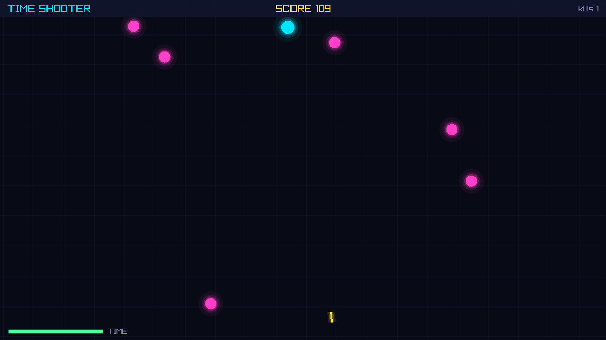
      </a>
      <p align="left">
        Waktu hanya berjalan saat kamu bergerak atau menembak. Kalau diam, musuh dan peluru membeku di tempat, jadi kamu punya waktu untuk merencanakan setiap langkah.<br/>
        <b>Kontrol:</b> WASD atau tombol panah untuk bergerak, mouse untuk membidik, klik kiri untuk menembak.
      </p>
    </td>
    <td width="50%" align="center">
      <h3><a href="games/echo_maze/GAME.md">Echo Maze</a></h3>
      <a href="games/echo_maze/GAME.md">
        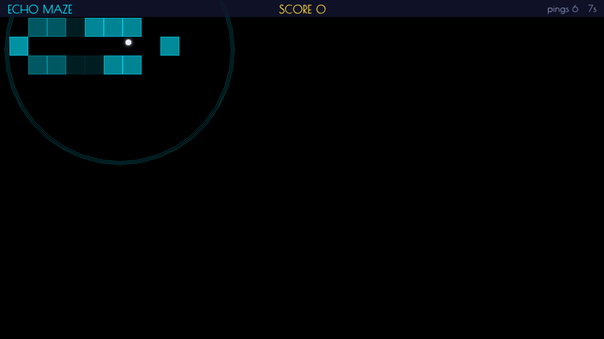
      </a>
      <p align="left">
        Maze-nya gelap. Tekan Space untuk mengirim pulse sonar yang menerangi sebentar dinding-dinding yang terlihat langsung dari posisimu. Capai pintu keluar dengan pulse sesedikit mungkin.<br/>
        <b>Kontrol:</b> WASD atau tombol panah untuk bergerak, Space untuk pulse.
      </p>
    </td>
  </tr>
  <tr>
    <td width="50%" align="center">
      <h3><a href="games/laser_mirrors/GAME.md">Laser Mirrors</a></h3>
      <a href="games/laser_mirrors/GAME.md">
        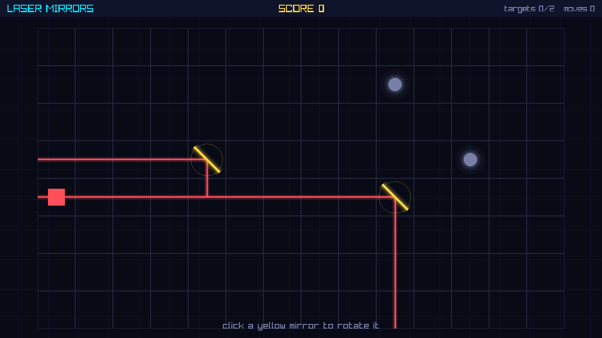
      </a>
      <p align="left">
        Klik cermin untuk memutarnya dan membelokkan sinar laser. Tile splitter membagi sinar menjadi dua cabang supaya kamu bisa mengenai semua target di grid.<br/>
        <b>Kontrol:</b> Klik kiri pada cermin kuning untuk memutar.
      </p>
    </td>
    <td width="50%" align="center">
      <h3><a href="games/ghost_loop/GAME.md">Ghost Loop</a></h3>
      <a href="games/ghost_loop/GAME.md">
        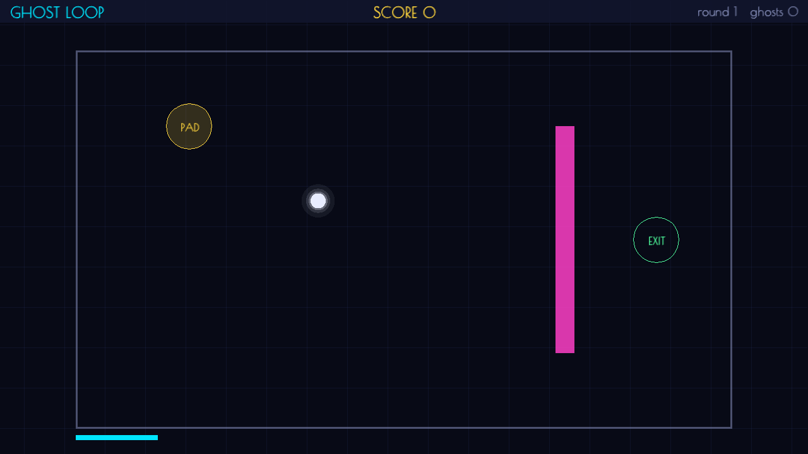
      </a>
      <p align="left">
        Setiap ronde berlangsung 8 detik. Saat ronde diulang, percobaan-percobaan sebelumnya diputar ulang sebagai ghost. Berdirilah di atas tombol lantai pada ronde awal supaya ghost-mu menahan pintu tetap terbuka untukmu di ronde berikutnya.<br/>
        <b>Kontrol:</b> WASD atau tombol panah untuk bergerak.
      </p>
    </td>
  </tr>
  <tr>
    <td width="50%" align="center">
      <h3><a href="games/beat_dodge/GAME.md">Beat Dodge</a></h3>
      <a href="games/beat_dodge/GAME.md">
        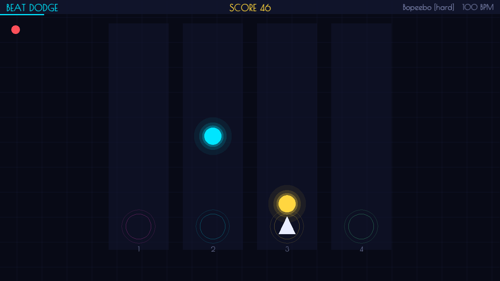
      </a>
      <p align="left">
        Game ritme: rintangan jatuh lewat tiga atau empat lane dan sampai di bagian bawah tepat pada beat. Peta lagu disimpan di file teks biasa yang bisa kamu edit atau tambah sendiri.<br/>
        <b>Kontrol:</b> A dan D atau tombol panah kiri dan kanan untuk pindah lane, atau tombol 1 sampai 4 untuk loncat langsung ke sebuah lane.
      </p>
    </td>
    <td width="50%" align="center">
      <h3><a href="games/absorb_grow/GAME.md">Absorb & Grow</a></h3>
      <a href="games/absorb_grow/GAME.md">
        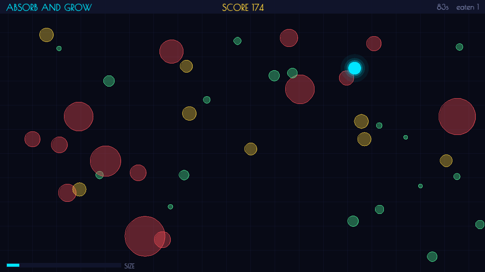
      </a>
      <p align="left">
        Serap blob yang lebih kecil untuk menambah massa, dan hindari yang lebih besar. Blob baru mengikuti ukuranmu saat ini, dan gerakanmu makin lambat seiring kamu membesar.<br/>
        <b>Kontrol:</b> WASD atau tombol panah untuk bergerak.
      </p>
    </td>
  </tr>
  <tr>
    <td width="50%" align="center">
      <h3><a href="games/sort_it/GAME.md">Sort It</a></h3>
      <a href="games/sort_it/GAME.md">
        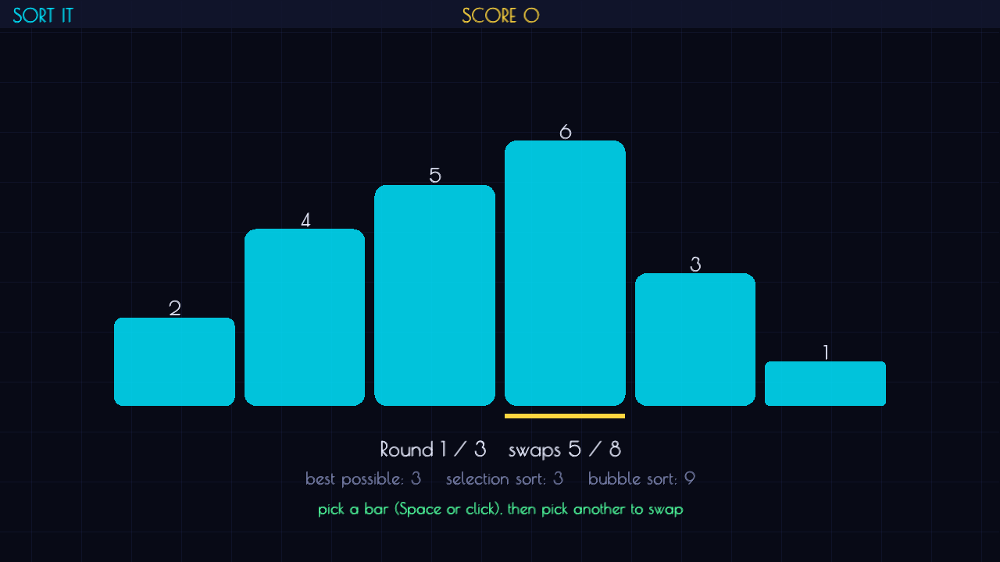
      </a>
      <p align="left">
        Tukar posisi bar untuk mengurutkannya sebelum jatah swap habis. Layar menampilkan berapa langkah yang kamu pakai dibandingkan dengan patokan selection sort dan bubble sort.<br/>
        <b>Kontrol:</b> Tombol panah untuk memilih, Space untuk menukar.
      </p>
    </td>
    <td width="50%" align="center">
      <h3><a href="games/sandbox/GAME.md">Sandbox</a></h3>
      <a href="games/sandbox/GAME.md">
        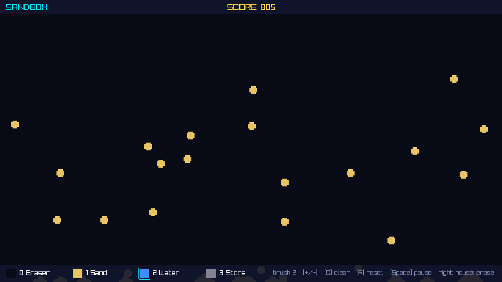
      </a>
      <p align="left">
        Mainan falling-sand dengan interaksi antara pasir, air, dan batu. Menu hub memakai engine simulasi yang sama persis untuk menganimasikan background-nya.<br/>
        <b>Kontrol:</b> Klik kiri untuk menggambar, klik kanan untuk menghapus, 0 sampai 3 untuk memilih material, Space untuk pause.
      </p>
    </td>
  </tr>
  <tr>
    <td width="50%" align="center">
      <h3><a href="games/post_it/GAME.md">Post It</a></h3>
      <a href="games/post_it/GAME.md">
        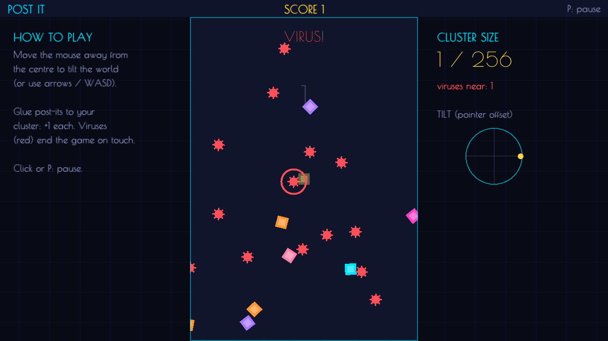
      </a>
      <p align="left">
        Satu post-it kuning di tengah. Miringkan dunia dengan mouse, tempelkan post-it berwarna ke gugusanmu, dan jangan sampai virus merah menyentuh satu pun.<br/>
        <b>Kontrol:</b> Mouse (geser menjauh dari tengah) atau WASD/panah untuk memiringkan dunia, klik atau P untuk jeda.
      </p>
    </td>
    <td width="50%" align="center">
      <h3><a href="games/master_juggler/GAME.md">Master Juggler</a></h3>
      <a href="games/master_juggler/GAME.md">
        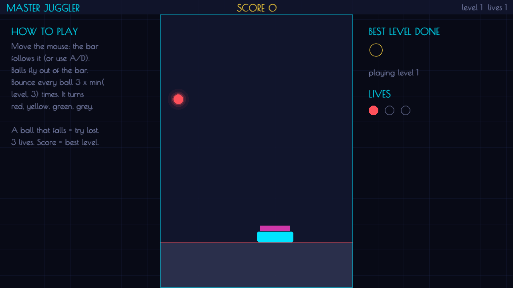
      </a>
      <p align="left">
        Trampolin mengikuti mouse. Pantulkan semua bola berkali-kali sampai berubah warna; makin tinggi level, makin banyak bola. Tiga nyawa.<br/>
        <b>Kontrol:</b> Mouse untuk menggeser trampolin (atau A/D), klik atau Spasi untuk memulai level.
      </p>
    </td>
  </tr>
  <tr>
    <td width="50%" align="center">
      <h3><a href="games/bw_reflex/GAME.md">BW Reflex</a></h3>
      <a href="games/bw_reflex/GAME.md">
        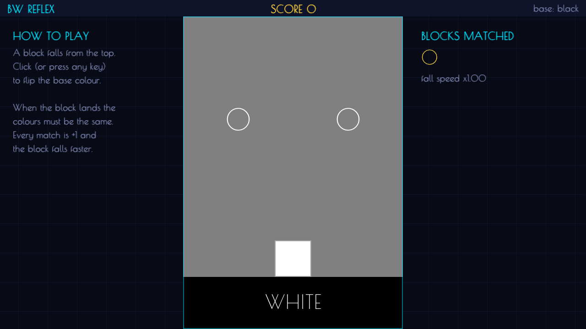
      </a>
      <p align="left">
        Balok hitam atau putih jatuh. Balik warna dasar tepat waktu supaya warnanya sama saat balok mendarat; tiap balok yang cocok membuat balok berikutnya lebih cepat.<br/>
        <b>Kontrol:</b> Klik atau tombol apa saja untuk membalik warna dasar.
      </p>
    </td>
    <td width="50%" align="center">
      <h3><a href="games/different_color/GAME.md">A Different Color</a></h3>
      <a href="games/different_color/GAME.md">
        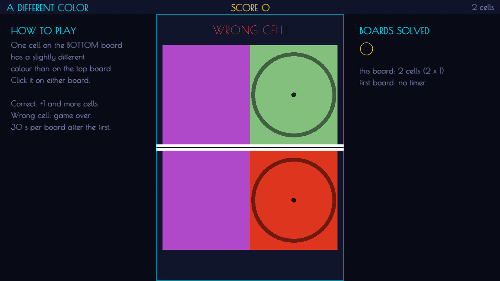
      </a>
      <p align="left">
        Dua papan kotak berwarna acak, satu kotak di papan bawah sedikit berbeda warnanya. Temukan dia sebelum 30 detik habis; papan makin besar tiap ronde.<br/>
        <b>Kontrol:</b> Klik kotak yang berbeda di papan atas atau bawah.
      </p>
    </td>
  </tr>
  <tr>
    <td width="50%" align="center">
      <h3><a href="games/spike_dart/GAME.md">Spike Dart</a></h3>
      <a href="games/spike_dart/GAME.md">
        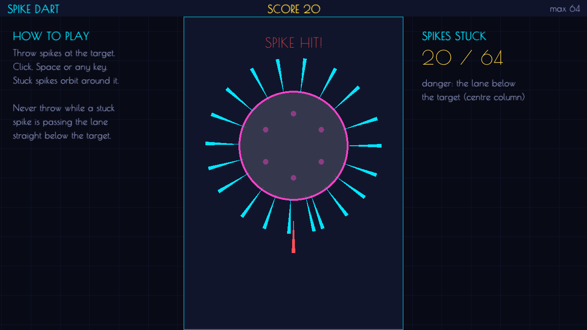
      </a>
      <p align="left">
        Lempar paku ke target yang berputar. Paku menancap lalu ikut berputar; jangan melempar saat paku lama sedang lewat di jalur lempar.<br/>
        <b>Kontrol:</b> Klik, Spasi, atau tombol apa saja untuk melempar.
      </p>
    </td>
    <td width="50%" align="center">
      <h3><a href="games/loop_lap/GAME.md">Loop Lap</a></h3>
      <a href="games/loop_lap/GAME.md">
        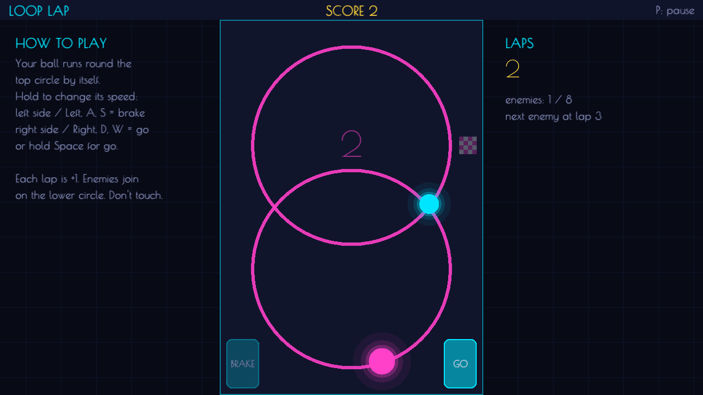
      </a>
      <p align="left">
        Bolamu berlari sendiri di lingkaran atas. Atur kecepatan dengan rem dan gas supaya lolos dari musuh di lingkaran bawah yang tumpang tindih.<br/>
        <b>Kontrol:</b> Tahan mouse di kiri (rem) atau kanan (gas), atau A/D, panah, Spasi. P untuk jeda.
      </p>
    </td>
  </tr>
  <tr>
    <td width="50%" align="center">
      <h3><a href="games/tower_stacker/GAME.md">Tower Stacker</a></h3>
      <a href="games/tower_stacker/GAME.md">
        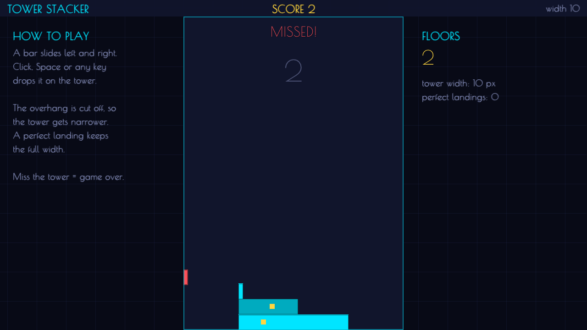
      </a>
      <p align="left">
        Satu batang bergeser di atas menara. Jatuhkan tepat waktu: bagian yang menjorok dipotong, jadi menara makin sempit. Landasan sempurna menjaga lebar penuh.<br/>
        <b>Kontrol:</b> Klik, Spasi, atau tombol apa saja untuk menjatuhkan batang.
      </p>
    </td>
    <td width="50%" align="center">
      <h3><a href="games/new_star/GAME.md">New Star</a></h3>
      <a href="games/new_star/GAME.md">
        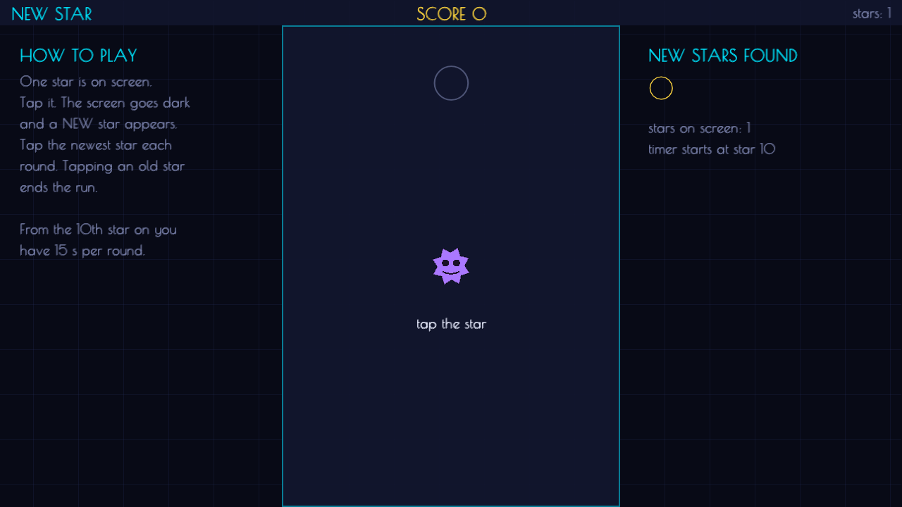
      </a>
      <p align="left">
        Tiap ronde layar menggelap dan satu bintang baru muncul. Ketuk bintang yang baru saja muncul; mengetuk bintang lama mengakhiri permainan.<br/>
        <b>Kontrol:</b> Klik bintang yang baru muncul.
      </p>
    </td>
  </tr>
  <tr>
    <td width="100%" colspan="2" align="center">
      <h3><a href="games/gritty_golf/GAME.md">Gritty Golf</a></h3>
      <a href="games/gritty_golf/GAME.md">
        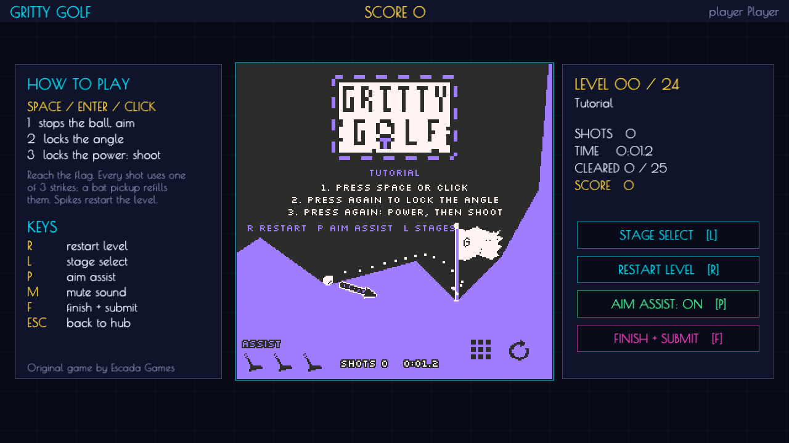
      </a>
      <p align="left">
        Mini-golf pixel dengan 25 level buatan tangan. Bekukan bola di udara, bidik, atur tenaga, lalu tembak. Kamu hanya punya tiga strike per percobaan, jadi setiap pukulan harus dipikirkan. Progres tersimpan per pemain.<br/>
        <b>Kontrol:</b> Space, Enter, atau klik untuk membekukan bola dan membidik, mengunci sudut, lalu mengunci tenaga dan menembak. R mengulang level, L membuka pilih level, F (dua kali) mengakhiri dan mengirim skor.
      </p>
    </td>
  </tr>
</table>

---

## Sorotan

- Background hub menjalankan simulasi falling-sand yang aktif.
- Skor disimpan di file teks biasa (scores.txt) dengan insertion sort, dan pencarian memakai binary search.
- Efek suara hub dan klik ritme dibuat langsung lewat kode (audio tone). Hanya Gritty Golf yang membawa 6 file WAV sendiri.
- Update logic berjalan pada rate tetap 60 Hz dengan random number generator PCG32, jadi hasil permainan dan replay selalu konsisten.
- Game terdaftar otomatis dari folder di games/; menambah game baru tidak perlu mengubah file source hub yang sudah ada.
- Bisa di-build dan dijalankan di Linux maupun Windows.

---

## Mulai cepat

### Rilis siap pakai

Build siap pakai untuk Linux dan Windows tersedia di [halaman releases](https://github.com/zaxx-q/arCade/releases/latest).

- Windows: unzip `arCade-vX.Y.Z-windows-x86_64.zip` lalu jalankan `arCade.exe`.
- Linux: ekstrak `arCade-vX.Y.Z-linux-x86_64.tar.gz` lalu jalankan `./arCade`.

### Build dari source

Kebutuhan: CMake 3.25 atau lebih baru, compiler C99 (GCC, Clang, atau MSVC), dan Ninja. CMake mengunduh dan mengompilasi raylib 6.2 pada build pertama.

```bash
# 1. Build dan jalankan unit test tanpa grafis
cmake --preset logic && cmake --build --preset logic && ctest --preset logic

# 2. Build hub game lengkap dengan raylib
cmake --preset dev && cmake --build --preset dev

# 3. Jalankan arCade
build/dev/bin/arCade        # Windows: build\dev\bin\arCade.exe
```

Detail setup per platform (paket MSYS2 di Windows, library dev di Linux) ada di [docs/DEVELOPMENT.md](docs/DEVELOPMENT.md).

---

## Kontrol hub

| Tombol                  | Aksi                                           |
| ----------------------- | ---------------------------------------------- |
| Up / Down atau W / S    | Memilih game di menu (mouse juga bisa)         |
| Enter atau klik         | Memulai game yang dipilih                      |
| L                       | Membuka leaderboard                            |
| N                       | Mengganti nama pemain                          |
| Esc                     | Keluar dari hub (di dalam game: kembali ke menu) |

Di background menu, klik kiri menggambar pasir dan klik kanan menggambar air.

Flag command line:

```bash
arCade --list                # Menampilkan semua game yang terdaftar
arCade --version             # Menampilkan informasi versi
arCade --smoke all           # Menjalankan pengecekan headless otomatis untuk semua game
arCade --smoke <id>          # Menjalankan pengecekan headless untuk satu game
```

---

## Arsitektur

Proyek ini menjaga pemisahan yang tegas antara aturan game dan rendering:

```
app/ (hub menu, leaderboard, smoke runner)
 └── games/<id>/<id>_game.c    (menggambar dan membaca input dengan raylib)
      ├── core/gfx/            (setup window, frame timing, helper menggambar)
      └── games/<id>/<id>_logic.c (C99 murni: state, collision, scoring)
           └── core/src/       (RNG, input monkey, sandbox engine, leaderboard)
```

Layer logic di `games/<id>/<id>_logic.c` tidak pernah meng-include `raylib.h`. Pemisahan ini memungkinkan testing headless di CI, dan memastikan aturan inti bisa dievaluasi terpisah dari raylib.

Untuk detail soal kontrak loop dan layout memori, lihat [docs/ARCHITECTURE.md](docs/ARCHITECTURE.md).

---

## Dokumentasi

- [docs/DEVELOPMENT.md](docs/DEVELOPMENT.md): setup toolchain, perintah build yang sering dipakai, dan roadmap.
- [docs/ARCHITECTURE.md](docs/ARCHITECTURE.md): struktur sistem dan keputusan desain.
- [docs/ADDING_A_GAME.md](docs/ADDING_A_GAME.md): cara membuat game baru dengan script scaffolding.
- [docs/SANDBOX.md](docs/SANDBOX.md): aturan cellular automata dan cara menambah material baru.
- [docs/RELEASING.md](docs/RELEASING.md): konvensi tag dan workflow rilis.
- [docs/REPORT_GUIDE.md](docs/REPORT_GUIDE.md): pemetaan kebutuhan tugas kuliah ke lokasi kode.
- [docs/raylib_subset.md](docs/raylib_subset.md): signature subset API raylib 6.2 yang dipakai di semua game.

---

## Lisensi

Proyek ini dirilis di bawah [MIT License](LICENSE). Pemberitahuan lisensi pihak ketiga ada di [THIRD_PARTY_NOTICES.md](THIRD_PARTY_NOTICES.md).
