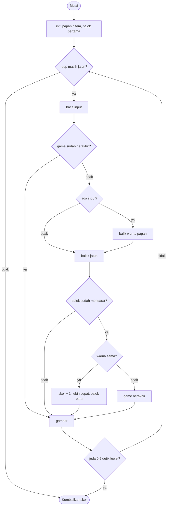

# BW Reflex - design brief

**Owner:** Leader  **Folder:** `deferred/bw_reflex/`  **Created:** 2026-11-12  **Status:** v1 sudah jalan (balik warna dasar, kecepatan naik tiap cocok)

## Hook
Sebuah balok hitam atau putih jatuh dari atas. Di bawah ada papan dasar yang warnanya bisa kamu balik dengan satu klik. Saat balok mendarat, warna dasar harus sama dengan warna balok. Cocok: +1 dan balok berikutnya jatuh lebih cepat. Beda warna: selesai. Tidak ada tombol lain, jadi semuanya soal refleks.

## Penjelasan sederhana
Bayangkan lampu lalu lintas dua warna. Ada balok yang turun, dan kamu harus memastikan papan di bawahnya berwarna sama pada detik balok menyentuhnya. Tiap klik (atau tombol apa saja) membalik papan dari hitam ke putih atau sebaliknya. Kamu boleh membalik sebanyak apa pun sebelum balok mendarat; yang dihitung hanya warna papan **pada saat mendarat**. Jadi inti game ini adalah menekan tombol dalam jumlah yang tepat (genap atau ganjil) dan di waktu yang tepat.

Warna balok berikutnya diacak setelah tiap pendaratan yang cocok, dan papan tidak direset: ia tetap berwarna terakhir yang kamu tinggalkan. Papan mulai hitam.

Tiap kecocokan membuat balok berikutnya jatuh lebih cepat, tetapi **penambahan kecepatannya sendiri mengecil**: kecepatan dikali `1 + mult`, lalu `mult` dikali 0,9625. Hasilnya, kecepatan naik cepat di awal lalu melandai dan berhenti di sekitar 6,3 kali kecepatan awal (satu balok jatuh sekitar 0,32 detik). Jadi game ini sangat sulit pada tingkat lanjut, tetapi tidak pernah mustahil.

Beberapa petunjuk visual membantu: panel dasar berwarna abu-abu tengah supaya hitam dan putih sama-sama terlihat (warna adalah mekaniknya), kata "WHITE" atau "BLACK" di atas papan ditulis **dengan warna balok** sehingga hilang begitu papan sama dengan balok, dan angka skor besar di kiri dan kanan memakai warna balok.

Aturan ada di `bw_reflex_logic.c` (tanpa raylib, bisa di-test di terminal). `bw_reflex_game.c` hanya menggambar dan memutar bunyi.

**Kalau cuma punya 1 menit:** `bw_reflex_step` melakukan tiga hal berurutan: membalik papan kalau ada input, menjatuhkan balok, lalu kalau balok sudah mendarat membandingkan warna (cocok: skor naik dan balok baru; beda: `over`).

## Kontrol
Klik kiri, Spasi, Enter, tombol arah, atau tombol karakter apa saja membalik warna papan. Tidak ada kontrol lain. Esc keluar.

## Aturan dan skor
Skor = jumlah balok yang cocok. Game berakhir pada balok pertama yang mendarat di papan dengan warna berbeda. Skor yang sudah terkumpul tetap dihitung.

Detail dari kode:
- **Geometri di lapangan 480 x 684:** tinggi papan `base_h = round(h / 6) = 114`; balok 80 x 80 px (`BW_BLOCK`), mulai dengan pusat di `y = -40` (di atas layar). Di test (480 x 800): `base_h = 133`.
- **Pendaratan:** balok "mendarat" saat tepi bawahnya (`block_y + 40`) melewati garis kontak `contact_y = h - base_h + 1,5`. Saat itu warna dibandingkan satu kali.
- **Kejatuhan per tick 50 Hz** (dikali `k = dt * 50`): `block_y += (h - base_h) * speed * k / 400`. Pada kecepatan awal 4, itu 5,7 px per tick (6,67 di 800 piksel), jadi balok pertama jatuh sekitar 2,0 detik.
- **Kecepatan:** `speed` mulai 4,0 (`BW_SPEED0`); tiap cocok `speed *= 1 + mult` dengan `mult` mulai 0,07 (`BW_MULT0`), lalu `mult *= 0,9625` (`BW_MULT_DECAY`). Contoh: setelah 10 cocok kecepatan 1,78 kali awal (1,13 detik per balok), setelah 20 cocok 2,64 kali (0,76 detik), setelah 50 cocok 4,75 kali (0,42 detik), dan batasnya sekitar 6,26 kali (0,32 detik).
- **Membalik:** input apa pun membalik `base_white` dan menambah `flips`; boleh berkali-kali sebelum mendarat.
- **Nada:** tiap cocok memainkan nada `last_note = skor_lama % 8` dari tangga nada 8 nada (memakai skor **sebelum** ditambah).
- Balok baru: warna acak 0 atau 1 (`rng_range` termasuk kedua ujungnya), mulai lagi dari `y = -40`.
- `bw_reflex_is_over` baru `true` 0,9 detik (`BW_OVER_DELAY`) setelah `over`, supaya pemain melihat "DIFFERENT COLOUR!".
- Tidak ada batas skor: kecepatan melandai, jadi game bisa berlangsung tanpa batas bagi pemain yang cukup cepat. `score` adalah `int`.

## Cara kerja per frame
1. `arcade_poll(&in)` mengisi `ArcadeInput`. Yang dihitung sebagai membalik (`flip_requested`): `fire_pressed`, `action_pressed`, tombol arah `*_pressed`, dan `typed`.
2. `bw_reflex_step(&s, &in, ARC_DT)`:
   1. Kalau `over` sudah `true`: `over_t += dt`, keluar.
   2. Kalau ada input: `base_white ^= 1`, `flips++`.
   3. `k = dt * 50`; `block_y += (h - base_h) * speed * k / 400`.
   4. Kalau tepi bawah balok belum melewati `contact_y`: keluar.
   5. Kalau warna sama: `last_note = score % 8`, `score++`, `matches++`, `speed *= 1 + mult`, `mult *= 0,9625`, `new_block`. Kalau beda: `over = true`.
3. Front-end membandingkan `flips` dan `matches` dengan frame lalu untuk memutar bunyi klik dan nada, lalu menggambar panel abu-abu, papan, kata warna, angka skor besar, balok, dan "DIFFERENT COLOUR!" saat `over`. Panel kanan menampilkan skor dan kecepatan ("fall speed x1.07").
4. Kalau `bw_reflex_is_over(&s)` bernilai `true`, loop berhenti dan skor dikembalikan.

## Peta file
| File | Isinya | Edit di sini kalau ... |
|------|--------|------------------------|
| `bw_reflex_logic.h` | Konstanta `BW_*`, struct `bw_reflex_State`, fungsi publik (`contact_y`) | menambah field state atau mengubah ukuran |
| `bw_reflex_logic.c` | `bw_reflex_step`, `new_block`, `flip_requested`, hukum kecepatan | mengubah aturan, kecepatan, atau kontrol |
| `bw_reflex_game.c` | Loop raylib, `draw_playfield`, panel, bunyi, `game_bw_reflex_def` | mengubah tampilan atau bunyi |
| `tests/test_bw_reflex.c` | 9 unit test (hanya logic) | menambah atau mengubah aturan |
| `CMakeLists.txt` | Mendaftarkan game ke build | menambah file `.c` atau test baru |
| `core/include/arcade/playfield.h` | Lapangan potret 480 x 684 yang dipakai bersama | jarang |
| `GAME.md` | Dokumen ini | aturan atau kode berubah |
| `AGENTS.md` | Instruksi untuk AI agent (tidak diterjemahkan) | jarang; ikuti aturan di file itu |

## Data penting (struct)
`bw_reflex_State`: seluruh keadaan game. Koordinat lokal lapangan.

| Field | Tipe | Artinya |
|-------|------|---------|
| `w`, `h` | `int` | ukuran lapangan |
| `base_h` | `int` | tinggi papan dasar (`round(h / 6)`) |
| `base_white` | `int` | 1 = papan putih, 0 = hitam (mulai 0) |
| `block_white` | `int` | 1 = balok putih, 0 = hitam |
| `block_y` | `float` | y pusat balok (mulai -40, di atas layar) |
| `speed` | `float` | faktor kecepatan jatuh, mulai 4,0 dan naik tiap cocok |
| `mult` | `float` | laju pertumbuhan `speed`, dikali 0,9625 tiap cocok |
| `score` | `int` | balok yang cocok |
| `over`, `over_t` | `bool`, `float` | game berakhir; detik sejak berakhir |
| `flips`, `matches` | `int` | penghitung kejadian untuk bunyi |
| `last_note` | `int` | nada 0..7 dari cocok terakhir |
| `rng` | `Rng` | pengacak deterministik untuk warna balok |

## Fungsi-fungsi penting
| Fungsi | Tugas | Dipanggil dari |
|--------|-------|----------------|
| `bw_reflex_init(s, seed)` / `_init_sized(s, seed, w, h)` | Mengosongkan state, menghitung `base_h`, membuat balok pertama | `play()`, test |
| `bw_reflex_step(s, in, dt)` | Satu langkah logic | `play()` tiap frame, test |
| `bw_reflex_is_over(s)` / `bw_reflex_score(s)` | Status selesai (setelah jeda 0,9 detik) dan skor | `play()` |
| `bw_reflex_contact_y(s)` | y garis tempat tepi bawah balok dianggap mendarat | `bw_reflex_step`, test |
| `new_block(s)` (static) | Balok baru di atas layar dengan warna acak | `init`, `bw_reflex_step` |
| `flip_requested(in)` (static) | Apakah input apa pun berarti "balik" | `bw_reflex_step` |

## Angka yang bisa diutak-atik
| Konstanta | Nilai sekarang | File | Efek kalau diubah |
|-----------|----------------|------|-------------------|
| `BW_BLOCK` | `80` px | `bw_reflex_logic.h` | ukuran balok (juga memengaruhi saat mendarat) |
| `BW_OVER_DELAY` | `0.9` detik | `bw_reflex_logic.h` | lama kesalahan terlihat sebelum game ditutup |
| `BW_SPEED0` | `4.0` | `bw_reflex_logic.c` | kecepatan awal |
| `BW_MULT0` | `0.07` | `bw_reflex_logic.c` | kenaikan kecepatan pada cocok pertama |
| `BW_MULT_DECAY` | `0.9625` | `bw_reflex_logic.c` | seberapa cepat kenaikan melandai; makin dekat 1, makin lama kecepatan terus naik |
| tinggi papan (angka langsung di `init_sized`) | `h / 6` | `bw_reflex_logic.c` | tinggi papan dan jarak jatuh |
| garis kontak (angka langsung di `bw_reflex_contact_y`) | `+ 1,5` px | `bw_reflex_logic.c` | tepatnya kapan balok dianggap mendarat |
| pembagi kejatuhan (angka langsung di `step`) | `400` | `bw_reflex_logic.c` | seberapa cepat balok jatuh pada kecepatan tertentu |
| warna panel (angka langsung di `draw_playfield`) | abu-abu `128, 128, 128` | `bw_reflex_game.c` | hanya tampilan |
| nada bunyi (di `play`) | tangga nada `k_scale`, klik 700 Hz, kalah 110 Hz | `bw_reflex_game.c` | hanya bunyi |

## Cara menjalankan dan menguji
```bash
# test logic saja (tanpa raylib, ~1 detik)
cmake --preset logic && cmake --build --preset logic && ctest --preset logic -R "^bw_reflex\."

# main game-nya
cmake --preset dev && cmake --build --preset dev && build/dev/bin/arCade

# smoke run headless: jalankan game 300 frame dan simpan screenshot PNG
cmake --preset headless && cmake --build --preset headless && build/headless/bin/arCade --smoke bw_reflex --frames 300 --out smoke-out
```

| Test | Menjaga aturan apa |
|------|--------------------|
| `test_init_is_sane` | Awal game: belum selesai, skor 0, tinggi papan 114 di lapangan 684, papan mulai hitam |
| `test_spec_geometry_at_480x800` | Di 480 x 800: tinggi papan 133, garis kontak `800 - 133 + 1,5`, jatuh 6,67 px per tick pada kecepatan 4 |
| `test_same_seed_same_result` | Seed sama dan input sama menghasilkan hasil yang sama |
| `test_monkey_never_breaks_invariants` | Input acak: `block_y` dan `speed` terbatas dan hingga, skor tidak negatif, nada selalu 0..7 |
| `test_speed_law` | Setelah dua cocok berturut-turut (papan selalu disamakan dengan balok): `speed = 4 x 1,07 x 1,067375` dan `mult = 0,07 x 0,9625^2` |
| `test_note_index_uses_old_score` | Nada memakai skor sebelum ditambah: skor 8 kembali ke nada 0 |
| `test_fall_time_at_60hz` | Satu balok jatuh sekitar 2 detik di 60 Hz (120 sampai 124 frame) |
| `test_mismatch_ends_the_game_after_reveal` | Warna beda (tanpa klik): `over` seketika, `is_over` setelah 0,9 detik, skor 0 |
| `test_any_input_flips_and_flips_back` | Input apa pun membalik papan dan input berikutnya membaliknya lagi (`flips = 2`) |

## Jebakan dan hal yang perlu diingat
- **Tidak ada tombol "pasti benar".** Klik membalik papan, bukan mengaturnya ke warna tertentu. Pemain harus tahu warna papan saat ini; HUD menampilkan "base: black" atau "base: white" di pojok kanan atas, dan kata warna di papan membantu.
- Kata "WHITE"/"BLACK" di papan ditulis dengan warna balok, jadi sengaja **hilang** saat papan sudah cocok. Jangan menggantinya dengan warna papan.
- Klik berulang yang cepat membalik papan berkali-kali. Itu bagian dari game (genap atau ganjil menentukan warna akhir); `test_any_input_flips_and_flips_back` mengunci perilaku ini.
- Nada memakai skor lama, bukan skor baru: cocok pertama memainkan nada 0. Itu asli dari spesifikasi.
- Perbandingan warna hanya terjadi **sekali**, saat balok mendarat. Membalik papan di tengah jalan tidak berpengaruh apa pun sampai saat itu.
- Kecepatan melandai di sekitar 6,26 kali kecepatan awal. Kalau menambah level kesulitan, ubah `BW_MULT_DECAY` (mendekati 1 berarti terus menanjak) atau tambahkan batas bawah pada `mult`.
- Satu-satunya pengacak adalah warna balok; seed yang sama dengan rangkaian klik yang sama selalu menghasilkan game yang sama.
- Game ini `ranked = true`, `order = 120`.

## Langkah implementasi (Implementation steps)
Daftar ini adalah pengembangan dari v1.

1. Tambahkan indikator "tekan sekarang": warna papan yang akan dibutuhkan saat balok mendarat (tidak dibutuhkan untuk spesifikasi, hanya bantuan).
2. Mode "dua balok": dua balok jatuh bergantian dengan warna berbeda sehingga ritme klik harus lebih rumit.
3. Papan dengan dua sisi (kiri dan kanan) yang dibalik secara terpisah.
4. Statistik per run: jumlah klik terbuang (`flips - matches`) ditampilkan di akhir.
5. Tingkat kesulitan: `BW_SPEED0` dan `BW_MULT0` yang bisa dipilih.

## Pseudocode (untuk laporan)
```
PROSEDUR step(input, dt)
    JIKA game berakhir MAKA hitung waktu; KEMBALI
    JIKA ada input MAKA papan <- bukan papan
    balok.y <- balok.y + (tinggi - tinggi_papan) * kecepatan * dt * 50 / 400
    JIKA tepi bawah balok belum melewati garis kontak MAKA KEMBALI
    JIKA warna balok = warna papan MAKA
        skor <- skor + 1
        kecepatan <- kecepatan * (1 + mult)
        mult <- mult * 0.9625
        buat balok baru dengan warna acak
    JIKA TIDAK
        game berakhir
```

## Flowchart (untuk laporan)


## Konsep kuliah yang dipakai
| Konsep (Pertemuan) | Di mana (file : fungsi) |
|--------------------|-------------------------|
| Tipe data (3) | `int` untuk warna (0 atau 1), `float` untuk kecepatan, `bool` untuk `over` |
| Operator (4) | `base_white ^= 1` (XOR untuk membalik), `score % 8` (modulo untuk nada) |
| Percabangan (5) | `bw_reflex_step` (cocok atau beda, sudah mendarat atau belum) |
| Struct (13) | `bw_reflex_logic.h` : `bw_reflex_State` |
| Prosedur, fungsi (11) | `new_block`, `flip_requested`, `bw_reflex_contact_y` |
| Pointer (10) | setiap parameter `bw_reflex_State *s` |
| Fungsi matematika (12) | `lroundf` (tinggi papan), perkalian beruntun sebagai pertumbuhan geometrik terbatas |
