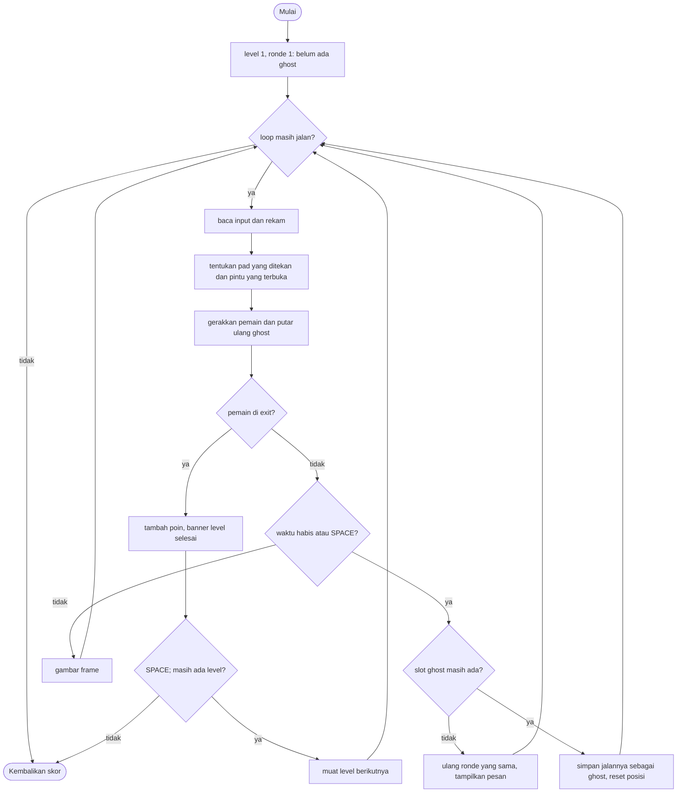

# Ghost Loop - design brief

**Owner:** Member 4  **Folder:** `deferred/ghost_loop/`  **Status:** bisa dimainkan: kampanye 6 level (dinding, banyak pad dan pintu, batas ghost per level, par per level); semua level dibuktikan bisa diselesaikan dan tidak bisa dilewati lewat samping

## Hook
Setiap ronde berlangsung maksimal 8 detik dan direkam. Di ronde berikutnya, ronde-ronde sebelumnya diputar ulang sebagai ghost yang bergerak persis seperti yang kamu lakukan. Bekerja samalah dengan dirimu di masa lalu: ghost-mu berdiri di atas pad dan menahan pintu terbuka, sementara kamu berjalan lewat. Level-level belakangan menuntut kerja sama beberapa ghost: ada pad yang tersembunyi di balik pintu, satu ghost yang harus menjadi dua kunci sekaligus (dalam waktu yang berbeda), dan ruangan dengan batas jumlah ghost.

## Penjelasan sederhana
Bayangkan kamu merekam dirimu sendiri memakai "kaset": setiap 1/60 detik, game mencatat tombol arah apa yang sedang kamu tekan. Ronde 1 selesai (8 detik habis), lalu ronde 2 dimulai dari awal. Kali ini ada satu "hantu" (ghost) yang memutar ulang kaset ronde 1 tanpa bantuanmu, sementara kamu bermain normal dan direkam lagi. Ghost bisa menginjak pad dan menahan pintu terbuka, padahal kamu sendiri sedang berada di tempat lain.

Yang direkam adalah **input** (arah kiri/kanan/atas/bawah per langkah), bukan posisi. Karena simulasi selalu berjalan dengan langkah tetap yang persis sama, memutar ulang input yang sama akan menghasilkan gerakan yang sama persis. Itu sebabnya `dt` sengaja diabaikan di `ghost_loop_step`. Kalau pintu pada saat replay dalam keadaan berbeda dari saat rekaman, ghost bisa menyimpang (menabrak pintu tertutup). Itu sebabnya solusi level harus "bersih": ghost direkam saat pintu yang ia butuhkan memang dibuka oleh ghost yang lebih awal.

Pemain dan ghost memakai fungsi gerak yang sama (`move_actor`), jadi aturan fisika untuk keduanya otomatis identik.

**Ide puzzle utama.** Karena ghost memutar ulang *seluruh* ronde, bukan hanya posisi akhirnya, satu ghost bisa menjadi dua kunci pada waktu yang berbeda: berdiri di pad A sampai kamu lewat pintu A, lalu berjalan ke pad B dan membuka pintu B untukmu (level RELAY). Batas jumlah ghost per level memaksa pemain menemukan trik seperti ini, bukan sekadar menambah ghost.

Aturan ada di `ghost_loop_logic.c` (tanpa raylib, bisa di-test di terminal). `ghost_loop_game.c` hanya menggambar dan meneruskan input.

**Kalau cuma punya 1 menit:** semua ghost dihitung ulang dari langkah 0 tiap ronde dengan memutar `ghost_moves[g][step]`. Jangan pernah memakai `dt` atau waktu nyata di logic game ini, karena itu merusak replay.

## Kontrol
- WASD / panah: bergerak.
- `SPACE` / `Enter`: akhiri ronde sekarang, jalanmu sampai di sini menjadi ghost. Sisa rekaman kosong, jadi ghost diam di tempat terakhirnya (cara termudah menahan pad). Di banner level selesai: lanjut ke level berikutnya.
- `R`: ulangi ronde ini dari awal (ghost yang sudah ada tetap; gratis).
- `U`: batalkan ghost terbaru dan mainkan ulang ronde itu (kalau salah menekan SPACE).
- `C`: mulai ulang level dari nol (semua ghost dihapus).
- `Esc`: keluar tanpa menyimpan skor.

## Aturan dan skor
Capai exit sebelum ronde habis (8 detik). Tiap level punya **batas ghost** (`max_ghosts`) dan **par** (`par_ghosts`, jumlah ghost yang dipakai solusi yang dimaksud). Ronde yang selesai (SPACE atau waktu habis) menjadi ghost selama masih ada slot. Kalau slot sudah penuh, ronde habis hanya diulang (ghost tetap ada) dan muncul pesan; **tidak ada kalah**, dan `C` selalu bisa memulai ulang level. Setelah level terakhir selesai dan pemain menekan lanjut, game selesai.

Poin satu level (`ghost_loop_level_points`): `max(100, 1500 - 300 * max(0, round - par_ghosts) - step)`. `round` adalah jumlah ghost saat menang, `step` jumlah langkah di ronde menang (60 langkah = 1 detik). Memakai lebih sedikit ghost dari par tidak merugikan. `ghost_loop_score` mengembalikan `total`: jumlah poin level yang sudah selesai.

Arti simbol di layar: lingkaran putih = pemain, lingkaran cyan bernomor = ghost, lingkaran berhuruf (A, B, C) = pad, balok berwarna dengan huruf yang sama = pintu yang dibuka pad itu (tebal saat tertutup, hampir transparan saat terbuka), balok abu-abu = dinding, lingkaran hijau = exit, lingkaran tipis di titik awal = start. Bar cyan di bawah ruangan = sisa waktu ronde (satu garis per detik).

### Aturan fisika
- Dinding selalu padat. Pintu padat selama pad-nya tidak ditekan oleh pemain atau ghost mana pun.
- Pintu hanya menghalangi **masuk** ke dalam pintu: aktor yang sudah berada di dalam area pintu saat pintu menutup boleh berjalan keluar. Karena itu pad **harus cukup jauh dari pintunya** (test `test_a_pad_cannot_open_its_own_door...`), kalau tidak pemain sendirian bisa "menunggangi" pintu.
- Gerak per sumbu (sumbu x dulu, lalu y), jadi aktor yang menabrak dinding menyelusuri dinding, bukan menempel.
- Satu "barrier" adalah dinding setebal 30 px yang membentang **seluruh tinggi ruangan**: dua potong dinding di atas dan bawah, dan pintu mengisi celah di tengahnya. Jadi pintu tidak bisa dilewati dari samping (ini perbaikan bug aslinya).

### Daftar level
`slot` = `max_ghosts`, `par` = `par_ghosts`. Jendela waktu diukur dengan skrip solusi di harness (langkah = 1/60 detik).

| # | Nama | slot / par | ide | solusi yang dimaksud |
|---|------|------------|-----|----------------------|
| 1 | HOLD THE DOOR | 2 / 1 | satu pad, satu pintu; SPACE | R1: berdiri di pad A, SPACE. R2: ke exit |
| 2 | CHAIN REACTION | 2 / 2 | pad B ada di balik pintu A | R1: pad A, SPACE. R2: ghost 1 menahan A; lewati pintu A ke pad B, SPACE. R3: lari ke exit |
| 3 | VENN | 1 / 1 | dua pintu, **satu** ghost: cincin pad A dan B saling beririsan | R1: berdiri di irisan kedua cincin (menekan A dan B sekaligus), SPACE. R2: ke exit |
| 4 | RELAY | 1 / 1 | satu ghost menjadi dua kunci berurutan | R1: pad A, tunggu 0,3 sampai 3,7 detik (pemain nanti lewat pintu A), jalan ke pad B, SPACE. R2: lurus ke exit, tunggu sebentar di pintu B sampai ghost tiba |
| 5 | THE LONG WAY | 2 / 1 | pad jauh di ujung koridor berliku, pintu dekat start | R1: lewati koridor (sekitar 5 detik) ke pad, SPACE. R2: tunggu di bawah pintu, masuk begitu terbuka |
| 6 | GRAND CENTRAL | 2 / 2 | tiga pintu berurutan, dua ghost | R1 (ghost 1): pad A lalu relay ke pad B. R2 (ghost 2): lewati pintu A (dibuka ghost 1) ke pad C di ruang tengah, SPACE. R3: lari ke exit |

Mengapa RELAY dan GRAND CENTRAL benar-benar memaksa relay: jarak antara pad A dan B tidak bisa ditempuh kurang dari sekitar 106 langkah, dan pemain butuh waktu antara pintu A dan pintu B, jadi satu ghost yang diam di satu pad tidak cukup. Di GRAND CENTRAL pad C ada di balik pintu A, jadi ghost yang menahan C tidak mungkin juga menahan A atau B.

Jendela waktu yang terukur (skrip solusi): RELAY menang untuk lama menahan pad A antara 20 dan 220 langkah (0,3 sampai 3,7 detik); GRAND CENTRAL antara 0 dan 200 langkah. Semua level masih menang kalau tiap ronde pembuat ghost dimulai 1 detik terlambat (dites).

## Cara kerja per frame
1. `arcade_poll(&in)` mengisi `ArcadeInput` (yang dipakai: `move_x`, `move_y`, `action_pressed`, `typed`).
2. `ghost_loop_step(&s, &in, ARC_DT)`. Parameter `dt` diabaikan; satu langkah selalu 1/60 detik. Urutannya:
   1. Kalau `won`, langsung keluar. Hitung mundur `notice_steps` (pesan di layar).
   2. Kalau `cleared` (banner level selesai): `clear_hold++`; setelah `GL_CLEAR_HOLD` langkah, `SPACE` memanggil `next_level` (muat level berikutnya, atau `won = true` setelah level terakhir). Keluar.
   3. Tombol perintah (masing-masing mengakhiri langkah ini): `C` = `restart_level`, `R` = `begin_round` (ulang ronde), `U` = `undo_round`, `SPACE` = `end_round(false)`.
   4. Input diubah menjadi `gl_Move` lewat `sign8` (nilai > 0,1 jadi 1, < -0,1 jadi -1, selain itu 0) dan disimpan di `recording[step]`.
   5. Untuk tiap pad: `pad_down[p] = pad_pressed(...)` (`true` kalau pemain **atau** ghost mana pun berjarak kurang dari `GL_PAD_R`). Untuk tiap pintu: `door_open[d] = pad_down[pintu.pad]`. Semua memakai posisi di awal langkah.
   6. Pemain bergerak dengan `move_actor`; lalu tiap ghost bergerak dengan `move_actor` memakai `ghost_moves[g][step]`. Semuanya memakai `door_open` yang sama.
   7. Kalau pemain berjarak kurang dari `GL_EXIT_R` dari exit: `level_points` dihitung, `total += level_points`, `cleared = true`, selesai.
   8. `step++`. Kalau `step` mencapai `GL_ROUND_STEPS` (480), panggil `end_round(true)`.
3. `end_round`: kalau semua slot ghost level ini sudah terpakai, ronde yang sama dimulai lagi (`begin_round`) dan `notice` diisi (`GL_NOTICE_TIME_UP` kalau karena timer, `GL_NOTICE_NO_GHOSTS` kalau karena SPACE). Selain itu seluruh `recording` disalin ke `ghost_moves[ghost_count]`, `ghost_count++`, `round++`, lalu `begin_round` (step 0, pintu tertutup, semua kembali ke titik awal, `recording` dikosongkan).
4. Front-end `draw_frame()` menggambar: ruangan, dinding, pintu dan pad (warna dan huruf yang sama per pasangan), exit, ghost bernomor, pemain, bar timer dengan tanda per detik, pesan, dan banner "LEVEL CLEARED". HUD menampilkan `level`, `round x/y`, `ghosts n/m`, dan waktu; strip di bawah HUD menampilkan nama dan petunjuk level; baris paling bawah menampilkan tombol.
5. Kalau `ghost_loop_is_over()` bernilai `true`, loop berhenti dan skor dikirim ke hub. `Esc` membuat `finished = false`.

Cara kerja `move_actor(lv, door_open, p, m)` (dipakai pemain dan ghost): arah `m` dinormalisasi (diagonal tidak lebih cepat), posisi maju sejauh `GL_SPEED * ARC_DT` (± 3,67 px per langkah) per sumbu, dijaga tetap di dalam ruangan. Gerak sumbu ditolak oleh `blocked(...)` kalau lingkaran aktor menabrak dinding, atau menabrak pintu tertutup padahal sebelumnya tidak berada di dalam pintu itu.

## Peta file
| File | Isinya | Edit di sini kalau ... |
|------|--------|------------------------|
| `ghost_loop_logic.h` | Konstanta `GL_*`, struct `gl_Rect`, `gl_Door`, `gl_Level`, `gl_Move`, `ghost_loop_State`, fungsi publik | menambah field state atau jenis objek level |
| `ghost_loop_logic.c` | Tabel level `k_levels`, `move_actor`, `blocked`, `pad_pressed`, `begin_round`, `end_round`, `ghost_loop_step`, poin, `ghost_loop_can_reach` | mengubah level, aturan, atau skor |
| `ghost_loop_game.c` | Loop raylib, `draw_frame`, menggambar ruangan/pad/pintu/ghost/timer/banner, HUD, `game_ghost_loop_def` | mengubah tampilan atau teks di menu |
| `tests/test_ghost_loop.c` | 20 unit test (hanya logic), termasuk solusi tiap level di `k_solution` | menambah atau mengubah aturan atau level |
| `CMakeLists.txt` | Mendaftarkan game ke build | menambah file `.c` atau test baru |
| `GAME.md` | Dokumen ini | aturan atau kode berubah |
| `AGENTS.md` | Instruksi untuk AI agent (tidak diterjemahkan) | jarang; ikuti aturan di file itu |

## Data penting (struct)
`gl_Rect`: persegi panjang `x0, y0, x1, y1` (piksel).

`gl_Door`: `box` (`gl_Rect`) dan `pad` (indeks pad di level yang membukanya).

`gl_Level` (satu entri tabel `k_levels`, hanya-baca):

| Field | Tipe | Artinya |
|-------|------|---------|
| `name`, `hint` | `const char *` | nama dan petunjuk di layar |
| `start`, `exit` | `Vec2` | titik awal pemain dan semua ghost, dan pusat exit |
| `max_ghosts` | `int` | slot ghost (ronde = ini + 1), maksimal `GL_MAX_GHOSTS` |
| `par_ghosts` | `int` | ghost yang dipakai solusi yang dimaksud; tiap ghost lebih banyak = -300 poin |
| `wall_count`, `walls[GL_MAX_WALLS]` | `gl_Rect` | dinding (selalu padat) |
| `pad_count`, `pads[GL_MAX_PADS]` | `Vec2` | pusat pad (jangkauan `GL_PAD_R`); pad ke-i berhuruf `'A' + i` |
| `door_count`, `doors[GL_MAX_DOORS]` | `gl_Door` | pintu |

`gl_Move`: satu langkah input.

| Field | Tipe | Artinya |
|-------|------|---------|
| `mx`, `my` | `int8_t` | arah per sumbu: -1, 0, atau 1. Hanya ini yang dibutuhkan ghost untuk memutar ulang satu ronde |

`ghost_loop_State`: seluruh keadaan game.

| Field | Tipe | Artinya |
|-------|------|---------|
| `recording[GL_ROUND_STEPS]` | `gl_Move` | input ronde yang sedang berjalan |
| `ghost_moves[GL_MAX_GHOSTS][GL_ROUND_STEPS]` | `gl_Move` | input ronde-ronde yang sudah selesai; satu baris = satu ghost |
| `ghost_count` | `int` | jumlah ghost yang sudah ada |
| `player` | `Vec2` | posisi pemain (piksel) |
| `ghost_pos[GL_MAX_GHOSTS]` | `Vec2` | posisi tiap ghost saat ini |
| `step` | `int` | nomor langkah dalam ronde ini (0 sampai 479) |
| `round` | `int` | nomor ronde, mulai dari 0 (selalu sama dengan `ghost_count`) |
| `pad_down[]`, `door_open[]` | `bool` | pad yang ditekan dan pintu yang terbuka pada langkah terakhir |
| `level` | `int` | indeks level yang dimainkan |
| `cleared`, `clear_hold` | `bool`, `int` | level baru selesai (banner) dan langkah sejak itu |
| `level_points` | `int` | poin level yang baru selesai |
| `total` | `int` | poin dari level yang sudah selesai (skor ke hub) |
| `won` | `bool` | level terakhir selesai dan pemain menekan lanjut: run berakhir |
| `notice`, `notice_steps` | `GlNotice`, `int` | pesan di layar (waktu habis, tidak ada ghost) dan sisa lamanya |

## Fungsi-fungsi penting
| Fungsi | Tugas | Dipanggil dari |
|--------|-------|----------------|
| `ghost_loop_init(s, seed)` | Mengosongkan state dan memuat level 0 (`seed` diabaikan) | `play()`, test |
| `ghost_loop_load_level(s, level)` | Memuat level: ronde 0, tanpa ghost; `total` dipertahankan | `init`, `next_level`, test |
| `ghost_loop_step(s, in, dt)` | Satu langkah simulasi (lihat "Cara kerja per frame") | `play()` tiap frame, test |
| `ghost_loop_is_over(s)` / `ghost_loop_score(s)` | Status selesai dan skor (`total`) | `play()` |
| `ghost_loop_level(i)` | Entri tabel level (indeks dijepit) | front-end, test |
| `ghost_loop_level_points(s)` | Poin kalau level ini selesai sekarang | `step`, test |
| `ghost_loop_can_reach(level, open_doors, from, target, radius)` | Flood fill (BFS pada grid 8 px): bisakah pemain berjalan dari `from` sampai dalam `radius` dari `target` kalau pintu pada bitmask `open_doors` terbuka dan lainnya tertutup? Sengaja sedikit lebih longgar dari pemain asli, jadi "tidak terjangkau" selalu aman dipercaya | test (bukti tidak ada celah) |
| `move_actor(lv, door_open, p, m)` (static) | Satu langkah gerak untuk pemain **atau** ghost | `ghost_loop_step` |
| `blocked(lv, door_open, from, to)` (static) | Apakah posisi baru menabrak dinding, atau masuk ke pintu tertutup | `move_actor` |
| `circle_hits_rect(p, r, rect)` (static) | Lingkaran beririsan dengan persegi panjang (menyentuh tidak dihitung) | `blocked`, `spot_is_free` |
| `pad_pressed(s, pad)` (static) | Apakah pemain atau ghost menginjak pad | `ghost_loop_step` |
| `begin_round(s)` (static) | Mereset langkah, pintu, posisi, dan `recording` (ghost tetap) | `load_level`, `end_round`, `undo_round`, `restart_level` |
| `end_round(s, timer)` (static) | Mengubah rekaman jadi ghost baru, atau mengulang ronde kalau slot penuh | `ghost_loop_step` |
| `undo_round(s)` / `restart_level(s)` / `next_level(s)` (static) | Tombol `U`, tombol `C`, dan lanjut setelah level selesai | `ghost_loop_step` |
| `sign8(v)` (static) | Mengubah input analog menjadi -1, 0, atau 1 (ambang 0,1) | `ghost_loop_step` |

## Angka yang bisa diutak-atik
| Konstanta | Nilai sekarang | File | Efek kalau diubah |
|-----------|----------------|------|-------------------|
| `GL_ROUND_STEPS` | `480` (8 detik) | `ghost_loop_logic.h` | panjang ronde; juga ukuran array rekaman. Jendela waktu level (relay) ikut berubah |
| `GL_MAX_GHOSTS` | `4` | `ghost_loop_logic.h` | batas atas `max_ghosts` per level |
| `GL_SPEED` | `220` px/detik | `ghost_loop_logic.h` | kecepatan pemain dan ghost; **semua** jarak dan waktu di level ikut berubah |
| `GL_R` | `12` px | `ghost_loop_logic.h` | radius pemain dan ghost |
| `GL_ROOM_X0/X1/Y0/Y1` | `120` / `1160` / `80` / `680` | `ghost_loop_logic.h` | batas ruangan (barrier selebar tinggi ruangan: `80` sampai `680`) |
| `GL_PAD_R` | `36` px | `ghost_loop_logic.h` | jangkauan pad (cincin yang beririsan di VENN: jarak pusat 44 px) |
| `GL_EXIT_R` | `36` px | `ghost_loop_logic.h` | jangkauan exit |
| `GL_LEVEL_COUNT` | `6` | `ghost_loop_logic.h` | jumlah level; harus sama dengan jumlah entri `k_levels` dan baris `k_solution` di test |
| `GL_MAX_WALLS/PADS/DOORS` | `12` / `4` / `4` | `ghost_loop_logic.h` | batas isi satu level |
| `GL_CLEAR_HOLD` | `30` langkah | `ghost_loop_logic.h` | jeda sebelum SPACE melewati banner |
| `GL_NOTICE_STEPS` | `150` | `ghost_loop_logic.h` | lama pesan tampil |
| rumus poin (angka langsung di `ghost_loop_level_points`) | `1500`, `300` per ghost di atas par, minimal `100` | `ghost_loop_logic.c` | keseimbangan skor |
| ambang input (angka langsung di `sign8`) | `0.1` | `ghost_loop_logic.c` | seberapa kecil input analog dianggap bergerak |
| sel flood fill `GL_CELL` | `8` px (grid `130 x 75`) | `ghost_loop_logic.c` | ketelitian pengecekan celah; harus cocok dengan ukuran ruangan |
| `k_levels` | 6 entri | `ghost_loop_logic.c` | tiap entri: nama, petunjuk, start, exit, slot, par, dinding, pad, pintu |

## Cara menjalankan dan menguji
```bash
# test logic saja (tanpa raylib, ~1 detik)
cmake --preset logic && cmake --build --preset logic && ctest --preset logic -R "^ghost_loop\."

# main game-nya
cmake --preset dev && cmake --build --preset dev && build/dev/bin/arCade

# smoke run headless: jalankan game 300 frame dan simpan screenshot PNG
cmake --preset headless && cmake --build --preset headless && build/headless/bin/arCade --smoke ghost_loop --frames 300 --out smoke-out
```

| Test | Menjaga aturan apa |
|------|--------------------|
| `test_every_level_is_well_formed` | Tiap level: nama, petunjuk, slot dan par masuk akal, indeks pad pintu valid, start dan exit di dalam ruangan, tidak ada yang mulai di dalam dinding atau pintu |
| `test_no_door_can_be_walked_around` | **Regresi bug asli.** Flood fill: dengan semua pintu tertutup exit tidak terjangkau; semua terbuka terjangkau; buka semua pintu **kecuali satu** tetap tidak terjangkau (tidak ada pintu yang bisa dilewati) |
| `test_pads_are_reachable_and_round_one_has_something_to_do` | Setiap pad terjangkau kalau pintu terbuka, dan minimal satu pad terjangkau dengan semua pintu tertutup (ronde 1 dimainkan sendirian) |
| `test_a_pad_cannot_open_its_own_door_for_the_one_standing_on_it` | Pad cukup jauh dari pintunya supaya pemain tidak bisa berdiri di pad sambil masuk pintu |
| `test_flood_fill_basics` | Titik di luar ruangan tidak terjangkau, titik awal sudah di tujuan, pad pertama terjangkau |
| `test_every_level_can_be_beaten_with_its_par_ghosts` | **Janji utama:** solusi yang dimaksud (`k_solution`) dimainkan lewat `ghost_loop_step` asli; level selesai dengan tepat `par_ghosts` ghost dan poin antara 1000 dan 1500 |
| `test_the_whole_campaign_can_be_played_through` | 6 level berurutan lewat banner dan SPACE; skor total benar; run selesai |
| `test_relay_levels_have_a_forgiving_timing_window` | RELAY dan GRAND CENTRAL menang untuk lama menahan 40, 130, dan 200 langkah |
| `test_every_level_forgives_a_slow_start` | Semua level menang kalau ronde ghost dimulai 1 detik terlambat |
| `test_walking_straight_at_the_exit_never_clears_a_level` | Berjalan lurus ke exit ronde demi ronde tidak pernah menyelesaikan level |
| `test_clear_banner_waits_before_moving_on` | SPACE sebelum `GL_CLEAR_HOLD` tidak melewati banner; sesudahnya lanjut, poin tersimpan |
| `test_a_finished_run_ignores_input` | Setelah `won`, input tidak mengubah apa pun |
| `test_points_follow_par` | Rumus poin: par, 300 per ghost ekstra, tidak rugi di bawah par, minimal 100 |
| `test_space_ends_the_round_early_and_the_ghost_stays_put` | SPACE membuat ghost; ghost yang rekamannya pendek diam di tempat dan menahan pad |
| `test_the_timer_ends_a_round_too` | Timer 480 langkah juga membuat ghost |
| `test_ghost_replays_the_recorded_run_exactly` | Ghost mengulang jalur ronde sebelumnya persis sama (selisih < 0,001 px) |
| `test_redo_undo_and_restart_keys` | `R` mengulang ronde, `U` membuang ghost terbaru, `C` menghapus semua ghost; `U` tanpa ghost tidak merusak |
| `test_running_out_of_ghost_slots_replays_the_round_instead_of_losing` | Slot penuh: SPACE menampilkan pesan, timer habis mengulang ronde yang sama; ghost tetap ada; game tidak berakhir |
| `test_a_closed_door_stops_an_actor_but_lets_one_inside_walk_out` | Pintu tertutup menahan dari luar dan aktor menyelusuri dinding; aktor yang berada di dalam pintu boleh keluar |
| `test_monkey_never_leaves_the_room_or_enters_a_wall` | 6000 langkah input acak di **setiap** level: pemain dan ghost tidak keluar ruangan dan tidak pernah masuk dinding |

## Jebakan dan hal yang perlu diingat
- **Ghost memutar ulang input, bukan posisi.** Kalau keadaan pintu saat replay berbeda dari saat rekaman, ghost menyimpang. Solusi level harus direkam saat pintu yang dibutuhkan memang dibuka ghost sebelumnya. `k_solution` di test memainkan rekaman bersih; rekaman yang mendorong pintu tertutup bisa berbeda jalannya.
- **Jangan pakai `dt` atau waktu nyata di logic.** Simulasi harus maju dalam langkah tetap supaya replay identik; itu sebabnya `dt` diabaikan.
- Pemain dan ghost harus selalu lewat `move_actor`. Kalau gerak pemain diberi aturan khusus, ghost tidak lagi menirunya dengan benar.
- **Level baru harus punya barrier yang utuh.** Dinding atas, pintu, dan dinding bawah harus membentang seluruh tinggi ruangan (`80` sampai `680`) tanpa celah. `test_no_door_can_be_walked_around` akan gagal kalau ada celah. Sama pentingnya: setiap level butuh solusi di `k_solution` (test), dan ronde pertama harus punya minimal satu pad yang bisa dicapai sendirian.
- Pintu hanya menghalangi **masuk** (`!circle_hits_rect(from, ...)` di `blocked`): kalau posisi lama sudah berada di area pintu, gerakan tidak ditahan. Pad harus jauh dari pintunya, kalau tidak pemain bisa menunggangi pintu (dites).
- `door_open` ditentukan dari posisi di **awal** langkah, lalu dipakai oleh pemain dan semua ghost pada langkah yang sama.
- Sisa `recording` yang tidak terisi bernilai 0 (`begin_round` mengosongkannya), jadi ghost yang rekamannya lebih pendek (karena SPACE) diam di tempat setelah rekamannya habis. Ini disengaja dan dipakai level-level.
- Tombol arah diubah jadi -1/0/1 per sumbu, jadi pemain tidak bisa berhenti tepat di satu titik. Di test, `walk_to` berhenti saat jarak <= 9 px karena `input_toward` berhenti mengarah ketika kedua sumbu dalam 6 px (bisa tersisa 8,5 px secara diagonal).
- `GL_LEVEL_COUNT`, `k_levels`, dan `k_solution` di test harus selalu sama panjangnya.
- Di renderer software (`--smoke` headless) tampilannya sama dengan jendela asli untuk game ini.
- HUD menampilkan skor total sampai game selesai.

## Langkah implementasi (Implementation steps)

### Prioritas dari diskusi tim
- [x] **Perbaiki level tutorial.** Akar masalah (terbukti oleh analisis awal tim dan harness uji): pintu hanya membentang y = 200 sampai 560 di ruangan y = 80 sampai 680, jadi bisa dilewati dari atas atau bawah. Sekarang pintu adalah bagian dari *barrier* setinggi ruangan, dan `test_no_door_can_be_walked_around` membuktikan dengan flood fill bahwa tidak ada level yang bisa dilewati tanpa membuka semua pintunya. Level 1 (HOLD THE DOOR) menjadi tutorial yang menjelaskan pad, pintu, dan SPACE lewat petunjuk di layar.
- [x] **Tambah level yang lebih cerdik.** `gl_Level` dan tabel `k_levels` menggantikan konstanta tata letak. Ada 6 level (hold, chain, venn, relay, long way, grand central), tiap level dengan slot ghost dan par sendiri, dan tiap level punya solusi yang dibuktikan di test.
- [x] **Ronde berakhir karena pemain memicunya sendiri (usul).** Diputuskan dan dikerjakan: `SPACE` mengakhiri ronde dan menjadikannya ghost, timer 8 detik tetap menjadi batas maksimum. Alasan: level RELAY, CHAIN REACTION, dan GRAND CENTRAL membutuhkan ghost yang diam di pad; tanpa ini pemain harus menunggu sampai 8 detik setiap ronde. Kekhawatiran lama dijawab begini: salah tekan SPACE bisa dibatalkan dengan `U` (dan `R` mengulang ronde, `C` mulai ulang), tekanan waktu tetap ada karena batas ronde dan skor memakai `step`, dan batas ghost per level memberi puzzle-nya harga yang jelas. Kalau tim ingin membatalkan keputusan ini, hapus cabang `in->action_pressed` di `ghost_loop_step`; level yang butuh ghost diam masih bisa diselesaikan dengan menunggu timer, tapi `test_space_ends_the_round_early...` dan `k_solution` perlu disesuaikan.

### Langkah dari design awal
1. Mekanik lebih banyak: pad yang menutup pintu, pad yang harus ditekan dua sekaligus (AND), pad tertunda (pintu tetap terbuka beberapa detik), tombol toggle, kotak yang didorong (kembangkan `move_actor`, `gl_Door`, dan state). `ghost_loop_can_reach` dan test celah perlu mengenal mekanik baru.
2. Level: ~~pindahkan konstanta ke struct level~~ selesai (`gl_Level`, `k_levels`). Masih terbuka: memuat level dari `assets/levels/*.txt` dengan file I/O.
3. Simpan replay kemenangan ke `ctx->data_dir` (tulis array `gl_Move` dengan `fwrite`/`fprintf`) dan putar ulang dari menu.
4. Visual di `ghost_loop_game.c`: jejak ghost (simpan posisi terakhir), efek rewind di awal ronde, partikel di pad.
5. Hati-hati: ghost memutar ulang INPUT, jadi ghost menyimpang kalau pintu berada dalam keadaan berbeda dari saat rekaman. Level baru perlu solusi yang direkam bersih di `k_solution`.
6. Ide level: AND-door, rantai tiga ghost (par 3 dengan solusi relay 2 ghost yang lebih cerdik), level di mana relay harus tepat waktu.

## Pseudocode (untuk laporan)
```
PROSEDUR step(input)
    JIKA level selesai MAKA tunggu SPACE lalu muat level berikutnya; KEMBALI
    JIKA tombol C: hapus semua ghost; ulang ronde
    JIKA tombol R: ulang ronde (ghost tetap)
    JIKA tombol U: buang ghost terbaru; ulang ronde itu
    JIKA tombol SPACE: end_round(); KEMBALI
    rekam input langkah ini (-1/0/1 per sumbu)
    UNTUK SETIAP pad: ditekan <- ada yang (pemain atau ghost mana pun) berdiri di pad
    UNTUK SETIAP pintu: terbuka <- pad pintu itu ditekan
    gerakkan pemain sesuai input                                        // dinding dan pintu tertutup padat
    UNTUK SETIAP ghost: gerakkan sesuai input rekamannya pada langkah ini      // fungsi gerak yang sama
    JIKA pemain menyentuh exit MAKA hitung poin; level selesai
    step <- step + 1
    JIKA step = panjang ronde MAKA end_round()

PROSEDUR end_round()
    JIKA tidak ada slot ghost tersisa MAKA ulang ronde yang sama
    JIKA TIDAK simpan rekaman sebagai ghost baru; round <- round + 1; reset posisi
AKHIR PROSEDUR
```

## Flowchart (untuk laporan)


## Konsep kuliah yang dipakai
| Konsep (Pertemuan) | Di mana (file : fungsi) |
|--------------------|-------------------------|
| Array 2D berisi struct (9, 13) | `ghost_loop_logic.h` : `ghost_moves[GL_MAX_GHOSTS][GL_ROUND_STEPS]` |
| Struct dan array of struct (9, 13) | `gl_Rect`, `gl_Door`, `gl_Level`, `gl_Move`, `ghost_loop_State`; tabel `k_levels` |
| Fungsi (11) | `move_actor` (dipakai bersama oleh pemain dan ghost), `end_round`, `blocked` |
| Perulangan (6) | `ghost_loop_step` (loop atas ghost, pad, pintu), `pad_pressed` |
| Percabangan (5) | tombol perintah, logika pintu dan menang di `ghost_loop_step` |
| Pencarian (10) | `ghost_loop_can_reach`: BFS (antrian dari array) pada grid untuk membuktikan tidak ada celah |
| File handling (13) | TODO: simpan/muat replay (langkah 3 di atas) |
