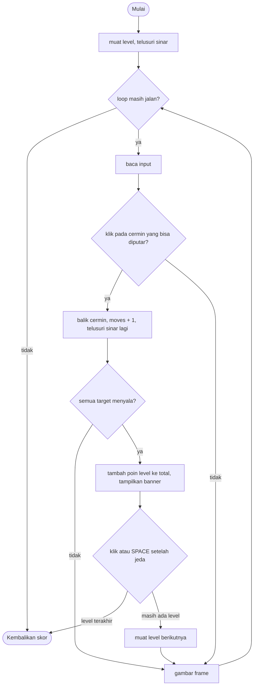

# Laser Mirrors - design brief

**Owner:** Member 3  **Folder:** `deferred/laser_mirrors/`  **Status:** bisa dimainkan: kampanye 12 level dengan par per level (penelusuran sinar, solver brute force, dan level sudah diuji)

## Hook
Klik cermin kuning untuk membaliknya antara `/` dan `\` supaya sinar laser memantul ke semua target. Splitter membelah sinar jadi dua arah sekaligus.

## Penjelasan sederhana
Bayangkan senter laser di dalam ruangan berpetak yang penuh cermin kecil. Sinar berjalan lurus petak demi petak, dan setiap kali menabrak cermin ia berbelok. Tugasmu memutar cermin-cermin kuning (yang boleh diubah) sampai sinar mengenai semua target. Ada satu jenis petak khusus, splitter, yang membuat sinar lurus terus **dan** sekaligus keluar satu cabang baru ke arah lain.

Game ini tidak punya animasi atau timer. Tidak ada yang berubah sampai pemain mengklik. Setiap klik membalik satu cermin, lalu seluruh sinar dihitung ulang dari awal (`laser_mirrors_recompute`): kode berjalan dari emitter, menelusuri petak satu per satu (`trace`), mencatat petak mana yang dilalui sinar dan target mana yang kena. Kalau semua target kena, level selesai: poinnya langsung masuk ke skor, muncul banner "LEVEL CLEARED", dan klik atau SPACE membawa pemain ke level berikutnya. Satu permainan adalah kampanye `LM_LEVEL_COUNT` (12) level berurutan; skor akhir adalah jumlah poin tiap level. Poin tiap level hanya bergantung pada jumlah klik dibanding par level itu, bukan waktu.

Setiap level punya **tepat satu** susunan cermin yang menang. Itu dijamin test, bukan kebetulan, dan itulah yang membuat levelnya "cerdik": tidak ada cermin hiasan, dan tidak ada jalan pintas. Par level = jumlah cermin yang harus dibalik dari posisi awal ke satu-satunya susunan yang menang.

Aturan ada di `laser_mirrors_logic.c` (tanpa raylib, bisa di-test di terminal). `laser_mirrors_game.c` hanya menggambar hasil hitungan itu dan meneruskan klik mouse ke logic.

**Kalau cuma punya 1 menit:** `trace` adalah fungsi rekursif yang menelusuri sinar; ia berhenti kalau menabrak dinding, menabrak target, keluar papan, atau masuk ke petak yang sudah pernah dilewati dalam arah yang sama (supaya sinar yang terjebak di lingkaran cermin tidak berputar selamanya).

## Kontrol
Klik kiri pada cermin (kuning) yang bisa diputar. Tombol `R` mengembalikan semua cermin ke posisi awal level (klik yang sudah dipakai tidak dikembalikan). Pada banner level selesai: klik atau `SPACE`/`Enter` untuk lanjut (baru bisa setelah 30 langkah, supaya klik ganda tidak melewatkan banner). `Esc` keluar tanpa menyimpan skor.

## Aturan dan skor
Nyalakan semua target untuk menyelesaikan level. Sinar berhenti di dinding dan di target (target "memakan" sinar, jadi sinar tidak tembus ke target di belakangnya).

Poin satu level (`laser_mirrors_level_points`): `max(100, 1000 - 60 * max(0, moves - par))`. Par adalah field per level (`LmLevel.par`), bukan angka global lagi. Poin 0 selama level belum selesai. `laser_mirrors_score` mengembalikan `total`: jumlah poin level yang sudah selesai (poin masuk saat target terakhir menyala).

Arti simbol di layar: cermin kuning = bisa diputar, cermin cyan = tetap, belah ketupat magenta = splitter, kotak merah dengan laras = emitter (laras menunjukkan arah tembak: kiri/atas/kanan/bawah), lingkaran abu-abu = target belum kena (hijau berdenyut kalau sudah kena), blok abu-abu = dinding, sinar berwarna merah. Nama level dan petunjuknya ditampilkan di strip di bawah HUD.

### Daftar level
Semua level punya tepat 1 solusi (dites). `rot` = cermin kuning, `lit` = target yang sudah menyala di awal.

| # | Nama | rot | target | splitter | cermin tetap | par | emitter | ide yang diajarkan |
|---|------|-----|--------|----------|--------------|-----|---------|--------------------|
| 1 | FIRST LIGHT | 1 | 1 | 0 | 0 | 1 | kiri | klik cermin; dinding memblokir sinar (tutorial) |
| 2 | ZIG-ZAG | 3 | 1 | 0 | 0 | 2 | kiri | rantai cermin; satu dari tiga cermin sudah benar sejak awal (jangan diklik) |
| 3 | FORK | 2 | 2 | 1 | 0 | 2 | kiri | splitter: lurus terus **dan** cabang |
| 4 | UPSTREAM | 4 | 2 | 1 | 0 | 3 | atas | splitter diberi sinar dari sisi lain, cabangnya berubah arah |
| 5 | BANK SHOT | 4 | 2 | 1 | 2 | 3 | kiri | cermin cyan tidak bisa diputar; 1 target sudah menyala di awal |
| 6 | REVERSE | 6 | 2 | 1 | 0 | 5 | kanan | emitter bisa di sisi mana pun |
| 7 | CROSSFIRE | 6 | 3 | 2 | 0 | 4 | atas | sinar saling menembus; hanya cermin yang membelokkan |
| 8 | DAISY CHAIN | 7 | 3 | 2 | 0 | 5 | bawah | satu splitter menyuapi splitter lain |
| 9 | HALL OF MIRRORS | 8 | 3 | 2 | 1 | 5 | kanan | telusuri mundur dari target; 2 target sudah menyala di awal |
| 10 | TRIPLE SPLIT | 8 | 4 | 3 | 0 | 7 | bawah | satu sinar menjadi banyak cabang |
| 11 | THE COMB | 11 | 4 | 3 | 0 | 8 | bawah | satu splitter demi satu splitter |
| 12 | FINAL EXAM | 12 | 4 | 3 | 0 | 8 | atas | semuanya sekaligus |

Level 1 sampai 3 dibuat tangan sebagai pengantar. Level 4 sampai 12 dicari dengan generator sementara (di luar repo): *tanam* satu jaringan sinar yang menang, tambahkan dinding atau cermin tetap yang tidak menyentuh jaringan itu, lalu buang semua rintangan yang tidak dibutuhkan agar solusinya tetap unik, dan terakhir pilih yang membuat "pemain serakah" (selalu balik cermin yang memperpanjang sinar atau menyalakan lebih banyak target) terjebak. Karena itu beberapa level punya papan yang hampir tanpa dinding: setiap rintangan yang tersisa memang dibutuhkan untuk keunikan solusi.

## Cara kerja per frame
1. `arcade_poll(&in)` mengisi `ArcadeInput`. Yang dipakai game ini: `fire_pressed` (klik kiri baru ditekan), posisi mouse `aim_x`/`aim_y`, `action_pressed` (SPACE/Enter) dan `typed` (huruf `r`).
2. `laser_mirrors_step(&s, &in, ARC_DT)`:
   1. Kalau run sudah `finished`, tidak ada yang terjadi.
   2. Kalau level sudah `solved` (banner tampil): `hold++`; setelah `LM_CLEAR_HOLD` langkah, klik atau SPACE memanggil `next_level` (muat level berikutnya, atau `finished = true` setelah level terakhir).
   3. Huruf `r`: `restart_level` memuat ulang level tapi mempertahankan `moves`.
   4. Kalau tidak ada klik di frame ini, keluar (parameter `dt` tidak dipakai sama sekali).
   5. Posisi mouse diubah menjadi indeks petak: `(aim - offset) / LM_TILE`. Klik di kiri atau atas papan diabaikan.
   6. `laser_mirrors_toggle(s, tx, ty)`: kalau petak itu bukan cermin yang bisa diputar, tidak terjadi apa-apa. Kalau ya, cermin dibalik (`/` jadi `\` dan sebaliknya) dan `laser_mirrors_recompute` dipanggil. Kalau berhasil, `moves++`; kalau level jadi `solved`, `level_points` dihitung dan ditambahkan ke `total`.
3. `laser_mirrors_recompute`: mengosongkan `beam` dan `lit`, memanggil `trace` dari emitter, menghitung `targets_lit`, lalu `solved = (semua target kena)`.
4. Front-end (`draw_frame`) menggambar: backdrop, garis grid, sinar (`draw_beams`: untuk tiap petak dan tiap arah sinar yang lewat, gambar setengah masuk dan setengah keluar; sinar emitter mulai dari emitter), cermin, dinding, target, splitter, emitter dengan larasnya, lalu banner "LEVEL CLEARED" kalau perlu. HUD menampilkan `level x/12`, `targets x/y`, `moves n (par p)`; strip di bawah HUD menampilkan nama dan petunjuk level.
5. Kalau `laser_mirrors_is_over()` bernilai `true` (level terakhir selesai dan pemain menekan lanjut), loop berhenti dan skor dikirim ke hub. `Esc` membuat `finished = false` sehingga skor tidak disimpan.

## Peta file
| File | Isinya | Edit di sini kalau ... |
|------|--------|------------------------|
| `laser_mirrors_logic.h` | Konstanta `LM_*`, enum `LmCell`, struct `laser_mirrors_State`, fungsi publik | menambah jenis petak, field state, atau mengubah ukuran papan |
| `laser_mirrors_logic.c` | Tabel level `k_levels` (nama, petunjuk, par, 8 baris teks), `load_rows`/`load_level`, `trace`, `laser_mirrors_recompute`, `toggle`, `step`, poin, `laser_mirrors_solve` | mengubah level, aturan sinar, atau skor |
| `laser_mirrors_game.c` | Loop raylib, `draw_frame`, menggambar sinar/cermin/target/banner, HUD, `game_laser_mirrors_def` | mengubah tampilan atau teks di menu |
| `tests/test_laser_mirrors.c` | 18 unit test (hanya logic) | menambah atau mengubah aturan atau level |
| `CMakeLists.txt` | Mendaftarkan game ke build | menambah file `.c` atau test baru |
| `GAME.md` | Dokumen ini | aturan atau kode berubah |
| `AGENTS.md` | Instruksi untuk AI agent (tidak diterjemahkan) | jarang; ikuti aturan di file itu |

## Data penting (struct)
`LmCell` (enum): jenis isi satu petak: `LM_EMPTY` (0), `LM_WALL`, `LM_SLASH` (`/`), `LM_BACK` (`\`), `LM_SPLIT`, `LM_TARGET`.

Arah sinar disimpan sebagai angka: `0` = kanan, `1` = bawah, `2` = kiri, `3` = atas.

`laser_mirrors_State`: seluruh keadaan game.

| Field | Tipe | Artinya |
|-------|------|---------|
| `cell[LM_H][LM_W]` | `uint8_t` | isi tiap petak (nilai `LmCell`) |
| `rotatable[LM_H][LM_W]` | `bool` | `true` kalau cermin di petak itu boleh diklik pemain (digambar kuning) |
| `beam[LM_H][LM_W]` | `uint8_t` | bitmask 4 bit per petak: bit `d` menyala berarti ada sinar yang melintas ke arah `d` |
| `lit[LM_H][LM_W]` | `bool` | target yang sudah kena sinar |
| `emitter_x`, `emitter_y`, `emitter_dir` | `int` | posisi petak emitter dan arah tembaknya (`0`..`3`, dibaca dari `>` `v` `<` `^` di teks level) |
| `targets`, `targets_lit` | `int` | jumlah target total dan yang sudah menyala |
| `level` | `int` | indeks level di papan (mulai 0) |
| `par` | `int` | klik minimum level ini (dari tabel level) |
| `moves` | `int` | klik yang berhasil membalik cermin di level ini (tombol `R` tidak menghapusnya) |
| `solved` | `bool` | `true` kalau `targets_lit == targets` (dan `targets > 0`): banner level selesai tampil |
| `total` | `int` | poin dari level yang sudah selesai (ini skor yang dikirim ke hub) |
| `level_points` | `int` | poin level yang baru selesai (untuk banner) |
| `hold` | `int` | langkah sejak level selesai (mencegah klik ganda melewatkan banner) |
| `finished` | `bool` | level terakhir selesai dan pemain sudah menekan lanjut: run berakhir |

`LmSolve` (hasil solver): `rotatable` (jumlah cermin kuning), `solutions` (berapa susunan yang menang, `-1` kalau cermin lebih dari `LM_MAX_ROT`), `min_moves` (klik minimum dari papan sekarang, `-1` kalau tidak bisa), `flips` (satu solusi terpendek: bit i = balik cermin ke-i, baris demi baris).

`LmLevel` (di `.c`, tidak diekspor): `name`, `hint`, `par`, `rows[LM_H]`.

## Fungsi-fungsi penting
| Fungsi | Tugas | Dipanggil dari |
|--------|-------|----------------|
| `laser_mirrors_init(s, seed)` | Mengosongkan state dan memuat level 0. Parameter `seed` **diabaikan** (urutan level tetap) | `play()`, test |
| `laser_mirrors_load_level(s, level)` | Memuat satu level dari tabel: papan, `par`; `moves = 0`; `total` dipertahankan | `init`, `next_level`, test |
| `laser_mirrors_load_rows(s, rows)` | Membaca teks papan (`.` `#` `/` `\` `r` `R` `S` `T` `>` `v` `<` `^`) ke `cell`, `rotatable`, emitter. Baris pendek atau `NULL` dianggap kosong. Berguna di test untuk papan kecil | `load_level`, test |
| `laser_mirrors_step(s, in, dt)` | Klik, tombol `R`, banner level selesai, lanjut ke level berikutnya | `play()` tiap frame, test |
| `laser_mirrors_toggle(s, tx, ty)` | Membalik cermin yang bisa diputar; `true` kalau berubah | `step`, test |
| `laser_mirrors_recompute(s)` | Menghitung ulang seluruh sinar dari emitter | `load_rows`, `toggle`, test |
| `laser_mirrors_solve(s)` | Brute force: coba semua kombinasi cermin yang bisa diputar (maksimal `LM_MAX_ROT` = 16 cermin = 65.536 kombinasi). Mengembalikan jumlah solusi, klik minimum, dan satu solusi terpendek | test (validasi level) |
| `laser_mirrors_can_solve(s)` | `solve(s).solutions > 0` | test |
| `laser_mirrors_level_points(s)` | Poin level sekarang (0 kalau belum selesai) | `step`, test |
| `laser_mirrors_level_name/hint/par(i)` | Mengambil data tabel level | front-end, test |
| `laser_mirrors_is_over(s)` / `laser_mirrors_score(s)` | Status selesai dan skor (`total`) | `play()` |
| `trace(s, x, y, d)` (static) | Rekursif: jalan petak demi petak mulai dari (x, y) ke arah d dan memantulkan sinar. Di splitter, memanggil dirinya sendiri untuk cabang | `recompute` |

Aturan pantulan di `trace` (arah: 0 kanan, 1 bawah, 2 kiri, 3 atas):
- `/` : `d = 3 - d` (kanan <-> atas, kiri <-> bawah)
- `\` : `d = d ^ 1` (kanan <-> bawah, kiri <-> atas)
- Splitter: sinar lanjut lurus **dan** satu cabang keluar ke arah `3 - d` (seperti memantul dari `/`)
- Target: sinar berhenti dan target ditandai `lit`
- Dinding atau keluar papan: sinar berhenti

## Angka yang bisa diutak-atik
| Konstanta | Nilai sekarang | File | Efek kalau diubah |
|-----------|----------------|------|-------------------|
| `LM_W` / `LM_H` | `14` / `8` petak | `laser_mirrors_logic.h` | ukuran papan (tiap baris level harus tepat `LM_W` karakter, jumlah baris `LM_H`) |
| `LM_TILE` | `80` px | `laser_mirrors_logic.h` | ukuran satu petak |
| `LM_OX` / `LM_OY` | `80` / `60` px | `laser_mirrors_logic.h` | posisi papan di layar |
| `LM_LEVEL_COUNT` | `12` | `laser_mirrors_logic.h` | jumlah level; harus sama dengan jumlah entri di `k_levels` |
| `LM_MAX_ROT` | `16` | `laser_mirrors_logic.h` | cermin kuning maksimal per level yang masih bisa diperiksa solver |
| `LM_CLEAR_HOLD` | `30` langkah | `laser_mirrors_logic.h` | jeda sebelum klik/SPACE melewati banner level selesai |
| rumus poin (angka langsung di `laser_mirrors_level_points`) | `1000`, `60` per klik di atas par, minimal `100` | `laser_mirrors_logic.c` | keseimbangan skor |
| `k_levels` | 12 entri | `laser_mirrors_logic.c` | tiap entri: `name`, `hint`, `par`, 8 baris x 14 karakter: `.` kosong, `#` dinding, `/` `\` cermin tetap, `r` `R` cermin yang bisa diputar (mulai `/` dan `\`), `S` splitter, `T` target, `>` `v` `<` `^` emitter dan arah tembaknya |

## Cara menjalankan dan menguji
```bash
# test logic saja (tanpa raylib, ~1 detik)
cmake --preset logic && cmake --build --preset logic && ctest --preset logic -R "^laser_mirrors\."

# main game-nya
cmake --preset dev && cmake --build --preset dev && build/dev/bin/arCade

# smoke run headless: jalankan game 300 frame dan simpan screenshot PNG
cmake --preset headless && cmake --build --preset headless && build/headless/bin/arCade --smoke laser_mirrors --frames 300 --out smoke-out
```

| Test | Menjaga aturan apa |
|------|--------------------|
| `test_every_level_is_well_formed` | Tiap level: nama dan petunjuk ada, ada target, belum selesai di awal, emitter di tepi papan menghadap ke dalam, cermin kuning 1..16 |
| `test_every_level_has_one_solution_and_a_true_par` | **Janji utama:** tiap level bisa dimenangkan, punya **tepat satu** susunan yang menang, dan par di tabel sama dengan klik minimum sebenarnya |
| `test_difficulty_ramps_up` | Level terakhir jauh lebih besar dari level pertama (cermin, target, par) |
| `test_init_ignores_the_seed_and_loading_clamps` | `seed` tidak berpengaruh; nomor level di luar rentang dijepit |
| `test_the_whole_campaign_can_be_beaten` | 12 level dimainkan dengan klik sungguhan sesuai solusi solver: par = 1000 poin, skor total 12.000, run selesai |
| `test_clear_banner_waits_before_moving_on` | Klik atau SPACE sebelum `LM_CLEAR_HOLD` tidak melewati banner; sesudahnya lanjut dan poin tetap tersimpan |
| `test_a_finished_run_ignores_input` | Setelah `finished`, input tidak mengubah apa pun |
| `test_clicks_count_moves_and_ignore_the_wrong_tiles` | Klik di petak kosong, di kiri atau atas papan tidak dihitung |
| `test_points_per_level_follow_par` | Rumus poin: par = 1000, 60 per klik ekstra, minimal 100, 0 kalau belum selesai |
| `test_reset_key_restores_mirrors_but_keeps_the_clicks` | Tombol `R` mengembalikan cermin tapi `moves` tidak dikembalikan |
| `test_mirror_reflections` | `/` memantulkan kanan -> atas, `\` kanan -> bawah, dinding memblokir sinar |
| `test_emitters_shoot_in_all_four_directions` | Emitter `>` `v` `<` `^` menembak ke arah yang benar |
| `test_splitter_branches_for_every_entry_side` | Splitter yang disuapi dari kiri, atas, kanan, dan bawah mengeluarkan dua arah yang benar dan tidak menyalakan target umpan |
| `test_targets_absorb_the_beam` | Target menelan sinar: target di belakangnya tidak menyala |
| `test_mirror_loops_terminate` | Empat cermin yang membentuk kotak tertutup tidak membuat `recompute` menggantung |
| `test_random_grids_never_hang_or_leave_the_board` | 300 papan acak: tidak hang, dan `targets_lit <= targets` |
| `test_solver_counts_every_combination` | Solver menghitung semua kombinasi (cermin yang tidak berpengaruh menggandakan jumlah solusi) dan solusi terpendek tidak menyentuhnya |
| `test_solver_reports_impossible_and_oversized_boards` | Papan mustahil: 0 solusi, `min_moves = -1`; 17 cermin: `solutions = -1` |

## Jebakan dan hal yang perlu diingat
- **Level baru harus lolos dua test:** `test_every_level_has_one_solution_and_a_true_par` (satu solusi dan par yang benar) dan `test_the_whole_campaign_can_be_beaten`. Kalau menambah level, naikkan `LM_LEVEL_COUNT` dan tambahkan entri di `k_levels`. Cermin kuning maksimal `LM_MAX_ROT` (16); lebih dari itu solver mengembalikan `solutions = -1` dan test gagal.
- Cermin kuning yang tidak ikut menentukan solusi (cermin "hiasan") membuat solusi lebih dari satu, jadi test menolaknya. Dinding atau cermin tetap hiasan boleh, dan sering justru dibutuhkan untuk mematikan solusi lain.
- Emitter sebaiknya di tepi papan dan menghadap ke dalam (dites). Petak emitter itu kosong dan tidak memblokir sinar yang kembali ke sana; di tepi papan itu tidak berpengaruh.
- `laser_mirrors_solve` mencoba `2^k` susunan dan memanggil `recompute` untuk tiap susunan; `k = 16` kira-kira 65 ribu kali, cukup cepat untuk test tapi jangan dipanggil tiap frame.
- Tombol `R` tidak mengembalikan `moves`: mengacak lalu reset tidak bisa dipakai untuk "menghapus" klik percobaan.
- `laser_mirrors_init` mengabaikan `seed`, jadi urutan level selalu sama.
- Sinar tidak dianimasikan; setiap frame menggambar hasil `beam[][]` langsung. Animasi "sinar bertumbuh" harus disimpan di front-end, bukan di logic.
- Satu petak bisa dilewati beberapa sinar sekaligus (bitmask `beam`), dan satu target cukup dikenai satu sinar dari arah mana pun.
- Di renderer software (`--smoke` headless) belah ketupat splitter tidak tergambar karena `DrawPoly` tidak didukung di sana; di jendela asli tampil normal. Logic tidak terpengaruh.

## Langkah implementasi (Implementation steps)

### Prioritas dari diskusi tim
- [x] **Perbaiki level tutorial.** Masalahnya ternyata bukan bug di logic, tapi level pertama yang terlalu sepele (dua cermin, dua klik, tanpa ide baru). Sekarang tutorial dipecah menjadi level kecil yang masing-masing memperkenalkan satu hal: satu cermin dan satu dinding (FIRST LIGHT), rantai cermin (ZIG-ZAG), splitter (FORK), lalu cermin tetap, emitter di sisi lain, dan seterusnya. Tiap level punya nama dan petunjuk yang ditampilkan di layar.
- [x] **Tambah lebih banyak level.** `k_level` menjadi tabel `k_levels` berisi 12 level dengan par per level (`LmLevel.par`). Solver `laser_mirrors_solve` menghitung par sebenarnya dan membuktikan tiap level punya tepat satu solusi; test menjaganya.

### Langkah dari design awal
1. ~~Lebih banyak level~~ selesai (lihat di atas). Masih terbuka: memilih level dari `seed` atau menambah mode level acak.
2. Jenis petak baru: filter warna, pintu yang menghalangi sinar, cermin yang bisa digeser (drag). Solver dan test par perlu dikembangkan kalau ada mekanik non-biner.
3. Efek sinar di `laser_mirrors_game.c`: sinar yang bertumbuh dengan animasi, glow "charge" pada target, partikel saat target menyala. (Target yang menyala sudah berdenyut pelan.)
4. Ide level editor: simpan level sebagai teks di `assets/levels/` lalu baca dengan file I/O. Format teks level sudah siap untuk itu (`laser_mirrors_load_rows`).
5. Test: setiap jenis petak baru butuh test pantulan seperti `test_mirror_reflections`.
6. Ide: tombol petunjuk yang membalik satu cermin yang salah (mudah dibuat dari `LmSolve.flips`).

## Pseudocode (untuk laporan)
```
PROSEDUR trace(x, y, d)         // rekursif
    SELAMA (x, y) masih di dalam papan
        JIKA petak adalah dinding MAKA KEMBALI
        JIKA petak ini sudah pernah dilewati ke arah d MAKA KEMBALI      // mencegah loop
        tandai (x, y, d)
        JIKA petak adalah target MAKA tandai target menyala; KEMBALI
        JIKA petak adalah '/' MAKA d <- 3 - d
        JIKA petak adalah '\' MAKA d <- d XOR 1
        JIKA petak adalah splitter MAKA trace(petak berikutnya ke arah 3 - d)   // cabang
        maju satu petak ke arah d
AKHIR PROSEDUR
```

## Flowchart (untuk laporan)


## Konsep kuliah yang dipakai
| Konsep (Pertemuan) | Di mana (file : fungsi) |
|--------------------|-------------------------|
| Rekursif (12) | `laser_mirrors_logic.c` : `trace` (cabang splitter) |
| Array 2D (9) | `laser_mirrors_State` : `cell[][]`, `beam[][]`, `lit[][]` |
| Enum (13) | `LmCell` |
| Operator bitwise (4) | `beam[y][x] \| (1u << d)`, `d ^ 1` |
| Perulangan (6) | loop di `trace`, `laser_mirrors_solve` (brute force atas bit mask) |
| Pencarian / brute force (10) | `laser_mirrors_solve`: mencoba semua `2^k` susunan, menghitung solusi dan klik minimum |
| Array of struct (9) | tabel level `k_levels` (`LmLevel`) |
| Percabangan (5) | `switch` di `trace` dan `laser_mirrors_load_rows` |
