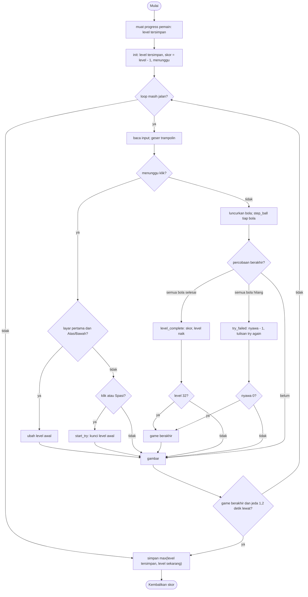

# Master Juggler - design brief

**Owner:** Leader  **Folder:** `deferred/master_juggler/`  **Created:** 2026-11-12  **Asal mekanik:** `g02_masterjuggler` di proyek `simple-games` (hanya aturan; tidak ada kode, gambar, suara, teks atau font yang disalin)  **Status:** v1 sudah jalan (level 1..32, 3 nyawa, lanjut dari level terakhir)

## Hook
Kamu memegang trampolin kecil yang mengikuti mouse. Bola-bola melesat keluar dari trampolin itu, dan tugasmu memantulkan semuanya berulang kali sampai tiap bola berubah warna menjadi abu-abu, tanpa satu pun jatuh ke lantai. Level 1 hanya satu bola; level 5 sudah lima bola yang harus dijaga sekaligus. Level yang sudah kamu capai disimpan, jadi kamu tidak perlu mengulang dari level 1 setiap kali main.

## Penjelasan sederhana
Bayangkan menjaga balon tetap di udara dengan telapak tangan. Level N melempar N bola, satu per satu dengan jeda pendek. Tiap bola harus dipantulkan `3 x min(N, 3)` kali: 3 kali di level 1, 6 kali di level 2, dan 9 kali di level 3 ke atas. Warna bola menunjukkan kemajuannya: merah (baru), kuning (sepertiga jalan), hijau (dua pertiga), lalu abu-abu dan memudar (selesai). Kalau semua bola sudah selesai, level lulus dan skor naik.

Memantulkan bola caranya sederhana: bola yang jatuh ke trampolin dipantulkan ke atas, dan **ke mana** ia menyamping ditentukan oleh bagian trampolin mana yang kena. Kena di tengah, bola naik lurus; kena di ujung, bola miring ke sisi itu. Bola yang menyentuh dinding malah **dipercepat** (dikali -2,5), jadi bola di pinggir bisa melesat balik dengan cepat.

Kalau satu bola jatuh melewati lantai, **semua bola langsung menjadi abu-abu dan tidak bisa dipantulkan lagi** pada percobaan itu (`first_lost`). Kamu hanya menunggu sisa bola jatuh. Kalau seluruh bola hilang, percobaan itu gagal: satu nyawa hilang dan level yang sama diulang. Nyawa ada 3 (`MJ_LIVES`; ini aturan baru di port ini, game aslinya tidak pernah selesai). Nyawa habis berarti game berakhir. Menyelesaikan level 32 juga mengakhiri game ("ALL 32 LEVELS DONE!").

**Lanjut dari level terakhir.** Level yang kamu capai disimpan per nama pemain di file kecil `master_juggler_progress.txt`. Saat kamu membuka game lagi, layar pertama langsung menawarkan level itu ("continuing from your saved level"), dan skor awalnya sudah `level - 1` karena level-level di bawahnya memang sudah kamu selesaikan. Di layar pertama itu kamu bisa menurunkan level awal dengan Atas/Bawah (atau roda mouse), sampai level 1 kalau mau mulai dari nol, tapi tidak bisa melompat lebih tinggi dari level yang sudah kamu capai. Begitu percobaan pertama dimulai, level awal terkunci. Progress yang tersimpan tidak pernah turun: main ulang dari level 1 untuk latihan tidak menghapusnya.

Tulisan merah "a ball was lost: try again" hanya muncul di layar tunggu **tepat setelah percobaan yang gagal**. Setelah level lulus, tulisan itu hilang walaupun nyawamu masih kurang dari 3.

Aturan ada di `master_juggler_logic.c` (tanpa raylib, bisa di-test di terminal). `master_juggler_game.c` membaca input, menggambar, memutar bunyi, dan membaca/menulis file progress.

**Kalau cuma punya 1 menit:** `step_ball` memuat semua fisika dan aturan satu bola (jatuh, pantul, selesai, hilang); `start_try` menyiapkan percobaan; `level_complete` dan `try_failed` adalah dua akhir percobaan; `master_juggler_resume` dan `pick_start_level` mengurus lanjut dari level tersimpan.

## Kontrol
Gerakkan mouse: trampolin mengikuti (tanpa klik). Atau pakai A/D atau panah kiri-kanan: papan hanya bergerak lewat keyboard selama mouse diam. Klik atau Spasi memulai level di layar tunggu. Di layar tunggu pertama (sebelum percobaan pertama), Atas/Bawah (atau W/S) atau roda mouse memilih level awal antara 1 dan level tersimpan. Esc keluar.

## Aturan dan skor
Skor = level tertinggi yang **selesai** (`best`). Level lulus kalau bola terakhir yang diluncurkan sudah selesai memudar tanpa ada bola yang hilang.

Detail dari kode:
- **Bola per level:** level N meluncurkan N bola (maksimal 32). Bola ke-i diluncurkan di tick `(int)(100 / N * i + 0.5)` dari jam peluncuran yang dimulai dari -10 tick. Level 3: tick 0, 33, 67 (bola pertama keluar saat jam mencapai 0, yaitu 10 tick setelah mulai).
- **Pantulan wajib:** `mj = min(level, 3)`, jadi bola selesai di `3 * mj` pantulan. Warna: kuning di `mj`, hijau di `2 * mj`, abu-abu di `3 * mj` (`master_juggler_stage`).
- **Fisika per tick 50 Hz** (dikali `k = dt * 50`): gravitasi `spy += gh * 0.2`; redaman samping `spx *= 0.98^k`; dinding di `x = 15` dan `x = w - 15` membalik dan **mempercepat** `spx` dengan faktor -2,5. Kecepatan lempar awal `gh * -12` (ke atas).
- **Pantulan di trampolin:** terjadi kalau `|y - bar_y| < gh * 20` dan `|x - bar_x| < 60`. Lalu `spy = gh * -0.2 - spy` dan `spx = ((x - bar_x) + acak{-1,0,1}) / 10`. Jadi pantulan miring sebanding dengan jarak dari pusat trampolin, ditambah sedikit acak.
- **Bola selesai:** begitu pantulannya `>= 3 * mj` (dan belum ada bola hilang), ia memudar `0,01 * k` per tick dan tidak bisa hilang lagi. Level lulus saat bola yang **terakhir diluncurkan** selesai memudar.
- **Bola hilang:** bola yang sedang turun dan `y > h` hilang. Bola pertama yang hilang menjadikan semua bola abu-abu penuh dan mematikan pantulan (`first_lost`). Kalau jumlah bola hilang (`bl`) mencapai `level`, percobaan gagal.
- **Nyawa:** percobaan gagal mengurangi `lives`, mengulang level yang sama, dan menyalakan `last_try_failed`. `lives == 0` mengakhiri game. Skor tetap `best`.
- **Lanjut:** `master_juggler_resume(s, level)` mengisi `resume_level = level`, `level = level`, `best = level - 1`. `pick_start_level` mengubah `level` antara 1 dan `resume_level` hanya kalau ada Atas/Bawah/roda, dan menjaga `best = level - 1`. `fresh` menjadi `false` begitu `start_try` berjalan.
- **Menyimpan:** di akhir `play()` (game over, Esc, atau jendela ditutup) front-end menyimpan `master_juggler_progress_level(&s) = max(resume_level, level)`. Smoke run headless tidak pernah menyentuh disk.
- Trampolin selalu berada penuh di dalam lapangan: `bar_x` dijepit ke `[45, w - 45]`.
- `master_juggler_is_over` baru `true` 1,2 detik (`MJ_OVER_DELAY`) setelah `over`, supaya pemain sempat melihat bola terakhir jatuh.

## Cara kerja per frame
1. `arcade_poll(&in)` mengisi `ArcadeInput`. Yang dipakai: `aim_x`/`aim_y` (posisi mouse), `move_x` (A/D atau panah), `fire_pressed` dan `action_pressed` (mulai), `up_pressed`/`down_pressed`/`wheel` (level awal).
2. `master_juggler_step(&s, &in, ARC_DT)`:
   1. Kalau `over` sudah `true`: `over_t += dt` lalu keluar.
   2. `since_bounce += dt` (untuk animasi pegas) dan `move_bar`: kalau x mouse berubah dibanding frame lalu, trampolin pindah ke sana; kalau tidak, tombol A/D menggesernya 420 px/detik. Lalu dijepit ke dalam lapangan.
   3. Kalau `waiting`: kalau `fresh`, `pick_start_level` memproses Atas/Bawah/roda; kalau ada klik atau Spasi, `start_try`. Lalu keluar.
   4. `k = dt * 50`; `frmball += k`. Kalau masih ada bola yang belum diluncurkan dan `frmball` sudah melewati `master_juggler_launch_tick`, `new_ball` meluncurkan satu bola dari balik trampolin.
   5. Untuk tiap bola yang `visible`: `step_ball` (fisika, dinding, selesai, hilang, pantul). Kalau mengembalikan `true`, percobaan baru saja berakhir dan loop bola berhenti.
3. `start_try` mengosongkan penghitung percobaan, menyembunyikan semua bola, mengunci level awal (`fresh = false`) dan mematikan `last_try_failed`.
4. `level_complete`: `best = level`; kalau level 32 maka `over` dan `capped`, kalau tidak `level++`; `waiting = true`. `try_failed`: `lives--`, `waiting = true`, `last_try_failed = true`, dan `over` kalau nyawa habis.
5. Front-end membandingkan penghitung `throws`, `hits`, `losses`, `levels_done`, `tries_lost` dengan frame lalu untuk memutar bunyi, lalu menggambar lantai, bola, trampolin dengan pegas, lapisan "LEVEL N" di layar tunggu (termasuk tulisan "try again" atau tawaran lanjut), dan panel kanan (level terbaik dan nyawa).
6. Kalau `master_juggler_is_over(&s)` bernilai `true`, loop berhenti. Setelah loop, progress disimpan (kecuali headless) dan `GameResult` berisi `master_juggler_score`.

## Peta file
| File | Isinya | Edit di sini kalau ... |
|------|--------|------------------------|
| `master_juggler_logic.h` | Konstanta `MJ_*`, struct `master_juggler_State`, fungsi publik (`resume`, `progress_level`, `progress_load/save`) | menambah field state atau mengubah ukuran |
| `master_juggler_logic.c` | `step_ball`, `start_try`, `level_complete`, `try_failed`, `pick_start_level`, `move_bar`, helper file progress | mengubah aturan, fisika, atau format file progress |
| `master_juggler_game.c` | Loop raylib, menggambar, bunyi, `progress_path`, muat/simpan progress, `game_master_juggler_def` | mengubah tampilan, teks, atau lokasi file |
| `tests/test_master_juggler.c` | 37 unit test (hanya logic) | menambah atau mengubah aturan |
| `CMakeLists.txt` | Mendaftarkan game ke build | menambah file `.c` atau test baru |
| `core/include/arcade/playfield.h` | Lapangan potret 480 x 684 yang dipakai bersama | jarang |
| `master_juggler_progress.txt` (dibuat saat main, di `data_dir`, di-ignore git) | Satu baris `nama|level` per pemain | lihat "Jebakan" sebelum mengubah formatnya |
| `GAME.md` | Dokumen ini | aturan atau kode berubah |
| `AGENTS.md` | Instruksi untuk AI agent (tidak diterjemahkan) | jarang; ikuti aturan di file itu |

## Data penting (struct)
`master_juggler_State`: seluruh keadaan game. Koordinat lokal lapangan.

| Field | Tipe | Artinya |
|-------|------|---------|
| `w`, `h` | `int` | ukuran lapangan (480 x 684 di game; 480 x 800 di test) |
| `base_h`, `bar_y`, `gh` | `float` | tinggi lantai (`h/6`), y tepi **atas** trampolin, dan skala vertikal untuk semua kecepatan |
| `bar_x`, `last_aim_x`, `have_aim` | `float`, `float`, `bool` | pusat x trampolin, x mouse frame lalu (membedakan mouse dan keyboard), sudah ada posisi mouse |
| `level` | `int` | 1..32, level yang sedang atau akan dimainkan |
| `best` | `int` | level tertinggi yang selesai = skor |
| `lives` | `int` | sisa nyawa (0..3) |
| `waiting` | `bool` | di layar "click to start": tidak ada bola bergerak |
| `fresh` | `bool` | belum ada percobaan dimulai: level awal masih bisa diubah |
| `resume_level` | `int` | level tertinggi yang boleh dipilih sebagai awal (progress tersimpan; 1 = dari nol) |
| `last_try_failed` | `bool` | percobaan yang baru berakhir menghilangkan nyawa: tampilkan "try again" |
| `nb`, `bl`, `mj` | `int` | bola yang sudah diluncurkan, bola yang hilang, `min(level, 3)` |
| `frmball` | `float` | jam peluncuran (mulai -10 tick) |
| `first_lost` | `bool` | bola pertama hilang: semua abu-abu, tidak ada pantulan lagi |
| `x[]`, `y[]`, `spx[]`, `spy[]`, `alpha[]` | `float` | posisi, kecepatan, dan transparansi tiap bola (32 elemen) |
| `bounces[]` | `int` | pantulan tiap bola |
| `visible[]` | `bool` | bola ikut dihitung dan digambar |
| `since_bounce` | `float` | detik sejak pantulan terakhir (animasi pegas) |
| `over`, `capped`, `over_t` | `bool`, `bool`, `float` | game berakhir; berakhir karena level 32; detik sejak berakhir |
| `throws`, `hits`, `losses`, `levels_done`, `tries_lost` | `int` | penghitung kejadian untuk bunyi |
| `rng` | `Rng` | pengacak deterministik: sedikit sudut acak di tiap pantulan |

## Fungsi-fungsi penting
| Fungsi | Tugas | Dipanggil dari |
|--------|-------|----------------|
| `master_juggler_init(s, seed)` / `_init_sized(s, seed, w, h)` | Mengosongkan state, menghitung geometri dari ukuran lapangan | `play()`, test |
| `master_juggler_step(s, in, dt)` | Satu langkah logic | `play()` tiap frame, test |
| `master_juggler_is_over(s)` / `master_juggler_score(s)` | Status selesai (setelah jeda 1,2 detik) dan skor | `play()` |
| `master_juggler_resume(s, level)` | Mulai dari level tersimpan: `level`, `resume_level`, `best = level - 1` | `play()`, test |
| `master_juggler_progress_level(s)` | Level yang harus disimpan: `max(resume_level, level)` | `play()`, test |
| `master_juggler_progress_load(path, player)` | Level tersimpan pemain itu, atau 1 | `play()`, test |
| `master_juggler_progress_save(path, player, level)` | Menulis ulang file lewat file sementara; `false` kalau gagal | `play()`, test |
| `master_juggler_stage(bounces, level)` | Warna 0..3 dari jumlah pantulan | front-end, `step_ball`, test |
| `master_juggler_launch_tick(level, i)` | Tick peluncuran bola ke-i | `step`, test |
| `step_ball(s, i, k)` (static) | Fisika dan aturan satu bola; `true` kalau percobaan baru berakhir | `master_juggler_step` |
| `start_try`, `new_ball`, `level_complete`, `try_failed` (static) | Siklus percobaan | `step`, `step_ball` |
| `pick_start_level(s, in)` (static) | Memilih level awal di layar pertama | `master_juggler_step` |
| `move_bar(s, in, dt)` (static) | Trampolin mengikuti mouse atau keyboard, dijepit ke lapangan | `master_juggler_step` |
| `progress_read`, `progress_key` (static) | Membaca baris `nama|level` yang sah dan membersihkan nama | `progress_load`, `progress_save` |
| `progress_path(ctx, out, size)` (static, front-end) | `<data_dir>/master_juggler_progress.txt` (tanda `/` ditambah kalau perlu) | `play()` |

## Angka yang bisa diutak-atik
| Konstanta | Nilai sekarang | File | Efek kalau diubah |
|-----------|----------------|------|-------------------|
| `MJ_MAX_BALLS` / `MJ_MAX_LEVEL` | `32` / `32` | `master_juggler_logic.h` | ukuran array bola dan level terakhir; harus sama atau array bola lebih besar |
| `MJ_LIVES` | `3` | `master_juggler_logic.h` | nyawa awal (aturan baru; game asli tanpa akhir) |
| `MJ_BAR_W` | `90` px | `master_juggler_logic.h` | lebar trampolin |
| `MJ_BALL_R` | `15` px | `master_juggler_logic.h` | radius bola |
| `MJ_OVER_DELAY` | `1.2` detik | `master_juggler_logic.h` | lama bola terakhir terlihat sebelum game ditutup |
| `MJ_PROGRESS_FILE` | `master_juggler_progress.txt` | `master_juggler_logic.h` | nama file progress |
| `MJ_BAR_HIT_HALF_W` | `60` px | `master_juggler_logic.c` | jangkauan pantulan (lebih lebar dari trampolin yang digambar) |
| `MJ_KEY_SPEED` | `420` px/detik | `master_juggler_logic.c` | kecepatan trampolin lewat keyboard |
| `MJ_WALL` | `15` px | `master_juggler_logic.c` | jarak dinding dari tepi lapangan |
| `MJ_PROGRESS_PLAYERS` / `MJ_NAME_LEN` | `64` / `16` | `master_juggler_logic.c` | pemain yang diingat file progress / panjang nama (15 karakter) |
| gravitasi, redaman, faktor dinding (angka langsung di `step_ball`) | `gh * 0.2`, `0.98`, `-2.5` | `master_juggler_logic.c` | rasa fisika |
| kecepatan lempar, pantulan (angka langsung) | `gh * -12`, `gh * -0.2 - spy`, sudut `/ 10` | `master_juggler_logic.c` | tinggi bola dan seberapa miring pantulan |
| tinggi zona pantul, jeda peluncuran (angka langsung) | `gh * 20`, `100 / level` tick | `master_juggler_logic.c` | seberapa mudah memantul (tinggi zona di atas trampolin) dan seberapa rapat bola keluar |
| tata letak (angka langsung di `init_sized`) | lantai `h/6`, tinggi trampolin `h/25`, `gh` dari `h` | `master_juggler_logic.c` | geometri; semua kecepatan ikut berskala |

## Cara menjalankan dan menguji
```bash
# test logic saja (tanpa raylib, ~1 detik)
cmake --preset logic && cmake --build --preset logic && ctest --preset logic -R "^master_juggler\."

# main game-nya
cmake --preset dev && cmake --build --preset dev && build/dev/bin/arCade

# smoke run headless: jalankan game 300 frame dan simpan screenshot PNG
cmake --preset headless && cmake --build --preset headless && build/headless/bin/arCade --smoke master_juggler --frames 300 --out smoke-out
```
Test file progress menulis `master_juggler_progress_test.tmp` di folder kerja (`*.tmp` di-ignore git) dan menghapusnya lagi.

| Test | Menjaga aturan apa |
|------|--------------------|
| `test_init_is_sane` | Awal game: skor 0, level 1, 3 nyawa, menunggu klik |
| `test_spec_constants_at_480x800` | Geometri turunan di 480 x 800: lantai 133,33, `bar_y` 634,67, `gh` 1,58476, kecepatan lempar -19,017, gravitasi 0,31695 |
| `test_waiting_until_click_or_space` | Tidak ada bola sebelum klik atau Spasi; keduanya memulai |
| `test_launch_schedule_level_3` | Tick peluncuran level 3: 0, 33, 67; bola keluar di tick 10, 43, 77 setelah mulai |
| `test_level_n_throws_n_balls` | Level N meluncurkan tepat N bola |
| `test_free_flight_apex` | Puncak lintasan bebas kira-kira 118,7 px di 480 x 800 (integrasi per tick, sedikit lebih rendah dari rumus kontinu 109) |
| `test_bounce_formula_and_offsets` | Pantulan: `spy = gh * -0.2 - spy`, `spx` dari jarak ke pusat ditambah acak `-1..1`, lalu dibagi 10 |
| `test_no_bounce_outside_the_bar_width` | Bola di `dx = 61` tidak memantul (batasnya `< 60`) |
| `test_wall_bounce_speeds_up` | Dinding membalik `spx` dengan faktor -2,5 (setelah redaman 0,98) dan menjepit x ke 15 |
| `test_damping_is_098_per_tick` | Redaman 0,98 per tick, dan 0,98^50 dalam satu detik di 60 Hz juga |
| `test_colour_stages_by_level` | Warna kuning/hijau/abu-abu di 1/2/3 kali `mj` untuk level 1, 2, 3 ke atas |
| `test_a_following_player_completes_level_1` | Pemain yang mengikuti bola terendah menyelesaikan level 1 |
| `test_a_following_player_completes_level_3` | Sama untuk level 3 (tiga bola, sembilan pantulan) |
| `test_first_lost_ball_turns_everything_grey_and_stops_bouncing` | Bola pertama hilang: `first_lost`, `losses = 1`, percobaan belum berakhir, tidak ada pantulan lagi |
| `test_all_balls_lost_costs_a_life_and_repeats_the_level` | Semua bola hilang: nyawa -1, level sama, `waiting`, dan percobaan baru bersih |
| `test_zero_lives_ends_the_game_with_the_best_level` | Nyawa 0: `over` (bukan `capped`), `is_over` baru setelah jeda, skor = `best` |
| `test_level_32_completion_ends_the_game` | Menyelesaikan level 32: `over` dan `capped`, `best = 32` |
| `test_hover_and_keyboard_control_of_the_bar` | Frame pertama memakai mouse, mouse bergerak menang atas keyboard, keyboard 420 px/detik saat mouse diam, trampolin selalu di dalam lapangan |
| `test_try_again_hint_is_only_for_the_try_that_was_just_lost` | **Perbaikan bug:** tulisan "try again" menyala setelah percobaan gagal, mati begitu percobaan ulang mulai, dan tidak muncul lagi setelah level lulus walaupun nyawa kurang dari 3 (diuji di 30 seed) |
| `test_try_again_hint_returns_after_the_next_lost_try` | Gagal lagi di level lain: tulisannya muncul lagi |
| `test_resume_starts_at_the_saved_level_and_counts_earlier_ones` | Resume ke level 6: `level = 6`, `best = 5`, level 6 meluncurkan 6 bola tanpa mengulang level 1..5 |
| `test_resume_is_clamped_and_level_1_changes_nothing` | Level resume dijepit ke 1..32; resume ke 1 sama dengan mulai baru |
| `test_start_level_can_be_lowered_but_never_above_the_saved_level` | Bawah/roda menurunkan level awal dan skor ikut; Atas kembali tapi berhenti di level tersimpan; bisa sampai level 1; memilih tidak memulai level |
| `test_idle_start_screen_changes_nothing` | Frame diam di layar pertama tidak mengubah level atau skor (regresi) |
| `test_start_level_is_locked_once_a_try_has_started` | Setelah percobaan dimulai (dan juga di layar ulang) Atas/Bawah tidak berpengaruh |
| `test_a_resumed_run_keeps_the_carried_score_when_it_fails` | Resume ke level 4 lalu kalah: skor 3, progress yang disimpan 4 |
| `test_progress_level_never_goes_down_and_follows_new_levels` | Memilih level 1 untuk latihan tidak menurunkan progress; melewati progress lama menaikkannya |
| `test_progress_file_round_trip` | Simpan dan muat, memperbarui tanpa menggandakan baris, pemain tak dikenal mendapat 1 |
| `test_progress_names_are_case_insensitive_and_sanitised` | Nama tidak peka huruf besar-kecil; `\|` dan baris baru dibersihkan; nama kosong menjadi `PLAYER` |
| `test_progress_levels_are_clamped` | Level yang disimpan dijepit ke 1..32 |
| `test_progress_file_ignores_bad_lines` | File rusak atau diedit tangan tidak membuat game crash: baris tanpa pemisah, nama kosong, level bukan angka, di luar 1..32, sisa karakter, baris sangat panjang, dan byte biner dilewati |
| `test_progress_file_forgets_the_oldest_player_when_full` | Lebih dari 64 pemain: yang paling lama dilupakan |
| `test_progress_save_fails_cleanly_for_a_bad_path` | Folder yang tidak ada: simpan mengembalikan `false`, muat mengembalikan 1 |
| `test_a_new_session_continues_where_the_last_one_ended` | Satu sesi penuh: simpan, buka lagi, lanjut dari level yang sama dengan skor yang benar |
| `test_monkey_with_a_resumed_run_never_breaks_invariants` | Input acak pada run yang di-resume: level, `best`, dan progress selalu valid |
| `test_same_seed_same_result` | Seed sama dan input sama menghasilkan hasil yang sama |
| `test_monkey_never_breaks_invariants` | Input acak: indeks array, nyawa, dan level selalu valid |

## Jebakan dan hal yang perlu diingat
- **Jangan menurunkan tulisan "try again" dari `lives < MJ_LIVES`.** Itu bug yang diperbaiki: kondisi itu tetap benar sepanjang sisa run, jadi tulisan muncul lagi di layar level berikutnya padahal percobaan terakhir berhasil. Yang benar adalah `last_try_failed`, yang dinyalakan `try_failed` dan dimatikan `start_try`.
- **File progress terpisah dari `scores.txt` dengan sengaja.** Hub memegang papan skor di memori dan menulis ulang seluruh `scores.txt`, jadi apa pun yang ditambahkan game ke file itu akan tertimpa.
- Skor run yang di-resume membawa level sebelumnya: mulai dari level 6 lalu kalah langsung berskor 5, bukan 0. Itu menjaga arti skor ("level tertinggi yang selesai") tapi berarti papan skor bisa berisi beberapa entri 5 dari pemain yang sama.
- Melompati level hanya mungkin sampai level yang pernah dicapai di komputer dan nama pemain yang sama. File progress bisa diedit tangan; itu diterima sebagai kejujuran, bukan keamanan.
- Nama pemain dipotong 15 karakter dan `|` serta karakter kontrol diganti `_`. Dua nama yang hanya beda setelah karakter ke-15 akan dianggap sama.
- Smoke run dan CI (headless) tidak membaca atau menulis file progress, supaya hasilnya deterministik.
- Menyimpan terjadi saat `play()` selesai. Kalau proses dimatikan paksa di tengah game, level yang baru dicapai di run itu belum tersimpan.
- Pantulan memakai `|dx| < 60` (`MJ_BAR_HIT_HALF_W`), lebih lebar dari trampolin yang digambar (90 px, setengahnya 45): bola yang tampak sedikit di luar ujung masih bisa dipantulkan. Itu asli dari spesifikasi.
- Puncak lintasan bebas 118,7 px di 480 x 800, bukan 109 seperti rumus kontinu, karena integrasi per tick mendarat sedikit lebih rendah. Perilaku asli dipertahankan.
- Setelah level lulus, bola terakhir (sudah memudar penuh) masih berstatus `visible` dan warnanya dihitung terhadap `level` yang sudah naik, jadi di layar tunggu ia tampak sebagai halo kuning redup di tengah. Penyebabnya dua: `level_complete` tidak menghapus `visible[]`, dan `gfx_glow_circle` memakai `Fade` yang **mengganti** alpha (tidak mengalikan), sehingga halo tidak ikut memudar. Hanya kosmetik; hilang begitu `start_try` berjalan.
- `master_juggler_is_over` memakai jeda 1,2 detik; `over` sendiri sudah `true` lebih awal. Jangan memakai `over` untuk menutup loop.
- Game ini `ranked = true`.

## Langkah implementasi (Implementation steps)
Daftar ini adalah pengembangan dari v1.

1. Sembunyikan bola yang sudah selesai di layar tunggu (kosongkan `visible[]` di `level_complete`) dan hitung warnanya terhadap level yang baru dimainkan.
2. Layar pilih level yang bisa diklik (tombol - dan + dengan mouse) selain Atas/Bawah dan roda.
3. Tampilkan "level tersimpan: N" di panel kanan supaya pemain tahu sebelum memulai.
4. Atur ulang progress dari dalam game (misalnya tombol R di layar pertama).
5. Penyetelan fisika lewat uji main sungguhan: kecepatan lempar, lebar jangkauan pantulan, jeda peluncuran.

## Pseudocode (untuk laporan)
```
PROSEDUR step_ball(i, k)
    spx <- spx * 0.98^k; spy <- spy + k * gh * 0.2
    x <- x + k * spx; y <- y + k * spy
    JIKA x di luar dinding MAKA spx <- spx * -2.5; jepit x
    JIKA tidak ada bola hilang DAN pantulan >= 3 * mj MAKA
        memudar; JIKA ini bola terakhir DAN sudah memudar habis MAKA level_complete
        KEMBALI
    JIKA sedang naik MAKA KEMBALI
    JIKA y > tinggi lapangan MAKA
        JIKA bola pertama hilang MAKA first_lost <- benar; semua jadi abu-abu
        bola hilang; JIKA semua bola hilang MAKA try_failed
        KEMBALI
    JIKA first_lost MAKA KEMBALI
    JIKA bola dekat trampolin MAKA
        spy <- gh * -0.2 - spy
        spx <- ((x - bar_x) + acak(-1..1)) / 10
        pantulan <- pantulan + 1

PROSEDUR master_juggler_step(input, dt)
    JIKA game berakhir MAKA hitung waktu; KEMBALI
    geser trampolin (mouse, atau keyboard kalau mouse diam)
    JIKA menunggu MAKA
        JIKA belum ada percobaan DAN ada Atas/Bawah/roda MAKA ubah level awal (1..tersimpan)
        JIKA ada klik atau Spasi MAKA start_try
        KEMBALI
    luncurkan bola yang sudah waktunya
    UNTUK tiap bola yang terlihat: step_ball

PROSEDUR try_failed
    nyawa <- nyawa - 1; menunggu <- benar; percobaan_gagal <- benar
    JIKA nyawa = 0 MAKA game berakhir

PROSEDUR start_try
    reset penghitung bola; level awal terkunci; percobaan_gagal <- salah

PROSEDUR simpan_progress(path, pemain, level)
    baca semua baris yang sah; cari pemain (tanpa peduli huruf besar-kecil)
    JIKA belum ada MAKA tambah (buang yang paling lama kalau sudah 64)
    tulis ke file sementara; ganti file asli
```

## Flowchart (untuk laporan)


## Konsep kuliah yang dipakai
| Konsep (Pertemuan) | Di mana (file : fungsi) |
|--------------------|-------------------------|
| Struct (13) | `master_juggler_logic.h` : `master_juggler_State`; `MjProgress` di `master_juggler_logic.c` |
| Array (9) | `x[]`, `y[]`, `spx[]`, `spy[]`, `alpha[]`, `bounces[]`, `visible[]`; larik `MjProgress rows[]` |
| String (9) | `progress_key` (menyalin dan membersihkan nama), `strchr`, `strtol` di `progress_read` |
| Perulangan (6) | `for` atas semua bola di `master_juggler_step`; `while (fgets)` di `progress_read` |
| Percabangan (5) | `step_ball` (dinding, selesai, hilang, pantul), `level_complete`, `try_failed` |
| Prosedur, fungsi (11) | `new_ball`, `start_try`, `pick_start_level`, `master_juggler_stage` |
| Pointer (10) | setiap parameter `master_juggler_State *s`; `char *end` pada `strtol` |
| File handling (13) | `master_juggler_progress_load` dan `_save`: `fopen`, `fgets`, `fprintf`, `rename`, validasi tiap baris |
| Fungsi matematika (12) | `powf` untuk redaman, `fabsf`, `arc_clampf`, `arc_clampi` |
