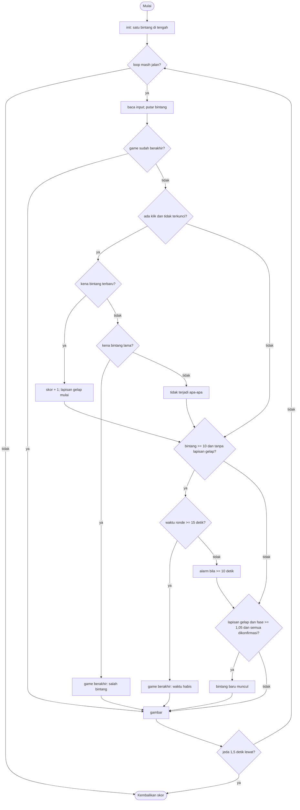

# New Star - design brief

**Owner:** Leader  **Folder:** `deferred/new_star/`  **Created:** 2026-11-12  **Status:** v1 sudah jalan (layar gelap tiap ronde, bintang baru, batas waktu dari bintang ke-10)

## Hook
Satu bintang di tengah layar. Ketuk. Layar menggelap, sebuah bintang **baru** muncul di antara yang lama, lalu layar terang lagi. Sekarang ketuk bintang yang baru. Ronde berikutnya satu bintang lagi ditambahkan, dan kamu harus mengingat mana yang sudah pernah kamu ketuk. Mengetuk bintang lama berarti selesai.

## Penjelasan sederhana
Ini permainan ingatan dan mata jeli: layar makin penuh, dan tugasmu hanya satu per ronde, yaitu menemukan satu bintang yang baru. Karena layar gelap saat bintang baru ditambahkan, kamu tidak bisa melihatnya muncul; kamu harus membandingkan layar sekarang dengan ingatanmu tentang layar sebelumnya. Semua bintang berputar searah jarum jam dengan kecepatan sama, dan ada enam jenis bintang (bentuk dan wajah berbeda), sehingga mengenali mana yang baru butuh perhatian.

Urutan satu ronde setelah ketukan yang benar:
- **0 sampai 1 detik:** layar menggelap perlahan (kurva sinus). Ketukan diabaikan sampai 1,4 detik.
- **1,05 detik:** pada saat layar paling gelap, bintang baru dibuat di tempat acak.
- **1,2 sampai 2,2 detik:** layar terang kembali. Setelah 2,2 detik lapisan gelap hilang sepenuhnya.
- Kamu boleh mengetuk setelah 1,4 detik. Bintang yang benar adalah yang terbaru; yang lama (sudah dikonfirmasi) mengakhiri game; ketukan di tempat kosong tidak melakukan apa-apa.

**Batas waktu mulai bintang ke-10.** Sampai bintang ke-9 kamu boleh berpikir selama apa pun. Dari bintang ke-10, setiap ronde punya waktu: setelah 10 detik sejak bintang baru muncul bintang-bintang bergetar dan alarm berbunyi, dan setelah 15 detik game berakhir ("TIME UP!").

Skor adalah jumlah bintang baru yang berhasil ditemukan. Bintang pertama (di tengah) tidak dihitung sebagai "baru" sampai kamu mengetuknya, jadi ketukan pertama sudah memberi skor 1.

Aturan ada di `new_star_logic.c` (tanpa raylib, bisa di-test di terminal). `new_star_game.c` hanya menggambar bintang berwajah dan lapisan gelap.

**Kalau cuma punya 1 menit:** `new_star_tap` memutuskan benar, kalah, atau diabaikan; `new_star_step` mengurus jam lapisan gelap (munculkan bintang di 1,05 detik) dan jam batas waktu; `new_star` menaruh bintang baru tanpa menumpuk bintang lama.

## Kontrol
Klik kiri pada bintang. Tidak ada tombol lain. Esc keluar. Klik di panel samping (di luar lapangan) tidak berpengaruh.

## Aturan dan skor
Skor = bintang yang sudah dikonfirmasi (`score`). Game berakhir kalau kamu mengetuk bintang lama, waktu ronde habis (dari bintang ke-10), atau bintang ke-512 dikonfirmasi.

Detail dari kode:
- **Bintang pertama:** selalu di pusat lapangan, jenis 5 (56 px). Di 480 x 684: `(240, 342)`; di test 480 x 800: `(240, 400)`.
- **Ukuran jenis** (`new_star_type_size`): faktor `1,0 / 0,8 / 1,4 / 1,2 / 1,2 / 1,4` dikali 40 px, jadi 40, 32, 56, 48, 48, dan 56 px.
- **Penempatan bintang baru:** `x` acak di `38 .. w - 38`, `y` acak di `78 .. h - 38`, jenis acak 0..5. Ditolak kalau berada di zona teks skor (selisih `x` dari tengah `< 100` dan selisih `y` dari `h/8` `< 60`) atau kalau jaraknya ke bintang lama `<= (ukuran_baru + ukuran_lama) / 1,8` (supaya tidak bertumpuk). Setelah 2000 kali gagal, kandidat terakhir diterima saja. Sudut awal acak 0..359 derajat.
- **Putaran:** semua bintang berputar `150` derajat per detik searah jarum jam. Bintang terbaru terus berputar bahkan setelah game berakhir.
- **Kotak ketuk:** persegi sumbu-x/y selebar ukuran bintang ditambah 10 px di tiap sisi (`NS_TAP_TOLERANCE`); rotasi diabaikan. Bintang yang benar dicek lebih dulu, jadi kalau kotaknya menimpa bintang lama, ketukan tetap dianggap benar.
- **Ketukan benar:** `score++`, `corrects++`, `overlay = true`, `phase_t = 0`, `new_t = 0`. Kalau `score` mencapai 512, game berakhir dengan `capped` ("ALL 512 FOUND!").
- **Lapisan gelap:** alfa `sin(t * pi/2)` sampai 0,999 detik, penuh sampai 1,199, lalu `sin((2,2 - t) * pi/2)` sampai 2,199, dan terlihat sampai 2,199 detik (`new_star_overlay_alpha`, `new_star_overlay_visible`). Bintang baru dibuat saat `phase_t >= 1,05` (`NS_CREATE_T`).
- **Ketukan dikunci:** selama lapisan gelap ada dan `phase_t < 1,4` (`NS_LOCK_T`), ketukan diabaikan (termasuk ketukan di bintang lama).
- **Batas waktu:** kalau sudah ada 10 bintang atau lebih (`NS_TIMED_FROM`) dan tidak ada lapisan gelap: `new_t >= 10,001` menyalakan `alarm` (bintang bergetar acak, `alarms++`); `new_t >= 15,001` berarti `timed_out`. `new_t` kembali ke 0 saat bintang baru muncul dan saat ketukan benar, sehingga alarm dan getaran dimatikan.
- `new_star_is_over` baru `true` 1,5 detik (`NS_OVER_DELAY`) setelah `over`, supaya pemain melihat bintang yang salah diketuk berkedip.

## Cara kerja per frame
1. `arcade_poll(&in)` mengisi `ArcadeInput`. Hanya `fire_pressed` (klik), `aim_x`, dan `aim_y` yang dipakai.
2. `new_star_step(&s, &in, ARC_DT)`:
   1. Bintang terbaru berputar (`rot += 150 * dt`) dulu, bahkan kalau game sudah berakhir.
   2. Kalau `over`: `over_t += dt`, keluar.
   3. Kalau `fire_pressed`: ubah posisi mouse ke koordinat lapangan dan panggil `new_star_tap`. Kalau game berakhir karenanya, keluar.
   4. Tiap bintang lain berputar; kalau `alarm`, `shake[i] += acak(-1..1)`.
   5. `new_t += dt`; kalau `overlay`, `phase_t += dt`.
   6. Dari 10 bintang dan tanpa lapisan gelap: `new_t >= 10,001` menyalakan alarm; `new_t >= 15,001` berarti `timed_out` dan `end_game`.
   7. Kalau ada lapisan gelap: kalau sudah tidak terlihat, `overlay = false`; kalau `phase_t < 1,05`, keluar. Kalau semua bintang sudah dikonfirmasi (`n == score`), `new_star` membuat bintang baru.
3. Front-end membandingkan `corrects`, `created`, dan `alarms` dengan frame lalu untuk memutar bunyi (ok, pop saat bintang muncul, alarm berulang tiap 0,5 detik), lalu menggambar bintang berwajah (enam jenis), lapisan gelap dengan alfa dari `new_star_overlay_alpha`, tulisan "tap the star" di awal, bilah waktu (hijau, merah saat alarm), dan pesan "WRONG STAR!", "TIME UP!", atau "ALL 512 FOUND!".
4. Kalau `new_star_is_over(&s)` bernilai `true`, loop berhenti dan skor dikembalikan.

## Peta file
| File | Isinya | Edit di sini kalau ... |
|------|--------|------------------------|
| `new_star_logic.h` | Konstanta `NS_*`, struct `new_star_State`, fungsi publik dan helper murni | menambah field state atau mengubah ukuran |
| `new_star_logic.c` | `new_star`, `new_star_tap`, `new_star_step`, `star_hit`, helper lapisan gelap | mengubah aturan, penempatan, atau waktu |
| `new_star_game.c` | Loop raylib, menggambar bintang dan wajah, lapisan gelap, bunyi, `game_new_star_def` | mengubah tampilan atau teks |
| `tests/test_new_star.c` | 19 unit test (hanya logic) | menambah atau mengubah aturan |
| `CMakeLists.txt` | Mendaftarkan game ke build | menambah file `.c` atau test baru |
| `core/include/arcade/playfield.h` | Lapangan potret 480 x 684 yang dipakai bersama | jarang |
| `GAME.md` | Dokumen ini | aturan atau kode berubah |
| `AGENTS.md` | Instruksi untuk AI agent (tidak diterjemahkan) | jarang; ikuti aturan di file itu |

## Data penting (struct)
`new_star_State`: seluruh keadaan game. Koordinat lokal lapangan, sudut dalam derajat.

| Field | Tipe | Artinya |
|-------|------|---------|
| `w`, `h` | `int` | ukuran lapangan |
| `score_pos` | `Vec2` | pusat zona teks skor `(w/2, h/8)`: tidak ada bintang yang ditaruh di dekatnya |
| `n` | `int` | bintang yang sudah dibuat |
| `score` | `int` | bintang yang sudah dikonfirmasi = indeks bintang yang harus diketuk berikutnya |
| `x[]`, `y[]`, `size[]`, `rot[]`, `shake[]`, `type[]` | `float`, `int` | pusat, ukuran, sudut, geseran getar, dan jenis tiap bintang (512 elemen) |
| `overlay` | `bool` | lapisan gelap sedang tampil |
| `phase_t` | `float` | detik sejak ketukan benar terakhir (jam lapisan gelap) |
| `new_t` | `float` | detik sejak bintang terbaru muncul atau dikonfirmasi (jam batas waktu) |
| `alarm` | `bool` | alarm dan getar sedang menyala |
| `over`, `capped`, `timed_out` | `bool` | game berakhir; karena 512 bintang; karena waktu habis |
| `over_t` | `float` | detik sejak berakhir |
| `corrects`, `alarms`, `created` | `int` | penghitung kejadian untuk bunyi |
| `rng` | `Rng` | pengacak deterministik: posisi, jenis, sudut, getar |

## Fungsi-fungsi penting
| Fungsi | Tugas | Dipanggil dari |
|--------|-------|----------------|
| `new_star_init(s, seed)` / `_init_sized(s, seed, w, h)` | Mengosongkan state dan membuat bintang pertama di tengah | `play()`, test |
| `new_star_step(s, in, dt)` | Satu langkah logic | `play()` tiap frame, test |
| `new_star_is_over(s)` / `new_star_score(s)` | Status selesai (setelah jeda 1,5 detik) dan skor | `play()` |
| `new_star_tap(s, lx, ly)` | Memutuskan ketukan: benar, kalah, atau diabaikan (koordinat lapangan) | `new_star_step`, test |
| `new_star_overlay_alpha(t)` | Alfa lapisan gelap `t` detik setelah ketukan benar (fungsi murni) | front-end, test |
| `new_star_overlay_visible(t)` | Lapisan gelap masih terlihat sampai 2,199 detik | `new_star_step`, front-end, test |
| `new_star_type_size(type)` | Ukuran bintang dalam px untuk satu jenis | `new_star`, front-end, test |
| `new_star(s)` (static) | Menaruh satu bintang baru (tengah untuk yang pertama, selain itu acak dengan penolakan) | `init`, `new_star_step` |
| `in_score_zone`, `overlaps_old_star` (static) | Dua syarat penolakan penempatan | `new_star` |
| `star_hit(s, i, lx, ly)` (static) | Apakah ketukan ada di kotak bintang i | `new_star_tap` |
| `end_game(s)` (static) | Menandai selesai dan menghentikan getar | `new_star_tap`, `new_star_step` |

## Angka yang bisa diutak-atik
| Konstanta | Nilai sekarang | File | Efek kalau diubah |
|-----------|----------------|------|-------------------|
| `NS_MAX_STARS` | `512` | `new_star_logic.h` | ukuran array dan batas akhir game |
| `NS_TAP_TOLERANCE` | `10` px | `new_star_logic.h` | seberapa jauh ketukan boleh meleset dari bintang |
| `NS_TIMED_FROM` | `10` | `new_star_logic.h` | jumlah bintang saat batas waktu mulai berlaku |
| `NS_ALARM_TIME` | `10.001` detik | `new_star_logic.h` | kapan alarm dan getar mulai |
| `NS_LIMIT_TIME` | `15.001` detik | `new_star_logic.h` | kapan game berakhir karena waktu |
| `NS_OVER_DELAY` | `1.5` detik | `new_star_logic.h` | lama bintang yang salah berkedip sebelum game ditutup |
| `NS_ROT_SPEED` | `150` derajat/detik | `new_star_logic.h` | kecepatan putar semua bintang |
| `NS_TYPES` | `6` | `new_star_logic.h` | jumlah jenis bintang |
| `NS_X_MARGIN` / `NS_Y_TOP` | `38` / `78` px | `new_star_logic.c` | area penempatan bintang |
| `NS_ZONE_HALF_W` / `NS_ZONE_HALF_H` | `100` / `60` px | `new_star_logic.c` | zona teks skor yang dijaga bersih |
| `NS_MAX_ATTEMPTS` | `2000` | `new_star_logic.c` | percobaan penempatan sebelum kandidat diterima apa adanya |
| `NS_CREATE_T` | `1.05` detik | `new_star_logic.c` | kapan bintang baru muncul setelah ketukan benar |
| `NS_LOCK_T` | `1.4` detik | `new_star_logic.c` | ketukan diabaikan selama ini setelah ketukan benar |
| `k_size_factor` | `{1,0, 0,8, 1,4, 1,2, 1,2, 1,4}` | `new_star_logic.c` | ukuran tiap jenis (kali 40 px) |
| pembagi tumpang tindih (angka langsung di `overlaps_old_star`) | `1,8` | `new_star_logic.c` | seberapa rapat bintang boleh berdekatan |
| nada bunyi (di `play`) | ok 660 Hz, pop 520 Hz, alarm 880 Hz, kalah 110 Hz | `new_star_game.c` | hanya bunyi |

## Cara menjalankan dan menguji
```bash
# test logic saja (tanpa raylib, ~1 detik)
cmake --preset logic && cmake --build --preset logic && ctest --preset logic -R "^new_star\."

# main game-nya
cmake --preset dev && cmake --build --preset dev && build/dev/bin/arCade

# smoke run headless: jalankan game 300 frame dan simpan screenshot PNG
cmake --preset headless && cmake --build --preset headless && build/headless/bin/arCade --smoke new_star --frames 300 --out smoke-out
```

| Test | Menjaga aturan apa |
|------|--------------------|
| `test_init_is_sane` | Awal game: belum selesai, skor 0, satu bintang, tanpa lapisan gelap |
| `test_first_star_at_480x800` | Bintang pertama di `(240, 400)`, jenis 5, ukuran 56; zona skor di `(240, 100)` |
| `test_star_type_sizes` | Ukuran enam jenis: 40, 32, 56, 48, 48, 56 |
| `test_overlay_alpha_vectors` | Alfa 0 di 0 detik, 0,7071 di 0,5, 1,0 di 1,1, 0,7071 di 1,7; terlihat di 2,1, hilang di 2,2 |
| `test_new_star_appears_at_1_05_seconds` | Setelah ketukan benar, bintang baru belum ada pada fase fade-in dan ada setelah 1,05 detik; lapisan hilang setelah 2,2 detik |
| `test_taps_are_ignored_for_the_first_1_4_seconds` | Ketukan di 1,32 detik diabaikan, di 1,44 detik diterima |
| `test_hit_box_edges` | Ketukan tepat di luar kotak tidak berpengaruh, dan tepat di sudut kotak (setengah ukuran + 10 px) dianggap benar |
| `test_clicks_in_the_gutters_are_ignored` | Klik di panel samping (di luar lapangan) tidak berpengaruh |
| `test_tapping_an_old_star_ends_the_game` | Mengetuk bintang yang sudah dikonfirmasi: `over`, `is_over` setelah 1,5 detik |
| `test_tapping_nothing_does_nothing` | Ketukan di tempat kosong tidak mengubah apa pun |
| `test_old_star_taps_are_ignored_during_the_overlay` | Ketukan di bintang lama saat layar masih terkunci (di bawah 1,4 detik) tidak mengakhiri game |
| `test_no_time_limit_before_the_10th_star` | Menunggu lama sebelum bintang ke-10 tidak mengakhiri game |
| `test_10th_star_alarm_and_timeout` | Di bintang ke-10: alarm setelah 10 detik (bintang bergetar, `alarms = 1`), game berakhir setelah 15 detik dengan `timed_out`, dan getar berhenti |
| `test_new_star_resets_the_shake_and_the_alarm` | Ketukan benar di detik ke-11 menyelamatkan; saat bintang ke-11 muncul alarm mati dan getar nol |
| `test_all_stars_rotate_150_deg_per_second` | Setiap bintang berputar 150 derajat per detik |
| `test_placement_invariants` | 25 bintang: semua di dalam `38..442` x `78..762` (480 x 800), di luar zona skor, jenis 0..5, dan tidak saling menumpuk |
| `test_cap_of_512_stars_ends_the_game` | Mengonfirmasi bintang ke-512: `over` dan `capped`, skor 512, tidak ada indeks terlewati |
| `test_same_seed_same_result` | Seed sama dan input sama menghasilkan hasil yang sama |
| `test_monkey_never_breaks_invariants` | Input acak: skor, jumlah bintang, dan state selalu valid |

## Jebakan dan hal yang perlu diingat
- **Dua jam yang berbeda.** `phase_t` menghitung lapisan gelap (dari ketukan benar), sedangkan `new_t` menghitung batas waktu (dari munculnya bintang). Keduanya dimulai dari 0 pada ketukan benar, dan `new_t` di-nol-kan lagi saat bintang baru muncul di 1,05 detik, jadi batas 10 dan 15 detik dihitung dari munculnya bintang, bukan dari ketukan.
- Batas waktu hanya berlaku **tanpa** lapisan gelap, dan hanya kalau `n >= 10`. Lapisan gelap melindungi pemain dari alarm pada saat bintang baru belum terlihat.
- Rotasi bintang diabaikan pada kotak ketuk (selalu persegi sejajar sumbu), jadi bintang yang berputar memiliki kotak ketuk yang tetap.
- Kalau kotak bintang lama menimpa bintang baru, ketukan di daerah tumpang tindih dianggap benar (bintang baru dicek lebih dulu). Penempatan menolak tumpang tindih, tetapi setelah 2000 percobaan gagal kandidat terakhir tetap diterima, jadi pada layar sangat penuh bintang bisa bertumpuk.
- Pembagi 1,8 di `overlaps_old_star` berarti jarak pusat minimum 0,556 kali jumlah ukuran dua bintang, sedikit di atas jumlah setengah-ukuran (0,5 kali). Jadi dua bintang tidak bersentuhan, tetapi boleh sangat berdekatan.
- Getar hanya mengubah `shake[]`, bukan posisi sebenarnya (`x[]`, `y[]`): kotak ketuk tidak ikut bergeser.
- Bintang terbaru terus berputar sesudah game berakhir, supaya bintang yang salah diketuk tetap terlihat hidup.
- Klik pada bintang yang sudah dikonfirmasi saat lapisan gelap masih mengunci (di bawah 1,4 detik) diabaikan, tetapi sesudahnya (sampai 2,2 detik) dihitung sebagai kalah.
- Skor 512 secara teori bisa dicapai tetapi sangat panjang: tiap ronde butuh minimal 1,4 detik (ketukan dikunci selama itu), jadi 512 ronde memakan paling sedikit sekitar 12 menit tanpa jeda berpikir sama sekali.
- Game ini `ranked = true`, `order = 170`.

## Langkah implementasi (Implementation steps)
Daftar ini adalah pengembangan dari v1.

1. Mode "bayangan": tampilkan bintang baru sebentar sebelum layar menggelap sebagai latihan.
2. Variasi lapisan gelap: layar tidak hanya menggelap tetapi bintang lama sedikit bergeser, sehingga mengingat posisi lebih sulit.
3. Skor kecepatan: bonus untuk ketukan cepat setelah lapisan hilang.
4. Tingkat kesulitan: lapisan gelap lebih pendek, atau batas waktu mulai lebih awal.
5. Mode warna: bintang berwarna berbeda agar bisa dibedakan dengan lebih mudah.

## Pseudocode (untuk laporan)
```
PROSEDUR tap(x, y)
    JIKA game berakhir ATAU di luar lapangan MAKA KEMBALI
    JIKA lapisan gelap ada DAN fase < 1.4 MAKA KEMBALI
    JIKA ketukan kena bintang terbaru (kotak + 10 px) MAKA
        skor <- skor + 1
        JIKA skor = 512 MAKA game berakhir (penuh); KEMBALI
        lapisan gelap <- ada; fase <- 0; waktu_ronde <- 0
    JIKA TIDAK
        UNTUK tiap bintang lama
            JIKA ketukan kena bintang itu MAKA game berakhir; KEMBALI

PROSEDUR step(input, dt)
    putar semua bintang 150 derajat per detik
    JIKA game berakhir MAKA hitung waktu; KEMBALI
    JIKA ada klik MAKA tap(posisi mouse di lapangan)
    waktu_ronde <- waktu_ronde + dt
    JIKA lapisan gelap ada MAKA fase <- fase + dt
    JIKA bintang >= 10 DAN tidak ada lapisan gelap MAKA
        JIKA waktu_ronde >= 10 MAKA alarm: bintang bergetar
        JIKA waktu_ronde >= 15 MAKA game berakhir (waktu habis)
    JIKA lapisan gelap ada MAKA
        JIKA fase > 2.199 MAKA lapisan hilang
        JIKA fase >= 1.05 DAN semua bintang sudah dikonfirmasi MAKA bintang_baru()

PROSEDUR bintang_baru()
    ULANGI sampai 2000 kali
        (x, y, jenis) <- acak
        JIKA di zona skor ATAU menumpuk bintang lama MAKA coba lagi
    simpan bintang; waktu_ronde <- 0; alarm mati
```

## Flowchart (untuk laporan)


## Konsep kuliah yang dipakai
| Konsep (Pertemuan) | Di mana (file : fungsi) |
|--------------------|-------------------------|
| Struct (13) | `new_star_logic.h` : `new_star_State`; `Vec2` |
| Array (9) | `x[]`, `y[]`, `size[]`, `rot[]`, `shake[]`, `type[]` (512 bintang); `k_size_factor[]` |
| Perulangan (6) | `new_star` (penolakan sampai 2000 kali), `overlaps_old_star` dan `new_star_tap` (loop atas bintang), `new_star_step` (putar semua) |
| Percabangan (5) | `new_star_tap` (benar, kalah, diabaikan, terkunci), `new_star_step` (alarm, waktu habis, lapisan gelap) |
| Prosedur, fungsi (11) | `new_star_overlay_alpha`, `new_star_overlay_visible`, `new_star_type_size` (fungsi murni), `star_hit` |
| Pointer (10) | setiap parameter `new_star_State *s`; `const new_star_State *s` pada fungsi yang tidak mengubah |
| Fungsi matematika (12) | `sinf` (alfa lapisan gelap), `fabsf` dan `vec2_dist` (kotak ketuk dan jarak), `arc_pf_contains` |
