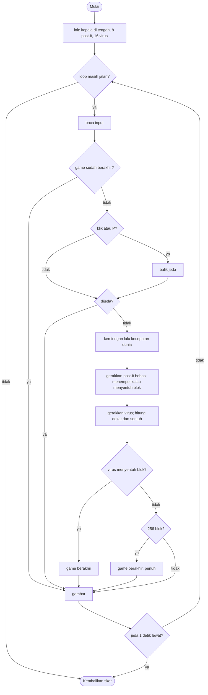

# Post It - design brief

**Owner:** Leader  **Folder:** `deferred/post_it/`  **Created:** 2026-11-12  **Asal mekanik:** `g01_grabgreen` di proyek `simple-games` (hanya aturan; tidak ada kode, gambar, suara, teks atau font yang disalin)  **Status:** v1 sudah jalan (miring dunia lewat mouse, gugusan post-it, virus, jeda)

## Hook
Sebuah post-it kuning diam di tengah layar. Delapan post-it berwarna dan enam belas virus hanyut mengelilinginya, dan kamu tidak menggerakkan apa pun secara langsung: kamu **memiringkan dunia**. Geser mouse menjauhi pusat, dan semuanya hanyut ke arah itu. Post-it yang menyentuh gugusanmu menempel (+1), virus yang menyentuhnya mengakhiri game.

## Penjelasan sederhana
Bayangkan meja miring dengan kepingan-kepingan di atasnya. Gugusanmu (post-it kuning di tengah dan semua yang sudah menempel) tidak pernah bergerak. Yang bergerak adalah **dunia**: tiap post-it bebas dan tiap virus hanyut sesuai kemiringan. Kamu memilih arah hanyut dengan posisi mouse relatif terhadap pusat lapangan: makin jauh, makin kencang, sampai batas tertentu.

Tiap benda bebas juga berjalan sendiri searah **sudut hadapnya**, dengan kecepatan separuh kecepatan dunia, sehingga mereka tidak persis bergerak serempak. Kalau benda keluar dari satu sisi lapangan, ia muncul lagi di sisi seberang dengan **sudut hadap baru yang acak**. Kalau dunia tidak miring sama sekali (mouse tepat di pusat), semuanya diam membeku.

- **Post-it berwarna (8)** yang menyentuh **blok mana pun** di gugusanmu (bukan hanya yang kuning) menempel di tempat ia menyentuh, skor +1, lalu satu post-it baru muncul di tempat acak. Gugusanmu jadi makin lebar, dan itu berarti target yang makin besar untuk virus.
- **Virus (16)**, bulat berduri merah, yang menyentuh blok mana pun mengakhiri game. Virus yang berada kurang dari 48 px dari blok mana pun berkedip merah-putih dan alarm berbunyi.
- Setiap post-it yang menempel memainkan satu nada tangga nada, naik lalu turun sesuai ukuran gugusan.

Skor adalah ukuran gugusan (mulai dari 1, post-it kuning). Game juga berakhir kalau gugusan mencapai 256 blok ("CLUSTER FULL!"; aslinya game akan crash di sini).

Aturan ada di `post_it_logic.c` (tanpa raylib, bisa di-test di terminal). `post_it_game.c` hanya menggambar dan memutar bunyi.

**Kalau cuma punya 1 menit:** `post_it_tilt_from_input` dan `post_it_drift_from_tilt` mengubah mouse atau tombol menjadi kecepatan dunia; `move_item` menggerakkan satu benda dan mengurus pembungkusan di tepi; `test_green` menempelkan post-it; `test_red` mengakhiri game dan mengatur peringatan.

## Kontrol
Mouse menjauhi pusat lapangan untuk memiringkan dunia (jarak 120 px sudah cukup untuk kecepatan penuh). Atau panah / WASD: tombol yang ditahan menggantikan mouse dan memberi kemiringan setengah. Klik atau P menjeda dan melanjutkan. Esc keluar.

## Aturan dan skor
Skor = jumlah blok di gugusan (`blockn`), termasuk post-it kuning. Game berakhir kalau virus menyentuh blok mana pun, atau gugusan mencapai 256 blok.

Detail dari kode:
- **Kemiringan:** `ax = (x_mouse - pusat_x) / 240`, `ay = (pusat_y - y_mouse) / 240`, masing-masing dijepit ke -1..1. Tombol yang ditahan mengabaikan mouse: `ax = 0,5 * move_x`, `ay = -0,5 * move_y` (`move_y` positif berarti Bawah di arCade).
- **Kecepatan dunia:** tiap sumbu dijepit ke plus minus 0,5 lalu dikali 8: maksimal 4 px per tick di tiap sumbu. Mouse di atas pusat membuat dunia hanyut ke atas (y mengecil). Contoh dari test: kemiringan `(0,3, -0,2)` menghasilkan kecepatan `(2,4, 1,6)`.
- **Gerak satu benda** (`move_item`, per tick 50 Hz, dikali `k = dt * 50`): `x += spx * k + v * k * cos(sudut) * 0,5`, `y += spy * k + v * k * sin(sudut) * 0,5`, dengan `v` besar kecepatan dunia. Jadi benda yang menghadap ke kanan dan dunia yang hanyut ke kanan bergerak 1,5 kali lebih cepat dari dunia.
- **Pembungkusan:** kalau `x > w + 16`, `x -= w + 31`; kalau `x < -16`, `x += w + 31` (begitu juga `y`). Tiap pembungkusan memilih `rot` baru acak. Jaraknya 31 px (bukan 32) disengaja: itu aslinya.
- **Menempel:** jarak pusat ke pusat `< 24` ke blok mana pun. Post-it jadi blok baru dengan posisi, sudut, dan warnanya sendiri; `blockn++`; nada `post_it_scale_index(blockn) - 1`; lalu post-it baru muncul di tempat acak di mana saja (bisa tepat di atas gugusan). Pengujian terhadap blok-blok sisanya berlanjut dengan post-it yang baru muncul itu, sama seperti spesifikasi.
- **Virus:** muncul acak minimal 144 px dari post-it kuning (`PI_MIN_VIRUS_DIST`; dicoba sampai 10.000 kali). Jarak `< 24` ke blok mana pun: `over`, `killer = i`. Jarak `< 48`: `rnear[i]` menyala dan `near_count` bertambah.
- **Nada:** `post_it_scale_index(n)` memetakan ukuran gugusan ke 1..8 dengan pola naik-turun: 1, 2, ..., 8, 8, 7, ..., 2, 1, 1, 2, ... (periode 16).
- **Batas 256:** `PI_MAX_BLOCKS`; di 256 game berakhir dengan `capped` dan tidak ada blok yang diindeks lewat batas.
- `post_it_is_over` baru `true` 1 detik (`PI_OVER_DELAY`) setelah `over`, supaya pemain melihat virus yang membunuhnya.

## Cara kerja per frame
1. `arcade_poll(&in)` mengisi `ArcadeInput`. Yang dipakai: `aim_x`/`aim_y` (posisi mouse), `move_x`/`move_y` (tombol ditahan), `fire_pressed` (klik), `typed` (tombol P).
2. `post_it_step(&s, &in, ARC_DT)`:
   1. Kalau `over` sudah `true`: `over_t += dt`, keluar.
   2. Klik atau P membalik `paused`; kalau `paused`, keluar.
   3. `post_it_tilt_from_input` mengisi `tilt_x`, `tilt_y`; `post_it_drift_from_tilt` mengisi `spx`, `spy`.
   4. Untuk tiap post-it bebas (8): `move_item`, lalu `test_green` (bisa menempel dan muncul lagi).
   5. Untuk tiap virus (16): `move_item`, lalu `test_red` (bisa membunuh dan mengatur `rnear`).
   6. `near_count` dihitung ulang. Kalau `blockn >= 256` dan belum `over`: `over` dan `capped`. Kalau `over`, `over_t = 0`.
3. Front-end membandingkan `grabs` dengan frame lalu untuk memutar nada `last_note`, mengulang bunyi alarm tiap 0,35 detik selama `near_count > 0`, lalu menggambar blok gugusan dan post-it bebas (miring sesuai `rot`), virus yang berkedip bila dekat, lapisan PAUSED, tulisan "VIRUS!" atau "CLUSTER FULL!", dan panel kanan (ukuran gugusan, jumlah virus dekat, ukur kemiringan).
4. Kalau `post_it_is_over(&s)` bernilai `true`, loop berhenti dan skor dikembalikan.

## Peta file
| File | Isinya | Edit di sini kalau ... |
|------|--------|------------------------|
| `post_it_logic.h` | Konstanta `PI_*`, struct `post_it_State`, fungsi publik dan helper murni | menambah field state atau mengubah ukuran |
| `post_it_logic.c` | `move_item`, `test_green`, `grab_green`, `test_red`, `new_green`, `new_red`, helper kemiringan dan nada | mengubah aturan, gerak, atau spawn |
| `post_it_game.c` | Loop raylib, warna post-it (`k_postit`), virus, jeda, bunyi, `game_post_it_def` | mengubah tampilan, warna, atau bunyi |
| `tests/test_post_it.c` | 17 unit test (hanya logic) | menambah atau mengubah aturan |
| `CMakeLists.txt` | Mendaftarkan game ke build | menambah file `.c` atau test baru |
| `core/include/arcade/playfield.h` | Lapangan potret 480 x 684 yang dipakai bersama | jarang |
| `GAME.md` | Dokumen ini | aturan atau kode berubah |
| `AGENTS.md` | Instruksi untuk AI agent (tidak diterjemahkan) | jarang; ikuti aturan di file itu |

## Data penting (struct)
`post_it_State`: seluruh keadaan game. Koordinat lokal lapangan, sudut dalam derajat.

| Field | Tipe | Artinya |
|-------|------|---------|
| `w`, `h` | `int` | ukuran lapangan |
| `head` | `Vec2` | pusat lapangan; tempat blok 0 (post-it kuning), yang tidak pernah bergerak |
| `spx`, `spy` | `float` | kecepatan hanyut dunia (px per tick 50 Hz, maksimal 4 per sumbu) |
| `tilt_x`, `tilt_y` | `float` | kemiringan terakhir (-1..1), untuk tampilan |
| `blockn` | `int` | blok di gugusan termasuk kepala = skor |
| `bx[]`, `by[]`, `brot[]`, `bcol[]` | `float`, `float`, `float`, `int` | posisi, sudut, dan warna tiap blok (256 elemen) |
| `gx[]`, `gy[]`, `grot[]`, `gcol[]` | `float`, `float`, `float`, `int` | post-it bebas (8) |
| `rx[]`, `ry[]`, `rrot[]` | `float` | virus (16) |
| `rnear[]`, `near_count` | `bool`, `int` | virus yang berjarak kurang dari 48 px dari blok, dan jumlahnya (alarm menyala selama > 0) |
| `paused` | `bool` | game dijeda |
| `over`, `capped`, `killer`, `over_t` | `bool`, `bool`, `int`, `float` | game berakhir; berakhir karena 256 blok; indeks virus pembunuh (-1 kalau tidak ada); detik sejak berakhir |
| `grabs`, `last_note` | `int` | penghitung kejadian untuk bunyi; nada 0..7 |
| `rng` | `Rng` | pengacak deterministik: spawn, sudut hadap baru |

## Fungsi-fungsi penting
| Fungsi | Tugas | Dipanggil dari |
|--------|-------|----------------|
| `post_it_init(s, seed)` / `_init_sized(s, seed, w, h)` | Mengosongkan state, menaruh kepala di tengah, memunculkan 8 post-it dan 16 virus | `play()`, test |
| `post_it_step(s, in, dt)` | Satu langkah logic | `play()` tiap frame, test |
| `post_it_is_over(s)` / `post_it_score(s)` | Status selesai (setelah jeda 1 detik) dan skor | `play()` |
| `post_it_tilt_from_input(in, w, h, &ax, &ay)` | Mouse atau tombol menjadi kemiringan -1..1 | `post_it_step`, test |
| `post_it_drift_from_tilt(ax, ay, &spx, &spy)` | Kemiringan menjadi kecepatan dunia | `post_it_step`, test |
| `post_it_scale_index(blockn)` | Nada 1..8 untuk ukuran gugusan | `grab_green`, test |
| `move_item(s, &x, &y, &rot, k)` (static) | Gerak satu benda dan pembungkusan | `post_it_step` |
| `test_green(s, i)`, `grab_green(s, i)` (static) | Uji sentuh dan penempelan post-it | `post_it_step`, `test_green` |
| `test_red(s, i)` (static) | Uji bunuh dan jarak peringatan satu virus | `post_it_step` |
| `new_green(s, i)`, `new_red(s, i)` (static) | Memunculkan benda baru | `init`, `grab_green` |
| `toggle_pause_requested(in)` (static) | Klik atau P | `post_it_step` |

## Angka yang bisa diutak-atik
| Konstanta | Nilai sekarang | File | Efek kalau diubah |
|-----------|----------------|------|-------------------|
| `PI_MAX_BLOCKS` | `256` | `post_it_logic.h` | batas gugusan dan ukuran array blok |
| `PI_GREENS` / `PI_REDS` | `8` / `16` | `post_it_logic.h` | jumlah post-it bebas dan virus |
| `PI_HIT_R` | `24` px | `post_it_logic.h` | jarak menempel dan jarak membunuh |
| `PI_NEAR_R` | `48` px | `post_it_logic.h` | jarak virus berkedip dan alarm berbunyi |
| `PI_COLORS` | `8` | `post_it_logic.h` | jumlah indeks warna (front-end memilih warnanya) |
| `PI_OVER_DELAY` | `1.0` detik | `post_it_logic.h` | lama virus pembunuh terlihat |
| `PI_ACC_PX` | `240` px | `post_it_logic.c` | jarak mouse untuk kemiringan 1 |
| `PI_WRAP` / `PI_WRAP_SPAN` | `16` / `31` px | `post_it_logic.c` | zona pembungkusan di luar lapangan |
| `PI_MIN_VIRUS_DIST` | `144` px | `post_it_logic.c` | jarak minimum spawn virus dari kepala |
| batas kemiringan dan faktor kecepatan (angka langsung di `post_it_drift_from_tilt`) | `0,5` dan `8` | `post_it_logic.c` | kecepatan hanyut maksimal (4 px per tick) |
| tombol ditahan (angka langsung di `post_it_tilt_from_input`) | `0,5` | `post_it_logic.c` | kemiringan lewat keyboard |
| faktor jalan sendiri (angka langsung di `move_item`) | `0,5` | `post_it_logic.c` | seberapa kencang benda berjalan menurut sudutnya sendiri |
| `ALARM_PERIOD` | `0.35` detik | `post_it_game.c` | jeda antar bunyi alarm |
| `k_scale`, `k_postit`, `k_head` | tangga nada C 262..523 Hz; 8 warna neon; kuning | `post_it_game.c` | hanya bunyi dan warna |

## Cara menjalankan dan menguji
```bash
# test logic saja (tanpa raylib, ~1 detik)
cmake --preset logic && cmake --build --preset logic && ctest --preset logic -R "^post_it\."

# main game-nya
cmake --preset dev && cmake --build --preset dev && build/dev/bin/arCade

# smoke run headless: jalankan game 300 frame dan simpan screenshot PNG
cmake --preset headless && cmake --build --preset headless && build/headless/bin/arCade --smoke post_it --frames 300 --out smoke-out
```

| Test | Menjaga aturan apa |
|------|--------------------|
| `test_init_is_sane` | Awal game: skor 1, 8 post-it dan 16 virus, kepala di tengah, belum selesai |
| `test_viruses_start_at_least_144_px_from_the_head` | Virus yang baru muncul tidak pernah lebih dekat dari 144 px ke kepala |
| `test_tilt_to_drift_vectors` | Kemiringan `(0,3, -0,2)` menjadi kecepatan `(2,4, 1,6)`; dijepit di plus minus 4; mouse di atas pusat membuat dunia ke atas |
| `test_pointer_and_keys_to_tilt` | Mouse di pusat memberi 0; 120 px memberi 0,5; jauh di luar memberi -1; tombol ditahan mengalahkan mouse |
| `test_scale_index_vectors` | Ukuran 2, 8, 9, 10, 15, 16, 17, 18 memberi nada 2, 8, 8, 7, 2, 1, 1, 2 (naik, berbalik di puncak, turun, lalu naik lagi) |
| `test_item_moves_with_world_plus_half_speed_heading` | Benda bergerak dengan kecepatan dunia ditambah separuh kecepatan itu searah sudutnya |
| `test_wrap_uses_a_new_heading` | Pembungkusan 497 menjadi -14 (dan -17 menjadi 494, 817 menjadi -14 pada sumbu y) dan sudut hadap berganti |
| `test_grab_radius_23_9_versus_24` | Jarak 23,9 menempel, jarak 24 tidak |
| `test_any_block_counts_not_only_the_head` | Post-it yang menyentuh blok mana pun (bukan hanya kepala) menempel |
| `test_virus_kill_and_warning_radii` | Virus di 47,9 px: dekat (alarm) tapi tidak membunuh; di 48,0: tidak dekat; di 24,0: masih hidup; di bawah 24: mati |
| `test_cluster_cap_ends_the_game` | Blok ke-256: `over` dan `capped`, skor 256, array tidak terlewati |
| `test_pause_by_key_and_click` | P dan klik menjeda dan melanjutkan; saat dijeda tidak ada yang bergerak |
| `test_dt_consistency` | Posisi setelah satu detik hampir sama di 50 dan 60 Hz (beda kurang dari 0,05 px) |
| `test_same_seed_same_result` | Seed sama dan input sama menghasilkan hasil yang sama |
| `test_monkey_never_breaks_invariants` | Input acak: indeks, jumlah blok, dan state selalu valid |
| `test_zero_tilt_freezes_the_world` | Mouse di pusat: tidak ada benda yang bergerak dan game tidak berakhir |
| `test_constant_tilt_player_ends_the_game` | Pemain yang memiringkan terus ke satu arah akhirnya berakhir (virus atau gugusan penuh) dengan skor minimal 1 |

## Jebakan dan hal yang perlu diingat
- **Klik menjeda game.** `fire_pressed` membalik jeda, jadi klik tidak sengaja saat bermain langsung menjeda. Itu asli dari spesifikasi (klik atau P).
- **Gugusan tidak pernah bergerak.** Kalau menambahkan fitur, ingat bahwa yang bergerak adalah dunia (benda bebas), bukan gugusan; kepala selalu di `head`.
- Post-it baru bisa muncul tepat di atas gugusan, dan karena `test_green` menguji terhadap `blockn` yang terus bertambah, satu post-it bisa menempel beberapa kali dalam satu frame (sesuai spesifikasi, bagian 5). Tiap penempelan menaikkan skor dan memicu satu nada.
- Pembungkusan memakai lebar `w + 31`, bukan `w + 32`. Jangan "merapikannya": test mengunci angka itu.
- Spawn virus dibatasi 10.000 percobaan agar tidak berputar selamanya kalau lapangan terlalu kecil.
- Tombol yang ditahan memberi kemiringan 0,5, yang sudah sama dengan kecepatan dunia penuh (4 px per tick), jadi keyboard sama cepatnya dengan mouse yang jauh dari pusat.
- Lebar lapangan sekarang 480 x 684; konstanta seperti `PI_ACC_PX = 240` adalah angka tetap, bukan proporsi lapangan, jadi 120 px dari pusat sudah memberi kecepatan penuh.
- Game ini `ranked = true`.

## Langkah implementasi (Implementation steps)
Daftar ini adalah pengembangan dari v1.

1. Tingkat kesulitan: virus bertambah seiring ukuran gugusan (memakai `rx[]` yang sudah berukuran tetap 16; perlu menaikkan `PI_REDS`).
2. Jenis virus berbeda: yang bergerak lebih cepat, atau yang mengejar gugusan.
3. Efek visual penempelan: post-it "menempel" dengan animasi singkat dan suara gesek.
4. Power-up: post-it khusus yang memperlambat dunia sejenak.
5. Skor waktu: catat berapa lama bertahan sebagai pembanding skor yang sama.

## Pseudocode (untuk laporan)
```
PROSEDUR step(input, dt)
    JIKA game berakhir MAKA hitung waktu; KEMBALI
    JIKA klik atau P MAKA balik jeda
    JIKA jeda MAKA KEMBALI
    (ax, ay) <- kemiringan dari tombol ditahan, atau dari posisi mouse
    kecepatan dunia <- (jepit(ax, -0.5, 0.5) * 8, jepit(ay, -0.5, 0.5) * -8)
    UNTUK tiap post-it bebas i
        gerakkan(i); UNTUK tiap blok j: JIKA jarak(i, j) < 24 MAKA tempelkan(i)
    UNTUK tiap virus i
        gerakkan(i)
        dekat <- salah
        UNTUK tiap blok j
            JIKA jarak(i, j) < 24 MAKA game berakhir; pembunuh <- i
            JIKA jarak(i, j) < 48 MAKA dekat <- benar
        virus[i].dekat <- dekat
    JIKA jumlah blok >= 256 MAKA game berakhir (penuh)

PROSEDUR gerakkan(benda)
    v <- panjang(kecepatan dunia)
    benda.x <- benda.x + kecepatan_x + v * cos(sudut) * 0.5
    benda.y <- benda.y + kecepatan_y + v * sin(sudut) * 0.5
    JIKA keluar lapangan lebih dari 16 px MAKA pindah ke sisi seberang; sudut <- acak
```

## Flowchart (untuk laporan)


## Konsep kuliah yang dipakai
| Konsep (Pertemuan) | Di mana (file : fungsi) |
|--------------------|-------------------------|
| Struct (13) | `post_it_logic.h` : `post_it_State`; `Vec2` |
| Array 1 dimensi (9) | `bx[]`, `by[]`, `brot[]`, `bcol[]`, `gx[]`, `rx[]`, `rnear[]` |
| Perulangan (6) | `post_it_step` (loop atas benda), `test_green` dan `test_red` (loop atas blok), `new_red` (`do ... while` sampai cukup jauh) |
| Percabangan (5) | `move_item` (pembungkusan), `test_red` (membunuh atau hanya dekat), `post_it_tilt_from_input` (tombol atau mouse) |
| Prosedur, fungsi (11) | `grab_green`, `new_green`, `new_red`, `post_it_scale_index` |
| Pointer (10) | `move_item(..., float *x, float *y, float *rot, ...)`, `post_it_tilt_from_input(..., float *ax, float *ay)` mengisi dua hasil |
| Fungsi matematika (12) | `cosf`, `sinf`, `sqrtf` (kecepatan dunia), `vec2_dist` (jarak), `arc_clampf` |
