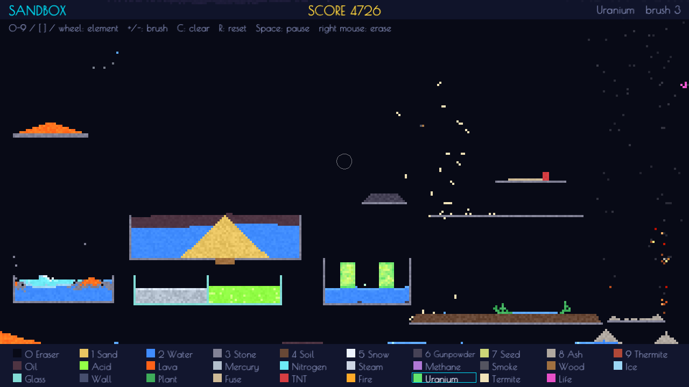
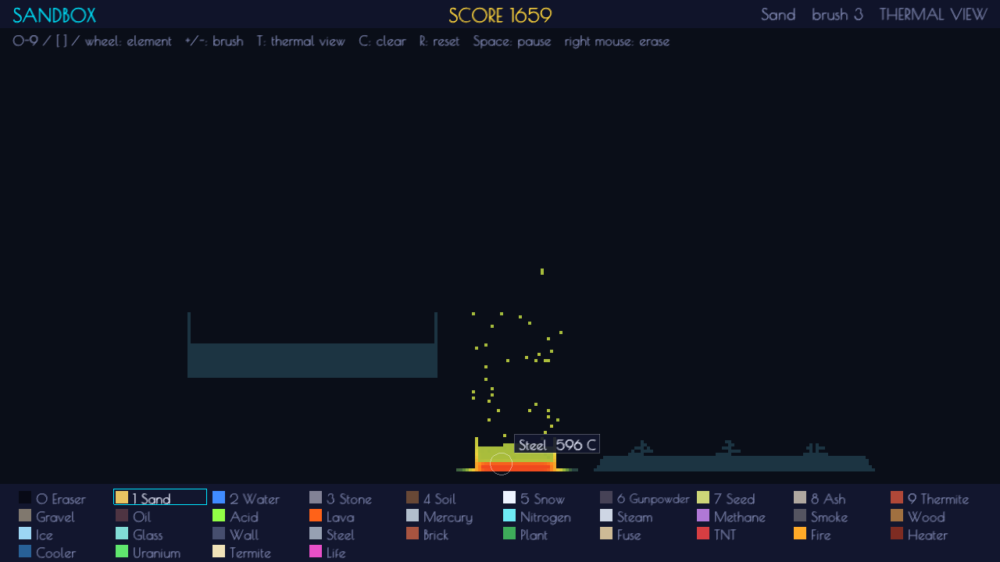
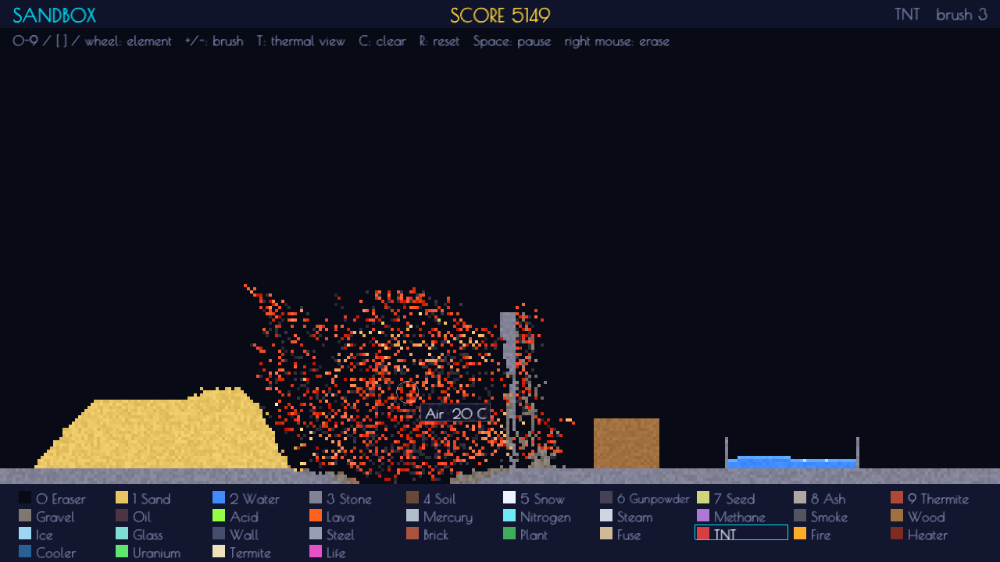
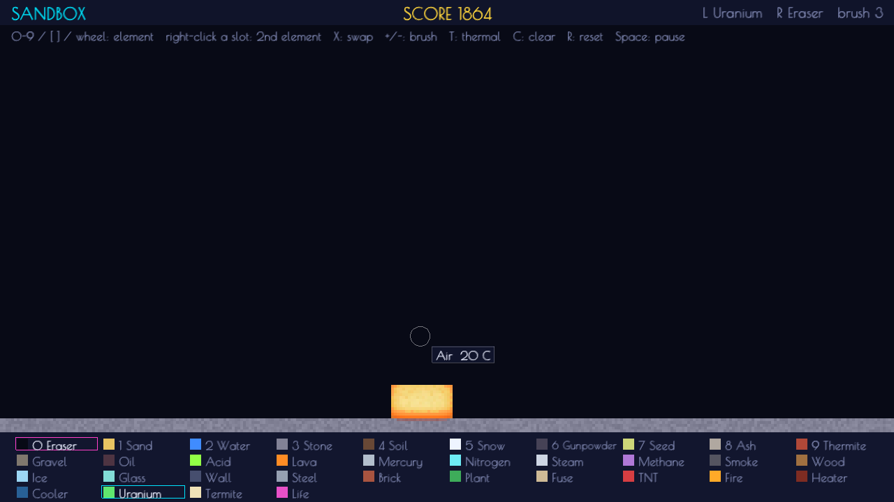
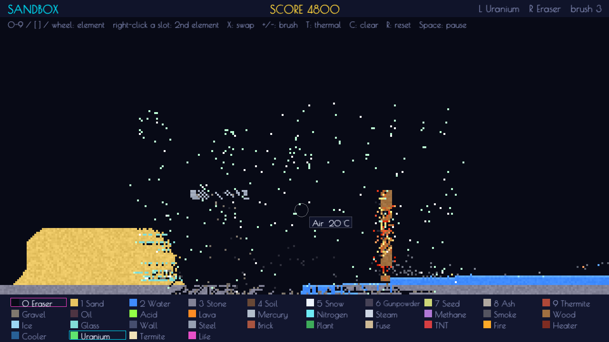
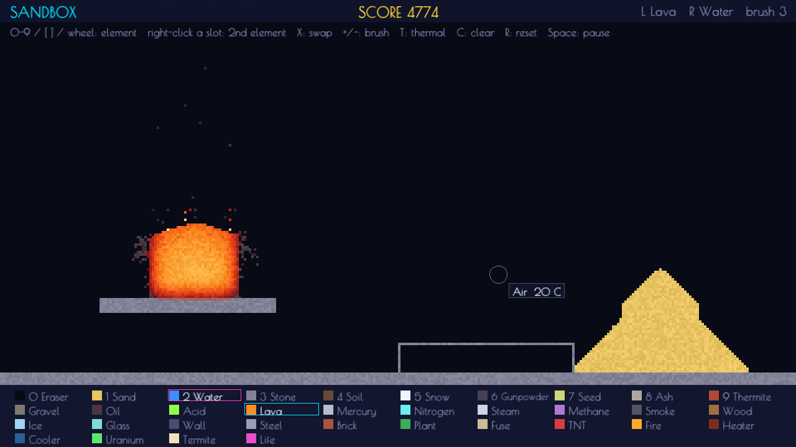
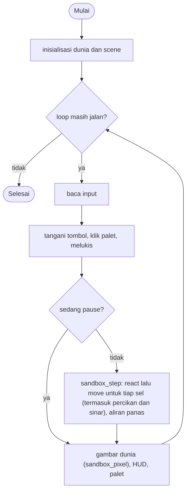
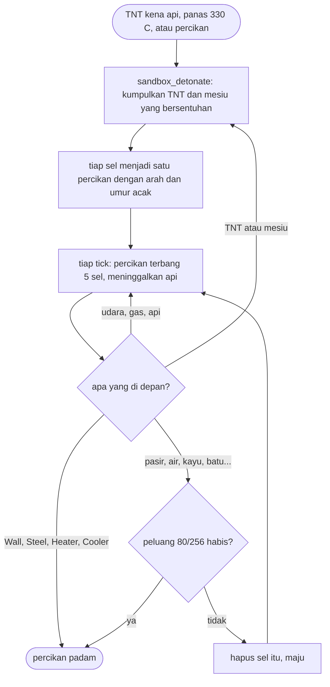
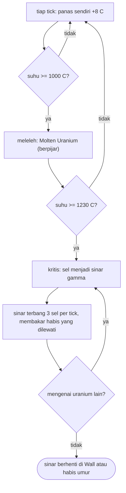

# Sandbox - design brief

**Owner:** Leader  **Folder:** `deferred/sandbox/`  **Status:** v4 sudah jalan: 34 elemen, suhu yang benar-benar dihitung, mouse kanan memegang elemen kedua (awalnya penghapus), ledakan dari percikan yang terbang ke segala arah, uranium yang meleleh lalu kritis, dan lava yang berubah warna menurut suhu lalu membatu

## Hook
Mainan falling-sand (pasir jatuh). Engine yang sama (`core/sandbox*.c`) juga menganimasikan background hub, jadi menambah elemen akan memperbaiki keduanya.

## Penjelasan sederhana
Bayangkan akuarium pasir dua dimensi yang terdiri dari kotak-kotak kecil. Setiap kotak (sel) berisi satu elemen: kosong, pasir, air, api, lava, uranium, dan seterusnya (34 pilihan di palet). Setiap sel juga punya **suhu**: panas mengalir antar sel menurut daya hantar bahannya, jadi baja menghantar dan bata menyekat, air mendidih dan membeku, dan lava berubah warna menurut suhunya lalu membatu. Dunia ini 320 x 155 sel, dan tiap sel digambar sebesar 4 x 4 piksel sehingga memenuhi bagian atas layar (1280 x 620). Palet elemen (4 baris) menempati strip di bawahnya, jadi tidak ada bagian dunia yang tertutup.

Aturannya sederhana dan dijalankan untuk setiap sel, dari baris paling bawah ke atas, satu kali per frame. Pertama kimia: sel boleh berubah (kayu yang cukup panas mulai terbakar, lava yang kena air mengeras jadi batu basalt). Lalu gerak, menurut jenis elemennya. Setelah semua sel diproses, panas mengalir satu langkah:

- **Bubuk** (pasir, tanah, salju, mesiu, biji, abu, thermite, kerikil) jatuh beberapa sel per tick, memercik ke samping kalau jatuh bersama-sama, longsor di lereng, dan tenggelam di cairan yang lebih ringan (atau mengapung di cairan yang lebih berat).
- **Cairan** (air, minyak, asam, lava, raksa, nitrogen) jatuh, lalu mencari tempat terdekat di sampingnya yang punya ruang untuk jatuh lagi. Karena itu genangan cepat menjadi rata dan lalu diam. Cairan berlapis menurut massa jenis.
- **Gas** (uap, metana, asap) naik dan melayang. Uap mengembun, asap memudar.
- **Padat** (batu, kayu, es, kaca, wall, baja, bata, tanaman, sumbu, TNT, pemanas, pendingin) tidak bergerak tetapi bisa bereaksi, menghantar panas, atau digali habis oleh percikan ledakan.
- **Api, uranium, rayap, Life** punya aturan sendiri (lihat tabel elemen). **Percikan** (dari TNT dan mesiu) dan **sinar gamma** (dari uranium yang kritis) adalah partikel yang terbang lurus; semua ledakan dibuat dari keduanya.

Pemain melukis elemen dengan mouse kiri, dan mouse kanan melukis **elemen kedua** yang awalnya Eraser (jadi menghapus). Klik kanan pada kotak palet mengganti elemen kedua, klik kiri mengganti elemen pertama, dan `X` menukar keduanya. Elemen dipilih juga dengan tombol angka, `[` `]`, atau scroll mouse (untuk elemen pertama). Menggerakkan mouse di atas dunia menampilkan label kecil dengan nama dan suhu sel di bawah pointer (misalnya "Steel  412 C"), dan `T` mengganti tampilan ke peta suhu. Tidak ada menang atau kalah.

Kodenya dibagi tiga lapis: `core/src/sandbox*.c` (engine murni: gerak, kimia, suhu `sandbox_heat.c`, ledakan dan radiasi `sandbox_burst.c`, dipakai bersama dengan background hub; penjelasan per file ada di `docs/SANDBOX.md`), `deferred/sandbox/sandbox_logic.c` (input pemain: memilih elemen, klik palet, ukuran kuas, pause, melukis), dan `sandbox_game.c` (menggambar). Perhatikan awalan nama: fungsi game memakai `sbx_`, fungsi engine memakai `sandbox_`, karena nama `sandbox_*` sudah dipakai oleh engine.

**Kalau cuma punya 1 menit:** menambah elemen berarti mengubah `core/include/arcade/sandbox.h` dan `core/src/sandbox_*.c`, bukan folder game ini. Folder ini hanya memetakan tombol dan klik ke elemen.

## Tampilan


Tampilan termal (`T`): panci baja membara di atas Heater, air menghangat dari bawah, kaki bata tetap dingin.



Satu blok TNT di udara terbuka, 12 tick setelah meledak: tiap sel menjadi percikan yang melesat ke segala arah dan meninggalkan jejak api. Pasir terbongkar, tiang bata tergores, peti kayu mulai terbakar.



Gumpalan uranium 22 x 12 sebelum kritis: panas sendiri membuatnya meleleh dan berpijar dari jingga sampai hampir putih.



Gumpalan uranium yang kritis: sinar gamma menyapu dunia, membakar pasir jadi kaca, menguapkan air, dan merobek lantai.



Lava yang baru dituang di atas batu: bagian tengahnya masih jingga terang, tepi yang menyentuh udara sudah merah tua dan mulai menjadi basalt yang gelap, dan nyala sesekali menjilat ke atas.



## Kontrol
- Mouse kiri melukis elemen pertama, mouse kanan melukis **elemen kedua**. Awalnya elemen kedua adalah Eraser, jadi mouse kanan menghapus seperti sebelumnya.
- Klik kiri pada kotak palet di bawah layar memilih elemen pertama (kotak bergaris cyan), klik kanan memilih elemen kedua (kotak bergaris magenta). Menaruh Eraser kembali di slot kedua mengembalikan mouse kanan menjadi penghapus. Baris pertama palet sama dengan tombol `0`-`9` (Eraser, Sand, Water, Stone, Soil, Snow, Gunpowder, Seed, Ash, Thermite). HUD menampilkan `L <elemen pertama>   R <elemen kedua>`.
- Arahkan mouse ke sel mana pun untuk membaca nama dan suhunya (label di dekat pointer).
- `T` mengganti tampilan termal: warna sel menunjukkan suhu (biru dingin, hijau sejuk, kuning dan oranye panas, putih sangat panas), bukan bahannya.
- `[` dan `]` atau scroll mouse berpindah ke elemen pertama sebelumnya/berikutnya (berputar, elemen tersembunyi dilewati). `X` menukar elemen pertama dan kedua.
- `+`/`-` mengubah ukuran kuas, Space menjeda, `C` membersihkan, `R` mengembalikan scene awal (huruf besar atau kecil sama saja).

Catatan dari kode: `C`, `R`, `T`, dan `X` dibaca sebagai huruf kecil maupun besar (`typed == 'c' || typed == 'C'`, dan seterusnya). Space dan Enter sama-sama menjeda (`action_pressed`). Menekan mouse (kiri atau kanan) di palet tidak melukis ke dunia di bawahnya, dan menyeret mouse dari palet ke dunia juga tidak melukis sampai tombol dilepas dan ditekan lagi (`pal_hold` untuk kiri, `pal_hold2` untuk kanan).

## Elemen
Kolom "Ingatan" adalah arti `aux[]` (ingatan per sel).

| Elemen | Jenis | Perilaku | Ingatan |
|--------|-------|----------|---------|
| Eraser | - | menghapus sel di dalam kuas | - |
| Sand | bubuk | jatuh cepat, gundukan. Kena lava, suhu 1100 C, atau sinar gamma berubah jadi Glass | - |
| Water | cair | rata dengan cepat; memadamkan api; mendidih jadi Steam di 100 C dan membeku jadi Ice di 0 C (keduanya butuh kalor laten); air panas naik, air dingin turun; diminum Plant | kalor laten yang sudah terserap (satuan 16) |
| Stone | padat | diam; larut oleh asam; digali habis oleh percikan ledakan; sinar gamma menghancurkannya (sebagian jadi Gravel); meleleh jadi lava di 1300 C | - |
| Soil | bubuk | gundukan lebih curam; biji tumbuh di atasnya | - |
| Snow | bubuk | ringan, ditaburkan jarang-jarang; meleleh jadi air di 0 C | kalor laten |
| Gunpowder | bubuk | seluruh tumpukan yang bersentuhan meledak sekaligus: tiap sel menjadi satu percikan (lebih lemah dari TNT, terbang 15 sampai 44 sel) | - |
| Seed | bubuk | mengapung di air; tumbuh jadi Plant kalau diam di atas Soil | - |
| Ash | bubuk | sisa kayu dan tanaman yang terbakar; mengapung di air | - |
| Thermite | bubuk | menyala di 700 C atau disulut api: jadi lava 2400 C yang melelehkan batu dan tanah di sekitarnya | - |
| Gravel | bubuk | kerikil: pecahan padat yang dihantam sinar gamma; berat, longsor kasar | - |
| Oil | cair | mengapung di air; terbakar sambil terus mengalir | bit 7 = terbakar, bit 0-6 = pewaktu |
| Acid | cair | melarutkan semua padat dan bubuk kecuali Glass, Wall, Lava; ikut habis; encer kena air | - |
| Lava | cair | 1150 C saat baru dituang. **Warnanya mengikuti suhu** (merah tua, merah, jingga, kuning, hampir putih) dan makin kental saat dingin. Di bawah 500 C ia mengeras menjadi Basalt (genangan kecil sekitar 100 tick, kolam 24 x 12 sekitar 700 tick, gumpalan besar membentuk kerak dulu); air atau nitrogen membatukannya seketika (dan air jadi uap); sesekali melempar nyala; mengubah pasir jadi kaca; memanaskan tetangganya sampai menyala sendiri | 0 = lava biasa, >0 = kekuatan melelehkan dari thermite |
| Mercury | cair | cairan terberat; semua bubuk mengapung di atasnya | - |
| Nitrogen | cair | sangat dingin (-196 C): membekukan air, memadamkan api, membatukan lava jadi Basalt; menguap di atas -150 C | - |
| Steam | gas | naik; mengembun jadi air saat suhunya turun di bawah 96 C (di dinding atau es yang dingin) | - |
| Methane | gas | sangat mudah terbakar (menyala sendiri di 480 C): bola api yang merambat, lalu jadi api biasa | - |
| Smoke | gas | memudar sendiri | - |
| Wood | padat | terbakar lama lalu jadi Ash (menyala sendiri di 300 C); dimakan rayap | bit 7 = terbakar, bit 0-6 = pewaktu |
| Ice | padat | -10 C; meleleh jadi air di 0 C (butuh kalor laten) | kalor laten |
| Glass | padat | tahan asam | - |
| Wall | padat | tidak bisa dihancurkan oleh apa pun; menghentikan percikan dan sinar gamma sepenuhnya | - |
| Steel | padat | penghantar panas terbaik (cepat membara dan meneruskan panas); menghentikan percikan ledakan (tetapi tidak sinar gamma); meleleh jadi lava di 1500 C | - |
| Brick | padat | penyekat panas yang baik, tahan asam; percikan ledakan menggores dan mengikisnya; meleleh di 1900 C | - |
| Plant | padat | tumbuh ke atas dan ke samping dengan anggaran tumbuh terbatas; minum air untuk menambah anggaran; terbakar | anggaran tumbuh (bit 0-6); bit 7 = terbakar |
| Fuse | padat | terbakar 1 sel tiap 6 tick dan menyulut TNT, mesiu, dan lainnya di ujungnya | bit 7 = terbakar, bit 0-6 = pewaktu |
| TNT | padat | disulut api atau panas 330 C: seluruh muatan (semua TNT dan mesiu yang bersentuhan) meledak seketika. Tiap sel menjadi satu percikan yang terbang 5 sel per tick ke arah acak sejauh 30 sampai 99 sel, meninggalkan api, menggali pasir dan air, membakar kayu, dan menyulut TNT lain; Wall dan Steel menghentikannya. | - |
| Fire | api | 800 C (sumber panas tetap); naik dan berkedip, mati sendiri, menempel pada bahan yang akan dibakarnya, padam kena air | umur |
| Heater | padat | sumber panas tetap 700 C yang tidak pernah habis; menghantar panas ke tetangganya; tahan asam | - |
| Cooler | padat | sumber dingin tetap -80 C; membekukan air di dekatnya; tahan asam | - |
| Uranium | padat | memanaskan dirinya 8 C per tick. Satu sel dan gumpalan kecil melepas panas secepat membuatnya; gumpalan besar terisolasi dan makin panas. Di 1000 C ia **meleleh** (Molten Uranium), dan di 1230 C sel menjadi **kritis** dan terbang sebagai sinar gamma; sinar yang mengenai uranium lain membuatnya kritis juga (reaksi berantai). Gumpalan 3 x 3 stabil, 4 x 4 meleleh tapi tidak meledak, 5 x 5 atau lebih meledak sendiri (5 x 5 setelah sekitar 13 detik, 10 x 10 setelah sekitar 3 detik). Air dan nitrogen mendinginkannya | - |
| Termite | merayap | berjalan di permukaan, makan Wood/Plant/Fuse dan sesekali berkembang biak; mati kalau kelaparan atau tenggelam | rasa lapar |
| Life | padat | Conway's Game of Life, satu generasi tiap 6 tick | - |
| Gamma (tersembunyi) | sinar | terbang lurus 3 sel per tick selama 40 sampai 63 tick; hanya berhenti di Wall atau tepi dunia. Membakar habis apa pun yang dilewatinya: air jadi uap, pasir jadi kaca, bahan mudah terbakar jadi api, padat jadi kerikil atau hilang; TNT meledak, uranium menjadi kritis. Sinar generasi pertama sesekali menghamburkan sinar anak | arah di `moved` bit 3-6; `aux` = generasi (bit 6-7) + sisa tick (bit 0-5) |
| Molten Uranium (tersembunyi) | cair | uranium cair yang kental dan terus memanas (berpijar jingga lalu memutih); membeku lagi di bawah 800 C, atau seketika kena air (dan air jadi uap); kritis di 1230 C seperti uranium padat | - |
| Spark (tersembunyi) | partikel | percikan ledakan: terbang 5 sel per tick dalam salah satu dari 16 arah, meninggalkan api di setiap sel yang dilewati, melubangi apa pun kecuali Wall, Steel, Heater, Cooler; tiap sel yang ditembus menghabiskan percikan dengan peluang 80/256 | sisa langkah; arah di `moved` bit 3-6 |
| Basalt (tersembunyi) | padat | batu gelap hasil lava yang mengeras; melebur lagi jadi lava di 1100 C | - |

## Aturan dan skor
Tidak ada menang atau kalah. "Skor" di HUD adalah jumlah sel yang terisi.

Rumusnya (`sbx_score`): `lebar * tinggi - jumlah sel kosong`. Game ini tidak punya akhir, jadi keluar dengan Esc mengakhiri run: skor saat itu dicatat ke leaderboard seperti game lain (`finished = true`) dan dikirim ke leaderboard online. Tapi hanya run yang benar-benar dimainkan yang dicatat: `play()` mengembalikan `finished = sbx_painted(&s)`, jadi kalau pemain keluar tanpa melukis atau menghapus apa pun, tidak ada yang dicatat (`finished = false`). Itu perlu karena adegan awal sudah punya skor (sekitar 1600 sel, dan tanamannya tumbuh sendiri), jadi mengintip sandbox lalu keluar tanpa itu akan menaruh adegan yang belum disentuh di papan. Skor tertinggi yang mungkin adalah `SBX_W * SBX_H` = 49600 (layar penuh).

## Cara kerja per frame
1. `arcade_poll(&in)` mengisi `ArcadeInput`. Yang dipakai game ini: `typed` (huruf atau angka yang diketik), `wheel` (scroll mouse), `action_pressed` (Space/Enter), `fire`, `fire_pressed`, `alt` dan `alt_pressed` (mouse kiri dan kanan), serta posisi mouse `aim_x`, `aim_y`.
2. `sbx_step(&s, &in, ARC_DT)` (`dt` diabaikan):
   1. `handle_keys`: angka `0`-`9` memilih slot palet 0-9; `[` dan `]` serta scroll mouse menggeser pilihan (berputar); `c` mengosongkan dunia; `r` membangun ulang scene awal; `x` menukar `element` dan `element2`; `t` membalik `world.heat_view` (tampilan termal); `+`/`=` dan `-` mengubah ukuran kuas (dijepit 0 sampai 12); Space atau Enter membalik `paused`.
   2. Kalau mouse kiri baru ditekan di atas palet, slot di bawahnya menjadi elemen pertama (`sbx_select`) dan `pal_hold` menyala sampai tombol dilepas. Mouse kanan yang baru ditekan di atas palet menjadi elemen kedua (`sbx_select2`) dengan `pal_hold2` yang sama gunanya.
   3. Posisi mouse diubah menjadi sel: `aim / SBX_CELL`. Selama pointer tidak di atas panel palet: mouse kiri (kalau `pal_hold` mati) memanggil `sandbox_paint` dengan `element`, mouse kanan (kalau `pal_hold2` mati) memanggil `sandbox_paint` dengan `element2` (awalnya `EL_EMPTY`, yaitu penghapus). Setiap panggilan itu menyalakan `painted`. Melukis tetap bisa dilakukan saat pause.
   4. Kalau tidak sedang pause, `sandbox_step(&s->world)` menjalankan satu tick dunia dan `ticks++`.
3. Di dalam `sandbox_step` (engine): `moved[]` digeser (bit "bergerak di tick ini" menjadi "bergerak di tick lalu", bit arah terbang dipertahankan), dan `tick++`. Lalu setiap baris dari **bawah ke atas**, arah penyisiran bergantian, tiap sel yang belum bertindak menjalankan `sandbox_react` (kimia dan suhu) dan, kalau tidak berubah, `sandbox_move` (gerak; partikel terbang seperti percikan dan sinar gamma dilayani `sandbox_fly` di `sandbox_burst.c`). Setelah itu `sandbox_heat_step` mengalirkan panas antar sel. Setiap 6 tick `sandbox_life_step` memajukan satu generasi Game of Life.
4. Front-end menggambar dunia lewat `gfx_sandbox_view_draw` (tekstur 320 x 155, warna tiap sel dari `sandbox_pixel`, diperbesar menjadi 1280 x 620; `sandbox_pixel` juga menggambar bara pijar dan tampilan termal), lalu lingkaran kuas, HUD ("SANDBOX", skor, nama elemen, ukuran kuas, "THERMAL VIEW", "PAUSED"), baris bantuan, label nama dan suhu di dekat pointer (`sbx_probe`), dan palet di bawah layar. Semua itu digambar oleh satu fungsi, `draw_frame`.
5. Game ini tidak pernah selesai sendiri (`sbx_is_over` selalu `false`); loop berhenti ketika `arcade_loop_running()` mengembalikan `false`, yaitu saat pemain keluar ke hub.

## Peta file
| File | Isinya | Edit di sini kalau ... |
|------|--------|------------------------|
| `core/include/arcade/sandbox.h` | `ElementId`, `MoveKind`, `ElementDef`, struct `Sandbox`, batas `SANDBOX_MAX_W/H`, API engine | menambah elemen atau jenis gerak baru |
| `core/src/sandbox_elements.c` | Tabel `k_elements`, fungsi palet | menambah baris elemen atau mengubah angka perilaku |
| `core/src/sandbox_move.c` | Gerak bubuk, cairan, gas, api, partikel terbang, rayap; kekentalan lava menurut suhu | mengubah cara sel bergerak |
| `core/src/sandbox_react.c` | Kimia dan reaksi: api, lava, asam, tanaman, TNT, uranium (memanaskan diri, meleleh, kritis), rayap, Life, konveksi cairan | menambah atau mengubah reaksi |
| `core/src/sandbox_heat.c` | Tabel `k_thermal[]` (daya hantar, kapasitas, suhu nyala, perubahan wujud), aliran panas, kalor laten, API suhu | mengubah seberapa cepat sesuatu panas, dingin, mendidih, meleleh, atau menyala |
| `core/src/sandbox_burst.c` | `sandbox_detonate` (muatan menjadi percikan), `sandbox_burst`, terbang dan tabrakan percikan, sinar gamma dan reaksi berantai uranium | mengubah bentuk, jarak, dan kekuatan ledakan atau radiasi |
| `core/src/sandbox_color.c` | `sandbox_pixel`: warna satu sel, bara pijar, warna lava menurut suhu, tampilan termal | mengubah tampilan (cahaya, kedip, peta suhu) |
| `core/src/sandbox.c`, `sandbox_internal.h` | Dasar grid, kuas, loop `sandbox_step`, helper privat | jarang |
| `deferred/sandbox/sandbox_logic.h` | `sbx_State`, `SBX_W/H/CELL`, geometri palet `SBX_PAL_*`, fungsi publik `sbx_*` | menambah field state game atau mengubah tata letak palet |
| `deferred/sandbox/sandbox_logic.c` | `handle_keys`, `build_scene` (termasuk panci di atas Heater), `sbx_step`, `sbx_probe`, klik palet kiri dan kanan, skor, batas kuas | menambah tombol atau alat baru |
| `deferred/sandbox/sandbox_game.c` | Loop raylib, `draw_frame`, `draw_palette`, label suhu, HUD, `game_sandbox_def` | mengubah tampilan palet, label suhu, atau teks di menu |
| `deferred/sandbox/tests/test_sandbox.c` | 19 unit test untuk lapisan game | menambah tombol atau alat |
| `tests/test_sandbox.c` (di root repo) | 90 unit test untuk engine (`core.sandbox`) | menambah elemen atau aturan |
| `core/gfx/gfx_draw.c` | `gfx_sandbox_view_draw`: memindahkan `sandbox_pixel` ke tekstur | jarang |
| `app/backdrop.c` | Animasi pasir dan air di belakang menu hub (memakai engine yang sama) | mengubah background hub |
| `docs/SANDBOX.md` | Panduan menambah elemen dan penjelasan engine | menambah langkah atau ide baru |
| `CMakeLists.txt`, `GAME.md` | Pendaftaran build dan dokumen ini | file baru atau aturan berubah |
| `AGENTS.md` | Instruksi untuk AI agent (tidak diterjemahkan) | jarang; ikuti aturan di file itu |

## Data penting (struct)
`ElementId` (enum): `EL_EMPTY` (0, juga dipakai sebagai penghapus), 33 elemen lain menurut urutan palet, empat elemen tersembunyi (`EL_GAMMA`, `EL_MOLTEN_URANIUM`, `EL_SPARK`, `EL_BASALT`), dan `EL_COUNT` (jumlah elemen, bukan elemen sungguhan). `MoveKind` (enum): `MOVE_NONE` (diam), `MOVE_POWDER`, `MOVE_LIQUID`, `MOVE_GAS`, `MOVE_FIRE`, `MOVE_RAY`, `MOVE_CRAWL`.

`ElementDef`: satu baris di tabel `k_elements`.

| Field | Tipe | Artinya |
|-------|------|---------|
| `name` | `const char *` | nama yang tampil di palet |
| `r`, `g`, `b` | `uint8_t` | warna dasar (`sandbox_pixel` menambah bayangan dan cahaya) |
| `density` | `int` | massa jenis; yang lebih berat menembus cairan yang lebih ringan |
| `kind` | `MoveKind` | cara bergerak |
| `flags` | `uint8_t` | `EF_HIDDEN` (tidak di palet), `EF_ACIDPROOF` (kebal asam), `EF_HOT` (sumber panas) |
| `speed` | `uint8_t` | bubuk/cairan: sel jatuh per tick; gas dan api: peluang naik (per 256) |
| `spread` | `uint8_t` | cairan: seberapa jauh mencari tempat jatuh di samping |
| `slip` | `uint8_t` | cairan: peluang bergerak tiap tick (rendah = kental, seperti lava) |
| `grip` | `uint8_t` | bubuk: 0 longsor di tepi mana pun, makin besar makin curam |
| `ignite` | `uint8_t` | peluang (per 256) terbakar per tick dekat sumber panas; 0 = tidak terbakar |
| `shade` | `uint8_t` | besar bayangan acak per sel |
| `spray` | `uint8_t` | kepadatan kuas (per 256): salju dan gas ditaburkan jarang-jarang |

`Sandbox` (engine, `core`):

| Field | Tipe | Artinya |
|-------|------|---------|
| `w`, `h` | `int` | ukuran dunia dalam sel (dijepit ke `SANDBOX_MAX_W` x `SANDBOX_MAX_H` = 320 x 180) |
| `cells[320*180]` | `uint8_t` | isi tiap sel (nilai `ElementId`) |
| `aux[320*180]` | `uint8_t` | ingatan per sel; artinya berbeda untuk tiap elemen (lihat tabel elemen) |
| `moved[320*180]` | `uint8_t` | scratch: bit 0 sudah bertindak di tick ini, bit 1 bergerak di tick lalu, bit 3-6 arah terbang percikan dan sinar gamma (satu dari 16), bit 7 tanda sementara untuk flood fill muatan |
| `temp[320*180]` | `int16_t` | suhu tiap sel dalam derajat Celsius (-273 sampai 9000, udara 20) |
| `heat_flow[320*180]` | `int16_t` | scratch untuk aliran panas |
| `heat_rows[180]` | `uint8_t` | baris yang masih perlu dihitung panasnya (baris tenang dilewati) |
| `heat_view` | `bool` | tampilan termal menyala (dibaca `sandbox_pixel`) |
| `tick` | `unsigned` | nomor tick |
| `rng` | `Rng` | pengacak deterministik |

`sbx_State` (game):

| Field | Tipe | Artinya |
|-------|------|---------|
| `world` | `Sandbox` | dunia pasir (± 400 KB, makanya `static`, bukan di stack) |
| `element` | `ElementId` | elemen yang dilukis mouse kiri (tidak pernah elemen tersembunyi) |
| `element2` | `ElementId` | elemen yang dilukis mouse kanan; awalnya `EL_EMPTY` (penghapus) dan bisa diganti dengan klik kanan di palet atau `X` |
| `brush` | `int` | radius kuas dalam sel (0 sampai 12, awal 3) |
| `paused` | `bool` | `true` kalau simulasi dijeda |
| `pal_hold` | `bool` | tekanan mouse kiri dimulai di palet, jangan melukis sampai dilepas |
| `pal_hold2` | `bool` | hal yang sama untuk mouse kanan |
| `painted` | `bool` | pemain sudah melukis atau menghapus sesuatu di dunia sejak sandbox dibuka; hanya run seperti itu yang dicatat |
| `ticks` | `unsigned` | jumlah tick simulasi yang sudah berjalan |

`ThermalDef` (satu baris di `k_thermal[]`, `sandbox_heat.c`): suhu awal (`temp0`), daya hantar (`cond`), kapasitas panas (`cap`), kehilangan ke udara (`loss`), suhu menyala sendiri (`autoignite`), batas dingin dan panas beserta elemen hasilnya (`cold_t`/`cold_to`, `hot_t`/`hot_to`), `rate`, `fixed` (suhu tetap), dan kalor laten pendidihan/pembekuan (`latent_hot`/`latent_cold`).

## Fungsi-fungsi penting
| Fungsi | Tugas | Dipanggil dari |
|--------|-------|----------------|
| `sbx_init(s, seed)` | Membuat dunia 320 x 160, memilih pasir, kuas 3, lalu `build_scene` | `play()`, test |
| `sbx_step(s, in, dt)` | Satu langkah: tombol, klik palet, melukis, simulasi | `play()` tiap frame, test |
| `sbx_is_over(s)` / `sbx_score(s)` | Selalu `false` dan jumlah sel terisi | `play()` |
| `sbx_painted(s)` | Apakah pemain sudah melukis sesuatu (menentukan `finished` saat keluar) | `play()`, test |
| `sbx_over_panel(px, py)` / `sbx_palette_slot_at(px, py)` / `sbx_select(s, i)` | Pointer di atas panel, slot palet di bawah pointer, memilih slot pertama (`sbx_select`) atau kedua (`sbx_select2`) | `sbx_step`, `draw_palette`, test |
| `sbx_probe(s, px, py, &id, &temp)` | Elemen dan suhu sel di bawah pointer; `false` kalau pointer di palet atau di luar dunia | `play()` (label suhu), test |
| `build_scene(s)` (static) | Mengosongkan dunia lalu menaruh mangkuk batu berisi air, panci baja di atas Heater dengan kaki bata, rak tanah, dan tiga biji | `sbx_init`, tombol `r` |
| `handle_keys(s, in)` (static) | Memilih elemen, menukar elemen (`X`), clear, reset, kuas, scroll, pause | `sbx_step` |
| `sandbox_step(sb)` | Satu tick: kimia, gerak (termasuk partikel terbang), panas, Life | `sbx_step`, `app/backdrop.c`, test |
| `sandbox_temp(sb, x, y)` / `sandbox_set_temp` / `sandbox_add_heat` | Baca suhu sel (di luar grid: 20), atur suhu (dijepit), tambah panas | engine, `sbx_probe`, test |
| `sandbox_burst(sb, x, y, sparks)` | Melempar sejumlah percikan dari satu titik ke arah acak (dasar semua ledakan; dipakai alat bantu dan test) | test, `sandbox_detonate` memakai mekanisme yang sama |
| `sandbox_detonate(sb, x, y)` (internal) | Mengumpulkan semua TNT dan Gunpowder yang bersentuhan dengan sel itu (flood fill) dan mengubah tiap selnya menjadi percikan | `sandbox_react.c` (TNT, mesiu), `sandbox_burst.c` (percikan atau sinar yang menabrak muatan) |
| `sandbox_go_critical(sb, x, y)` (internal) | Uranium yang kritis menjadi sinar gamma | `react_uranium`, sinar gamma yang mengenai uranium |
| `sandbox_paint(sb, cx, cy, radius, id)` | Kuas bulat. `EL_EMPTY` menghapus semuanya; elemen lain hanya mengisi sel kosong (dengan kepadatan `spray`) | `sbx_step`, `app/backdrop.c`, test |
| `sandbox_get` / `sandbox_set` | Baca atau tulis sel. Di luar grid, `get` mengembalikan `EL_STONE` dan `set` diabaikan; `set` mengosongkan `aux` | seluruh engine, test |
| `sandbox_count(sb, id)` | Menghitung sel dengan elemen tertentu | `sbx_score`, test |
| `sandbox_pixel(sb, x, y)` | Warna sel (0xRRGGBB) termasuk bayangan, cahaya, bara pijar, dan tampilan termal | `gfx_sandbox_view_draw`, test |
| `sandbox_palette_count/id/index` | Palet yang terlihat (elemen tersembunyi dilewati) | `sbx_*`, `draw_palette`, test |
| `sandbox_element(id)` | Mengambil baris tabel elemen (ID tidak valid menghasilkan baris `EL_EMPTY`) | engine, front-end |

## Angka yang bisa diutak-atik
| Konstanta | Nilai sekarang | File | Efek kalau diubah |
|-----------|----------------|------|-------------------|
| `SANDBOX_MAX_W` / `SANDBOX_MAX_H` | `320` / `180` | `sandbox.h` | ukuran maksimal dunia (dan ukuran array `cells`/`aux`/`moved`/`temp`) |
| `SANDBOX_AMBIENT` / `SANDBOX_TEMP_MIN` / `SANDBOX_TEMP_MAX` | `20` / `-273` / `9000` | `sandbox.h` | suhu udara dan batas suhu sel |
| `SBX_W` / `SBX_H` | `320` / `155` | `sandbox_logic.h` | ukuran dunia game (engine mendukung sampai 320 x 180) |
| `SBX_CELL` | `4` px | `sandbox_logic.h` | ukuran tiap sel di layar; 320 x 4 = 1280 dan 155 x 4 = 620 (palet mulai di y = 620, lihat `SBX_PAL_Y`) |
| `SBX_PAL_COLS` / `SBX_PAL_ROWS` | `10` / `4` | `sandbox_logic.h` | jumlah slot palet (40); baris pertama = tombol `0`-`9` |
| `BRUSH_MIN` / `BRUSH_MAX` | `0` / `12` | `sandbox_logic.c` | batas radius kuas (awal `3`) |
| bentuk kuas (angka langsung di `sandbox_paint`) | sel dilukis kalau `dx^2 + dy^2 <= r^2 + r` | `sandbox.c` | bentuk "bulat" kuas |
| tabel `k_elements` | lihat komentar di atas tabel | `sandbox_elements.c` | warna, massa jenis, kecepatan, kekentalan, mudah terbakar |
| `LIQUID_RUN`, `BAR_CAP` | `4`, `64` | `sandbox_move.c` | kecepatan sebar cairan per tick, panjang undakan yang diperiksa |
| `FUSE_DELAY`, `THERMITE_POWER` | `6`, `110` | `sandbox_react.c` | kecepatan sumbu, daya thermite |
| `URANIUM_HEAT`, `URANIUM_CRIT` | `8`, `1230` | `sandbox_react.c` | panas sendiri uranium per tick; suhu kritis (suhu meleleh 1000 C ada di `k_thermal`) |
| `LAVA_FLAME` | `6` | `sandbox_react.c` | peluang (per 256) lava panas melempar nyala per tick |
| `SPARK_STEPS`, `SPARK_LIFE_MIN/SPAN`, `POWDER_LIFE_MIN/SPAN` | `5`, `30`/`70`, `15`/`30` | `sandbox_burst.c` | kecepatan percikan (sel per tick) dan jarak terbangnya (TNT dan mesiu) |
| `SPARK_FORK`, `SPARK_DIE` | `6`, `80` | `sandbox_burst.c` | peluang (per 256) percikan beranak per langkah, dan padam per sel yang ditembus atau percikan yang ditabrak |
| `GAMMA_STEPS`, `GAMMA_LIFE_MIN/SPAN`, `GAMMA_SCATTER` | `3`, `40`/`24`, `16` | `sandbox_burst.c` | kecepatan sinar gamma (sel per tick), umurnya (tick), dan peluang (per 256) sinar generasi pertama menghamburkan sinar anak |
| `THERMAL_PASSES` | `2` | `sandbox_heat.c` | berapa kali panas dialirkan per tick (kecepatan rambat panas) |
| tabel `k_thermal` | lihat komentar di atas tabel | `sandbox_heat.c` | daya hantar, kapasitas, suhu menyala, titik didih dan leleh (termasuk lava 500 C ke Basalt dan uranium 1000 C ke Molten Uranium) |
| `LIFE_PERIOD` | `6` tick | `sandbox_internal.h` | kecepatan Game of Life |
| scene awal (`build_scene`) | mangkuk batu di x 60-139 / y 100-120 berisi air, panci baja di x 152-177 di atas Heater (kaki bata, lantai batu x 146-184 / y 150), rak batu y 150 / x 190-279 dengan tanah dan 3 biji | `sandbox_logic.c` | tampilan awal dan tombol `r` |

## Cara menjalankan dan menguji
```bash
# test logic saja (tanpa raylib, ~7 detik): game dan engine
cmake --preset logic && cmake --build --preset logic && ctest --preset logic -R "sandbox"

# main game-nya
cmake --preset dev && cmake --build --preset dev && build/dev/bin/arCade

# smoke run headless: jalankan game 300 frame dan simpan screenshot PNG
cmake --preset headless && cmake --build --preset headless && build/headless/bin/arCade --smoke sandbox --frames 300 --out smoke-out
```

Lapisan game (`deferred/sandbox/tests/test_sandbox.c`, nama test CTest `sandbox.test_sandbox`):

| Test | Menjaga aturan apa |
|------|--------------------|
| `test_init_and_idle_stepping` | Game tidak pernah selesai; 10 tick tanpa input menambah `ticks` 10 dan tidak membuat sel baru |
| `test_select_element_and_paint` | Menekan `2` memilih air; mouse kiri melukis air |
| `test_clear_pause_and_brush` | Space menjeda dunia (`ticks` berhenti), `+` menaikkan kuas jadi 4, `c` mengosongkan dunia |
| `test_monkey_is_safe` | 3000 langkah input acak: kuas selalu 0-12 dan kedua elemen terpilih selalu elemen yang terlihat di palet atau penghapus |
| `test_palette_geometry` | Setiap elemen punya slot; titik tengah slot mengenai slot itu sendiri; slot kosong dan dunia mengembalikan -1; panel mulai tepat di tempat dunia berakhir |
| `test_click_on_palette_selects_without_painting` | Klik palet memilih elemen tanpa melukis; menyeret ke dunia tidak melukis sampai tombol dilepas |
| `test_a_run_counts_only_once_the_player_painted` | Waktu berlalu, `C`, `R`, klik palet, dan menyeret klik palet ke dunia tidak menyalakan `painted`; klik baru di dunia menyalakannya dan tetap menyala setelah `C`; mouse kanan (penghapus) juga menghitung |
| `test_cannot_paint_through_the_panel` | Mouse di atas panel tidak melukis atau menghapus; klik slot kosong (slot pertama setelah elemen terakhir) tidak mengubah pilihan |
| `test_right_mouse_erases_by_default` | Elemen kedua awalnya `EL_EMPTY`: mouse kanan menghapus |
| `test_right_click_on_a_slot_sets_the_second_element` | Klik kanan pada slot palet memilih elemen kedua tanpa mengubah elemen pertama dan tanpa melukis; menyeret ke dunia tidak melukis sampai tombol dilepas |
| `test_left_and_right_buttons_paint_their_own_element` | Mouse kiri melukis `element`, mouse kanan melukis `element2`; indeks di luar jangkauan diabaikan |
| `test_x_swaps_the_two_elements` | `x` dan `X` menukar elemen pertama dan kedua |
| `test_number_keys_pick_the_first_row` | `0`-`9` memilih slot 0-9; `0`-`3` tetap Eraser, Sand, Water, Stone |
| `test_bracket_keys_and_wheel_cycle_and_wrap` | `[` `]` dan scroll berputar di kedua arah dan tidak pernah memilih elemen tersembunyi |
| `test_starter_scene_and_reset` | Scene awal berisi air, tanah, 3 biji yang tumbuh sendiri; `c` mengosongkan, `r` mengembalikan |
| `test_hover_probe_reports_element_and_temperature` | `sbx_probe` memberi elemen dan suhu sel di bawah pointer, udara kosong 20 C, dan `false` di palet atau di luar jendela |
| `test_thermal_view_key_toggles` | `t` dan `T` membalik tampilan termal; `C` tidak mengubahnya |
| `test_the_starter_kettle_heats_and_boils` | Panci di scene awal: air menghangat lewat baja, pelat baja jauh lebih panas, lalu air mendidih (uap muncul) tanpa membakar ruangan |
| `test_painting_every_element_is_safe` | Melukis tiap elemen dari palet lalu menjalankan 600 tick tidak merusak apa pun |

Engine (`tests/test_sandbox.c`, nama test CTest `core.sandbox`, 90 test). Kelompoknya:

| Kelompok | Menjaga aturan apa |
|----------|--------------------|
| Dasar grid (`test_grid_and_bounds`, `test_paint_and_erase`, `test_count_in_rectangle`, `test_set_clears_cell_memory`, `test_clear_resets_everything`) | Ukuran dijepit; di luar grid dianggap batu; kuas tidak menimpa; `aux` dikosongkan |
| Palet dan warna (`test_palette`, `test_colours_are_distinct_and_stable`, `test_every_element_has_a_row`, `test_brush_spray_and_hidden_cells`) | Palet dan indeksnya konsisten, tiap elemen terlihat di latar dan warnanya stabil, elemen tersembunyi tidak ada di palet |
| Gerak bubuk (`test_sand_falls_*`, `test_a_big_dump_*`, `test_a_trickle_*`, `test_stone_is_static_and_blocks`) | Jatuh beberapa sel per tick, gumpalan memercik jadi landai, aliran tipis jadi kerucut curam |
| Gerak cairan (`test_water_*`, `test_a_settled_pool_stays_still`, `test_liquids_layer_by_density`, `test_light_powder_floats_on_water`, `test_heavy_things_sink_*`) | Air rata dalam 60 tick, genangan diam, tidak ada air yang hilang, lapisan menurut massa jenis |
| Gas (`test_gas_rises_*`, `test_steam_condenses_*`, `test_smoke_fades`) | Gas naik dan tidak bocor, uap mengembun, asap memudar |
| Api dan peledak (`test_fire_*`, `test_water_puts_out_fire`, `test_oil_burns_*`, `test_gunpowder_*`, `test_fuse_*`, `test_tnt_*`, `test_one_tnt_cell_*`, `test_methane_burns`) | Api membakar kayu jadi abu dan padam, sumbu pelan, mesiu dan TNT meledak sekaligus menjadi percikan, TNT berantai, Wall selamat, satu sel TNT pun membuat lubang, metana hanya terbakar |
| Zat panas dan dingin (`test_lava_*`, `test_hot_sand_*`, `test_basalt_*`, `test_thermite_*`, `test_acid_*`, `test_nitrogen_*`, `test_heat_melts_*`) | Lava + air jadi Basalt, lava + pasir jadi kaca, warna lava mengikuti suhu, lava mendingin melewati warna-warna itu lalu membatu dan basalt bisa melebur lagi, lava makin kental saat dingin dan melempar nyala, thermite, asam (kaca dan Wall kebal), nitrogen, es meleleh |
| Suhu (`test_every_cell_starts_at_room_temperature`, `test_heat_sources_*`, `test_new_hot_and_cold_cells_*`, `test_heat_flows_along_a_conductor_*`, `test_conduction_never_overshoots`, `test_hot_things_cool_down_in_air`) | Semua sel mulai 20 C, suhu dijepit, Heater/Cooler/Fire/lava punya suhu sendiri, baja menghantar panas jauh sementara bata tidak, panas hanya mengalir dari panas ke dingin, benda panas mendingin di udara |
| Perubahan wujud (`test_steel_pot_boils_*`, `test_a_pot_of_water_warms_up_*`, `test_water_freezes_and_ice_melts_*`, `test_wood_catches_fire_at_*`, `test_every_element_survives_extreme_temperatures`) | Panci baja mendidihkan air sedangkan panci bata hampir tidak; air menghangat dulu sebelum mendidih; membeku dan meleleh; kayu menyala sendiri di suhu nyalanya; tiap elemen tahan suhu ekstrem |
| Ledakan (`test_sparks_*`, `test_a_charge_*`, `test_a_separate_charge_*`, `test_a_lone_spark_*`, `test_explosion_under_water_*`, `test_burst_*`) | Percikan terbang ke semua arah (5 sel per tick), menggali kawah di pasir, tidak menembus Wall dan Steel; satu muatan meledak sekaligus (TNT dan mesiu yang bersentuhan), muatan terpisah hanya disulut percikan; ledakan di bawah air melubangi air dan menguapkan sebagian; `sandbox_burst` tahan argumen aneh |
| Makhluk hidup (`test_seed_*`, `test_plants_*`, `test_termites_*`, `test_life_*`) | Biji hanya tumbuh di tanah, tanaman minum air dan terbakar, rayap makan dan kelaparan, blinker dan glider |
| Uranium (`test_uranium_*`, `test_gamma_*`, `test_big_uranium_*`, `test_small_uranium_*`, `test_one_critical_cell_*`, `test_a_lump_too_small_*`, `test_water_keeps_*`, `test_a_bigger_lump_*`, `test_molten_*`) | Sinar gamma berhenti di Wall dan membakar habis yang dilewatinya; uranium memanaskan dirinya sebanding dengan ukuran gumpalan; gumpalan 3 x 3 stabil; gumpalan besar meleleh dulu, baru beberapa saat kemudian kritis dan merusak seluruh dunia; satu sel kritis membawa seluruh gumpalan; gumpalan yang hanya cukup panas untuk meleleh tidak meledak; air menjaga gumpalan kecil tetap dingin tetapi tidak gumpalan besar; gumpalan lebih besar membuang lebih banyak pasir; uranium cair membeku kena air |
| Keseluruhan (`test_mass_is_conserved_*`, `test_deterministic*`, `test_chaos_never_breaks_the_grid`) | Massa elemen inert tetap, seed yang sama menghasilkan dunia yang sama, input kacau tidak merusak grid |

## Jebakan dan hal yang perlu diingat
- **Tombol angka hanya `0`-`9`** (slot palet 0-9, baris pertama) dan hanya memilih elemen pertama. Elemen lain dipilih dengan klik, `[` `]`, atau scroll; elemen kedua dipilih dengan klik kanan pada palet atau ditukar dengan `X`. Teks kontrol di kartu menu (`GameDef.controls` di `sandbox_game.c`) menyebut ini.
- **Palet punya 40 slot** (4 x 10); sekarang terisi 34. Elemen ke-41 yang terlihat butuh baris baru atau tata letak lain (ubah `SBX_PAL_ROWS`/`SBX_PAL_COLS`; `SBX_PAL_Y` bergantung pada `SBX_H`, jadi panel yang lebih tinggi berarti `SBX_H` harus dikurangi supaya dunia dan panel tidak bertumpuk: 155 x 4 + 6 + 4 x 23 = 718 dari 720 piksel).
- **`aux` artinya beda untuk tiap elemen.** Selalu tulis arti `aux` elemen baru di komentar bagian atas `sandbox_react.c`. `sandbox_set` dan `sandbox_put` mengosongkannya; `sandbox_swap` memindahkannya bersama sel.
- **`moved[]` mencegah satu sel bertindak dua kali dalam satu tick**, dan sel yang baru diubah (`sandbox_put`) menunggu tick berikutnya. Sumber panas yang baru dibuat atau baru bergerak di tick ini belum menyulut tetangga (`hot_near`), supaya api merambat satu langkah per tick, bukan satu baris penuh.
- **`sandbox_step` berjalan untuk semua sel dunia di setiap frame** (49.600 di game ini, sampai 57.600 di background hub). Adegan biasa sekitar 1-2 ms per tick (baris yang hanya berisi udara dilewati oleh perhitungan panas); adegan penuh elemen campuran sekitar 5 ms. Jaga tetap cepat, dan jaga tetap deterministik (hanya pakai `sb->rng`, jangan `rand()` atau waktu).
- **Background hub (`app/backdrop.c`)** hanya melukis pasir, air, dan batu. Elemen baru tidak muncul di sana kecuali ditambahkan ke sana, **tetapi** perubahan pada engine ikut mengubah tampilan background hub dan perilaku "vault" yang membuka arsip deferred (`core/vault`); test `core.vault` dan smoke test hub menjaga ini.
- Fungsi di lapisan game memakai awalan `sbx_`, dan fungsi engine memakai `sandbox_`. Jangan dicampur.
- `sbx_State` berukuran ± 400 KB; jangan letakkan di stack (sudah `static` di `play()`).
- **Suhu itu nyata, bukan efek.** Elemen baru butuh baris di `k_thermal[]` (`sandbox_heat.c`); baris yang terlupa berisi nol dan elemennya tidak akan menghantar panas. `sandbox_set_temp` hanya memberi energi sekali: perubahan wujud butuh kalor laten, jadi air yang "dipaksa" dingin sesaat tidak membeku. Pakai Cooler atau Heater di dekatnya kalau ingin perubahan yang terus berlanjut.
- **Ledakan adalah partikel, bukan satu perhitungan.** Satu sel TNT menjadi satu percikan, jadi muatan sebesar layar (sekitar 50.000 sel) menghasilkan puluhan ribu percikan dalam satu tick. Ini masih muat dalam satu frame karena tiap percikan murah (5 langkah) dan banyak yang padam saling bertabrakan, tetapi kalau percikan ditambah atau dibuat lebih awet, ukur lagi tick terburuknya (sekarang sekitar 5 ms pada kasus terburuk yang diuji, yaitu layar penuh TNT, dengan anggaran frame 16,6 ms). Kecepatan percikan (5 sel per tick) sengaja sama dengan pasir yang jatuh; kalau dikurangi ledakan terlihat seperti gerak lambat.
- **Es dan air hampir tidak berubah suhu oleh udara kamar** (kehilangan ke udara sangat kecil). Es di ruangan tetap es sampai ada sumber panas; itu disengaja.
- **Percikan dan sinar adalah sel biasa** (`EL_SPARK`, `EL_GAMMA`, `MOVE_RAY`) dengan arah di bit `moved[]`. Mereka bisa tertimpa atau dihapus oleh sel lain seperti sel apa pun, dan `sandbox_burst` menimpa sel apa saja kecuali Wall dan Steel di sekitar titiknya.
- Reaksi memakai peluang per tick, jadi hasilnya berbeda-beda antar percobaan (satu sel api yang menyentuh TNT atau minyak tidak selalu menyulutnya sebelum api padam). Test memakai `torch()` (menahan api beberapa tick, seperti pemain menahan mouse) supaya tidak bergantung pada keberuntungan.

## Langkah implementasi (Implementation steps)

### Sudah selesai di v4
- [x] Elemen kedua: mouse kanan melukis elemen kedua (awalnya Eraser), klik kanan pada palet menggantinya, `X` menukar kedua elemen; HUD dan palet menandai keduanya.
- [x] Ledakan dari partikel: tiap sel TNT atau mesiu dalam satu muatan menjadi percikan yang terbang 5 sel per tick ke segala arah, meninggalkan api, menghancurkan hampir semua yang dilewatinya (kecuali Wall dan Steel), dan menyulut muatan lain.
- [x] Uranium yang realistis: memanaskan dirinya, meleleh di 1000 C, lalu kritis di 1230 C dan memancarkan sinar gamma yang membakar apa pun di jalurnya dan memicu uranium lain; gumpalan kecil stabil, gumpalan besar menyapu dunia.
- [x] Lava yang hidup: warna mengikuti suhu, makin kental saat dingin, melempar nyala, dan mengeras menjadi Basalt (yang bisa melebur lagi).
- [x] Tanpa kilatan layar: ledakan besar dan uranium kritis tidak lagi memutihkan layar (`flash` dihapus; efek visualnya hanya api, asap, dan sinar itu sendiri).
- [x] Dihapus: gelombang kejut, `sandbox_blast`, kolom `resist`/`tough`, batas TNT per tick, dan hitung mundur TNT.

### Sudah selesai di v3
- [x] Suhu per sel: aliran panas dengan daya hantar berbeda (baja menghantar, bata menyekat), kehilangan ke udara, kalor laten, titik didih, beku, dan leleh, menyala sendiri, bara pijar, tampilan termal (`T`), dan label suhu di dekat pointer.
- [x] Panas bekerja nyata: panci baja di atas Heater mendidihkan air, panci bata tidak; lava mendingin jadi batu; pasir yang cukup panas jadi kaca.
- [x] Ledakan sungguhan (v3: gelombang kejut; diganti partikel di v4).
- [x] Uranium kritis (v3; diganti model meleleh-lalu-kritis di v4).
- [x] 5 elemen baru: Gravel, Steel, Brick, Heater, Cooler (34 di palet, 4 baris).

### Sudah selesai di v2
- [x] Perilaku pasir dan air yang lebih alami: jatuh cepat, percikan saat gumpalan mendarat, air cepat rata dan diam, lapisan menurut massa jenis.
- [x] 25 elemen baru dengan reaksi antar elemen (tabel di atas): bubuk, cairan, gas, padat, api, uranium dengan reaksi berantai, rayap, dan Game of Life.
- [x] Palet yang bisa diklik (sekarang 40 slot), tombol `[` `]`, dan tombol angka untuk baris pertama.
- [x] Warna dan efek cahaya dihitung di engine (`sandbox_pixel`), jadi hub dan game selalu sama.
- [x] Scene awal yang hidup: air di mangkuk, tanah dengan biji yang tumbuh sendiri.

### Ide berikutnya
| Ide | Yang dibutuhkan |
|-----|-----------------|
| Emitter tetap | array `struct` di `sbx_State` yang di-step di `sbx_step` |
| Tekanan dan gas yang mengembang di ruang tertutup | suhu sudah ada; tekanan bisa dihitung dari jumlah gas per sel tertutup |
| Kabel, baterai, LED, gerbang logika | `aux` sebagai muatan, urutan update yang tidak bergantung pada arah penyisiran |
| Tumbuhan lain (lumut, bambu), makhluk lain | cabang baru di `sandbox_react.c` |
| Simpan/muat scene ke `ctx->data_dir` | file I/O (lihat `core/src/leaderboard.c` untuk polanya) |
| Zoom dan alat kuas lain (garis, kotak) | di `sandbox_logic.c` dan `sandbox_game.c` |

## Pseudocode (untuk laporan)
```
PROSEDUR sbx_step(state, input)
    tangani tombol: pilih elemen, tukar elemen (X), clear, reset, ukuran kuas, pause
    JIKA mouse kiri baru ditekan di palet MAKA elemen pertama <- slot itu
    JIKA mouse kanan baru ditekan di palet MAKA elemen kedua <- slot itu
    JIKA pointer TIDAK di atas panel palet MAKA
        JIKA mouse kiri ditahan (dan tidak dimulai di palet) MAKA lukis elemen pertama di sekitar pointer
        JIKA mouse kanan ditahan (dan tidak dimulai di palet) MAKA lukis elemen kedua di sekitar pointer
                                                                  // elemen kedua awalnya penghapus
    JIKA TIDAK sedang pause MAKA simulasikan satu tick dunia
AKHIR PROSEDUR

PROSEDUR simulate_tick(world)
    geser penanda "bergerak"
    UNTUK baris DARI bawah SAMPAI atas
        UNTUK SETIAP kolom (arah bergantian tiap baris)
            JIKA sel tidak kosong DAN belum bertindak MAKA
                react(sel)                       // kimia dan suhu: menyala sendiri, mendidih, membeku, meledak, ...
                JIKA sel tidak berubah MAKA move(sel)
                    bubuk : jatuh sampai speed sel, tenggelam, memercik, longsor
                    cairan: jatuh, lalu geser ke tempat jatuh terdekat di samping
                    gas   : naik atau melayang
                    percikan atau sinar gamma: terbang lurus beberapa sel (lihat di bawah)
    alirkan panas: UNTUK 2 kali, setiap sel mengambil atau memberi panas ke tetangganya
                   sebanding dengan selisih suhu dan daya hantar pasangan; sel kehilangan panas ke udara
    JIKA tick habis dibagi 6 MAKA majukan Game of Life satu generasi
AKHIR PROSEDUR

PROSEDUR detonate(sel_tersulut)
    kumpulkan semua TNT dan mesiu yang bersentuhan dengan sel itu (flood fill 8 arah)
    UNTUK SETIAP sel yang terkumpul
        ubah menjadi percikan: arah acak (1 dari 16), umur acak (TNT 30-99 langkah, mesiu 15-44)
AKHIR PROSEDUR

PROSEDUR fly_spark(percikan)               // dipanggil sekali per tick
    ULANGI 5 kali
        kurangi umur; JIKA habis MAKA hilang
        dengan peluang 6/256: lahirkan kembaran tegak lurus
        target <- sel di depan menurut arah
        JIKA target Wall, Steel, Heater, atau Cooler MAKA percikan padam; berhenti
        JIKA target percikan lain MAKA (peluang 80/256 padam) dan berhenti menunggu
        JIKA target TNT atau mesiu MAKA detonate(target); berhenti
        JIKA target bukan udara, gas, atau api DAN peluang 80/256 MAKA percikan padam; berhenti
        pindah ke target (sel target dihapus), tinggalkan api di sel lama
AKHIR PROSEDUR

PROSEDUR fly_gamma(sinar)                  // 3 langkah per tick
    UNTUK 3 langkah
        JIKA target Wall atau tepi MAKA sinar hilang
        JIKA target uranium MAKA target menjadi sinar baru (kritis)
        JIKA target TNT atau mesiu MAKA detonate(target)
        JIKA target benda lain (bukan lava, gas, api, sinar) MAKA bakar habis,
             tinggalkan sisa di belakang sinar: uap, kaca, api, asap, atau kerikil
        majukan sinar
AKHIR PROSEDUR
```

## Flowchart (untuk laporan)


Bagaimana TNT meledak (`sandbox_react` -> `sandbox_detonate` -> `fly_spark`):


Bagaimana uranium meledak (`react_uranium` -> `sandbox_go_critical` -> `fly_gamma`):


## Konsep kuliah yang dipakai
| Konsep (Pertemuan) | Di mana (file : fungsi) |
|--------------------|-------------------------|
| Array 2D / 1D (9) | `core/include/arcade/sandbox.h` : `Sandbox.cells`, `aux`, `moved`, `temp` |
| Enum (13) | `core/include/arcade/sandbox.h` : `ElementId`, `MoveKind` |
| Struct (13) | `ElementDef`, `ThermalDef`, `Sandbox`, `sbx_State` |
| Perulangan bersarang (6) | `core/src/sandbox.c` : `sandbox_step`; `sandbox_react.c` : `sandbox_life_step`; `sandbox_burst.c` : `sandbox_detonate` (flood fill), `fly_spark` (langkah percikan), `sandbox_heat.c` : `sandbox_heat_step` |
| Percabangan (5) | `core/src/sandbox_react.c` : `sandbox_react` (`switch`), `sandbox_move.c` : `sandbox_move` |
| Fungsi (11) | `sandbox_logic.c` : `handle_keys`, `sbx_palette_slot_at` |
