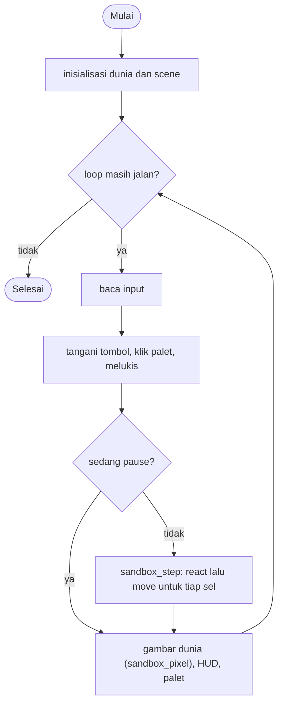

# Sandbox - design brief

**Owner:** Leader  **Folder:** `deferred/sandbox/`  **Status:** v2 sudah jalan (unranked): 29 elemen dengan reaksi antar elemen

## Hook
Mainan falling-sand (pasir jatuh). Engine yang sama (`core/sandbox*.c`) juga menganimasikan background hub, jadi menambah elemen akan memperbaiki keduanya.

## Penjelasan sederhana
Bayangkan akuarium pasir dua dimensi yang terdiri dari kotak-kotak kecil. Setiap kotak (sel) berisi satu elemen: kosong, pasir, air, api, lava, uranium, dan seterusnya (29 pilihan di palet). Dunia ini 320 x 160 sel, dan tiap sel digambar sebesar 4 x 4 piksel sehingga memenuhi bagian atas layar (1280 x 640). Palet elemen menempati strip di bawahnya, jadi tidak ada bagian dunia yang tertutup.

Aturannya sederhana dan dijalankan untuk setiap sel, dari baris paling bawah ke atas, satu kali per frame. Pertama kimia: sel boleh berubah (kayu yang dekat api mulai terbakar, lava yang kena air mengeras jadi batu). Lalu gerak, menurut jenis elemennya:

- **Bubuk** (pasir, tanah, salju, mesiu, biji, abu, thermite) jatuh beberapa sel per tick, memercik ke samping kalau jatuh bersama-sama, longsor di lereng, dan tenggelam di cairan yang lebih ringan (atau mengapung di cairan yang lebih berat).
- **Cairan** (air, minyak, asam, lava, raksa, nitrogen) jatuh, lalu mencari tempat terdekat di sampingnya yang punya ruang untuk jatuh lagi. Karena itu genangan cepat menjadi rata dan lalu diam. Cairan berlapis menurut massa jenis.
- **Gas** (uap, metana, asap) naik dan melayang. Uap mengembun, asap memudar.
- **Padat** (batu, kayu, es, kaca, wall, tanaman, sumbu, TNT) tidak bergerak tetapi bisa bereaksi.
- **Api, uranium, rayap, Life** punya aturan sendiri (lihat tabel elemen).

Pemain melukis elemen dengan mouse kiri, menghapus dengan mouse kanan, dan memilih elemen dengan klik pada palet, tombol angka, `[` `]`, atau scroll mouse. Tidak ada menang atau kalah.

Kodenya dibagi tiga lapis: `core/src/sandbox*.c` (engine murni, dipakai bersama dengan background hub; penjelasan per file ada di `docs/SANDBOX.md`), `deferred/sandbox/sandbox_logic.c` (input pemain: memilih elemen, klik palet, ukuran kuas, pause, melukis), dan `sandbox_game.c` (menggambar). Perhatikan awalan nama: fungsi game memakai `sbx_`, fungsi engine memakai `sandbox_`, karena nama `sandbox_*` sudah dipakai oleh engine.

**Kalau cuma punya 1 menit:** menambah elemen berarti mengubah `core/include/arcade/sandbox.h` dan `core/src/sandbox_*.c`, bukan folder game ini. Folder ini hanya memetakan tombol dan klik ke elemen.

## Kontrol
- Mouse kiri melukis elemen terpilih, mouse kanan menghapus.
- Klik kotak pada palet di bawah layar untuk memilih elemen. Baris pertama palet sama dengan tombol `0`-`9` (Eraser, Sand, Water, Stone, Soil, Snow, Gunpowder, Seed, Ash, Thermite).
- `[` dan `]` atau scroll mouse berpindah ke elemen sebelumnya/berikutnya (berputar, elemen tersembunyi dilewati).
- `+`/`-` mengubah ukuran kuas, Space menjeda, `C` membersihkan, `R` mengembalikan scene awal.

Catatan dari kode: `C` dan `R` dibaca sebagai huruf **kecil** (`typed == 'c'` dan `'r'`), jadi menekan dengan Shift atau CapsLock aktif tidak berpengaruh. Space dan Enter sama-sama menjeda (`action_pressed`). Menekan mouse di palet tidak melukis ke dunia di bawahnya, dan menyeret mouse dari palet ke dunia juga tidak melukis sampai tombol dilepas dan ditekan lagi.

## Elemen
Kolom "Ingatan" adalah arti `aux[]` (ingatan per sel).

| Elemen | Jenis | Perilaku | Ingatan |
|--------|-------|----------|---------|
| Eraser | - | menghapus sel di dalam kuas | - |
| Sand | bubuk | jatuh cepat, gundukan. Kena lava berubah jadi Glass | - |
| Water | cair | rata dengan cepat; memadamkan api; mengeras jadi Ice kena nitrogen; diminum Plant | - |
| Stone | padat | diam; larut oleh asam; hancur oleh ledakan | - |
| Soil | bubuk | gundukan lebih curam; biji tumbuh di atasnya | - |
| Snow | bubuk | ringan, ditaburkan jarang-jarang; meleleh jadi air kena panas | - |
| Gunpowder | bubuk | menyala seketika jadi api yang merambat cepat di seluruh tumpukan | - |
| Seed | bubuk | mengapung di air; tumbuh jadi Plant kalau diam di atas Soil | - |
| Ash | bubuk | sisa kayu dan tanaman yang terbakar; mengapung di air | - |
| Thermite | bubuk | disulut api jadi lava super panas yang melelehkan batu dan tanah di sekitarnya | - |
| Oil | cair | mengapung di air; terbakar sambil terus mengalir | bit 7 = terbakar, bit 0-6 = pewaktu |
| Acid | cair | melarutkan semua padat dan bubuk kecuali Glass, Wall, Lava; ikut habis; encer kena air | - |
| Lava | cair | kental dan lambat; air mengubahnya jadi batu (dan air jadi uap); menyulut bahan mudah terbakar; mengubah pasir jadi kaca | 0 = lava biasa, >0 = kekuatan melelehkan dari thermite |
| Mercury | cair | cairan terberat; semua bubuk mengapung di atasnya | - |
| Nitrogen | cair | membekukan air, memadamkan api, mengeraskan lava; menguap saat bekerja | - |
| Steam | gas | naik, mengembun jadi air (lebih cepat dekat es) | - |
| Methane | gas | sangat mudah terbakar: bola api yang merambat, kadang meledak kecil | - |
| Smoke | gas | memudar sendiri | - |
| Wood | padat | terbakar lama lalu jadi Ash; dimakan rayap | bit 7 = terbakar, bit 0-6 = pewaktu |
| Ice | padat | meleleh jadi air kena panas | - |
| Glass | padat | tahan asam | - |
| Wall | padat | tidak bisa dihancurkan oleh apa pun | - |
| Plant | padat | tumbuh ke atas dan ke samping dengan anggaran tumbuh terbatas; minum air untuk menambah anggaran; terbakar | anggaran tumbuh (bit 0-6); bit 7 = terbakar |
| Fuse | padat | terbakar 1 sel tiap 6 tick dan menyulut TNT, mesiu, dan lainnya di ujungnya | bit 7 = terbakar, bit 0-6 = pewaktu |
| TNT | padat | disulut: hitung mundur 4 tick lalu meledak (radius 8); TNT di dekatnya ikut meledak berantai; Wall selamat | hitung mundur |
| Fire | api | naik dan berkedip, mati sendiri, menempel pada bahan yang akan dibakarnya, padam kena air | umur |
| Uranium | padat | memanas sendiri; kena sinar gamma bisa membelah dan memancarkan 2-3 sinar. Balok besar di udara bereaksi berantai lalu meleleh; air menyerap sinar dan mendinginkan | panas (250 = meleleh) |
| Termite | merayap | berjalan di permukaan, makan Wood/Plant/Fuse dan sesekali berkembang biak; mati kalau kelaparan atau tenggelam | rasa lapar |
| Life | padat | Conway's Game of Life, satu generasi tiap 6 tick | - |
| Gamma (tersembunyi) | sinar | terbang lurus 2 sel per tick, berhenti di benda padat | arah (3 bit atas) + sisa terbang |
| Molten Uranium (tersembunyi) | cair | uranium cair yang panas, memancarkan sinar; membeku lagi kena air | - |

## Aturan dan skor
Tidak ada menang atau kalah. "Skor" di HUD hanyalah jumlah sel yang terisi. Game ini `ranked = false`.

Rumusnya (`sbx_score`): `lebar * tinggi - jumlah sel kosong`. Hasil akhirnya tidak dicatat ke leaderboard (`finished = false`).

## Cara kerja per frame
1. `arcade_poll(&in)` mengisi `ArcadeInput`. Yang dipakai game ini: `typed` (huruf atau angka yang diketik), `wheel` (scroll mouse), `action_pressed` (Space/Enter), `fire`, `fire_pressed` dan `alt` (mouse kiri dan kanan), serta posisi mouse `aim_x`, `aim_y`.
2. `sbx_step(&s, &in, ARC_DT)` (`dt` diabaikan):
   1. `handle_keys`: angka `0`-`9` memilih slot palet 0-9; `[` dan `]` serta scroll mouse menggeser pilihan (berputar); `c` mengosongkan dunia; `r` membangun ulang scene awal; `+`/`=` dan `-` mengubah ukuran kuas (dijepit 0 sampai 12); Space atau Enter membalik `paused`.
   2. Kalau mouse kiri baru ditekan di atas palet, slot di bawahnya dipilih (`sbx_select`) dan `pal_hold` menyala sampai tombol dilepas.
   3. Posisi mouse diubah menjadi sel: `aim / SBX_CELL`. Selama pointer tidak di atas panel palet: mouse kiri (kalau `pal_hold` mati) memanggil `sandbox_paint` dengan elemen terpilih, mouse kanan memanggil `sandbox_paint` dengan `EL_EMPTY`. Melukis tetap bisa dilakukan saat pause.
   4. Kalau tidak sedang pause, `sandbox_step(&s->world)` menjalankan satu tick dunia dan `ticks++`.
3. Di dalam `sandbox_step` (engine): `moved[]` digeser (bit "bergerak di tick ini" menjadi "bergerak di tick lalu") dan `tick++`. Lalu setiap baris dari **bawah ke atas**, arah penyisiran bergantian, tiap sel yang belum bertindak menjalankan `sandbox_react` (kimia) dan, kalau tidak berubah, `sandbox_move` (gerak). Setiap 6 tick `sandbox_life_step` memajukan satu generasi Game of Life.
4. Front-end menggambar dunia lewat `gfx_sandbox_view_draw` (tekstur 320 x 160, warna tiap sel dari `sandbox_pixel`, diperbesar menjadi 1280 x 640), lalu lingkaran kuas, HUD ("SANDBOX", skor, nama elemen, ukuran kuas, "PAUSED"), baris bantuan, dan palet di bawah layar.
5. Game ini tidak pernah selesai sendiri (`sbx_is_over` selalu `false`); loop berhenti ketika `arcade_loop_running()` mengembalikan `false`, yaitu saat pemain keluar ke hub.

## Peta file
| File | Isinya | Edit di sini kalau ... |
|------|--------|------------------------|
| `core/include/arcade/sandbox.h` | `ElementId`, `MoveKind`, `ElementDef`, struct `Sandbox`, batas `SANDBOX_MAX_W/H`, API engine | menambah elemen atau jenis gerak baru |
| `core/src/sandbox_elements.c` | Tabel `k_elements`, fungsi palet | menambah baris elemen atau mengubah angka perilaku |
| `core/src/sandbox_move.c` | Gerak bubuk, cairan, gas, api, sinar, rayap | mengubah cara sel bergerak |
| `core/src/sandbox_react.c` | Kimia dan reaksi: api, lava, asam, tanaman, TNT, uranium, rayap, Life | menambah atau mengubah reaksi |
| `core/src/sandbox_color.c` | `sandbox_pixel`: warna satu sel | mengubah tampilan (cahaya, kedip) |
| `core/src/sandbox.c`, `sandbox_internal.h` | Dasar grid, kuas, loop `sandbox_step`, helper privat | jarang |
| `deferred/sandbox/sandbox_logic.h` | `sbx_State`, `SBX_W/H/CELL`, geometri palet `SBX_PAL_*`, fungsi publik `sbx_*` | menambah field state game atau mengubah tata letak palet |
| `deferred/sandbox/sandbox_logic.c` | `handle_keys`, `build_scene`, `sbx_step`, klik palet, skor, batas kuas | menambah tombol atau alat baru |
| `deferred/sandbox/sandbox_game.c` | Loop raylib, `draw_palette`, HUD, `game_sandbox_def` | mengubah tampilan palet atau teks di menu |
| `deferred/sandbox/tests/test_sandbox.c` | 11 unit test untuk lapisan game | menambah tombol atau alat |
| `tests/test_sandbox.c` (di root repo) | 58 unit test untuk engine (`core.sandbox`) | menambah elemen atau aturan |
| `core/gfx/gfx_draw.c` | `gfx_sandbox_view_draw`: memindahkan `sandbox_pixel` ke tekstur | jarang |
| `app/backdrop.c` | Animasi pasir dan air di belakang menu hub (memakai engine yang sama) | mengubah background hub |
| `docs/SANDBOX.md` | Panduan menambah elemen dan penjelasan engine | menambah langkah atau ide baru |
| `CMakeLists.txt`, `GAME.md` | Pendaftaran build dan dokumen ini | file baru atau aturan berubah |
| `AGENTS.md` | Instruksi untuk AI agent (tidak diterjemahkan) | jarang; ikuti aturan di file itu |

## Data penting (struct)
`ElementId` (enum): `EL_EMPTY` (0, juga dipakai sebagai penghapus), 28 elemen lain menurut urutan palet, dua elemen tersembunyi (`EL_GAMMA`, `EL_MOLTEN_URANIUM`), dan `EL_COUNT` (jumlah elemen, bukan elemen sungguhan). `MoveKind` (enum): `MOVE_NONE` (diam), `MOVE_POWDER`, `MOVE_LIQUID`, `MOVE_GAS`, `MOVE_FIRE`, `MOVE_RAY`, `MOVE_CRAWL`.

`ElementDef`: satu baris di tabel `k_elements`.

| Field | Tipe | Artinya |
|-------|------|---------|
| `name` | `const char *` | nama yang tampil di palet |
| `r`, `g`, `b` | `uint8_t` | warna dasar (`sandbox_pixel` menambah bayangan dan cahaya) |
| `density` | `int` | massa jenis; yang lebih berat menembus cairan yang lebih ringan |
| `kind` | `MoveKind` | cara bergerak |
| `flags` | `uint8_t` | `EF_HIDDEN` (tidak di palet), `EF_ACIDPROOF` (kebal asam), `EF_HOT` (sumber panas) |
| `speed` | `uint8_t` | bubuk/cairan: sel jatuh per tick; gas dan api: peluang naik (per 256) |
| `spread` | `uint8_t` | cairan: seberapa jauh mencari tempat jatuh di samping |
| `slip` | `uint8_t` | cairan: peluang bergerak tiap tick (rendah = kental, seperti lava) |
| `grip` | `uint8_t` | bubuk: 0 longsor di tepi mana pun, makin besar makin curam |
| `ignite` | `uint8_t` | peluang (per 256) terbakar per tick dekat sumber panas; 0 = tidak terbakar |
| `shade` | `uint8_t` | besar bayangan acak per sel |
| `spray` | `uint8_t` | kepadatan kuas (per 256): salju dan gas ditaburkan jarang-jarang |

`Sandbox` (engine, `core`):

| Field | Tipe | Artinya |
|-------|------|---------|
| `w`, `h` | `int` | ukuran dunia dalam sel (dijepit ke `SANDBOX_MAX_W` x `SANDBOX_MAX_H` = 320 x 180) |
| `cells[320*180]` | `uint8_t` | isi tiap sel (nilai `ElementId`) |
| `aux[320*180]` | `uint8_t` | ingatan per sel; artinya berbeda untuk tiap elemen (lihat tabel elemen) |
| `moved[320*180]` | `uint8_t` | scratch: bit 0 sudah bertindak di tick ini, bit 1 bergerak di tick lalu, bit 2 uranium tereksitasi |
| `tick` | `unsigned` | nomor tick |
| `rng` | `Rng` | pengacak deterministik |

`sbx_State` (game):

| Field | Tipe | Artinya |
|-------|------|---------|
| `world` | `Sandbox` | dunia pasir (± 173 KB, makanya `static`, bukan di stack) |
| `element` | `ElementId` | elemen yang dilukis mouse kiri (tidak pernah elemen tersembunyi) |
| `brush` | `int` | radius kuas dalam sel (0 sampai 12, awal 3) |
| `paused` | `bool` | `true` kalau simulasi dijeda |
| `pal_hold` | `bool` | tekanan mouse dimulai di palet, jangan melukis sampai dilepas |
| `ticks` | `unsigned` | jumlah tick simulasi yang sudah berjalan |

## Fungsi-fungsi penting
| Fungsi | Tugas | Dipanggil dari |
|--------|-------|----------------|
| `sbx_init(s, seed)` | Membuat dunia 320 x 160, memilih pasir, kuas 3, lalu `build_scene` | `play()`, test |
| `sbx_step(s, in, dt)` | Satu langkah: tombol, klik palet, melukis, simulasi | `play()` tiap frame, test |
| `sbx_is_over(s)` / `sbx_score(s)` | Selalu `false` dan jumlah sel terisi | `play()` |
| `sbx_over_panel(px, py)` / `sbx_palette_slot_at(px, py)` / `sbx_select(s, i)` | Pointer di atas panel, slot palet di bawah pointer, memilih slot | `sbx_step`, `draw_palette`, test |
| `build_scene(s)` (static) | Mengosongkan dunia lalu menaruh mangkuk batu berisi air, rak tanah, dan tiga biji | `sbx_init`, tombol `r` |
| `handle_keys(s, in)` (static) | Memilih elemen, clear, reset, kuas, scroll, pause | `sbx_step` |
| `sandbox_step(sb)` | Satu tick: kimia, gerak, Life | `sbx_step`, `app/backdrop.c`, test |
| `sandbox_paint(sb, cx, cy, radius, id)` | Kuas bulat. `EL_EMPTY` menghapus semuanya; elemen lain hanya mengisi sel kosong (dengan kepadatan `spray`) | `sbx_step`, `app/backdrop.c`, test |
| `sandbox_get` / `sandbox_set` | Baca atau tulis sel. Di luar grid, `get` mengembalikan `EL_STONE` dan `set` diabaikan; `set` mengosongkan `aux` | seluruh engine, test |
| `sandbox_count(sb, id)` | Menghitung sel dengan elemen tertentu | `sbx_score`, test |
| `sandbox_pixel(sb, x, y)` | Warna sel (0xRRGGBB) termasuk bayangan, cahaya, dan kedip | `gfx_sandbox_view_draw`, test |
| `sandbox_palette_count/id/index` | Palet yang terlihat (elemen tersembunyi dilewati) | `sbx_*`, `draw_palette`, test |
| `sandbox_element(id)` | Mengambil baris tabel elemen (ID tidak valid menghasilkan baris `EL_EMPTY`) | engine, front-end |

## Angka yang bisa diutak-atik
| Konstanta | Nilai sekarang | File | Efek kalau diubah |
|-----------|----------------|------|-------------------|
| `SANDBOX_MAX_W` / `SANDBOX_MAX_H` | `320` / `180` | `sandbox.h` | ukuran maksimal dunia (dan ukuran array `cells`/`aux`/`moved`) |
| `SBX_W` / `SBX_H` | `320` / `160` | `sandbox_logic.h` | ukuran dunia game (engine mendukung sampai 320 x 180) |
| `SBX_CELL` | `4` px | `sandbox_logic.h` | ukuran tiap sel di layar; 320 x 4 = 1280 dan 160 x 4 = 640 (palet mulai di y = 640, lihat `SBX_PAL_Y`) |
| `SBX_PAL_COLS` / `SBX_PAL_ROWS` | `10` / `3` | `sandbox_logic.h` | jumlah slot palet (30); baris pertama = tombol `0`-`9` |
| `BRUSH_MIN` / `BRUSH_MAX` | `0` / `12` | `sandbox_logic.c` | batas radius kuas (awal `3`) |
| bentuk kuas (angka langsung di `sandbox_paint`) | sel dilukis kalau `dx^2 + dy^2 <= r^2 + r` | `sandbox.c` | bentuk "bulat" kuas |
| tabel `k_elements` | lihat komentar di atas tabel | `sandbox_elements.c` | warna, massa jenis, kecepatan, kekentalan, mudah terbakar |
| `LIQUID_RUN`, `BAR_CAP` | `4`, `64` | `sandbox_move.c` | kecepatan sebar cairan per tick, panjang undakan yang diperiksa |
| `TNT_DELAY`, `TNT_RADIUS`, `FUSE_DELAY`, `THERMITE_POWER` | `4`, `8`, `6`, `110` | `sandbox_react.c` | waktu dan jangkauan ledakan, kecepatan sumbu, daya thermite |
| `GAMMA_HIT`, `FISSION_HEAT`, `URANIUM_MELT` | `140`, `22`, `250` | `sandbox_react.c` | seberapa mudah uranium bereaksi berantai dan meleleh |
| `LIFE_PERIOD` | `6` tick | `sandbox_internal.h` | kecepatan Game of Life |
| scene awal (`build_scene`) | mangkuk batu di x 60-139 / y 100-120 berisi air, rak batu y 150 / x 190-279 dengan tanah dan 3 biji | `sandbox_logic.c` | tampilan awal dan tombol `r` |

## Cara menjalankan dan menguji
```bash
# test logic saja (tanpa raylib, ~7 detik): game dan engine
cmake --preset logic && cmake --build --preset logic && ctest --preset logic -R "sandbox"

# main game-nya
cmake --preset dev && cmake --build --preset dev && build/dev/bin/arCade

# smoke run headless: jalankan game 300 frame dan simpan screenshot PNG
cmake --preset headless && cmake --build --preset headless && build/headless/bin/arCade --smoke sandbox --frames 300 --out smoke-out
```

Lapisan game (`deferred/sandbox/tests/test_sandbox.c`, nama test CTest `sandbox.test_sandbox`):

| Test | Menjaga aturan apa |
|------|--------------------|
| `test_init_and_idle_stepping` | Game tidak pernah selesai; 10 tick tanpa input menambah `ticks` 10 dan tidak membuat sel baru |
| `test_select_element_and_paint` | Menekan `2` memilih air; mouse kiri melukis air |
| `test_clear_pause_and_brush` | Space menjeda dunia (`ticks` berhenti), `+` menaikkan kuas jadi 4, `c` mengosongkan dunia |
| `test_monkey_is_safe` | 3000 langkah input acak: kuas selalu 0-12 dan elemen terpilih selalu elemen yang terlihat di palet |
| `test_palette_geometry` | Setiap elemen punya slot; titik tengah slot mengenai slot itu sendiri; slot kosong dan dunia mengembalikan -1; panel mulai tepat di tempat dunia berakhir |
| `test_click_on_palette_selects_without_painting` | Klik palet memilih elemen tanpa melukis; menyeret ke dunia tidak melukis sampai tombol dilepas |
| `test_cannot_paint_through_the_panel` | Mouse di atas panel tidak melukis atau menghapus; klik slot kosong tidak mengubah pilihan |
| `test_number_keys_pick_the_first_row` | `0`-`9` memilih slot 0-9; `0`-`3` tetap Eraser, Sand, Water, Stone |
| `test_bracket_keys_and_wheel_cycle_and_wrap` | `[` `]` dan scroll berputar di kedua arah dan tidak pernah memilih elemen tersembunyi |
| `test_starter_scene_and_reset` | Scene awal berisi air, tanah, 3 biji yang tumbuh sendiri; `c` mengosongkan, `r` mengembalikan |
| `test_painting_every_element_is_safe` | Melukis tiap elemen dari palet lalu menjalankan 600 tick tidak merusak apa pun |

Engine (`tests/test_sandbox.c`, nama test CTest `core.sandbox`, 58 test). Kelompoknya:

| Kelompok | Menjaga aturan apa |
|----------|--------------------|
| Dasar grid (`test_grid_and_bounds`, `test_paint_and_erase`, `test_count_in_rectangle`, `test_set_clears_cell_memory`, `test_clear_resets_everything`) | Ukuran dijepit; di luar grid dianggap batu; kuas tidak menimpa; `aux` dikosongkan |
| Palet dan warna (`test_palette`, `test_colours_are_distinct_and_stable`, `test_every_element_has_a_row`, `test_brush_spray_and_hidden_cells`) | Palet dan indeksnya konsisten, tiap elemen terlihat di latar dan warnanya stabil, elemen tersembunyi tidak ada di palet |
| Gerak bubuk (`test_sand_falls_*`, `test_a_big_dump_*`, `test_a_trickle_*`, `test_stone_is_static_and_blocks`) | Jatuh beberapa sel per tick, gumpalan memercik jadi landai, aliran tipis jadi kerucut curam |
| Gerak cairan (`test_water_*`, `test_a_settled_pool_stays_still`, `test_liquids_layer_by_density`, `test_light_powder_floats_on_water`, `test_heavy_things_sink_*`) | Air rata dalam 60 tick, genangan diam, tidak ada air yang hilang, lapisan menurut massa jenis |
| Gas (`test_gas_rises_*`, `test_steam_condenses_*`, `test_smoke_fades`) | Gas naik dan tidak bocor, uap mengembun, asap memudar |
| Api dan peledak (`test_fire_*`, `test_water_puts_out_fire`, `test_oil_burns_*`, `test_gunpowder_*`, `test_fuse_*`, `test_tnt_*`, `test_methane_burns`) | Api membakar kayu jadi abu dan padam, sumbu pelan, TNT membuat kawah dan berantai, Wall selamat |
| Panas dan dingin (`test_lava_*`, `test_thermite_*`, `test_acid_*`, `test_nitrogen_*`, `test_heat_melts_*`) | Lava + air, lava + pasir, thermite, asam (kaca dan Wall kebal), nitrogen, es meleleh |
| Makhluk hidup (`test_seed_*`, `test_plants_*`, `test_termites_*`, `test_life_*`) | Biji hanya tumbuh di tanah, tanaman minum air dan terbakar, rayap makan dan kelaparan, blinker dan glider |
| Uranium (`test_uranium_*`, `test_big_uranium_*`, `test_small_uranium_*`, `test_water_between_rods_*`, `test_molten_*`) | Sinar berhenti di benda padat, balok besar meleleh, gumpalan kecil stabil, air di antara batang mencegah meleleh |
| Keseluruhan (`test_mass_is_conserved_*`, `test_deterministic*`, `test_chaos_never_breaks_the_grid`) | Massa elemen inert tetap, seed yang sama menghasilkan dunia yang sama, input kacau tidak merusak grid |

## Jebakan dan hal yang perlu diingat
- **Tombol angka hanya `0`-`9`** (slot palet 0-9, baris pertama). Elemen lain dipilih dengan klik, `[` `]`, atau scroll. Teks kontrol di kartu menu (`GameDef.controls` di `sandbox_game.c`) menyebut ini.
- **Palet punya 30 slot** (3 x 10); sekarang terisi 29. Elemen ke-31 yang terlihat butuh baris baru atau tata letak lain (ubah `SBX_PAL_ROWS`/`SBX_PAL_COLS`; `SBX_PAL_Y` bergantung pada `SBX_H`, jadi panel yang lebih tinggi berarti `SBX_H` harus dikurangi supaya dunia dan panel tidak bertumpuk).
- **`aux` artinya beda untuk tiap elemen.** Selalu tulis arti `aux` elemen baru di komentar bagian atas `sandbox_react.c`. `sandbox_set` dan `sandbox_put` mengosongkannya; `sandbox_swap` memindahkannya bersama sel.
- **`moved[]` mencegah satu sel bertindak dua kali dalam satu tick**, dan sel yang baru diubah (`sandbox_put`) menunggu tick berikutnya. Sumber panas yang baru dibuat atau baru bergerak di tick ini belum menyulut tetangga (`hot_near`), supaya api merambat satu langkah per tick, bukan satu baris penuh.
- **`sandbox_step` berjalan untuk semua sel dunia di setiap frame** (51.200 di game ini, sampai 57.600 di background hub). Di grid penuh sekarang sekitar 1 ms per tick. Jaga tetap cepat, dan jaga tetap deterministik (hanya pakai `sb->rng`, jangan `rand()` atau waktu).
- **Background hub (`app/backdrop.c`)** hanya melukis pasir, air, dan batu. Elemen baru tidak muncul di sana kecuali ditambahkan ke sana, **tetapi** perubahan pada engine ikut mengubah tampilan background hub dan perilaku "vault" yang membuka arsip deferred (`core/vault`); test `core.vault` dan smoke test hub menjaga ini.
- Fungsi di lapisan game memakai awalan `sbx_`, dan fungsi engine memakai `sandbox_`. Jangan dicampur.
- `sbx_State` berukuran ± 173 KB; jangan letakkan di stack (sudah `static` di `play()`).
- Reaksi memakai peluang per tick, jadi hasilnya berbeda-beda antar percobaan (satu sel api yang menyentuh TNT menyulutnya sekitar 70% dari waktu). Test memakai `torch()` (menahan api beberapa tick, seperti pemain menahan mouse) supaya tidak bergantung pada keberuntungan.

## Langkah implementasi (Implementation steps)

### Sudah selesai di v2
- [x] Perilaku pasir dan air yang lebih alami: jatuh cepat, percikan saat gumpalan mendarat, air cepat rata dan diam, lapisan menurut massa jenis.
- [x] 25 elemen baru dengan reaksi antar elemen (tabel di atas): bubuk, cairan, gas, padat, api, uranium dengan reaksi berantai, rayap, dan Game of Life.
- [x] Palet yang bisa diklik (30 slot), tombol `[` `]`, dan tombol angka untuk baris pertama.
- [x] Warna dan efek cahaya dihitung di engine (`sandbox_pixel`), jadi hub dan game selalu sama.
- [x] Scene awal yang hidup: air di mangkuk, tanah dengan biji yang tumbuh sendiri.

### Ide berikutnya
| Ide | Yang dibutuhkan |
|-----|-----------------|
| Emitter tetap | array `struct` di `sbx_State` yang di-step di `sbx_step` |
| Kabel, baterai, LED, gerbang logika | `aux` sebagai muatan, urutan update yang tidak bergantung pada arah penyisiran |
| Tumbuhan lain (lumut, bambu), makhluk lain | cabang baru di `sandbox_react.c` |
| Simpan/muat scene ke `ctx->data_dir` | file I/O (lihat `core/src/leaderboard.c` untuk polanya) |
| Zoom dan alat kuas lain (garis, kotak) | di `sandbox_logic.c` dan `sandbox_game.c` |

## Pseudocode (untuk laporan)
```
PROSEDUR sbx_step(state, input)
    tangani tombol: pilih elemen, clear, reset, ukuran kuas, pause
    JIKA mouse kiri baru ditekan di palet MAKA pilih elemen di slot itu
    JIKA pointer TIDAK di atas panel palet MAKA
        JIKA mouse kiri ditahan (dan tidak dimulai di palet) MAKA lukis elemen di sekitar pointer
        JIKA mouse kanan ditahan MAKA hapus di sekitar pointer
    JIKA TIDAK sedang pause MAKA simulasikan satu tick dunia
AKHIR PROSEDUR

PROSEDUR simulate_tick(world)
    geser penanda "bergerak"
    UNTUK baris DARI bawah SAMPAI atas
        UNTUK SETIAP kolom (arah bergantian tiap baris)
            JIKA sel tidak kosong DAN belum bertindak MAKA
                react(sel)                       // kimia: terbakar, melarutkan, tumbuh, ...
                JIKA sel tidak berubah MAKA move(sel)
                    bubuk : jatuh sampai speed sel, tenggelam, memercik, longsor
                    cairan: jatuh, lalu geser ke tempat jatuh terdekat di samping
                    gas   : naik atau melayang
    JIKA tick habis dibagi 6 MAKA majukan Game of Life satu generasi
AKHIR PROSEDUR
```

## Flowchart (untuk laporan)


## Konsep kuliah yang dipakai
| Konsep (Pertemuan) | Di mana (file : fungsi) |
|--------------------|-------------------------|
| Array 2D / 1D (9) | `core/include/arcade/sandbox.h` : `Sandbox.cells`, `aux`, `moved` |
| Enum (13) | `core/include/arcade/sandbox.h` : `ElementId`, `MoveKind` |
| Struct (13) | `ElementDef`, `Sandbox`, `sbx_State` |
| Perulangan bersarang (6) | `core/src/sandbox.c` : `sandbox_step`; `sandbox_react.c` : `sandbox_explode`, `sandbox_life_step` |
| Percabangan (5) | `core/src/sandbox_react.c` : `sandbox_react` (`switch`), `sandbox_move.c` : `sandbox_move` |
| Fungsi (11) | `sandbox_logic.c` : `handle_keys`, `sbx_palette_slot_at` |
