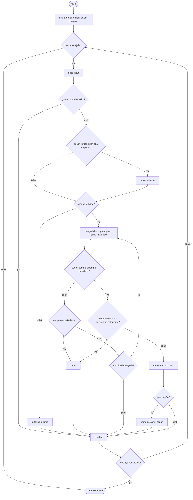

# Spike Dart - design brief

**Owner:** Leader  **Folder:** `deferred/spike_dart/`  **Created:** 2026-11-12  **Status:** v1 sudah jalan (lempar paku, orbit, hitbox = segitiga yang digambar)

## Hook
Sebuah target bulat berputar di tengah layar. Kamu melempar paku dari bawah; paku menancap lalu ikut mengorbit target. Makin banyak paku menancap, makin ramai jalur lempar di bawah target. Kalau paku yang kamu lempar **menyentuh** paku lama yang sedang lewat di jalur itu, kamu kalah. Skornya adalah jumlah paku yang berhasil menancap.

## Penjelasan sederhana
Bayangkan permainan lempar pisau ke papan putar, tapi pisau-pisau yang sudah menancap ikut berputar bersama papan. Kamu hanya punya satu keputusan: **kapan** melempar. Paku baru selalu terbang lurus dari bawah ke titik di bawah target (0,2 detik), jadi kamu harus memperhitungkan di mana paku-paku lama akan berada pada saat itu. Putaran target satu kali per 4 detik (seperempat putaran per detik), jadi paku lama bergeser sekitar 18 derajat selama paku barumu terbang.

Yang menentukan kalah atau tidak adalah **bentuk paku itu sendiri**. Setiap paku adalah segitiga tipis sepanjang 80 px dengan ujung runcing menghadap pusat target dan ujung rata selebar 8 px. Game menguji apakah segitiga paku yang kamu lempar bertumpang tindih dengan segitiga paku lama yang menancap. Segitiga yang diuji adalah **segitiga yang sama** yang digambar di layar (`spike_dart_shape` dipakai oleh logic dan front-end), jadi kalau di layar kedua paku tampak terpisah, game tidak akan menyatakan kamu kalah. Tumpang tindih sampai 1,5 px (`SD_HIT_SLACK`) masih dimaafkan sebagai "nyaris kena".

Pengujian ini dilakukan sepanjang penerbangan, bukan hanya di akhir. Penerbangan dipotong menjadi langkah kecil paling jauh 4 px, dan di tiap langkah paku-paku lama ikut bergeser sedikit, sehingga hasilnya sama di frame rate berapa pun dan paku yang terbang cepat tidak bisa melompati paku lain. Tempat mendarat juga diuji sebelum paku menancap.

Aturan ada di `spike_dart_logic.c` (tanpa raylib, bisa di-test di terminal). `spike_dart_game.c` hanya menggambar dan meneruskan input.

**Kalau cuma punya 1 menit:** `fly` memotong penerbangan jadi langkah kecil; `spike_dart_would_touch` adalah satu-satunya uji tabrakan (di `fly` dan di `spike_dart_lane_blocked`); `triangles_touch` adalah uji dua segitiga (separating axis).

## Kontrol
Klik kiri, Spasi, Enter, tombol arah, atau tombol karakter apa saja melempar satu paku. Lemparan saat paku sedang terbang diabaikan. Esc keluar.

## Aturan dan skor
Skor = jumlah paku yang menancap (`stuck`). Game berakhir kalau paku yang dilempar menyentuh paku lama, atau kalau paku ke-64 menancap (ditampilkan sebagai "ALL 64 STUCK!").

Detail dari kode:
- **Geometri di lapangan 480 x 684:** pusat target `(240, 282)`, tepi bawah target `target_dn = 402`, paku menunggu di `(240, 604)`. Kecepatan terbang `spike_spd = ((spike_y - 40) + 8 - target_dn) / 10 = 17` px per tick 50 Hz: ujung paku menempuh jaraknya dalam tepat 10 tick (0,2 detik). Di test (480 x 800) angkanya 340, 460, 720, dan 22,8.
- **Bentuk paku** (`spike_dart_shape`): pusat `(cx, cy)`, sudut orbit `a`; ujung di pusat + 40 px ke arah target, dua sudut ujung rata di pusat - 40 px dengan lebar 8 px. Sudut `pi/2` berarti menggantung tepat di bawah target dengan ujung ke atas.
- **Tempat mendarat:** pusat paku berada di jari-jari orbit `SD_ORBIT_R = 152` dari pusat target (jadi ujungnya menancap 8 px ke dalam piringan yang berjari-jari 120): `(240, 434)` di 684 piksel.
- **Orbit:** paku menancap dengan sudut `pi/2` (bawah) dan `rot += (pi/2) * dt` per detik nyata. Posisi `(tx - cos(rot) * 152, ty + sin(rot) * 152)`. Setelah 1 detik paku ada di sisi kanan; satu putaran penuh 4 detik.
- **Uji tabrakan:** `spike_dart_would_touch(s, y)` membandingkan segitiga paku yang dilempar (pusat `(spike_x, y)`, sudut `pi/2`) dengan segitiga tiap paku yang menancap. Dua segitiga dianggap bersentuhan hanya kalau bayangan mereka tumpang tindih lebih dari 1,5 px pada **setiap** sumbu (sumbu = normal tiap sisi segitiga; ini uji separating axis).
- **Penerbangan:** `jarak = spike_spd * dt * 50`; dipotong menjadi `ceil(jarak / 4)` langkah. Tiap langkah: paku lama berputar `dt / n`, paku terbang maju `jarak / n`, lalu: kalau pusatnya sudah mencapai jari-jari orbit, ia dipaku ke posisi mendarat dan diuji sekali lagi; kalau menyentuh, kalah; kalau tidak, `stick_current`. Kalau belum sampai, uji sentuh di posisi sekarang.
- **Lemparan yang terlalu cepat:** tidak ada batas waktu antar lemparan selain paku sebelumnya harus sudah menancap.
- **`spike_dart_lane_blocked(s)`:** "kalau paku mendarat tepat sekarang, apakah ia menyentuh paku lama?" (uji sentuh di posisi mendarat). Dipakai test; tidak ditampilkan di layar.
- **Batas 64:** paku ke-64 mengakhiri game (`capped`); array tidak pernah diindeks lewat `stuck`.
- `spike_dart_is_over` baru `true` 1,2 detik (`SD_OVER_DELAY`) setelah `over`, supaya pemain melihat paku merah yang menyentuh.

## Cara kerja per frame
1. `arcade_poll(&in)` mengisi `ArcadeInput`. Yang dihitung sebagai lemparan (`throw_requested`): `fire_pressed`, `action_pressed`, tombol arah `*_pressed`, dan `typed`.
2. `spike_dart_step(&s, &in, ARC_DT)`:
   1. Kalau `over` sudah `true`: `over_t += dt`, keluar.
   2. Kalau belum terbang dan ada lemparan: `flying = true`, `throws++`.
   3. Kalau terbang: `fly(s, dt)`. Kalau tidak: `orbit_all(s, dt)` (paku lama berputar).
3. `fly`: lihat "Penerbangan" di atas. Hasilnya bisa tetap terbang, `stick_current` (menancap, `sticks++`, dan `capped` kalau ke-64), atau `lose` (`over`).
4. Front-end membandingkan `throws` dan `sticks` dengan frame lalu untuk memutar bunyi, lalu menggambar piringan target dengan enam titik yang berputar (dekorasi, kecepatan sama dengan orbit), paku-paku menancap (cyan), paku di tangan (kuning, merah setelah menyentuh), tulisan "SPIKE HIT!" atau "ALL 64 STUCK!", dan panel kanan (`n / 64`).
5. Kalau `spike_dart_is_over(&s)` bernilai `true`, loop berhenti dan skor dikembalikan.

## Peta file
| File | Isinya | Edit di sini kalau ... |
|------|--------|------------------------|
| `spike_dart_logic.h` | Konstanta `SD_*`, struct `spike_dart_State`, fungsi publik (`shape`, `would_touch`, `lane_blocked`) | menambah field state atau mengubah ukuran |
| `spike_dart_logic.c` | `fly`, `orbit_all`, `stick_current`, `spike_dart_shape`, `triangles_touch`, `spike_dart_would_touch` | mengubah aturan tabrakan, kecepatan, atau orbit |
| `spike_dart_game.c` | Loop raylib, `draw_spike` (memakai `spike_dart_shape`), target, panel, bunyi, `game_spike_dart_def` | mengubah tampilan atau teks |
| `tests/test_spike_dart.c` | 23 unit test (hanya logic) | menambah atau mengubah aturan |
| `CMakeLists.txt` | Mendaftarkan game ke build | menambah file `.c` atau test baru |
| `core/include/arcade/playfield.h` | Lapangan potret 480 x 684 yang dipakai bersama | jarang |
| `GAME.md` | Dokumen ini | aturan atau kode berubah |
| `AGENTS.md` | Instruksi untuk AI agent (tidak diterjemahkan) | jarang; ikuti aturan di file itu |

## Data penting (struct)
`spike_dart_State`: seluruh keadaan game. Koordinat lokal lapangan.

| Field | Tipe | Artinya |
|-------|------|---------|
| `w`, `h` | `int` | ukuran lapangan (480 x 684 di game; 480 x 800 di test) |
| `target_x`, `target_y`, `target_dn` | `float` | pusat target dan y tepi bawahnya |
| `spike_x`, `spike_y` | `float` | pusat tempat paku baru menunggu (juga x jalur lempar) |
| `spike_spd` | `float` | kecepatan terbang dalam px per tick 50 Hz |
| `stuck` | `int` | paku yang menancap = skor |
| `px[]`, `py[]`, `rot[]` | `float` | pusat dan sudut orbit tiap paku yang menancap (64 elemen) |
| `cur_y` | `float` | y pusat paku yang menunggu atau terbang |
| `flying` | `bool` | ada paku yang sedang terbang |
| `over`, `capped`, `over_t` | `bool`, `bool`, `float` | game berakhir; berakhir karena paku ke-64; detik sejak berakhir |
| `throws`, `sticks` | `int` | penghitung kejadian untuk bunyi |
| `rng` | `Rng` | tidak dipakai (game ini tanpa acak), ada demi kontrak game |

## Fungsi-fungsi penting
| Fungsi | Tugas | Dipanggil dari |
|--------|-------|----------------|
| `spike_dart_init(s, seed)` / `_init_sized(s, seed, w, h)` | Mengosongkan state, menghitung geometri dan kecepatan terbang | `play()`, test |
| `spike_dart_step(s, in, dt)` | Satu langkah logic | `play()` tiap frame, test |
| `spike_dart_is_over(s)` / `spike_dart_score(s)` | Status selesai (setelah jeda 1,2 detik) dan skor | `play()` |
| `spike_dart_shape(cx, cy, angle, tri)` | Tiga titik segitiga paku: yang digambar dan yang diuji | `draw_spike`, uji tabrakan, test |
| `spike_dart_would_touch(s, y)` | Apakah paku yang dilempar di ketinggian `y` menyentuh paku yang menancap | `fly`, `spike_dart_lane_blocked`, test |
| `spike_dart_lane_blocked(s)` | Apakah tempat mendarat sedang terisi | test |
| `fly(s, dt)` (static) | Satu frame penerbangan dengan langkah kecil | `spike_dart_step` |
| `triangles_touch(a, b)` (static) | Uji separating axis dua segitiga, dengan toleransi `SD_HIT_SLACK` | `spike_dart_would_touch` |
| `project(t, axis, &lo, &hi)` (static) | Bayangan segitiga pada sebuah sumbu | `triangles_touch` |
| `stick_current(s)` (static) | Menancapkan paku di sudut `pi/2`; mengecek batas 64 | `fly` |
| `orbit_all(s, dt)` (static) | Memutar semua paku yang menancap | `fly`, `spike_dart_step` |
| `place_on_orbit(s, i)` (static) | Pusat paku dari sudutnya | `stick_current`, `orbit_all` |
| `landing_y(s)` (static) | y pusat paku yang baru menancap (`target_y + 152`) | `fly`, `lane_blocked` |
| `lose(s)` (static) | Mengakhiri game karena menyentuh | `fly` |
| `throw_requested(in)` (static) | Apakah input berarti "lempar" | `spike_dart_step` |

## Angka yang bisa diutak-atik
| Konstanta | Nilai sekarang | File | Efek kalau diubah |
|-----------|----------------|------|-------------------|
| `SD_MAX_SPIKES` | `64` | `spike_dart_logic.h` | ukuran array dan batas akhir game |
| `SD_TARGET_R` | `120` px | `spike_dart_logic.h` | jari-jari target (juga kedalaman paku menancap) |
| `SD_ORBIT_R` | `152` px | `spike_dart_logic.h` | jarak pusat paku yang menancap dari pusat target |
| `SD_SPIKE_LEN` / `SD_SPIKE_W` | `80` / `8` px | `spike_dart_logic.h` | ukuran paku, sekaligus ukuran hitbox |
| `SD_OVER_DELAY` | `1.2` detik | `spike_dart_logic.h` | lama paku merah terlihat sebelum game ditutup |
| `SD_HIT_SLACK` | `1.5` px | `spike_dart_logic.h` | seberapa besar tumpang tindih yang dimaafkan (0 = sentuhan sekecil apa pun kalah) |
| `SD_ORBIT_SPEED` | `pi/2` rad/detik | `spike_dart_logic.c` | kecepatan putar; satu putaran 4 detik. Juga kecepatan titik dekorasi di front-end |
| `SD_SUBSTEP` | `4` px | `spike_dart_logic.c` | seberapa rapat penerbangan diuji (jangan lebih dari panjang paku) |
| `SD_EPS` | `0.01` | `spike_dart_logic.c` | toleransi float supaya paku yang tepat di tepi tetap menancap |
| waktu terbang (angka langsung di `init_sized`) | `10` tick | `spike_dart_logic.c` | kecepatan terbang: makin kecil, makin cepat |
| posisi target dan paku (angka langsung di `init_sized`) | target `h/2 - 60`, paku `h - 80` | `spike_dart_logic.c` | tata letak |
| nada bunyi (di `play`) | lempar 880 Hz, menancap 330 Hz, kalah 110 Hz | `spike_dart_game.c` | hanya bunyi |

## Cara menjalankan dan menguji
```bash
# test logic saja (tanpa raylib, ~1 detik)
cmake --preset logic && cmake --build --preset logic && ctest --preset logic -R "^spike_dart\."

# main game-nya
cmake --preset dev && cmake --build --preset dev && build/dev/bin/arCade

# smoke run headless: jalankan game 300 frame dan simpan screenshot PNG
cmake --preset headless && cmake --build --preset headless && build/headless/bin/arCade --smoke spike_dart --frames 300 --out smoke-out
```

| Test | Menjaga aturan apa |
|------|--------------------|
| `test_init_is_sane` | Awal game: belum selesai, skor 0, target di tengah |
| `test_spec_constants_at_480x800` | Geometri di 480 x 800: target 340, tepi bawah 460, paku di 720, kecepatan 22,8 |
| `test_first_spike_sticks_in_10_ticks_at_orbit_radius` | Paku pertama menancap tepat setelah 10 tick di `(240, 492)` |
| `test_orbit_after_one_second` | Setelah 1 detik paku di `(392, 340)`: seperempat putaran |
| `test_orbit_period_at_60hz` | 240 frame di 60 Hz = satu putaran penuh (`2 pi`) |
| `test_shape_is_the_drawn_triangle` | Titik ujung dan ujung rata di sudut `pi/2` dan 0; panjang 80, lebar 8, terpusat, di semua sudut |
| `test_hit_box_follows_the_drawn_triangle_vertically` | Paku di jalur: jarak 12 px sebelum ujung rata tidak kena, tepat di ujung tidak kena, 10 px ke dalam kena (aturan lama sudah memvonis kalah di jarak 12 px itu) |
| `test_hit_box_follows_the_drawn_triangle_sideways` | Dua paku sejajar: selisih 0, 3, 6 px kena; 7, 8, 14 px tidak (dan simetris di sisi kiri) |
| `test_a_near_miss_the_old_rule_punished_is_now_a_pass` | **Perbaikan bug:** paku 3 derajat dari bawah (pusatnya 7,96 px dari jalur; aturan lama menyatakan kena) kini lolos, 1 derajat tetap kena, di kedua sisi |
| `test_spikes_far_from_the_lane_never_touch` | Paku di mana pun selain dekat bawah tidak menyentuh tempat mendarat; tanpa paku, tidak ada yang kena |
| `test_any_stuck_spike_in_the_way_counts` | Paku mana pun di array (pertama atau terakhir) yang ada di jalur menghalangi |
| `test_throw_into_a_passing_spike_ends_game` | Melempar tepat saat paku lama tiba di jalur: kalah, paku tidak menancap, `is_over` setelah jeda |
| `test_losing_spike_stops_where_it_touched` | Paku merah berhenti di tempat bersentuhan, tidak melewati target |
| `test_throw_with_clear_lane_survives` | Jalur kosong saat paku tiba: menancap, skor 2 |
| `test_spamming_throws_eventually_loses` | Melempar tanpa menunggu pasti berakhir kalah dengan skor di antara 1 dan 63 |
| `test_throw_ignored_while_flying` | Menekan lagi saat paku terbang tidak menambah lemparan |
| `test_cap_of_64_ends_the_game` | Paku ke-64: `over` dan `capped`, skor 64 |
| `test_big_step_cannot_tunnel` | Satu langkah `dt = 0,2` (seluruh penerbangan) tetap menancap, tidak terbang melewati |
| `test_the_landing_spot_is_checked_before_sticking` | Di tepi jendela sentuh ada sudut paku yang hanya menyentuh tempat mendarat, bukan posisi 3 px sebelumnya; tetap dihitung kalah |
| `test_outcome_does_not_depend_on_the_frame_rate` | 360 sudut awal: hasil sama di 30, 50, 60, 120 Hz dan satu langkah 0,2 detik; jendela kalah sekitar 8 derajat dari 360 |
| `test_every_loss_is_visible_and_every_visible_overlap_is_a_loss` | **Sifat utama:** di 120 game acak, setiap kalah benar-benar tumpang tindih di gambar, tidak ada frame terbang dengan tumpang tindih jelas yang lolos, dan paku yang menancap tidak berada di dalam paku lain. Ground truth dihitung dengan cara lain (mengambil sampel titik tiap 0,5 px), bukan dengan kode yang sama dengan game |
| `test_same_seed_same_result` | Input sama menghasilkan hasil yang sama |
| `test_monkey_never_breaks_invariants` | Input acak: `stuck` di 0..64, array tidak terlewati, state valid |

## Jebakan dan hal yang perlu diingat
- **Jangan mengembalikan uji lama.** Versi pertama menguji `|x_pusat_paku_lama - spike_x| < 8` (hanya x, hanya pusat, dan hanya dalam 68 px terakhir penerbangan). Paku itu lebar 8 px dan runcing, jadi aturan itu tidak cocok dengan gambarnya. Pada 20.000 game acak yang diukur, 67,9% kekalahan terjadi dengan paku yang tampak terpisah 2 sampai 5 px (rata-rata 3,7 px), dan di 2.097 frame sampel paku yang tampak bertumpuk lebih dari 1,5 px justru tidak dihitung kena. Uji berbasis bentuk menghasilkan 0 dan 0. Kesulitan rata-rata hampir tidak berubah (rata-rata 14,9 menjadi 14,6 paku sebelum kalah dengan pola lempar acak yang sama).
- **Hitbox dan gambar harus satu sumber.** `draw_spike` memanggil `spike_dart_shape`. Kalau suatu hari bentuk paku diubah, ubah di fungsi itu saja.
- `SD_HIT_SLACK` memaafkan tumpang tindih sampai 1,5 px. Dengan nilai 0, sentuhan sekecil apa pun (termasuk yang tampak hanya menempel) dianggap kena, dan beberapa test sengaja gagal.
- Uji sentuh dilakukan di tiap langkah penerbangan **dan** di tempat mendarat. Tanpa uji di tempat mendarat, paku yang baru menancap bisa berada di dalam paku lama pada kasus di tepi jendela sentuh (ada test untuk ini).
- Pembagian penerbangan (`SD_SUBSTEP`) harus jauh lebih kecil dari panjang paku (80 px). Frame lambat membuat `jarak` besar dan jumlah langkah bertambah; test `test_big_step_cannot_tunnel` menjaganya.
- Orbit memakai `dt` nyata, tetapi penerbangan memakai `k = dt * 50`. Keduanya dipakai bersama di tiap langkah kecil, jadi hasilnya tidak bergantung pada frame rate (ada test).
- **Batas 64 hampir di batas geometri.** Pemain yang melempar di saat aman pertama macet di sekitar 40 paku (aturan lama: 43) karena tidak ada waktu aman lagi. Dengan penempatan yang sengaja dirapatkan, simulasi mencapai 63 paku pada aturan lama maupun baru, dan paku ke-64 tidak muncul. Jadi "ALL 64 STUCK!" praktis hanya tercapai kalau semuanya sempurna; wajar kalau tidak pernah terlihat.
- `rng` tidak dipakai: game ini sepenuhnya deterministik terhadap input.
- Titik-titik dekorasi di target berputar dengan kecepatan yang sama dengan orbit, tetapi dihitung dari waktu di front-end (`t`), bukan dari logic. Tidak mempengaruhi aturan.
- Game ini `order = 140`.

## Langkah implementasi (Implementation steps)
Daftar ini adalah pengembangan dari v1.

1. Tampilkan peringatan visual di jalur: sorot paku lama yang akan menghalangi lemparan (data: `spike_dart_lane_blocked`).
2. Tingkat kesulitan: kecepatan putar yang naik makin banyak paku, atau arah putar yang berbalik sesekali.
3. Paku rintangan yang sudah menancap sejak awal (memakai `rng`), jadi game tidak lagi sepenuhnya tanpa acak.
4. Efek hancur: paku merah dan paku yang disentuh berkedip dan jatuh.
5. Tampilkan jarak ke paku terdekat saat paku menancap sebagai "nyaris kena" (data: celah dari uji separating axis).

## Pseudocode (untuk laporan)
```
FUNGSI sentuh(paku_lempar, paku_lama)
    UNTUK tiap sisi dari kedua segitiga
        sumbu <- normal sisi itu
        bayangan A, bayangan B <- proyeksi tiap segitiga ke sumbu
        tumpang <- min(akhir A, akhir B) - maks(awal A, awal B)
        JIKA tumpang <= 1.5 MAKA KEMBALI salah     // ada celah, tidak bersentuhan
    KEMBALI benar

PROSEDUR fly(dt)
    jarak <- kecepatan * dt * 50
    n <- max(1, atas(jarak / 4))
    ULANGI n kali
        putar semua paku lama sebesar dt / n
        y <- y - jarak / n
        JIKA y <= tempat_mendarat MAKA
            y <- tempat_mendarat
            JIKA sentuh di y MAKA kalah SELAIN ITU menancap
            KEMBALI
        JIKA sentuh di y MAKA kalah; KEMBALI

PROSEDUR step(input, dt)
    JIKA game berakhir MAKA hitung waktu; KEMBALI
    JIKA belum terbang DAN ada lemparan MAKA mulai terbang
    JIKA terbang MAKA fly(dt) SELAIN ITU putar semua paku lama
```

## Flowchart (untuk laporan)


## Konsep kuliah yang dipakai
| Konsep (Pertemuan) | Di mana (file : fungsi) |
|--------------------|-------------------------|
| Struct (13) | `spike_dart_logic.h` : `spike_dart_State`; `Vec2` untuk titik segitiga |
| Array (9) | `px[]`, `py[]`, `rot[]` (64 paku); `Vec2 tri[3]` |
| Perulangan (6) | `fly` (langkah kecil), `triangles_touch` (loop atas sisi), `orbit_all` (loop atas paku) |
| Percabangan (5) | `fly` (mendarat, menyentuh, atau terus terbang), `stick_current` (batas 64) |
| Prosedur, fungsi (11) | `spike_dart_shape`, `spike_dart_would_touch`, `project`, `lose` |
| Pointer (10) | `Vec2 tri[3]` sebagai parameter keluaran di `spike_dart_shape`; `float *lo, float *hi` di `project`; setiap parameter `spike_dart_State *s` |
| Fungsi matematika (12) | `cosf`, `sinf` (posisi orbit dan bentuk paku), `ceilf` (jumlah langkah), proyeksi vektor (`vec2_dot`, `vec2_norm`) |
