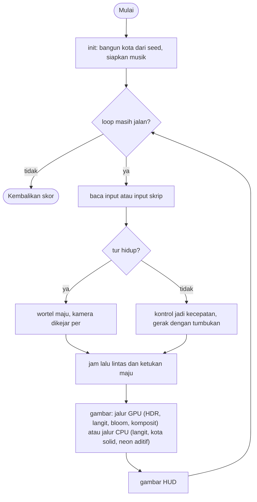

# Synthwave City - design brief

**Owner:** Leader  **Folder:** `deferred/synthwave_city/`  **Created:** 2026-11-16  **Asal mekanik:** port ke C dari `highsierralabs/Synthwave_City`: rencana kota, model terbang, lalu lintas, dan komposisi lagu diterjemahkan dari TypeScript ke C99 dan dicocokkan angka demi angka. Tampilan WebGL dibawa bertahap: langit, bloom HDR, penyelarasan warna, dan tiga suasana sudah memakai shader GLSL yang sama dengan versi web (jalur GPU, butuh OpenGL 3.3); gedung (fasad, jendela, panel LED beranimasi, toko, lampu atap) dan sinar (lampu sorot, pilar suar, kipas laser, kilau pemancar), tanah (jalan, marka, lampu jalan, jalan basah berpantulan), dan lalu lintas udara (ribuan mobil terbang, kapal angkut, dan drone di jalur langit, ditambah enam kapal besar) juga sudah memakai shader aslinya; kehidupan jalan (mobil di jalan, orang di trotoar, lampu dan cahayanya) dan hologram (panel iklan melayang, benda kawat, cincin teks berjalan di menara raksasa) juga sudah memakai shader aslinya, dengan atlas 28 iklan yang digambar oleh kode saat start (bukan gambar atau huruf dari versi web). Sejak M10: empat iklan stasiun radio baru di atlas (OBSIDIAN, VELVET, STARPORT, PLAZA) dan satu butir baru di teks berjalan. Sejak M9: motor di lalu lintas (satu dari sepuluh kendaraan biasa), serta orang di gang antar gedung dan di plaza (pembaruan "street life" versi web). Terakhir (M8): tiga tingkat kualitas versi web (low, medium, high; tombol Q), tepi MSAA 4x di tingkat high, skala render adaptif, atlas iklan yang disebar ke beberapa frame supaya awal tidak tersendat, HUD yang ikut ukuran jendela, dan seed bawaan 1984 di jendela biasa (seperti versi web). Jalur CPU (rlgl tanpa shader) tetap ada sebagai cadangan dan dipakai smoke run headless.

## Hook
Terbang bebas di atas kota neon tanpa ujung saat matahari terbenam; tidak ada musuh, tidak ada game over, hanya kamera, jalan raya, dan lagu 105 BPM.

## Penjelasan sederhana
Kota dibuat dari satu angka seed: kisi 40 x 40 sel (satu sel 160 m, satu ubin 6400 m) yang berulang ke segala arah, jadi kamu bisa terbang selamanya. Isinya sekitar 16 ribu kotak gedung, 520 jalur lalu lintas, dua ribu lebih "situs" (hologram, lampu sorot, pilar, laser, papan berjalan), dan 12 menara raksasa. Kamu terbang bebas dengan WASD dan mouse, atau menyalakan tur otomatis: sebuah drone mengikuti garis tengah jalan dan kamera menyusulnya seperti per yang diredam. Ada enam titik pandang dan tiga suasana (matahari terbenam, tengah malam, Miami).

Di balik layar, `synthwave_city_step()` hanya memajukan jam, memindahkan kamera (bola kecil bersama kecepatan yang menabrak dan menggeser di dinding gedung), dan memutar jam ketukan. Semua yang terlihat adalah fungsi murni dari seed dan waktu, jadi kota dan lalu lintasnya selalu sama untuk seed yang sama. Seperti maket kota yang dikelilingi kamera: maketnya tidak berubah, hanya sudut pandangnya.

Kalau cuma punya 1 menit: tekan Spasi untuk tur, tekan 1-6 untuk melompat ke titik pandang, T untuk mengganti suasana, L untuk mematikan sinar atau lalu lintas udara, Q untuk menurunkan tingkat kualitas kalau frame terasa berat.

## Kontrol
WASD atau panah: terbang (maju, mundur, geser). Tahan klik kiri dan seret mouse: melihat sekeliling. Klik kanan (tahan): dorongan kecepatan (x3.5). Roda mouse: skala kecepatan jelajah (0.25 sampai 4). Spasi: tur otomatis hidup atau mati (kontrol terbang apa pun mematikannya). 1-6: titik pandang (Sunset Avenue, Downtown Canyon, Rooftop, Panorama, Megatower, Plaza). T: ganti suasana. L: saklar lapisan, berputar dari semuanya hidup, sinar saja, lalu lintas udara saja, kehidupan jalan saja, hologram saja, sampai semuanya mati lalu kembali (enam keadaan; pesan singkat dan baris status HUD menunjukkan keadaannya; berlaku di penggambar GPU maupun CPU, berguna untuk melihat biaya tiap lapisan). Q: ganti tingkat kualitas GPU, berputar dari high ke medium ke low lalu kembali ke high (pesan singkat "QUALITY ..." muncul sebentar; baris status HUD menampilkan tingkat, MSAA, dan skala render saat di bawah 100%; hanya ada di jalur GPU). G: ganti penggambar GPU atau CPU (hanya ada kalau OpenGL 3.3 tersedia; HUD menampilkan "GPU" saat jalur GPU aktif). M: bisukan musik. Esc: keluar (kalau game dimulai dari arsip) atau kembali ke menu (kalau dimainkan di latar belakang hub, lihat bagian berikutnya).

## Dua cara menjalankannya
1. **`play()`**: game biasa dengan loop-nya sendiri. Muncul di menu setelah arsip dibuka, dan dipakai oleh smoke run.
2. **Sesi tamu** (`synthwave_city_session.h`): hub menjalankan game yang sama di belakang menunya, di dalam loop hub. Selama menu tampil, hub memberi input kosong, jadi hanya drone tur yang menggerakkan kamera, lagu diputar pelan (volume 0.3), dan HUD disembunyikan. Saat pemain mengklik latar belakang, hub memanggil `swc_session_set_control(true)`: input nyata dibaca, HUD tampil (teksnya "ESC: menu"), dan lagu penuh (0.8). `Esc` memanggil `swc_session_set_control(false)`: sesi mengirim satu tekan `action_pressed` (sama dengan Spasi) bila tur sedang mati, sehingga drone mengambil kamera dari posisi terakhir tanpa lompatan. Klik yang menyembunyikan menu tidak boleh menjadi "seret" (itu kontrol terbang yang mematikan tur); aturan itu ada di `screens.c`, dan tiga tes logic (`test_an_idle_host_leaves_the_drone_flying`, `test_a_lone_space_press_hands_the_camera_back_to_the_drone`, `test_the_click_that_takes_the_camera_does_not_turn_it`) mengunci apa yang diandalkan hub.

Sesi tamu dan `play()` masing-masing punya `synthwave_city_State` dan `Soundtrack` sendiri. Yang dipakai bersama hanya tekstur renderer, dan itu dihitung referensinya (`swc_render_init/shutdown`).

## Aturan dan skor
- Kota adalah fungsi dari `seed`; ubin 6400 m berulang, jadi posisi x dan z selalu dibungkus ke `0..6400`.
- Kamera adalah bola berjari-jari 1.8 m; tidak bisa masuk ke gedung (menabrak berarti menggeser di sepanjang dinding) dan tidak bisa lebih rendah dari jari-jarinya atau lebih tinggi dari 1500 m.
- Kecepatan puncak = `45 m/s * (1 + tinggi / 300) * skala_roda`, dorongan klik kanan mengalikan 3.5; kecepatan mendekati yang diminta kontrol secara eksponensial (`RESPONSE` 3 per detik).
- Gerak dipecah menjadi sub-langkah <= 1.5 m dan langkah fisika <= 1/120 detik, jadi 30 Hz dan 60 Hz menempuh jalur yang sama.
- Tur: "wortel" berjalan di garis tengah jalan, berbelok acak di persimpangan, naik dan turun; kamera mengejarnya dengan per teredam kritis dan tidak pernah menyentuh gedung.
- Lalu lintas: kendaraan beredar di jalur dengan periode tepat 4096 detik (fungsi murni dari waktu, tanpa state).
- Musik: lagu 105 BPM, bar 16 sampai 31 dari gerakan pertama diputar berulang; denyut ketukan menggerakkan kilau neon.
- **Skor = jumlah kilometer penuh yang ditempuh.** Game ini tidak pernah "selesai" dan tidak masuk ranking (`ranked = false`).

## Cara kerja per frame
1. `arcade_poll()` mengisi `ArcadeInput` (di smoke run, `scripted_input()` menggantikan "monyet" acak dengan film singkat (900 frame, berulang) yang menyentuh semua kontrol, termasuk keenam keadaan saklar L di frame 840 sampai 900 dan tombol Q di frame 790, 800, dan 810: medium, low, lalu high lagi).
2. `synthwave_city_step()`: tombol angka, T, dan Spasi diproses; kontrol terbang mematikan tur. Tombol L ditangani front-end (`swc_layers_next()`), bukan aturan permainan: ia hanya mengubah topeng lapisan yang dibaca kedua penggambar.
3. Tur: wortel maju dan kamera dikejar per; atau terbang bebas: kontrol menjadi kecepatan yang diminta, lalu `swc_flight_move()` menggerakkan bola dengan tumbukan.
4. Jam lalu lintas dan jam ketukan bertambah; front-end menyamakan jam ketukan dengan audio jika selisihnya > 0.06 detik.
5. Penggambaran, dua jalur:
   - **GPU** (`swc_render_scene_gpu()`, jendela biasa dengan OpenGL 3.3): `swc_look_update()` menggeser warna suasana menuju suasana aktif (`1 - exp(-1.2 dt)` per langkah, seperti versi web); lebih dulu pass pantulan: kota dilihat dari kamera di bawah tanah ke target setengah ukuran (langit, gedung, lambung kendaraan udara, lampu penerbangan, lampu kendaraan udara, pilar sinar, tiang dan kilau lampu); lalu ke target HDR RGBA16F dalam cahaya linear: lalu lintas dan situs dari geometri kota lama, gedung, tiang lampu, lambung kendaraan udara (tiga panggilan gambar, satu per bentuk, dan satu untuk kapal besar), dan tanah (shader jalan yang membaca gambar cermin, digambar sesudah lapisan buram lain supaya yang tertutup ditolak uji kedalaman); kubah langit (shader asli) di piksel yang masih terbuka; lalu lampu dan jejak kendaraan udara, sinar, dan kilau lampu aditif setelah langit; lalu bloom 7 tingkat dan pass terakhir (aberrasi kromatik, bloom mode SCREEN, grade, sRGB, dither) menulis ke jendela. Di awal frame yang sama `swc_render_scene_gpu()` membaca tingkat kualitas (`swc_quality()`), memajukan skala render adaptif (hanya di jendela biasa), dan membuat ulang target HDR, target MSAA, dan cermin kalau ukuran atau tingkatnya berubah; setiap lapisan mengambil kepadatan, jarak pudar, jumlah orang, dan serah-terima mobil dari tingkat lewat `*_sync(city, q)`. Tingkat high menggambar adegan ke target MSAA 4x lalu meng-resolve-nya ke target HDR sebelum bloom (urutan yang sama dengan versi web).
   - **CPU** (`swc_render_scene()`, juga smoke run headless): langit 2D, lalu tanah, gedung, dan kendaraan (solid), lalu garis neon, tekstur jendela, dan sprite kilau (aditif) dengan kamera sebagai pusat.
6. `draw_overlay()` menggambar HUD; `arcade_frame_end()` menutup frame. (Langkah 2 sampai 6 dipakai bersama oleh `play()` dan sesi tamu lewat `game_step()` dan `game_draw()`.)

## Peta file
| File | Isinya | Edit di sini kalau ... |
|---|---|---|
| `swc_core.h` | konstanta ubin, RNG `mulberry32`/`hash32`, matematika kecil | mengubah ukuran dunia atau RNG (jangan: parit paritas) |
| `swc_city.h`, `swc_city.c` | pembangkit kota (sel, kotak, situs, jalur, landmark) dan pertanyaan (`height_at`, `volume_blocked`, `collide`) | mengubah bentuk kota |
| `swc_traffic.h`, `swc_traffic.c` | posisi dan jenis kendaraan sebagai fungsi waktu | mengubah lalu lintas |
| `swc_song.h`, `swc_song.c` | komposisi (bentuk, akor, nada) dan penerjemah ke `SynthNote` | mengubah lagu |
| `synthwave_city_logic.h`, `.c` | state, kamera terbang, tur, titik pandang, jam (tanpa raylib) | mengubah kontrol atau aturan terbang |
| `swc_look.h`, `swc_look.c` | tampilan GPU sebagai data murni: tiga suasana dalam cahaya linear, easing antar suasana, palet neon, matriks kamera (tanpa raylib) | mengubah warna suasana atau matriks |
| `synthwave_city_front.h` | antarmuka kecil ke penggambar (tanpa tipe raylib) | menambah fungsi gambar publik |
| `synthwave_city_session.h` | antarmuka untuk hub: sesi tamu (begin/end, siapa yang memegang kamera, update, draw, jeda dan bisukan lagu) | mengubah cara hub menjalankan game ini |
| `synthwave_city_render_game.c` | penggambar CPU: langit, kabut, gedung, jendela, situs, kilau; juga mengisi geometri kota untuk jalur GPU sementara | mengubah tampilan jalur CPU |
| `synthwave_city_render_gpu_game.c` | satu frame jalur GPU: easing suasana, uniform, urutan target HDR - kota - langit - bloom - komposit | mengubah urutan lapisan GPU |
| `swc_gpu.h` | tipe polos untuk jalur GPU (`SwcProg`, `SwcTarget`, `SwcPost`, uniform) | menambah target atau program |
| `swc_gpu_core_game.c` | program shader (cache lokasi uniform), target RGBA16F, segitiga layar penuh, kubus | mengubah dasar GL |
| `swc_gpu_sky_game.c` | uniform bersama dan kubah langit | mengubah langit |
| `swc_gpu_buildings_game.c` | lapisan gedung: setiap kotak rencana kota satu instance kotak atau silinder satuan, dua panggilan gambar, ditambah lampu penerbangan sebagai sprite aditif | mengubah lapisan gedung |
| `swc_pack.h`, `swc_pack.c` | data instance gedung dan lampu atap dari rencana kota (murni, cocok angka demi angka dengan `pack.ts`) | mengubah atribut instance |
| `swc_shapes.h`, `swc_shapes.c` | kotak satuan dan silinder satuan (posisi, normal, id sisi, u dan v, indeks) | mengubah bentuk |
| `swc_beams.h`, `swc_beams.c` | data instance sinar dari rencana kota (murni): lampu mana yang menyala, gerak lampu sorot, pilar, dan kipas laser; cocok angka demi angka dengan `pack.ts` | mengubah atribut sinar atau pemilihan pemancar |
| `swc_gpu_beams_game.c` | lapisan sinar: pita 16 segmen dan sprite kilau, satu set untuk langit dan satu untuk pilar, aditif (satu-satu, alfa nol-satu) | mengubah lapisan sinar |
| `swc_ground.h`, `swc_ground.c` | data tanah (murni): letak lampu jalan dan warnanya, cakram tempat shader jalan digambar, dan satu tiang lampu; cocok angka demi angka dengan `layout.ts` | mengubah jarak atau tinggi lampu, atau bentuk cakram |
| `swc_gpu_ground_game.c` | lapisan tanah: satu cakram dengan shader jalan (marka, zebra cross, plaza, jalan basah dengan pantulan), tiang lampu (satu pola 640 m diulang pada kisi kecil yang mengikuti kamera), dan satu kilau per lampu (aditif); tekstur sel 40 x 40 | mengubah lapisan tanah |
| `swc_air.h`, `swc_air.c` | data lalu lintas udara (murni): kendaraan setiap jalur langit (16 angka per kendaraan, diurutkan menurut bentuk), rute enam kapal besar, bentuk lambung (loft cincin), tabel lampu, dan cermin CPU dari gerak di shader; cocok angka demi angka dengan `pack.ts` dan `shapes.ts` | mengubah kepadatan, rute, atau bentuk kendaraan |
| `swc_gpu_air_game.c` | lapisan lalu lintas udara: lambung (buram, satu panggilan gambar per bentuk dan satu untuk kapal besar, instance dari satu buffer yang sama), lampu mesin, lampu sorot, strobo, dan jejak knalpot (aditif), serta lampu kapal besar; semua juga digambar ke pass pantulan | mengubah lapisan lalu lintas udara |
| `swc_street.h`, `swc_street.c` | data kehidupan jalan (murni): tabel jalur dan hash GLSL yang dicerminkan di CPU, medan mobil dan medan orang di sekitar kamera (urutan terdekat dahulu), tabel gang antar gedung (dicari dari kotak lantai dasar tiap blok), medan orang di blok (gang dan plaza), kelas kendaraan (mobil, van, bus, motor), mesh kendaraan dengan tiga bentuk per verteks (mobil, van, motor); cocok angka demi angka dengan `pack.ts`, `mesh.ts`, dan shader versi web | mengubah mobil, orang, atau kepadatan jalan |
| `swc_gpu_street_game.c` | lapisan kehidupan jalan: badan kendaraan (buram, termasuk motor dengan pengendaranya), orang di trotoar dan orang di gang dan plaza (buram, dua panggilan gambar; gang dibaca dari tekstur float 160 x 40), lampu depan dan belakang, dan cahaya di aspal (aditif); badan kendaraan dan lampu ikut pass pantulan (orang dan cahaya aspal tidak, seperti versi web) | mengubah lapisan kehidupan jalan |
| `swc_holo.h`, `swc_holo.c` | data hologram (murni): tata letak atlas 2048 x 2048, panel iklan (21 angka per panel), cincin teks berjalan, benda kawat (sekitar 103 ribu verteks); cocok angka demi angka dengan `layout.ts`, `pack.ts`, dan `wire.ts` | mengubah pemilihan atau bentuk hologram |
| `swc_raster.h`, `swc_raster.c` | rasteriser 2D perangkat lunak dengan model gambar kanvas (path, isi, goresan, gradien linear banyak titik dan gradien radial, klip, transformasi, dan `swc_cv_shift_slice` untuk menggeser sepotong baris seperti `getImageData` + `putImageData`); cakupan tepat horizontal dan 16 sampel vertikal | mengubah cara iklan digambar |
| `swc_font.h`, `swc_font.c` | huruf sans dari goresan (A-Z, 0-9, spasi, `% / . : -`, dan huruf kecil e, l, t, v yang dipakai iklan VELVET, masing-masing dengan tinggi dan lebar sendiri): bentuk huruf milik port ini, bukan huruf sistem | mengubah tampilan teks iklan |
| `swc_atlas.h`, `swc_atlas.c` | 16 iklan lebar (sejak M10 termasuk OBSIDIAN, VELVET, STARPORT, PLAZA menggantikan empat iklan lama), 8 iklan tinggi, dan 4 strip teks berjalan digambar oleh kode (sekitar 0.14 detik; bisa dikerjakan sel demi sel lewat `SwcAtlasJob`, dan diubah ke setengah-float per potongan baris dengan tabel sRGB, supaya satu frame tidak menanggung semuanya); setiap sel bebas urutan; tanpa berkas gambar atau huruf | mengubah atau menambah iklan |
| `swc_gpu_holo_game.c` | lapisan hologram: panel (instance), benda kawat, dan cincin teks berjalan; aditif, uji kedalaman tanpa tulis kedalaman; atlas jadi tekstur setengah-float linear (mipmap, anisotropi 16, ulang pada S); ikut pass pantulan | mengubah lapisan hologram |
| `swc_layers.h`, `swc_layers.c` | keadaan saklar lapisan (tombol L) dan labelnya untuk HUD (murni) | menambah lapisan yang bisa dimatikan pemain |
| `swc_quality.h`, `swc_quality.c` | tiga tingkat kualitas dengan angka `quality.ts` versi web (rasio piksel, MSAA, skala cermin, kepadatan, jarak pudar, orang, batas skala render), langkah tombol Q, label dan nama, ukuran adegan dan cermin, serta skala render adaptif (port `adaptive.ts`) (murni) | mengubah angka tingkat atau aturan skala adaptif |
| `swc_gpu_post_game.c` | target HDR, target MSAA 4x (renderbuffer multisampel dan resolve lewat `rlGetProcAddress`, karena rlgl tidak punya API-nya; gagal berarti jalan tanpa MSAA), bloom 7 tingkat, pass komposit | mengubah bloom, grade, atau MSAA |
| `shaders/` | sumber GLSL (`common*.glsl`, `sky.*`, `buildings.*`, `lights.*`, `beams.*`, `flare.*`, `ground*`, `lamp_*`, `hull.*`, `craft_light.vert`, `air_light.frag`, `hero*`, `sl_*`, `holo_*` dari versi web, MIT; `bloom_*`, `post.frag`, `fullscreen.vert`, `prelude_*` ditulis mengikuti pustaka aslinya) | mengubah shader |
| `embed_shaders.cmake`, `swc_shaders.h` | saat configure, `shaders/*` dibungkus menjadi `<build>/swc_shaders.c` (array byte, bebas peringatan string panjang C99) | menambah berkas shader (cukup taruh di `shaders/`) |
| `synthwave_city_game.c` | loop raylib, HUD (ikut ukuran jendela), tombol Q dan pesan singkatnya, seed bawaan, musik, film skrip smoke run, pilihan penggambar, saklar debug headless, sesi tamu, `GameDef` | mengubah HUD, musik, sesi tamu, atau teks di menu |
| `tests/*.c` | unit test untuk kota, lalu lintas, lagu, logic, tampilan, data jalur GPU, rasteriser, huruf, atlas, dan tingkat kualitas | menambah atau mengubah aturan |
| `CMakeLists.txt` | `arcade_add_game(...)` | menambah file `.c` atau test baru |
| `GAME.md` | dokumen ini | aturan atau kode berubah |
| `AGENTS.md` | instruksi untuk AI agent (tidak diterjemahkan) | jarang; ikuti aturan di file itu |

## Data penting (struct)
| Field | Tipe | Artinya |
|---|---|---|
| `city` | `SwcCity` | seluruh kota: `cells[1600]`, `boxes[]`, `sites[]`, `lanes[]`, `landmarks[]` (sekitar 2.5 MB: state harus statis) |
| `traffic` | `SwcTraffic` | kepadatan dan tabel jalur untuk kendaraan |
| `cam` | `SwcFlight` | posisi, kecepatan, `yaw`, `pitch` kamera (double) |
| `tour` | `SwcTour` | wortel (`px,py,pz`), sumbu, arah, belokan berikutnya, RNG |
| `views[6]` | `SwcViewpoint` | nama dan pose enam titik pandang (semuanya di udara bebas) |
| `touring`, `view` | bool, int | tur hidup; titik pandang terakhir (-1 jika belum ada) |
| `mood` | int | 0 matahari terbenam, 1 tengah malam, 2 Miami |
| `speed_scale` | double | skala roda mouse, 0.25 sampai 4 |
| `clock`, `beat_time` | double | detik dalam siklus lalu lintas (4096) dan dalam loop musik |
| `distance` | double | meter yang ditempuh (skor = jarak / 1000) |
| `prev_aim_x/y`, `prev_look` | float, float, bool | untuk menghitung seretan mouse tanpa lompatan di frame pertama |

## Fungsi-fungsi penting
| Fungsi | Tugas | Dipanggil dari |
|---|---|---|
| `swc_city_build` | membangun kota dari seed (bit-persis dengan versi web) | `synthwave_city_init`, tes |
| `swc_city_collide` | mendorong bola keluar dari kotak dan silinder | `swc_flight_move` |
| `swc_city_volume_blocked` | apakah satu titik berada di dalam bangunan | tur, tes |
| `swc_traffic_slot_near`, `swc_vehicle_present` | kendaraan di dekat posisi pada waktu tertentu | penggambar |
| `swc_song_init`, `swc_song_synth_notes` | menyusun lagu dan mengubah bar menjadi `SynthNote` | `music_start` |
| `swc_top_speed` | kecepatan puncak menurut tinggi dan skala | `swc_flight_step`, tes |
| `swc_flight_step`, `swc_flight_move` | kontrol menjadi kecepatan, lalu gerak dengan sub-langkah dan tumbukan | `synthwave_city_step`, tes |
| `swc_goto_view` | lompat ke titik pandang | `synthwave_city_step`, tes |
| `swc_render_scene` | satu frame 3D jalur CPU (clip plane 0.4 sampai 4000, kabut, lalu pass aditif) | `game_draw()` |
| `swc_render_scene_gpu` | satu frame jalur GPU (HDR, langit, bloom, komposit) | `game_draw()` |
| `swc_look_update` | menggeser semua warna suasana `1 - exp(-1.2 dt)` menuju suasana aktif | `swc_render_scene_gpu`, tes |
| `swc_view_matrix`, `swc_proj_matrix` | matriks kamera (kolom-utama, kamera di `(0, y, 0)`) dan proyeksi (62 derajat, dekat 1, jauh 14000) | `swc_render_scene_gpu`, tes |
| `swc_post_present` | bloom 7 tingkat lalu pass terakhir ke jendela | `swc_render_scene_gpu` |
| `swc_pack_boxes`, `swc_pack_roof_lights` | satu instance per kotak (posisi, ukuran, gaya, benih, tinggi atap bangunan) dan satu sprite per lampu atap | `swc_buildings_sync` |
| `swc_buildings_draw`, `swc_building_lights_draw` | menggambar semua gedung (buram, uji kedalaman) dan lampu penerbangan (aditif, setelah langit) | `swc_render_scene_gpu` |
| `swc_pack_beams`, `swc_choose_emitters`, `swc_beam_direction` | data instance sinar (tujuh atribut per sinar), pemilihan pemancar dengan jarak minimum, dan arah sinar pada satu saat (cermin CPU dari `bm_dir()`) | `swc_beams_sync`, tes |
| `swc_beams_draw`, `swc_beams_draw_pillars` | menggambar pita dan kilau sinar (aditif, setelah langit dan lampu penerbangan); yang kedua hanya pilar, satu-satunya sinar yang dicerminkan jalan basah | `swc_render_scene_gpu` |
| `swc_build_lamps`, `swc_build_post_instances`, `swc_build_disc`, `swc_build_post` | letak semua lampu, tiang yang diulang pada kisi, cakram tanah (cincin yang jarinya berlipat dua), dan satu tiang lampu | `swc_ground_init` |
| `swc_ground_draw`, `swc_lamp_posts_draw`, `swc_lamp_glows_draw` | menggambar tanah (buram, setelah lapisan buram lain), tiang lampu (buram), dan kilau lampu (aditif, setelah langit) | `swc_render_scene_gpu` |
| `swc_air_pack_craft`, `swc_air_plan_heroes`, `swc_air_build_craft_hull`, `swc_air_build_hero_hull`, `swc_air_hero_lights` | semua kendaraan jalur langit (benih lapisan = benih kota dicampur nama lapisan), enam rute kapal besar, tiga bentuk lambung kecil dan satu lambung besar, serta lampu kapal besar | `swc_airtraffic_sync`, tes |
| `swc_airtraffic_hulls_draw`, `swc_airtraffic_lights_draw` | menggambar lambung (buram, bersama gedung) dan lampu serta jejak (aditif, setelah langit); keduanya juga di pass pantulan | `swc_render_scene_gpu` |
| `swc_street_build_lanes`, `swc_street_build_car_field`, `swc_street_build_crowd_field`, `swc_street_slot_car`, `swc_street_walker_at`, `swc_street_car_class`, `swc_street_build_car_mesh` | tabel jalur dan mobil yang hadir, medan mobil dan orang di sekitar kamera, satu mobil pada satu slot (cermin CPU dari shader), satu orang, kelas kendaraan (mobil, van, bus, motor), dan mesh kendaraan (tiga bentuk) |
| `swc_street_build_alleys`, `swc_street_cell_rect`, `swc_street_build_block_field`, `swc_street_block_walker_at` | tabel gang (paling lebar tiga per sumbu per sel; bukan di plaza dan megatower), persegi bangunan sel, medan orang per sel di sekitar kamera (5 x 5 sel), dan satu orang di gang atau plaza (cermin CPU dari `sl_block.vert`) | `swc_streetlife_sync`, tes | `swc_streetlife_sync`, tes |
| `swc_streetlife_bodies_draw`, `swc_streetlife_crowds_draw`, `swc_streetlife_lamps_draw`, `swc_streetlife_lights_draw` | badan kendaraan dan orang (trotoar, gang, plaza; buram, bersama gedung) serta lampu dan cahaya di aspal (aditif, setelah langit); badan mobil dan lampu juga di pass pantulan | `swc_render_scene_gpu` |
| `swc_atlas_layout`, `swc_holo_pack_panels`, `swc_holo_pack_tickers`, `swc_holo_pick_objects`, `swc_holo_build_wire` | letak 28 sel atlas, panel iklan, cincin teks berjalan, pemilihan benda kawat, dan mesh kawatnya | `swc_holograms_sync`, tes |
| `swc_atlas_draw_all`, `swc_atlas_draw_cell` | menggambar semua iklan (atau satu sel; bebas urutan) ke kanvas 2048 x 2048 dengan `swc_raster` dan `swc_font` | `swc_holograms_sync`, tes |
| `swc_cv_*`, `swc_font_draw`, `swc_font_measure` | rasteriser kanvas (path, isi, goresan, gradien, klip) dan huruf goresan | `swc_atlas`, tes |
| `swc_holograms_sync`, `swc_holograms_draw` | menyiapkan atlas, panel, kawat, dan cincin sekali per rencana kota; menggambar ketiganya (aditif) dan juga di pass pantulan | `swc_render_scene_gpu` |
| `swc_layers_next`, `swc_layers_label`, `swc_live_layers_set` | langkah berikutnya saklar L, teks HUD-nya, dan topeng yang dibaca kedua penggambar | `play()`, `swc_render_scene_legacy`, `swc_render_scene_gpu` |
| `swc_quality`, `swc_tier_next`, `swc_tier_label`, `swc_tier_from_name` | tabel tiga tingkat versi web, langkah tombol Q (high, medium, low, high), label HUD, dan nama "low" / "medium" / "high" | `swc_render_scene_gpu`, `play()`, tes |
| `swc_quality_render_size`, `swc_quality_mirror_size`, `swc_quality_crowd_per_face`, `swc_quality_handover_end` | ukuran adegan (rasio piksel jendela dibatasi tingkat, dikali skala render), ukuran cermin, orang per sisi trotoar dan per sel (fungsi yang sama, dengan 64 atau 240 penuh), dan serah-terima mobil dekat ke lalu lintas jauh | `swc_render_scene_gpu`, `swc_streetlife_sync`, tes |
| `swc_adaptive_init`, `swc_adaptive_set_range`, `swc_adaptive_update` | skala render adaptif: turun cepat kalau frame lama, naik pelan sesudah masa tenang, naik yang harus dibatalkan membuat percobaan berikut menunggu lebih lama; tingkat baru mulai dari skala terbaiknya | `swc_render_scene_gpu`, tes |
| `swc_gpu_set_tier`, `swc_gpu_set_interactive`, `swc_gpu_note_frame` | front-end menyetel tingkat (tombol Q), menyalakan mode jendela biasa (skala adaptif, atlas disebar), dan melaporkan lama frame sungguhan | `play()` |
| `swc_atlas_job_start`, `swc_atlas_job_next`, `swc_atlas_job_take`, `swc_atlas_half_rows` | menggambar atlas sel demi sel dan mengubahnya ke setengah-float per potongan baris | `swc_holograms_sync`, tes |
| `swc_mirror_view_matrix`, `swc_mirror_sample_matrix` | kamera di bawah tanah dan matriks yang mengubah titik dunia menjadi koordinat tekstur gambar cermin | `swc_render_scene_gpu` (pass pantulan) |
| `music_start`, `music_update` | merender loop lagu ke WAV di memori dan menyamakan jam ketukan | `play()`, sesi tamu |
| `game_step`, `game_draw` | satu langkah dan satu gambar game, dipakai bersama | `play()`, sesi tamu |
| `swc_session_begin/end/set_control/update/draw` | menjalankan game di dalam loop hub | `app/backdrop.c` |

## Angka yang bisa diutak-atik
| Konstanta | Nilai sekarang | File | Efek kalau diubah |
|---|---|---|---|
| `SWC_BASE_SPEED`, `SWC_ALTITUDE_SPEED` | 45 m/s, 300 m | `synthwave_city_logic.h` | kecepatan jelajah dan seberapa cepat ia naik dengan tinggi |
| `SWC_BOOST` | 3.5 | `synthwave_city_logic.h` | pengali dorongan klik kanan |
| `SWC_CAMERA_RADIUS`, `SWC_MAX_ALTITUDE` | 1.8 m, 1500 m | `synthwave_city_logic.h` | ukuran bola tumbukan, langit-langit terbang |
| `SWC_FOV_DEG` | 62 | `synthwave_city_logic.h` | sudut pandang vertikal |
| `RESPONSE`, `LOOK_SENSITIVITY` | 3.0 /s, 0.0032 rad/px | `synthwave_city_logic.c` | kelincahan kendali dan kepekaan mouse |
| `SWC_MUSIC_FIRST_BAR`, `SWC_MUSIC_BARS` | 16, 16 | `synthwave_city_logic.h` | bagian lagu yang diputar berulang |
| `fog` (jarak 700 / 780 / 620 m, tinggi 240 m) | di `synthwave_city_render_game.c` | | seberapa jauh kota terlihat sebelum menyatu dengan langit |
| `CELL_RANGE`, `DRAW_DIST`, `WINDOW_DIST` | 15 sel, 1500 m, 320 m | `synthwave_city_render_game.c` | jarak gambar; paling berpengaruh pada kecepatan frame |
| `MAX_SPRITES` | 7000 | `synthwave_city_render_game.c` | jumlah kilau aditif per frame |
| bloom: ambang 0.82, halus 0.3, radius 0.78, intensitas 1.15, 7 tingkat | `swc_post_defaults()` di `swc_gpu_post_game.c` | kekuatan dan sebaran cahaya (nilai versi web) |
| grade: vignette 0.42, grain 0.035, tahan 0.45, aberrasi (0.0011, 0.00066) | `swc_post_defaults()` | tampilan akhir (nilai versi web) |
| tabel tingkat: low / medium / high | rasio piksel 1 / 1.5 / 2, MSAA 0 / 0 / 4, cermin 0 / 0.5 / 0.5, kepadatan 0.35 / 0.6 / 1, pudar 1300 sampai 1800 / 1900 sampai 2400 / 2500 sampai 3100 m, orang mati / hidup / hidup, skala render 0.5 sampai 0.85 / 0.6 sampai 1 / 0.7 sampai 1 | `swc_quality.c` | angka tingkat kualitas (sama dengan `quality.ts` versi web) |
| `STARTUP_BUDGET_MS` | 6 ms per frame | `synthwave_city_render_gpu_game.c` | waktu kerja awal (atlas iklan) per frame di jendela biasa; 0 berarti semuanya di frame pertama |
| `SWC_DEFAULT_SEED` | 1984 | `synthwave_city_logic.h` | seed kota di jendela biasa; smoke run headless tetap memakai seed konteks |
| tabel suasana (warna, kabut, matahari, eksposur, bintang) | `swc_look.c` | | rupa tiap suasana (sama dengan `moods.ts`) |

## Cara menjalankan dan menguji
```bash
# test logic saja (tanpa raylib)
cmake --preset logic && cmake --build --preset logic && ctest --preset logic -R "^synthwave_city\."

# main game-nya
cmake --preset dev && cmake --build --preset dev && build/dev/bin/arCade

# smoke run headless: 300 frame dan screenshot PNG (render CPU: sekitar 20 detik)
cmake --preset headless && cmake --build --preset headless && build/headless/bin/arCade --smoke synthwave_city --frames 300 --out smoke-out
```

Smoke run headless memakai rasteriser perangkat lunak raylib, jadi selalu jalur CPU. Jalur GPU hanya jalan di konteks OpenGL 3.3 asli. Untuk memeriksa frame GPU tanpa kartu grafis, bangun raylib dengan konteks Mesa (llvmpipe) dan jalankan `--smoke` yang sama; sakelar debug di bawah hanya dibaca saat headless (di jendela biasa diabaikan):

| Variabel lingkungan | Efek |
|---|---|
| `SWC_RENDERER=cpu` | paksa jalur CPU |
| `SWC_VIEW=1..6` | diam di titik pandang itu (input dikosongkan) |
| `SWC_MOOD=0..2` | kunci suasana (0 Sunset, 1 Midnight, 2 Miami) |
| `SWC_FREEZE=detik` | bekukan jam (animasi) pada detik itu |
| `SWC_LAYERS=n` | bit 1 langit, bit 2 kota lama (lalu lintas, situs, dan yang belum digambar GPU), bit 4 gedung GPU, bit 8 sinar GPU, bit 16 tanah GPU (jalan, lampu, cermin jalan basah), bit 32 lalu lintas udara GPU, bit 64 kehidupan jalan GPU, bit 128 hologram GPU (untuk membandingkan lapisan demi lapisan; bawaan 255) |
| `SWC_REFLECT=0` | jalan basah tanpa gambar cermin (untuk memisahkan biaya dan selisih pantulan); `SWC_POST=0` juga mematikannya, seperti jalur cadangan versi web yang tidak punya pass pantulan |
| `SWC_POST=0`, `SWC_BLOOM=0` | matikan pass terakhir atau hanya bloom |
| `SWC_LIVE=0..15` | keadaan awal saklar lapisan tombol L: bit 1 sinar, bit 2 lalu lintas udara, bit 4 kehidupan jalan, bit 8 hologram (15 = semua, bawaan); berlaku di kedua penggambar |
| `SWC_TIER=low\|medium\|high` | tingkat kualitas awal (bawaan high; di jendela biasa tombol Q yang mengubahnya) |
| `SWC_MSAA=0` | tanpa MSAA di tingkat high (untuk membandingkan tepi) |
| `SWC_INTERACTIVE=1` | berperilaku seperti jendela biasa: skala render adaptif dan kerja awal disebar (bawaan mati supaya gambar smoke tetap bisa dibandingkan) |
| `SWC_POSE=x,y,z,yaw,pitch` | diam di pose itu (bukan titik pandang); dipakai untuk membandingkan kapal besar, kendaraan, panel iklan, benda kawat, dan cincin dari dekat |

Cara membandingkan dengan versi web: seed 1984, jam beku di 12, enam titik pandang, satu lapisan sekali; ukurannya SSIM dan MAE pada baris 40 sampai 535 (di luar HUD).

| Test | Menjaga aturan apa |
|---|---|
| `test_matches_the_web_version` (kota) | jumlah kotak, bangunan, jalur, situs, landmark, jumlah sel per distrik, dan dua tinggi sampel sama dengan keluaran versi TypeScript untuk seed 1 dan 42 |
| `test_deterministic_and_seed_dependent`, `test_every_seed_fits_and_is_sane` | seed sama menghasilkan kota sama; semua seed muat di array dan tinggi masuk akal |
| `test_landmarks`, `test_height_wraps_round_the_tile` | menara raksasa ada; tinggi dan posisi dibungkus pada ubin |
| `test_collide_pushes_out_of_a_box`, `test_collide_leaves_open_air_alone` | tumbukan bola dengan kotak dan silinder |
| `test_lane_coordinates` | koordinat jalur di tengah jalan |
| `test_one_loop_returns_every_vehicle_to_its_start`, `test_vehicles_move_at_the_lane_speed_in_the_lane_direction` | lalu lintas periodik 4096 detik, arah dan kecepatan sesuai jalur |
| `test_speeds_are_plausible`, `test_neighbours_never_overlap_and_never_catch_up`, `test_slot_lookup_finds_the_vehicle_at_a_position` | kecepatan wajar, jarak antar mobil, pencarian slot |
| `test_mix_of_vehicles`, `test_density_changes_the_count`, `test_deterministic` (lalu lintas) | campuran jenis, kepadatan, determinisme |
| `test_matches_the_web_version` (lagu), `test_form_and_energy` | bentuk dan energi lagu sama dengan versi TypeScript |
| `test_every_note_is_well_formed_and_sorted`, `test_synth_loop_is_a_clean_loop`, `test_energy_eases_in_over_the_first_beat` | nada valid dan terurut; loop bersih; energi naik halus |
| `test_init_is_sane`, `test_the_six_viewpoints_are_in_free_air` | state awal; semua titik pandang di luar gedung |
| `test_the_tour_flies_on_its_own_and_never_hits_a_building` | drone terbang sendiri tanpa pernah menyentuh gedung |
| `test_flight_forward_reaches_top_speed`, `test_flight_does_not_depend_on_the_frame_rate` | kecepatan puncak; 30 dan 60 Hz menempuh jalur yang sama |
| `test_flying_into_a_wall_slides_and_never_enters` | menabrak dinding menggeser, tidak pernah menembus |
| `test_the_viewpoint_keys`, `test_mood_key_cycles`, `test_space_toggles_the_tour_and_controls_take_over` | tombol 1-6, T, Spasi |
| `test_dragging_looks_around_without_a_jump`, `test_wheel_scales_the_cruise_speed` | seret mouse dan roda |
| `test_clocks_loop`, `test_same_input_same_result` | jam berputar; deterministik |
| `test_hex_converts_srgb_to_linear`, `test_moods_are_sound`, `test_a_new_look_sits_on_its_mood` (tampilan) | hex sRGB ke linear dengan gain; tiga suasana wajar (matahari di atas cakrawala di depan kamera, kabut, eksposur); tampilan baru tepat di suasananya |
| `test_matches_the_web_version` (pack), `test_every_box_is_one_instance_in_plan_order`, `test_a_building_shares_its_seed_and_roof_height`, `test_a_spire_does_not_raise_the_roof_height`, `test_roof_lights_are_the_roof_light_sites` | data instance gedung cocok dengan `pack.ts` untuk tiga seed (jumlah, jumlah nilai, instance pertama dan terakhir); satu kotak satu instance sesuai urutan rencana; benih dan tinggi atap satu bangunan sama; tiang tidak menaikkan tinggi atap; lampu atap sama dengan situs lampu atap |
| `test_the_lamp_spacing_follows_the_density`, `test_lamps_match_the_web_version`, `test_post_instances_match_the_web_version`, `test_the_disc_matches_the_web_version`, `test_the_post_mesh_matches_the_web_version` | data tanah cocok dengan `layout.ts` angka demi angka: jarak lampu menurut kerapatan; jumlah, jumlah nilai, lampu pertama dan terakhir pada pola dan ubin; instance tiang pada kisi 4 x 4; jumlah titik dan indeks cakram serta jari-jari cincin; bentuk tiang |
| `test_lamps_line_the_roads_and_miss_the_junctions`, `test_lamp_colours_alternate_by_grid_line`, `test_the_disc_is_sound_and_faces_up`, `test_the_post_mesh_is_a_pole_an_arm_and_a_head`, `test_every_period_divides_the_tile` | lampu berpasangan di kedua sisi jalan dan tidak pernah di persimpangan; warna bergantian per garis kisi; cakram tanpa segitiga rusak dan menghadap atas; tiang terdiri dari batang, lengan, dan kepala; semua periode marka dan lampu habis membagi sel dan ubin (tanah menyambung tanpa sambungan) |
| `test_matches_the_web_version` (sinar), `test_the_layer_seed_is_the_web_versions`, `test_the_direction_matches_the_web_version` | data sinar cocok dengan `pack.ts` untuk enam kasus (tiga seed, tiga kerapatan): benih lapisan, lampu mana yang menyala, jumlah sinar, jumlah nilai setiap atribut, sinar pertama dan terakhir, serta arah sinar pada tiga saat |
| `test_lit_emitters_keep_their_spacing`, `test_megatower_pillars_are_always_lit`, `test_a_plaza_ring_is_lit_whole`, `test_a_lower_density_lights_fewer_emitters` | pemancar menjaga jarak minimum (termasuk melintasi tepi ubin); pilar menara raksasa selalu menyala; cincin plaza menyala atau padam utuh; kerapatan lebih rendah menyalakan lebih sedikit |
| `test_a_sites_beams_do_not_depend_on_the_other_sites`, `test_beams_stay_inside_their_limits`, `test_a_set_always_has_room`, `test_packing_is_deterministic` | sinar satu situs tidak bergantung pada situs lain; lampu sorot miring 20 sampai 60 derajat setiap saat, laser selalu di atas cakrawala, pilar tegak, arah selalu vektor satuan; satu set selalu cukup untuk 24 seed; hasil deterministik |
| `test_the_box_has_four_walls_and_a_top`, `test_u_runs_left_to_right_seen_from_outside`, `test_the_cylinder_is_a_wall_and_a_cap`, `test_fewer_segments_still_make_a_sound_cylinder` | bentuk satuan: jumlah verteks dan indeks, setiap segitiga berlawanan arah jarum jam dilihat dari luar (GPU membuang sisi belakang), u dari kiri ke kanan, tanpa alas |
| `test_easing_moves_a_share_of_the_way_per_step`, `test_easing_converges_and_keeps_the_sun_a_unit_vector`, `test_easing_does_not_depend_on_the_frame_rate` | easing `1 - exp(-1.2 dt)`; menyatu ke suasana; vektor matahari tetap satuan; 30 dan 60 Hz sama |
| `test_matrix_product_composes_in_column_major_order`, `test_mirror_view_sees_a_ground_point_where_its_reflected_ray_goes`, `test_mirror_image_is_in_frame_where_the_ground_is` | hasil kali matriks kolom-utama (keluaran boleh sama dengan masukan); titik tanah P dan titik Q pada sinar pantulnya jatuh di piksel cermin yang sama (kamera cermin, P, dan Q segaris); setiap titik tanah yang terlihat di layar juga ada di dalam gambar cermin (tanda kemiringan dibalik benar) |
| `test_view_matrix_maps_the_view_direction_to_minus_z`, `test_yaw_turns_towards_minus_x`, `test_projection_maps_the_frustum_edge_to_the_screen_edge` | matriks pandang dan proyeksi cocok dengan kamera versi web (arah yaw, tepi frustum, w = -z untuk kubah langit) |
| `test_the_craft_pack_matches_the_web_version`, `test_the_craft_motion_matches_the_web_version`, `test_the_hero_routes_match_the_web_version`, `test_the_hulls_match_the_web_version`, `test_the_light_tables_and_hero_lights_match_the_web_version` | data lalu lintas udara cocok dengan `pack.ts` dan `shapes.ts` angka demi angka untuk tiga seed (benih lapisan dari nama lapisan): jumlah kendaraan, jumlah nilai setiap atribut, kendaraan pertama dan terakhir, gerak pada dua saat, rute enam kapal besar, jumlah verteks dan indeks serta jumlah nilai setiap lambung, tabel lampu dan 76 lampu kapal besar |
| `test_the_pack_is_deterministic_and_the_seed_matters`, `test_the_sky_holds_thousands_of_craft_and_density_thins_them`, `test_the_craft_are_sorted_by_shape_with_every_shape_present` | hasil deterministik; langit penuh ribuan kendaraan dan kerapatan menipiskannya; urutan menurut bentuk dengan ketiga bentuk ada |
| `test_lanes_run_at_25_to_70_metres_a_second_and_higher_lanes_are_faster`, `test_offsets_sway_and_hull_stay_inside_the_lane_tube`, `test_craft_in_a_lane_share_a_speed_and_keep_a_gap_longer_than_the_longest_hull`, `test_the_motion_is_periodic_and_continuous_across_the_loop_seam`, `test_each_craft_moves_the_way_its_lane_points` | kecepatan jalur 25 sampai 70 m/s dan jalur lebih tinggi lebih cepat; goyangan dan lambung tetap di dalam tabung jalur; satu jalur satu kecepatan dengan jarak lebih panjang dari lambung terpanjang; gerak periodik dan mulus di sambungan putaran; arah gerak sesuai jalur |
| `test_the_hero_plan_has_two_of_each_type_and_is_deterministic`, `test_the_wide_ships_share_an_axis_on_different_avenues`, `test_the_wide_ships_fly_above_every_sky_lane_and_roof_beside_them`, `test_the_patrol_craft_thread_the_canyon_between_lane_levels`, `test_the_hero_ships_move_periodically_and_other_cities_plan_too` | dua kapal untuk tiap jenis; kapal lebar satu sumbu di jalan raya berbeda; terbang di atas semua jalur langit dan atap di sampingnya; kapal patroli menyusuri ngarai di antara tingkat jalur; periodik, dan kota lain juga punya rencana |
| `test_every_hull_piece_is_wound_outwards_with_one_part_id`, `test_the_craft_hulls_stay_inside_the_limits_the_packer_assumes`, `test_the_hero_hulls_fit_the_extents_the_route_planner_clears`, `test_the_hero_lights_have_sane_kinds_and_only_the_patrol_craft_has_a_searchlight` | setiap potongan lambung berlawanan arah jarum jam dari luar dan membawa satu id bagian; lambung kecil dan besar muat dalam batas yang dianggap pembuat rencana; jenis lampu wajar dan hanya kapal patroli punya lampu sorot |
| `test_the_key_walks_through_six_distinct_states_and_comes_back`, `test_the_states_are_everything_each_layer_alone_and_nothing`, `test_bits_outside_the_known_layers_are_ignored`, `test_a_mask_a_harness_made_still_moves_on`, `test_each_state_has_its_own_label_that_says_what_is_drawn` | tombol L melewati enam keadaan berbeda (semua, tiap lapisan sendiri, tidak ada) dan kembali ke semuanya hidup; bit tak dikenal diabaikan; topeng buatan harness tetap bisa dilanjutkan; setiap keadaan punya teks HUD sendiri |
| `test_the_layer_seed_is_the_engines`, `test_traffic_density_thins_gently`, `test_lane_table_matches_the_web_version`, `test_the_glsl_hash_is_reproduced_bit_for_bit` | (kehidupan jalan) benih lapisan, kepadatan, tabel jalur, dan hash GLSL yang dicerminkan di CPU sama dengan versi web |
| `test_every_car_draw_matches_the_web_version`, `test_the_car_a_slot_draws_matches_the_web_version`, `test_the_car_field_matches_the_web_version`, `test_the_car_field_does_not_fit_a_small_buffer`, `test_the_car_field_is_nearest_first` | medan mobil: setiap undian, mobil satu slot, isi medan, penolakan buffer kecil, dan urutan terdekat dahulu |
| `test_the_crowd_field_matches_the_web_version`, `test_where_a_person_stands_matches_the_web_version`, `test_the_vehicle_mesh_matches_the_web_version`, `test_each_mesh_part_is_wound_outward_and_inside_its_dimensions`, `test_a_lane_never_holds_cars_closer_than_the_minimum_gap`, `test_the_table_is_deterministic_and_seed_dependent` | medan orang, tempat berdiri, mesh kendaraan (arah putar dan ukuran), jarak minimum antar mobil, dan determinisme |
| `test_the_alley_table_matches_the_web_version`, `test_the_cell_rectangle_matches_the_web_version`, `test_where_block_people_stand_matches_the_web_version`, `test_the_block_field_matches_the_web_version`, `test_the_vehicle_classes_match_the_web_version`, `test_the_motorcycle_shape_matches_the_web_version` | (`test_swc_block.c`, data emas dari TypeScript untuk empat seed) tabel gang (seed 1984: 5.163 gang), persegi sel, tempat berdiri orang di gang dan plaza (empat mode: gang, cincin, silang, berdiri), isi medan blok, jumlah tiap kelas kendaraan beserta hash urutannya, dan bentuk motor di mesh |
| `test_motorcycles_are_a_narrow_shape_standing_on_their_wheels`, `test_motorcycles_make_up_a_tenth_of_the_traffic_and_are_never_taxis_or_emergency`, `test_alleys_are_between_the_lots_and_only_where_no_building_stands`, `test_the_alley_table_is_deterministic`, `test_people_never_stand_in_a_building_or_a_road`, `test_plaza_people_keep_off_the_centre_the_pillar_and_the_searchlights`, `test_people_come_back_where_they_started_and_walk_at_a_human_pace`, `test_people_thin_out_with_the_tier_and_vanish_where_there_are_no_crowds` | sifat yang diuji juga oleh versi web: motor sepersepuluh dari mobil biasa dan tidak pernah taksi atau darurat, gang hanya di tempat tanpa gedung setinggi jalan, orang tidak berdiri di gedung atau jalan dan sedikitnya 0,5 m dari dinding, orang plaza jauh dari pusat, pilar, dan lampu sorot, satu putaran utuh dalam satu loop dengan kecepatan jalan kaki 0,5 sampai 1,8 m/s, dan jumlah menurun menurut tingkat |
| `test_the_atlas_layout_matches_the_web_version`, `test_every_cell_lies_in_the_canvas_and_none_overlap`, `test_partner_colours_match_the_web_version`, `test_the_content_fit_matches_the_web_version`, `test_the_sites_kept_match_the_web_version` | (hologram) tata letak atlas, warna pasangan, penyesuaian isi, dan situs yang dipertahankan cocok dengan versi web |
| `test_the_panels_match_the_web_version`, `test_the_tickers_match_the_web_version`, `test_the_wire_solids_match_the_web_version` | panel, cincin, dan benda kawat cocok angka demi angka dengan versi web (data emas dari keluaran TypeScript) |
| `test_a_lower_density_keeps_a_subset_and_every_landmark_panel`, `test_a_panel_shows_two_different_ads_of_its_own_shape`, `test_the_wire_mesh_is_whole_triangles_with_finite_numbers`, `test_packing_is_deterministic` | kepadatan lebih rendah menyisakan himpunan bagian dan semua panel landmark; dua iklan berbeda per panel; mesh kawat segitiga utuh tanpa NaN; deterministik |
| `test_a_new_canvas_is_opaque_black`, `test_a_rectangle_on_whole_pixels_is_exact`, `test_a_rectangle_on_half_pixels_covers_half`, `test_a_circle_has_the_right_area`, `test_a_stroke_is_as_wide_as_the_line_width`, `test_caps_add_their_own_area`, `test_joins_fill_the_outside_of_a_corner_as_asked`, `test_a_stroke_closed_by_a_path_has_no_cap_at_the_seam` | rasteriser: kanvas hitam, luas persegi dan lingkaran, lebar goresan, ujung dan sambungan garis |
| `test_a_gradient_runs_between_its_points_and_clamps`, `test_a_gradient_follows_the_transform`, `test_a_gradient_with_several_stops`, `test_a_rectangle_clip_limits_drawing_and_restore_lifts_it`, `test_a_circle_clip_and_a_nested_clip_intersect`, `test_arcs_turn_the_way_a_browser_turns_them`, `test_the_even_odd_rule_leaves_a_hole`, `test_transforms_apply_in_order`, `test_rounded_rectangles_via_arc_to`, `test_curves_are_flattened_close_to_the_true_curve` | gradien, klip, busur gaya peramban, aturan genap-ganjil, transformasi, persegi membulat, dan kurva |
| `test_a_stroke_with_a_hole_is_an_outline`, `test_a_stroke_box_cuts_the_stroke`, `test_a_stroke_box_cuts_in_x_too_and_a_skew_leans_the_picture`, `test_stroking_can_use_the_fill_style`, `test_drawing_outside_the_canvas_is_harmless`, `test_the_same_drawing_gives_the_same_pixels` | tambahan untuk huruf goresan (garis tepi, potongan kotak, miring), menggambar di luar kanvas tidak berbahaya, hasil deterministik |
| `test_metrics_follow_the_size_and_the_spacing`, `test_a_monospaced_face_has_one_advance_and_lighter_stems`, `test_heavier_weights_have_wider_stems`, `test_every_character_draws_ink_and_stays_near_its_advance`, `test_capitals_stand_on_the_baseline_with_the_cap_height` | huruf goresan: ukuran dan jarak, huruf monospasi, bobot, setiap karakter menggambar tinta di dalam batasnya, tinggi huruf kapital |
| `test_lower_case_draws_as_upper_case_and_unknown_characters_are_blank`, `test_italic_leans_the_top_to_the_right`, `test_a_halo_is_wider_and_a_ring_leaves_the_letter_alone`, `test_the_same_text_gives_the_same_pixels` | huruf kecil digambar sebagai kapital, karakter asing kosong, miring ke kanan, halo dan cincin, deterministik |
| `test_a_new_atlas_is_black_and_2048_square`, `test_every_cell_draws_a_plausible_amount_of_ink`, `test_the_padding_of_every_cell_stays_black`, `test_cells_are_independent_of_the_order_they_are_drawn_in`, `test_one_cell_touches_only_its_own_pixels`, `test_the_seed_changes_the_glyph_runs_but_the_ads_keep_their_layout`, `test_the_whole_atlas_draws_quickly` | atlas iklan: awalnya hitam 2048 persegi; setiap sel punya tinta wajar; tepi sel tetap hitam (mipmap tidak bocor); sel bebas urutan dan hanya menyentuh miliknya; benih hanya mengubah aksara asing dan batang; menggambar semuanya cepat |
| `test_the_tiers_hold_the_web_versions_numbers`, `test_the_q_key_cycles_down_and_wraps`, `test_names_and_labels`, `test_crowds_and_the_street_handover_follow_the_tier`, `test_the_scene_size_follows_pixel_ratio_scale_and_tier`, `test_the_mirror_is_a_share_of_the_frame_and_low_has_none` | (kualitas) tabel tiga tingkat sama dengan `quality.ts`; tombol Q berputar high, medium, low, high; nama dan label; jumlah orang dan serah-terima mobil menurut tingkat; ukuran adegan menurut rasio piksel, skala, dan tingkat; cermin sebagian dari frame dan low tidak punya |
| `test_the_scale_starts_at_the_top_and_ignores_the_first_seconds`, `test_slow_frames_step_the_scale_down_to_the_floor`, `test_the_first_step_down_comes_after_a_second_of_slow_frames`, `test_calm_frames_never_change_a_scale_that_is_at_the_top`, `test_a_calm_spell_steps_up_by_half_a_step`, `test_a_failed_step_up_makes_the_next_attempt_wait_longer`, `test_the_wait_between_attempts_is_capped`, `test_a_new_tier_starts_at_its_best_scale` | skala render adaptif: mulai dari atas dan mengabaikan 3 detik pertama; frame lambat menurunkan skala sampai batas bawah, langkah pertama setelah sekitar satu detik; frame tenang tidak mengubah skala yang sudah di atas; masa tenang menaikkan setengah langkah; naik yang gagal membuat percobaan berikut menunggu lebih lama (dibatasi); tingkat baru mulai dari skala terbaiknya |
| `test_the_packs_match_the_web_version_at_the_tier_densities`, `test_a_lower_tier_never_draws_more_than_a_higher_one` | data gedung, sinar, lalu lintas udara, kehidupan jalan, dan hologram pada kepadatan 0.35 dan 0.6 cocok dengan keluaran TypeScript; tingkat lebih rendah tidak pernah menggambar lebih banyak |
| `test_an_even_gradient_spaces_its_stops_and_a_radial_one_grows_from_the_centre`, `test_a_slice_moves_sideways_without_clearing_what_it_leaves` | (rasteriser, M10) gradien banyak titik berjarak sama dan gradien radial tumbuh dari pusat ke semua arah; `swc_cv_shift_slice` menyalin sepotong baris ke samping, tidak menghapus sumbernya, dan tidak melakukan apa pun kalau hasilnya keluar kanvas |
| `test_the_few_lower_case_letters_have_their_own_shapes_and_heights` | (huruf, M10) e dan v setinggi x (0.53 em), l ascender 0.72 em, t 0.66 em, semuanya berdiri di garis dasar; bukan huruf kapital; lebar `velvet` menurut tabel advance |
| `test_the_four_station_ads_carry_the_ink_of_the_web_versions_ads` | (atlas, M10) jumlah tinta tiap kanal empat iklan stasiun baru dalam 12 persen dari yang digambar versi web di seed 1984 |
| `test_a_job_drawn_cell_by_cell_makes_the_same_atlas`, `test_an_unfinished_job_is_freed_without_a_leak`, `test_half_floats_have_the_right_bits`, `test_the_srgb_table_is_monotone_and_hits_its_ends`, `test_the_texture_rows_are_flipped_and_done_in_any_chunks` | atlas sel demi sel sama dengan sekaligus; pekerjaan yang tidak selesai dibebaskan tanpa bocor; bit setengah-float; tabel sRGB; baris tekstur terbalik dan sama untuk potongan berapa pun |
| `test_monkey_never_breaks_it`, `test_big_and_bad_time_steps_are_survivable` | input acak dan dt buruk tidak pernah menghasilkan NaN atau kamera di dalam gedung |

## Jebakan dan hal yang perlu diingat
- `synthwave_city_State` sekitar 2.5 MB: harus `static` (di stack akan mematikan game). `play()` dan sesi tamu punya salinan `static` masing-masing.
- `swc_render_init()` / `swc_render_shutdown()` dan `swc_gpu_init()` / `swc_gpu_shutdown()` dihitung referensinya. Kalau dua pemakai (latar belakang hub dan `play()` dari arsip) berbagi resource penggambar, `shutdown` yang pertama tidak boleh melepasnya; kalau tidak, latar belakang hub menjadi kosong atau hitam. Smoke check `hub_city` menguji ini.
- Hub bergantung pada game ini lewat id `synthwave_city`: foldernya (di `games/` atau `deferred/`) harus tetap ada.
- Paritas dengan versi web dijaga ketat: RNG diambil ke variabel lokal agar urutan evaluasinya sama dengan JavaScript, kota dibangkitkan dengan `double`, kotak disimpan `float32`, dan pengurutan memakai insertion sort yang stabil. Proyek dikompilasi dengan `-ffp-contract=off`; jangan diubah atau angka kota bergeser.
- Smoke run memakai input skrip (`scripted_input`), bukan "monyet" acak, supaya screenshot menunjukkan kota dan bukan kamera yang tertahan di dinding.
- Penyimpangan dari versi web (sengaja): hanya gerakan pertama lagu (loop bar 16 sampai 31) dengan suara synth inti arCade, tanpa dinamika dan tanpa suara noise; tur lebih sederhana dari versi web.
- Status jalur GPU (milestone M1 sampai M7): langit, bloom, grade, suasana, gedung, sinar, tanah (jalan, marka, zebra cross, plaza, tiang dan kilau lampu, jalan basah dengan pantulan), lalu lintas udara (kendaraan kecil, enam kapal besar, lampu, jejak knalpot, ikut terpantul di jalan basah), kehidupan jalan, dan hologram cocok dengan versi web. Diukur terhadap render asli (seed 1984, jam 12 dengan beat 21, enam titik pandang, satu lapisan sekali): langit tanpa pass akhir SSIM 1.000; langit dengan pass akhir 0.965 (batas noise grain 0.968); Midnight 0.976; Miami 0.981; langit dan gedung tanpa pass akhir 0.991 (kesalahan rata-rata 0.8 dari 255); dengan pass akhir 0.977; gedung Midnight dan Miami (tiga titik pandang) 0.982 keduanya. Langit, gedung, dan sinar bersama: tanpa pass akhir 0.992 (kesalahan rata-rata 0.7), dengan pass akhir 0.981; Midnight 0.983 dan Miami 0.983 (tiga titik pandang). Sumbangan sinar sendiri (selisih terhadap frame tanpa sinar) berenergi sama dengan versi web (rasio 1.00 sampai 1.004) dengan SSIM selisih 0.995 sampai 1.000. Sisa selisih di gedung (sebelum M8) hampir seluruhnya tepi: MSAA 4x di versi web, sejak M8 ada di sini juga. Langit, gedung, sinar, dan tanah bersama (kota lama dimatikan, jadi isi kedua gambar sama): dengan pass akhir SSIM 0.984 (enam titik pandang 0.976 sampai 0.991, kesalahan rata-rata 1.4 dari 255); tanpa pass akhir 0.990 (kesalahan 0.8; di jalur cadangan web itu tidak ada pantulan, jadi di sini juga dimatikan); Midnight 0.986 dan Miami 0.985 (tiga titik pandang). Pantulan jalan basah (target setengah ukuran, kamera di bawah tanah) tidak menambah selisih yang terukur. Lalu lintas udara (M5), lapisan `airtraffic` ditambahkan ke empat lapisan di atas (kota lama hanya menggambar yang belum diganti): dengan pass akhir SSIM 0.983 (enam titik pandang 0.970 sampai 0.989), tanpa pass akhir 0.988, Midnight 0.987 dan Miami 0.986 (tiga titik pandang), sama dengan sebelum lapisan ini ada. Sumbangan lapisan sendiri (selisih terhadap frame tanpa lalu lintas udara) sama dengan versi web: jumlah piksel yang diterangi dan energinya berbanding 0.99 sampai 1.00 di lima dari enam titik pandang (Downtown Canyon 1.10 dan 1.16). Kapal besar dan kendaraan dari dekat (delapan pose bebas lewat `SWC_POSE`, kamera di udara bebas): SSIM 0.977 sampai 0.986. Kehidupan jalan (M6: mobil di jalan, orang di trotoar, lampu depan dan belakang, cahaya di aspal; badan mobil dan lampu ikut terpantul di jalan basah) dan hologram (M7: panel iklan, benda kawat dengan kerucut cahaya, cincin teks berjalan; ikut terpantul) ditambahkan sebagai dua lapisan terakhir, sehingga kota lama (bit 2) tinggal menggambar sisanya. Seluruh adegan (semua lapisan hidup, enam titik pandang): dengan pass akhir SSIM 0.984 (0.977 sampai 0.989, kesalahan rata-rata 1.5 dari 255; sebelum M6: 0.95); Miami 0.985 dan Midnight 0.986 (titik pandang 4 sampai 6). Hologram sendiri (hanya lapisan `holograms`, dengan pass akhir): SSIM 0.980 (0.977 sampai 0.987, kesalahan 1.2); enam pose dekat (panel menghadap, panel dilihat miring, benda kawat dengan kerucutnya, cincin menara dari dua jarak, panel jauh): 0.972 (0.958 sampai 0.982). Letak, ukuran, warna, kerucut cahaya, dan fase animasi cocok; energi cahaya lapisan hologram 95 sampai 98 persen dari versi web (piksel terang 92 sampai 98 persen). **Yang tidak sama persis: bentuk huruf.** Versi web menggambar teks iklan dengan huruf sistem komputer (`system-ui`), jadi bahkan di sana bentuk hurufnya berbeda dari mesin ke mesin; port ini tidak membawa berkas huruf atau gambar dari versi web (semuanya digambar kode) dan memakai huruf goresan sendiri (`swc_font`), dengan tata letak, lebar, tebal, dan miring yang sama. Karena huruf goresan sedikit lebih tipis, tinta atlas 3 sampai 7 persen lebih sedikit, itulah sumber selisih energi di atas. Nama merek iklan (semua rekaan) dan seluruh gambar iklan selain huruf mengikuti versi web. Biaya: atlas digambar sekitar 0.14 detik satu kali per rencana kota (sejak M8 disebar ke beberapa frame di jendela biasa); tekstur atlas setengah-float linear tetap sekitar 43 MB dengan mipmap (rlgl tidak punya format sRGB); mesh kawat sekitar 103 ribu verteks dan seribu panel instance digambar dua kali (pass pantulan). Biaya per frame di GPU asli diukur oleh pemilik proyek: tombol L menunjukkan biaya tiap lapisan dan tombol Q membandingkan tingkat; pengukuran per lapisan yang lebih teliti direncanakan di M9 atau M10. Sementara itu hanya warna verteks jalur lama yang diubah ke cahaya linear.
- Status M8 (tingkat kualitas, MSAA, skala adaptif, seed). Diukur terhadap render asli per tingkat (seed 1984, jam 12, semua lapisan, enam titik pandang, dengan pass akhir; SSIM dan kesalahan rata-rata dari 255 pada baris 40 sampai 535): high tanpa MSAA 0.984 dan 1.5 (bit-persis sama dengan M7); high dengan MSAA 4x 0.988 dan 1.2 (tepi gedung kini halus seperti versi web); medium 0.987 dan 1.1; low 0.987 dan 1.7. Kepadatan, jarak pudar, orang, serah-terima mobil, dan skala cermin tiap tingkat cocok angka demi angka dengan versi web. Tingkat low rata-rata 0.4 sampai 0.9 (dari 255) lebih terang daripada versi web; selisihnya ada di garis tipis (kawat gunung, tepi matahari, titik cakrawala) pada skala render 0.85, bukan di bentuk, dan penyebab pastinya belum ditemukan. Gambar smoke CPU tanpa `--seed` tidak berubah sama sekali (0 piksel berbeda dari sebelum M8).
- Status M9 (pembaruan kehidupan jalan: motor, orang di gang dan plaza). Dibandingkan dengan render asli versi web **terbaru** (seed 1984, jam 12, semua lapisan, dengan pass akhir): enam titik pandang SSIM 0.987 (0.980 sampai 0.992, kesalahan rata-rata 1.2 dari 255); di piksel yang berubah dari versi web lama ke baru (plaza di titik pandang 6, jalan di titik pandang 1 dan 2) kesalahan turun dari 10 sampai 24 menjadi 1.1 sampai 1.9. Sepuluh pose dekat (empat di gang, tiga di plaza, tiga di belakang motor, lewat `SWC_POSE`): SSIM 0.988 (0.982 sampai 0.992). Yang masih berbeda dari versi web baru di titik pandang 3 sampai 5 dan satu pose plaza adalah iklan stasiun baru (iklan lebar OBSIDIAN, VELVET, STARPORT, PLAZA; dikerjakan di M10), bukan kehidupan jalan. Tabel gang, kelas kendaraan, dan bentuk motor cocok angka demi angka dengan TypeScript di empat seed. Gambar smoke CPU tanpa `--seed` tidak berubah (0 piksel berbeda).
- Status M10 (iklan stasiun radio). Versi web terbaru mengganti empat iklan lebar di atlas dengan iklan stasiun radio baru: OBSIDIAN 93.3 (darksynth: kristal hitam dan garis video yang sobek, hampir semuanya tinta A), VELVET 97.1 (chillwave: bulan sabit di atas air tenang, gradien lembut, huruf ringan yang lebar), STARPORT 101.5 (spacesynth: bintang di titik hilang dengan laser yang menyatu, huruf krom), dan PLAZA 104.3 (mallsoft: kolom di bawah lengkung, lantai kotak-kotak, huruf berjarak lebar); strip teks berjalan mendapat butir "OBSIDIAN 93.3 FM". Semuanya ditulis ulang dari `atlas.ts` ke `swc_atlas.c`; rasteriser mendapat gradien banyak titik, gradien radial, dan `swc_cv_shift_slice` (potongan baris yang digeser, dipakai efek glitch iklan), huruf goresan mendapat e, l, t, v kecil, titik bulat (tutup bulat untuk goresan sepanjang nol), serta angka 3 dan 5 yang lebih terbuka supaya "93.3" dan "101.5" tidak terbaca "93.8" dan "101.6" pada huruf tebal. Sel atlas dibandingkan dengan atlas versi web di seed 1984 (SSIM per sel pada luma): empat iklan baru naik dari 0.30 sampai 0.42 menjadi 0.84 sampai 0.91 (OBSIDIAN 0.85, VELVET 0.89, STARPORT 0.84, PLAZA 0.91); rata-rata 16 iklan lebar dari 0.75 menjadi 0.88; hanya sel lebar 0, 2, 5, 6 dan strip 1 yang berubah. Adegan penuh (semua lapisan, dengan pass akhir, enam titik pandang) SSIM 0.988 (0.983 sampai 0.992, kesalahan rata-rata 1.2 dari 255); titik pandang 3 sampai 5, yang melihat iklan itu, naik 0.980 → 0.983, 0.985 → 0.986, 0.987 → 0.988. Empat pose dekat di depan tiap iklan baru: SSIM 0.972 (OBSIDIAN), 0.958 (STARPORT), 0.978 (PLAZA); VELVET 0.72, tetapi selisihnya ada di pola jendela dua menara yang berjarak belasan meter dari kamera (iklannya sendiri cocok), bukan di iklan atau atlas: lapisan gedung saja (langit dan gedung) di pose itu juga hanya 0.75, sedangkan di pose PLAZA 0.993. Himpunan jendela yang menyala dan letak geometrinya sama (tidak ada pergeseran yang terukur), yang berbeda adalah nada dan tepi tiap jendela di bawah satu piksel, dan gambar bergantung pada waktu (render web pada jam 12 dan 12.5 saja sudah berselisih 7.9 dari 255), sedangkan jam 12 paling cocok di sisi ini. Perbedaan itu sudah ada sebelum M10 (M10 hanya mengubah atlas, raster, dan huruf) dan belum diselidiki; tampaknya khas jarak sangat dekat ke fasad. Yang tidak sama persis tetap bentuk huruf (huruf sistem versi web tidak dibawa). Gambar smoke CPU tanpa `--seed` tidak berubah (0 piksel berbeda).
- MSAA hanya di tingkat high. rlgl tidak punya API-nya, jadi `swc_gpu_post_game.c` membuat renderbuffer multisampel dan memanggil `glRenderbufferStorageMultisample` dan `glBlitFramebuffer` lewat `rlGetProcAddress`. Kalau GPU atau ukurannya tidak mau, jalur jalan tanpa MSAA dan mencatat peringatan. Resolve terjadi pada cahaya HDR sebelum tone map, persis seperti versi web.
- Skala render adaptif hanya hidup di jendela biasa (`swc_gpu_set_interactive(true)`). Ia memakai lama frame sungguhan, mengabaikan 3 detik pertama, turun 0.1 setelah sekitar satu detik frame lambat, dan mencoba naik setengah langkah sesudah masa tenang (dengan vsync tidak ada sisa waktu yang bisa diukur, jadi ia hanya mencoba). Tingkat baru dari tombol Q selalu mulai dari skala terbaiknya. Di harness headless skalanya tetap di batas atas tingkat (low 0.85) supaya gambar bisa dibandingkan.
- Atlas iklan disebar 6 ms per frame di jendela biasa, jadi panel iklan hologram muncul sekitar satu detik sesudah start; yang lain langsung ada. Di harness headless semuanya digambar di frame pertama.
- HUD digambar dengan skala menurut tinggi jendela (acuan 720). Bar judul paling atas milik `gfx_hud()` di core tidak ikut skala di jendela selain 720p (kode core tidak diubah). Jendela hub tetap 1280 x 720 tanpa fullscreen, jadi ukuran lain hanya terjadi kalau jendela diperbesar dari luar.
- Perubahan jalur CPU dilarang tanpa alasan: gambar smoke run (CPU) harus tetap sama persis.
- Penyimpangan: tidak ada ranking (tidak ada skor yang bermakna) dan game tidak pernah `finished`; keluar dengan Esc.
- Ada garis lengkung samar di cakrawala saat terbang sangat tinggi (mode Panorama): langit 2D dan tanah 3D tidak disambung mulus.
- Render CPU (smoke headless) sekitar 65 ms per frame, jadi 300 frame butuh sekitar 20 detik; di GPU jauh lebih cepat.
- Logic tidak boleh memanggil `rand`, `srand`, `time`, atau `clock`: semua acak dari `SwcRng` yang diberi seed.

## Langkah implementasi (Implementation steps)
1. Salin aturan ke `swc_core.h` (RNG, konstanta) dan `swc_city.c`; bandingkan keluaran C dengan versi TypeScript lewat tes angka sampai identik.
2. Tulis lalu lintas dan lagu dengan cara yang sama (fungsi murni dari seed dan waktu).
3. Tulis `synthwave_city_logic.c`: kamera terbang dengan tumbukan, tur, titik pandang, jam. Tulis tesnya terlebih dahulu.
4. Tulis penggambar 3D di `synthwave_city_render_game.c` dengan rlgl, semuanya relatif terhadap kamera.
5. Tulis `synthwave_city_game.c`: loop, HUD, musik, input skrip untuk smoke run.
6. Kalau menambah aturan: tulis tesnya dulu, lalu ubah logic, lalu perbarui bagian Jebakan dan tabel di dokumen ini.

## Pseudocode (untuk laporan)
```
PROSEDUR step(s, input, dt)
    dt = min(dt, 0.25)
    JIKA tombol angka 1-6 MAKA lompat ke titik pandang; tur = salah
    JIKA tombol T MAKA mood = (mood + 1) mod 3
    JIKA Spasi MAKA tur = NOT tur
    JIKA ada kontrol terbang MAKA tur = salah
    JIKA tur MAKA
        wortel maju di garis tengah jalan; kamera dikejar per teredam
    LAIN
        UNTUK setiap potongan dt <= 1/120:
            kecepatan_diminta = kontrol * kecepatan_puncak(tinggi, skala)
            kecepatan mendekati kecepatan_diminta secara eksponensial
            gerak dalam sub-langkah <= 1.5 m; tumbukan menggeser di dinding
    clock += dt; beat_time += dt; distance += jarak_ditempuh
AKHIR PROSEDUR
```

## Flowchart (untuk laporan)


## Konsep kuliah yang dipakai (untuk Bab I laporan)
| Konsep (Pertemuan) | Di mana (file : fungsi) |
|---|---|
| Struct (13) | `synthwave_city_logic.h` : `synthwave_city_State`, `SwcFlight`; `swc_city.h` : `SwcBox`, `SwcSite` |
| Array (9) | `swc_city.h` : `cells[]`, `boxes[]`, `sites[]`, `lanes[]`; `synthwave_city_logic.h` : `views[]` |
| Perulangan (6-7) | `swc_city.c` : `swc_city_build` (setiap sel); `synthwave_city_logic.c` : `swc_flight_move` (sub-langkah) |
| Percabangan (5) | `synthwave_city_logic.c` : `synthwave_city_step` (tur atau terbang bebas, tombol) |
| Fungsi (11) | `synthwave_city_logic.c` : `swc_top_speed`, `swc_goto_view`; `swc_song.c` : `swc_song_bar` |
| Tipe data (3) | `synthwave_city_logic.h` : `double` untuk posisi kamera, `float` untuk kotak |
| Pointer (10) | semua fungsi menerima `synthwave_city_State *s`; `synthwave_city_game.c` : `static synthwave_city_State s` |
| Fungsi matematika (12) | `synthwave_city_logic.c` : `sin`, `cos` untuk arah pandang; `swc_look.c` : `exp` untuk easing suasana, `pow` untuk sRGB ke linear, `tan` untuk proyeksi |
| Sorting (14) | `swc_city.c`, `swc_song.c` : insertion sort stabil |
