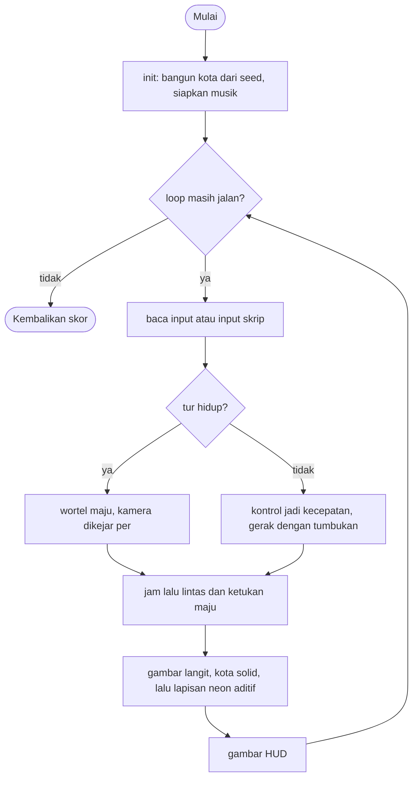

# Synthwave City - design brief

**Owner:** Leader  **Folder:** `deferred/synthwave_city/`  **Created:** 2026-11-16  **Asal mekanik:** port ke C dari `highsierralabs/Synthwave_City` (Kris E. Granholm, lisensi MIT, lihat `THIRD_PARTY_NOTICES.md`): rencana kota, model terbang, lalu lintas, dan komposisi lagu diterjemahkan dari TypeScript ke C99 dan dicocokkan angka demi angka. Tampilan WebGL (shader, pantulan basah, bloom HDR) **tidak** dibawa: diganti render 3D raylib biasa.

## Hook
Terbang bebas di atas kota neon tanpa ujung saat matahari terbenam; tidak ada musuh, tidak ada game over, hanya kamera, jalan raya, dan lagu 105 BPM.

## Penjelasan sederhana
Kota dibuat dari satu angka seed: kisi 40 x 40 sel (satu sel 160 m, satu ubin 6400 m) yang berulang ke segala arah, jadi kamu bisa terbang selamanya. Isinya sekitar 16 ribu kotak gedung, 520 jalur lalu lintas, dua ribu lebih "situs" (hologram, lampu sorot, pilar, laser, papan berjalan), dan 12 menara raksasa. Kamu terbang bebas dengan WASD dan mouse, atau menyalakan tur otomatis: sebuah drone mengikuti garis tengah jalan dan kamera menyusulnya seperti per yang diredam. Ada enam titik pandang dan tiga suasana (matahari terbenam, tengah malam, Miami).

Di balik layar, `synthwave_city_step()` hanya memajukan jam, memindahkan kamera (bola kecil bersama kecepatan yang menabrak dan menggeser di dinding gedung), dan memutar jam ketukan. Semua yang terlihat adalah fungsi murni dari seed dan waktu, jadi kota dan lalu lintasnya selalu sama untuk seed yang sama. Seperti maket kota yang dikelilingi kamera: maketnya tidak berubah, hanya sudut pandangnya.

Kalau cuma punya 1 menit: tekan Spasi untuk tur, tekan 1-6 untuk melompat ke titik pandang, T untuk mengganti suasana.

## Kontrol
WASD atau panah: terbang (maju, mundur, geser). Tahan klik kiri dan seret mouse: melihat sekeliling. Klik kanan (tahan): dorongan kecepatan (x3.5). Roda mouse: skala kecepatan jelajah (0.25 sampai 4). Spasi: tur otomatis hidup atau mati (kontrol terbang apa pun mematikannya). 1-6: titik pandang (Sunset Avenue, Downtown Canyon, Rooftop, Panorama, Megatower, Plaza). T: ganti suasana. M: bisukan musik. Esc: keluar (kalau game dimulai dari arsip) atau kembali ke menu (kalau dimainkan di latar belakang hub, lihat bagian berikutnya).

## Dua cara menjalankannya
1. **`play()`**: game biasa dengan loop-nya sendiri. Muncul di menu setelah arsip dibuka, dan dipakai oleh smoke run.
2. **Sesi tamu** (`synthwave_city_session.h`): hub menjalankan game yang sama di belakang menunya, di dalam loop hub. Selama menu tampil, hub memberi input kosong, jadi hanya drone tur yang menggerakkan kamera, lagu diputar pelan (volume 0.3), dan HUD disembunyikan. Saat pemain mengklik latar belakang, hub memanggil `swc_session_set_control(true)`: input nyata dibaca, HUD tampil (teksnya "ESC: menu"), dan lagu penuh (0.8). `Esc` memanggil `swc_session_set_control(false)`: sesi mengirim satu tekan `action_pressed` (sama dengan Spasi) bila tur sedang mati, sehingga drone mengambil kamera dari posisi terakhir tanpa lompatan. Klik yang menyembunyikan menu tidak boleh menjadi "seret" (itu kontrol terbang yang mematikan tur); aturan itu ada di `screens.c`, dan tiga tes logic (`test_an_idle_host_leaves_the_drone_flying`, `test_a_lone_space_press_hands_the_camera_back_to_the_drone`, `test_the_click_that_takes_the_camera_does_not_turn_it`) mengunci apa yang diandalkan hub.

Sesi tamu dan `play()` masing-masing punya `synthwave_city_State` dan `Soundtrack` sendiri. Yang dipakai bersama hanya tekstur renderer, dan itu dihitung referensinya (`swc_render_init/shutdown`).

## Aturan dan skor
- Kota adalah fungsi dari `seed`; ubin 6400 m berulang, jadi posisi x dan z selalu dibungkus ke `0..6400`.
- Kamera adalah bola berjari-jari 1.8 m; tidak bisa masuk ke gedung (menabrak berarti menggeser di sepanjang dinding) dan tidak bisa lebih rendah dari jari-jarinya atau lebih tinggi dari 1500 m.
- Kecepatan puncak = `45 m/s * (1 + tinggi / 300) * skala_roda`, dorongan klik kanan mengalikan 3.5; kecepatan mendekati yang diminta kontrol secara eksponensial (`RESPONSE` 3 per detik).
- Gerak dipecah menjadi sub-langkah <= 1.5 m dan langkah fisika <= 1/120 detik, jadi 30 Hz dan 60 Hz menempuh jalur yang sama.
- Tur: "wortel" berjalan di garis tengah jalan, berbelok acak di persimpangan, naik dan turun; kamera mengejarnya dengan per teredam kritis dan tidak pernah menyentuh gedung.
- Lalu lintas: kendaraan beredar di jalur dengan periode tepat 4096 detik (fungsi murni dari waktu, tanpa state).
- Musik: lagu 105 BPM, bar 16 sampai 31 dari gerakan pertama diputar berulang; denyut ketukan menggerakkan kilau neon.
- **Skor = jumlah kilometer penuh yang ditempuh.** Game ini tidak pernah "selesai" dan tidak masuk ranking (`ranked = false`).

## Cara kerja per frame
1. `arcade_poll()` mengisi `ArcadeInput` (di smoke run, `scripted_input()` menggantikan "monyet" acak dengan film singkat yang menyentuh semua kontrol).
2. `synthwave_city_step()`: tombol angka, T, dan Spasi diproses; kontrol terbang mematikan tur.
3. Tur: wortel maju dan kamera dikejar per; atau terbang bebas: kontrol menjadi kecepatan yang diminta, lalu `swc_flight_move()` menggerakkan bola dengan tumbukan.
4. Jam lalu lintas dan jam ketukan bertambah; front-end menyamakan jam ketukan dengan audio jika selisihnya > 0.06 detik.
5. `swc_render_scene()` menggambar langit 2D, lalu tanah, gedung, dan kendaraan (solid), lalu garis neon, tekstur jendela, dan sprite kilau (aditif) dengan kamera sebagai pusat.
6. `draw_overlay()` menggambar HUD; `arcade_frame_end()` menutup frame. (Langkah 2 sampai 6 dipakai bersama oleh `play()` dan sesi tamu lewat `game_step()` dan `game_draw()`.)

## Peta file
| File | Isinya | Edit di sini kalau ... |
|---|---|---|
| `swc_core.h` | konstanta ubin, RNG `mulberry32`/`hash32`, matematika kecil | mengubah ukuran dunia atau RNG (jangan: parit paritas) |
| `swc_city.h`, `swc_city.c` | pembangkit kota (sel, kotak, situs, jalur, landmark) dan pertanyaan (`height_at`, `volume_blocked`, `collide`) | mengubah bentuk kota |
| `swc_traffic.h`, `swc_traffic.c` | posisi dan jenis kendaraan sebagai fungsi waktu | mengubah lalu lintas |
| `swc_song.h`, `swc_song.c` | komposisi (bentuk, akor, nada) dan penerjemah ke `SynthNote` | mengubah lagu |
| `synthwave_city_logic.h`, `.c` | state, kamera terbang, tur, titik pandang, jam (tanpa raylib) | mengubah kontrol atau aturan terbang |
| `synthwave_city_front.h` | antarmuka kecil ke penggambar (tanpa tipe raylib) | menambah fungsi gambar publik |
| `synthwave_city_session.h` | antarmuka untuk hub: sesi tamu (begin/end, siapa yang memegang kamera, update, draw, jeda dan bisukan lagu) | mengubah cara hub menjalankan game ini |
| `synthwave_city_render_game.c` | seluruh gambar 3D: langit, kabut, gedung, jendela, situs, kilau | mengubah tampilan |
| `synthwave_city_game.c` | loop raylib, HUD, musik, film skrip smoke run, sesi tamu, `GameDef` | mengubah HUD, musik, sesi tamu, atau teks di menu |
| `tests/*.c` | unit test untuk kota, lalu lintas, lagu, dan logic | menambah atau mengubah aturan |
| `CMakeLists.txt` | `arcade_add_game(...)` | menambah file `.c` atau test baru |
| `GAME.md` | dokumen ini | aturan atau kode berubah |
| `AGENTS.md` | instruksi untuk AI agent (tidak diterjemahkan) | jarang; ikuti aturan di file itu |

## Data penting (struct)
| Field | Tipe | Artinya |
|---|---|---|
| `city` | `SwcCity` | seluruh kota: `cells[1600]`, `boxes[]`, `sites[]`, `lanes[]`, `landmarks[]` (sekitar 2.5 MB: state harus statis) |
| `traffic` | `SwcTraffic` | kepadatan dan tabel jalur untuk kendaraan |
| `cam` | `SwcFlight` | posisi, kecepatan, `yaw`, `pitch` kamera (double) |
| `tour` | `SwcTour` | wortel (`px,py,pz`), sumbu, arah, belokan berikutnya, RNG |
| `views[6]` | `SwcViewpoint` | nama dan pose enam titik pandang (semuanya di udara bebas) |
| `touring`, `view` | bool, int | tur hidup; titik pandang terakhir (-1 jika belum ada) |
| `mood` | int | 0 matahari terbenam, 1 tengah malam, 2 Miami |
| `speed_scale` | double | skala roda mouse, 0.25 sampai 4 |
| `clock`, `beat_time` | double | detik dalam siklus lalu lintas (4096) dan dalam loop musik |
| `distance` | double | meter yang ditempuh (skor = jarak / 1000) |
| `prev_aim_x/y`, `prev_look` | float, float, bool | untuk menghitung seretan mouse tanpa lompatan di frame pertama |

## Fungsi-fungsi penting
| Fungsi | Tugas | Dipanggil dari |
|---|---|---|
| `swc_city_build` | membangun kota dari seed (bit-persis dengan versi web) | `synthwave_city_init`, tes |
| `swc_city_collide` | mendorong bola keluar dari kotak dan silinder | `swc_flight_move` |
| `swc_city_volume_blocked` | apakah satu titik berada di dalam bangunan | tur, tes |
| `swc_traffic_slot_near`, `swc_vehicle_present` | kendaraan di dekat posisi pada waktu tertentu | penggambar |
| `swc_song_init`, `swc_song_synth_notes` | menyusun lagu dan mengubah bar menjadi `SynthNote` | `music_start` |
| `swc_top_speed` | kecepatan puncak menurut tinggi dan skala | `swc_flight_step`, tes |
| `swc_flight_step`, `swc_flight_move` | kontrol menjadi kecepatan, lalu gerak dengan sub-langkah dan tumbukan | `synthwave_city_step`, tes |
| `swc_goto_view` | lompat ke titik pandang | `synthwave_city_step`, tes |
| `swc_render_scene` | satu frame 3D (clip plane 0.4 sampai 4000, kabut, lalu pass aditif) | `game_draw()` |
| `music_start`, `music_update` | merender loop lagu ke WAV di memori dan menyamakan jam ketukan | `play()`, sesi tamu |
| `game_step`, `game_draw` | satu langkah dan satu gambar game, dipakai bersama | `play()`, sesi tamu |
| `swc_session_begin/end/set_control/update/draw` | menjalankan game di dalam loop hub | `app/backdrop.c` |

## Angka yang bisa diutak-atik
| Konstanta | Nilai sekarang | File | Efek kalau diubah |
|---|---|---|---|
| `SWC_BASE_SPEED`, `SWC_ALTITUDE_SPEED` | 45 m/s, 300 m | `synthwave_city_logic.h` | kecepatan jelajah dan seberapa cepat ia naik dengan tinggi |
| `SWC_BOOST` | 3.5 | `synthwave_city_logic.h` | pengali dorongan klik kanan |
| `SWC_CAMERA_RADIUS`, `SWC_MAX_ALTITUDE` | 1.8 m, 1500 m | `synthwave_city_logic.h` | ukuran bola tumbukan, langit-langit terbang |
| `SWC_FOV_DEG` | 62 | `synthwave_city_logic.h` | sudut pandang vertikal |
| `RESPONSE`, `LOOK_SENSITIVITY` | 3.0 /s, 0.0032 rad/px | `synthwave_city_logic.c` | kelincahan kendali dan kepekaan mouse |
| `SWC_MUSIC_FIRST_BAR`, `SWC_MUSIC_BARS` | 16, 16 | `synthwave_city_logic.h` | bagian lagu yang diputar berulang |
| `fog` (jarak 700 / 780 / 620 m, tinggi 240 m) | di `synthwave_city_render_game.c` | | seberapa jauh kota terlihat sebelum menyatu dengan langit |
| `CELL_RANGE`, `DRAW_DIST`, `WINDOW_DIST` | 15 sel, 1500 m, 320 m | `synthwave_city_render_game.c` | jarak gambar; paling berpengaruh pada kecepatan frame |
| `MAX_SPRITES` | 7000 | `synthwave_city_render_game.c` | jumlah kilau aditif per frame |

## Cara menjalankan dan menguji
```bash
# test logic saja (tanpa raylib)
cmake --preset logic && cmake --build --preset logic && ctest --preset logic -R "^synthwave_city\."

# main game-nya
cmake --preset dev && cmake --build --preset dev && build/dev/bin/arCade

# smoke run headless: 300 frame dan screenshot PNG (render CPU: sekitar 20 detik)
cmake --preset headless && cmake --build --preset headless && build/headless/bin/arCade --smoke synthwave_city --frames 300 --out smoke-out
```

| Test | Menjaga aturan apa |
|---|---|
| `test_matches_the_web_version` (kota) | jumlah kotak, bangunan, jalur, situs, landmark, jumlah sel per distrik, dan dua tinggi sampel sama dengan keluaran versi TypeScript untuk seed 1 dan 42 |
| `test_deterministic_and_seed_dependent`, `test_every_seed_fits_and_is_sane` | seed sama menghasilkan kota sama; semua seed muat di array dan tinggi masuk akal |
| `test_landmarks`, `test_height_wraps_round_the_tile` | menara raksasa ada; tinggi dan posisi dibungkus pada ubin |
| `test_collide_pushes_out_of_a_box`, `test_collide_leaves_open_air_alone` | tumbukan bola dengan kotak dan silinder |
| `test_lane_coordinates` | koordinat jalur di tengah jalan |
| `test_one_loop_returns_every_vehicle_to_its_start`, `test_vehicles_move_at_the_lane_speed_in_the_lane_direction` | lalu lintas periodik 4096 detik, arah dan kecepatan sesuai jalur |
| `test_speeds_are_plausible`, `test_neighbours_never_overlap_and_never_catch_up`, `test_slot_lookup_finds_the_vehicle_at_a_position` | kecepatan wajar, jarak antar mobil, pencarian slot |
| `test_mix_of_vehicles`, `test_density_changes_the_count`, `test_deterministic` (lalu lintas) | campuran jenis, kepadatan, determinisme |
| `test_matches_the_web_version` (lagu), `test_form_and_energy` | bentuk dan energi lagu sama dengan versi TypeScript |
| `test_every_note_is_well_formed_and_sorted`, `test_synth_loop_is_a_clean_loop`, `test_energy_eases_in_over_the_first_beat` | nada valid dan terurut; loop bersih; energi naik halus |
| `test_init_is_sane`, `test_the_six_viewpoints_are_in_free_air` | state awal; semua titik pandang di luar gedung |
| `test_the_tour_flies_on_its_own_and_never_hits_a_building` | drone terbang sendiri tanpa pernah menyentuh gedung |
| `test_flight_forward_reaches_top_speed`, `test_flight_does_not_depend_on_the_frame_rate` | kecepatan puncak; 30 dan 60 Hz menempuh jalur yang sama |
| `test_flying_into_a_wall_slides_and_never_enters` | menabrak dinding menggeser, tidak pernah menembus |
| `test_the_viewpoint_keys`, `test_mood_key_cycles`, `test_space_toggles_the_tour_and_controls_take_over` | tombol 1-6, T, Spasi |
| `test_dragging_looks_around_without_a_jump`, `test_wheel_scales_the_cruise_speed` | seret mouse dan roda |
| `test_clocks_loop`, `test_same_input_same_result` | jam berputar; deterministik |
| `test_monkey_never_breaks_it`, `test_big_and_bad_time_steps_are_survivable` | input acak dan dt buruk tidak pernah menghasilkan NaN atau kamera di dalam gedung |

## Jebakan dan hal yang perlu diingat
- `synthwave_city_State` sekitar 2.5 MB: harus `static` (di stack akan mematikan game). `play()` dan sesi tamu punya salinan `static` masing-masing.
- `swc_render_init()` dan `swc_render_shutdown()` dihitung referensinya. Kalau dua pemakai (latar belakang hub dan `play()` dari arsip) berbagi tekstur, `shutdown` yang pertama tidak boleh melepasnya; kalau tidak, latar belakang hub menjadi kosong. Smoke check `hub_city` menguji ini.
- Hub bergantung pada game ini lewat id `synthwave_city`: foldernya (di `games/` atau `deferred/`) harus tetap ada.
- Paritas dengan versi web dijaga ketat: RNG diambil ke variabel lokal agar urutan evaluasinya sama dengan JavaScript, kota dibangkitkan dengan `double`, kotak disimpan `float32`, dan pengurutan memakai insertion sort yang stabil. Proyek dikompilasi dengan `-ffp-contract=off`; jangan diubah atau angka kota bergeser.
- Smoke run memakai input skrip (`scripted_input`), bukan "monyet" acak, supaya screenshot menunjukkan kota dan bukan kamera yang tertahan di dinding.
- Penyimpangan dari versi web (sengaja): tidak ada pantulan jalan basah dan bloom HDR (diganti kabut ke warna cakrawala, pelapis jendela aditif, dan sprite kilau); hanya gerakan pertama lagu (loop bar 16 sampai 31) dengan suara synth inti arCade, tanpa dinamika dan tanpa suara noise; tur lebih sederhana dari versi web.
- Penyimpangan: tidak ada ranking (tidak ada skor yang bermakna) dan game tidak pernah `finished`; keluar dengan Esc.
- Ada garis lengkung samar di cakrawala saat terbang sangat tinggi (mode Panorama): langit 2D dan tanah 3D tidak disambung mulus.
- Render CPU (smoke headless) sekitar 65 ms per frame, jadi 300 frame butuh sekitar 20 detik; di GPU jauh lebih cepat.
- Logic tidak boleh memanggil `rand`, `srand`, `time`, atau `clock`: semua acak dari `SwcRng` yang diberi seed.

## Langkah implementasi (Implementation steps)
1. Salin aturan ke `swc_core.h` (RNG, konstanta) dan `swc_city.c`; bandingkan keluaran C dengan versi TypeScript lewat tes angka sampai identik.
2. Tulis lalu lintas dan lagu dengan cara yang sama (fungsi murni dari seed dan waktu).
3. Tulis `synthwave_city_logic.c`: kamera terbang dengan tumbukan, tur, titik pandang, jam. Tulis tesnya terlebih dahulu.
4. Tulis penggambar 3D di `synthwave_city_render_game.c` dengan rlgl, semuanya relatif terhadap kamera.
5. Tulis `synthwave_city_game.c`: loop, HUD, musik, input skrip untuk smoke run.
6. Kalau menambah aturan: tulis tesnya dulu, lalu ubah logic, lalu perbarui bagian Jebakan dan tabel di dokumen ini.

## Pseudocode (untuk laporan)
```
PROSEDUR step(s, input, dt)
    dt = min(dt, 0.25)
    JIKA tombol angka 1-6 MAKA lompat ke titik pandang; tur = salah
    JIKA tombol T MAKA mood = (mood + 1) mod 3
    JIKA Spasi MAKA tur = NOT tur
    JIKA ada kontrol terbang MAKA tur = salah
    JIKA tur MAKA
        wortel maju di garis tengah jalan; kamera dikejar per teredam
    LAIN
        UNTUK setiap potongan dt <= 1/120:
            kecepatan_diminta = kontrol * kecepatan_puncak(tinggi, skala)
            kecepatan mendekati kecepatan_diminta secara eksponensial
            gerak dalam sub-langkah <= 1.5 m; tumbukan menggeser di dinding
    clock += dt; beat_time += dt; distance += jarak_ditempuh
AKHIR PROSEDUR
```

## Flowchart (untuk laporan)


## Konsep kuliah yang dipakai (untuk Bab I laporan)
| Konsep (Pertemuan) | Di mana (file : fungsi) |
|---|---|
| Struct (13) | `synthwave_city_logic.h` : `synthwave_city_State`, `SwcFlight`; `swc_city.h` : `SwcBox`, `SwcSite` |
| Array (9) | `swc_city.h` : `cells[]`, `boxes[]`, `sites[]`, `lanes[]`; `synthwave_city_logic.h` : `views[]` |
| Perulangan (6-7) | `swc_city.c` : `swc_city_build` (setiap sel); `synthwave_city_logic.c` : `swc_flight_move` (sub-langkah) |
| Percabangan (5) | `synthwave_city_logic.c` : `synthwave_city_step` (tur atau terbang bebas, tombol) |
| Fungsi (11) | `synthwave_city_logic.c` : `swc_top_speed`, `swc_goto_view`; `swc_song.c` : `swc_song_bar` |
| Tipe data (3) | `synthwave_city_logic.h` : `double` untuk posisi kamera, `float` untuk kotak |
| Pointer (10) | semua fungsi menerima `synthwave_city_State *s`; `synthwave_city_game.c` : `static synthwave_city_State s` |
| Fungsi matematika (12) | `synthwave_city_logic.c` : `sin`, `cos` untuk arah pandang |
| Sorting (14) | `swc_city.c`, `swc_song.c` : insertion sort stabil |
