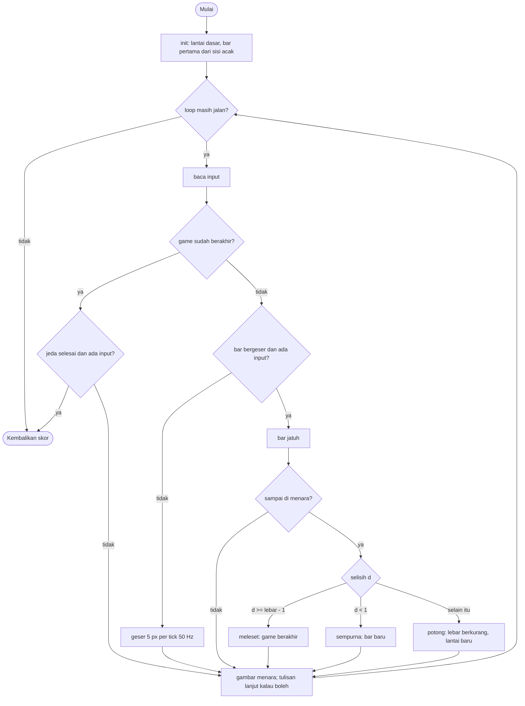

# Tower Stacker - design brief

**Owner:** Leader  **Folder:** `deferred/tower_stacker/`  **Created:** 2026-11-12  **Status:** v1 sudah jalan (bar dari kiri/kanan acak, tower scroll, zoom akhir, tap untuk lanjut)

## Hook
Satu batang meluncur bolak-balik di atas menara. Tekan satu tombol untuk menjatuhkannya: bagian yang menjorok keluar dari lantai di bawahnya dipotong dan jatuh pudar, sisanya menjadi lantai baru, jadi menara makin sempit. Landasan yang pas sempurna menjaga lebar penuh. Meleset sepenuhnya berarti selesai, lalu kamu bisa melihat menara yang sudah kamu bangun sebelum lanjut.

## Penjelasan sederhana
Bayangkan menumpuk papan di atas papan. Papan baru selalu selebar lantai teratas, dan ia berjalan ke kiri-kanan di atasnya. Kamu menjatuhkannya kapan saja. Kalau papan itu jatuh tepat di atas lantai, lebarnya utuh. Kalau agak bergeser, bagian yang melewati tepi lantai terpotong, sehingga lantai berikutnya lebih sempit sebesar geseran itu. Makin sering meleset sedikit, makin kecil papan yang tersisa. Skor adalah jumlah lantai yang berhasil ditumpuk di atas lantai dasar.

Bar tidak selalu datang dari sisi yang sama. Setiap bar baru memilih acak (50/50) apakah ia muncul dari **kiri** (bergerak ke kanan) atau dari **kanan** (bergerak ke kiri), jadi kamu tidak bisa menghafal ritmenya.

Setelah game berakhir, layar tidak langsung pindah ke papan skor. Menara yang sudah jadi tetap tampil (kalau tingginya 10 lantai atau lebih, kamera zoom-out dulu supaya seluruh menara muat), dan sebuah tulisan berkedip meminta **klik atau tombol apa saja untuk lanjut**. Game baru benar-benar selesai pada tap itu.

Ada satu hal yang membuat game ini adil: bar bergerak dengan langkah bulat 5 px pada jam 50 Hz (bukan menurut `dt`), dan posisi awalnya dipilih supaya `bar_x` selalu punya sisa bagi 5 yang sama dengan tepi kiri lantai di bawahnya. Akibatnya ada saat di mana bar tepat di atas lantai (selisih 0), jadi landasan sempurna selalu bisa dicapai, dari kiri maupun dari kanan.

Aturan ada di `tower_stacker_logic.c` (tanpa raylib, bisa di-test di terminal). `tower_stacker_game.c` hanya membaca input, menggambar, dan memutar bunyi.

**Kalau cuma punya 1 menit:** `land` adalah jantung game (meleset / sempurna / potong); `new_bar` memilih sisi masuk dan menjaga keselarasan mod 5; `tower_stacker_step` menjalankan jam 5 px dan, setelah game berakhir, menunggu tap (`can_continue`).

## Kontrol
Klik kiri, Spasi, Enter, tombol karakter apa saja, atau panah menjatuhkan bar. Setelah game berakhir, input yang sama menutup layar menara (hanya setelah tulisan "click / any key to continue" muncul). Esc keluar kapan saja; kalau game sudah berakhir, skornya tetap dihitung.

## Aturan dan skor
Skor = jumlah lantai di atas lantai dasar. Game berakhir kalau bar mendarat tanpa menyentuh lantai atas sama sekali, atau kalau lantai ke-1023 tercapai (batas array, ditampilkan sebagai "TOWER COMPLETE!").

Detail dari kode (`land`, `d = |bar_x - base_x|`, selisih tepi kiri bar dan lantai):
- `d >= base_w - 1`: tidak ada tumpang tindih, `TS_MISSED`, game berakhir.
- `d < 1`: **sempurna**. Lebar tetap, `perfects++`, bar baru langsung muncul.
- selain itu: **potong**. `base_w -= d`; potongan selebar `d` menjadi bar yang jatuh pelan dan memudar selama 0,5 detik (`TS_FADING`). Kalau bar ada di kanan lantai, lantai baru mulai di `bar_x` dan potongan duduk di ujung kanannya; kalau di kiri, `base_x` tetap dan potongan tetap di `bar_x`.
- Kelas nada potong (`last_cut_class`): `d < 10` kelas 0, `d < 30` kelas 1, selain itu kelas 2.
- Tiap pendaratan yang tidak meleset menambah `score` dan memanggil `record_floor` (menyimpan `bases_x[]`, `bases_w[]` dengan pembulatan ke atas, dan melempar jendela).
- Jendela: tiap lantai punya sampai 3 jendela kuning; tiap jendela muncul dengan peluang 50% hanya kalau lantai selebar 31 px atau lebih, di `x` acak antara `bases_x + 10` dan `bases_x + bases_w - 20`. Hanya hiasan.
- Sampai lantai ke-9 menara "naik" (garis pendaratan `base_y` naik satu lantai per poin). Dari `TS_SCROLL_FLOORS` (10) garis pendaratan berhenti naik dan menara turun 1 px per tick (`base_y_move`) sampai puncaknya mencapai garis itu.
- Setelah game berakhir: jeda `TS_OVER_DELAY_SHORT` (0,8 detik) untuk menara di bawah 10 lantai, atau zoom-out `TS_ZOOM_TIME` (2,5 detik) untuk 10 lantai ke atas. Sesudahnya `tower_stacker_can_continue` bernilai `true` sampai pemain menekan sesuatu.

Meleset hanya mungkin kalau menara sudah cukup sempit. Bar tidak boleh keluar lapangan, jadi di lantai dasar (lebar 240, tepi kiri 120) selisih terbesar yang mungkin hanya 120 px, kurang dari `base_w - 1`. Test memaksa `bar_x` langsung untuk menguji meleset.

## Cara kerja per frame
1. `arcade_poll(&in)` mengisi `ArcadeInput`. Yang dihitung sebagai "jatuhkan atau lanjut" (`drop_requested`): `fire_pressed`, `action_pressed`, `typed`, dan tombol arah `*_pressed`.
2. `tower_stacker_step(&s, &in, ARC_DT)`:
   1. Kalau `over` sudah `true`: `over_t += dt`; kalau `tower_stacker_can_continue` dan ada `drop_requested`, `done = true`. Lalu keluar. Tap sebelum jeda selesai diabaikan.
   2. Kalau `state == TS_SLIDING` dan ada `drop_requested`: `state = TS_FALLING`, `bar_spx = 0` (x dibekukan), `bar_spy = speed_y`. Ini hanya terjadi sekali per bar.
   3. `k = dt * 50`. Kalau masih `TS_SLIDING`: `bar_acc += k`; selama `bar_acc >= 1`, panggil `slide_tick` (geser 5 px, pantul di dinding). Jadi bar bergerak dalam langkah 5 px pada jam 50 Hz, berapa pun frame rate-nya.
   4. `bar_y += bar_spy * k` (jatuh).
   5. Kalau `score >= 10` dan `base_y_move < base_y`: `base_y_move += k` (menara scroll turun).
   6. Kalau `TS_FADING`: `bar_alpha -= dt / 0.5`; saat `<= 0`, `new_bar`; lalu keluar.
   7. Kalau `TS_FALLING` dan `bar_y >= base_y`: `land`.
3. `land` memutuskan meleset / sempurna / potong (lihat Aturan), lalu `record_floor` dan `new_bar` (setelah memudar kalau ada potongan).
4. `new_bar` mengatur bar berikutnya: lebar `base_w`, dan dengan peluang 50% (`rng_chance`) mulai dari kanan (`bar_x = base_x + 5 * floor((w - bar_w - base_x) / 5)`, `bar_spx = -5`) atau dari kiri (`bar_x = base_x mod 5`, `bar_spx = +5`).
5. Front-end: bandingkan `perfects` dan `cuts` dengan frame lalu untuk memutar bunyi, gambar dunia (menara, bar, angka skor pudar, "MISSED!", dan tulisan lanjut yang berkedip selama `can_continue`), panel bantuan dan panel lantai.
6. Kalau `tower_stacker_is_over(&s)` (yaitu `done`): loop berhenti. `GameResult.finished = s.over`, jadi Esc sesudah game berakhir tetap menyimpan skor.

## Peta file
| File | Isinya | Edit di sini kalau ... |
|------|--------|------------------------|
| `tower_stacker_logic.h` | Konstanta `TS_*`, struct `tower_stacker_State`, fungsi publik (`can_continue`, `zoom`) | menambah field state atau mengubah ukuran array |
| `tower_stacker_logic.c` | `new_bar`, `land`, `record_floor`, `slide_tick`, `tower_stacker_step`, `tower_stacker_zoom`, `can_continue` | mengubah aturan potong, sisi masuk bar, atau alur setelah game berakhir |
| `tower_stacker_game.c` | Loop raylib, menggambar menara/bar/panel, bunyi, tulisan lanjut, `game_tower_stacker_def` | mengubah tampilan, teks, atau bunyi |
| `tests/test_tower_stacker.c` | 29 unit test (hanya logic) | menambah atau mengubah aturan |
| `CMakeLists.txt` | Mendaftarkan game ke build | menambah file `.c` atau test baru |
| `core/include/arcade/playfield.h` | Lapangan potret 480 x 684 yang dipakai bersama | jarang |
| `GAME.md` | Dokumen ini | aturan atau kode berubah |
| `AGENTS.md` | Instruksi untuk AI agent (tidak diterjemahkan) | jarang; ikuti aturan di file itu |

## Data penting (struct)
`tower_stacker_State`: seluruh keadaan game. Koordinat lokal lapangan, y membesar ke bawah.

| Field | Tipe | Artinya |
|-------|------|---------|
| `w`, `h` | `int` | ukuran lapangan (480 x 684 di game; 480 x 800 di test supaya angka spesifikasi berlaku) |
| `base_w0`, `base_h0`, `base_x0` | `float` | lebar awal (`w/2`), tinggi lantai (`(int)(h/20)`), x awal (`(w - base_w0)/2`) |
| `bar_y0`, `speed_x`, `speed_y` | `float` | tinggi bar menunggu (`h/4`), kecepatan samping 5 px/tick, kecepatan jatuh (bar sampai ke menara dalam 50 tick = 1 detik) |
| `base_x`, `base_w`, `base_h` | `float` | tepi kiri, lebar, dan tinggi lantai teratas |
| `base_y`, `base_y_move` | `float` | garis pendaratan (puncak lantai teratas, berhenti naik setelah lantai 9) dan tempat puncak menara digambar sekarang (scroll turun) |
| `score` | `int` | lantai di atas lantai dasar |
| `bases_x[]`, `bases_w[]` | `int` | tepi kiri dan lebar tiap lantai, dibulatkan ke atas (1024 elemen) |
| `window[][TS_WINDOWS]` | `int` | x tiap jendela per lantai; 0 = tidak ada |
| `state` | `int` | `TS_SLIDING`, `TS_FALLING`, `TS_FADING`, atau `TS_MISSED` |
| `bar_x`, `bar_y` | `float` | tepi kiri dan tepi **bawah** bar (atau potongan yang memudar) |
| `bar_w`, `bar_h` | `float` | ukuran bar |
| `bar_spx`, `bar_spy` | `float` | kecepatan: x per tick (+5, -5, atau 0), y per tick |
| `bar_alpha`, `bar_acc` | `float` | transparansi potongan; sub-jam 50 Hz untuk langkah 5 px |
| `over`, `capped` | `bool` | game berakhir; berakhir karena lantai penuh (1023) |
| `done` | `bool` | pemain sudah menekan lanjut setelah game berakhir (inilah arti `is_over`) |
| `over_t` | `float` | detik sejak game berakhir (menggerakkan zoom dan jeda) |
| `perfects`, `cuts`, `landings` | `int` | penghitung kejadian untuk bunyi |
| `last_cut_class`, `last_cut_d` | `int`, `float` | kelas nada dan besar potongan terakhir |
| `rng` | `Rng` | pengacak deterministik: jendela dan sisi masuk bar |

## Fungsi-fungsi penting
| Fungsi | Tugas | Dipanggil dari |
|--------|-------|----------------|
| `tower_stacker_init(s, seed)` / `_init_sized(s, seed, w, h)` | Mengosongkan state, menghitung konstanta dari ukuran lapangan, mencatat lantai 0, membuat bar pertama | `play()`, test |
| `tower_stacker_step(s, in, dt)` | Satu langkah logic (lihat "Cara kerja per frame") | `play()` tiap frame, test |
| `tower_stacker_is_over(s)` | `true` hanya setelah pemain menekan lanjut (`done`) | `play()` untuk menghentikan loop |
| `tower_stacker_can_continue(s)` | `true` dari akhir jeda sampai tap: saatnya menampilkan tulisan lanjut | `tower_stacker_step`, `play()`, test |
| `tower_stacker_score(s)` | Jumlah lantai | `play()` |
| `tower_stacker_zoom(s, &top, &h)` | Posisi atas dan tinggi lantai saat zoom-to-fit; fungsi murni dari `over_t` | `play()`, test |
| `new_bar(s)` (static) | Membuat bar berikutnya, sisi masuk acak, keselarasan mod 5 | `init`, `land`, `step` |
| `land(s)` (static) | Meleset, sempurna, atau potong; menambah skor | `tower_stacker_step` |
| `record_floor(s)` (static) | Menyimpan lantai baru dan melempar jendela | `init`, `land` |
| `slide_tick(s)` (static) | Satu langkah 5 px lalu pantul di dinding | `tower_stacker_step` |
| `drop_requested(in)` (static) | Apakah ada input yang berarti "jatuhkan" atau "lanjut" | `tower_stacker_step` |
| `reveal_time(s)` (static) | 0,8 atau 2,5 detik, tergantung tinggi menara | `can_continue` |

## Angka yang bisa diutak-atik
| Konstanta | Nilai sekarang | File | Efek kalau diubah |
|-----------|----------------|------|-------------------|
| `TS_BAR_SPEED_X` | `5` px per tick 50 Hz | `tower_stacker_logic.c` | kecepatan bar (jaga tetap bilangan bulat supaya keselarasan mod 5 tetap berlaku) |
| `TS_SCROLL_FLOORS` | `10` | `tower_stacker_logic.h` | lantai tempat menara mulai scroll dan zoom akhir aktif |
| `TS_ZOOM_TIME` | `2.5` detik | `tower_stacker_logic.h` | lama zoom-out sebelum tulisan lanjut muncul (10+ lantai) |
| `TS_OVER_DELAY_SHORT` | `0.8` detik | `tower_stacker_logic.h` | jeda sebelum tulisan lanjut untuk menara pendek |
| `TS_MAX_FLOORS` | `1023` | `tower_stacker_logic.h` | batas lantai; array berukuran `TS_MAX_FLOORS + 1` |
| `TS_WINDOWS` | `3` | `tower_stacker_logic.h` | jumlah maksimum jendela per lantai |
| peluang sisi kanan (angka langsung di `new_bar`) | `0.5` | `tower_stacker_logic.c` | seberapa sering bar datang dari kanan (0 = selalu kiri, 1 = selalu kanan) |
| batas sempurna (angka langsung di `land`) | `d < 1` | `tower_stacker_logic.c` | seberapa ketat landasan sempurna |
| batas kelas nada potong (angka langsung di `land`) | `10` dan `30` | `tower_stacker_logic.c` | nada mana yang diputar |
| lama memudar (angka langsung di `step`) | `0.5` detik | `tower_stacker_logic.c` | lama potongan jatuh sebelum bar baru muncul |
| lebar awal, tinggi lantai, tinggi bar | `w/2`, `h/20`, `h/4` | `tower_stacker_logic.c` | tampilan dan kesulitan awal |
| nada bunyi (di `play`) | potong 523/392/262 Hz, sempurna 1047 Hz, kalah 110 Hz | `tower_stacker_game.c` | hanya bunyi |

## Cara menjalankan dan menguji
```bash
# test logic saja (tanpa raylib, ~1 detik)
cmake --preset logic && cmake --build --preset logic && ctest --preset logic -R "^tower_stacker\."

# main game-nya
cmake --preset dev && cmake --build --preset dev && build/dev/bin/arCade

# smoke run headless: jalankan game 300 frame dan simpan screenshot PNG
cmake --preset headless && cmake --build --preset headless && build/headless/bin/arCade --smoke tower_stacker --frames 300 --out smoke-out
```
Catatan: smoke run memakai input monkey acak, jadi game cepat berakhir dan monkey menekan lanjut. Untuk melihat layar menara, mainkan sendiri.

| Test | Menjaga aturan apa |
|------|--------------------|
| `test_init_is_sane` | Awal game: belum selesai, skor 0, tinggi lantai 34 di lapangan 684, bar sedang bergeser |
| `test_spec_constants_at_480x800` | Konstanta turunan di 480 x 800: 240, 40, 120, 200, kecepatan jatuh 11,2, lantai dasar di y = 760 |
| `test_cut_on_the_right_drop_at_150` | Bar di kanan (d = 30): lebar 210, lantai baru mulai di 150, potongan 30 px di x = 360, kelas nada 2 |
| `test_cut_on_the_left_drop_at_105` | Bar di kiri (d = 15): lebar 225, `base_x` tidak berubah, potongan di `bar_x`, kelas nada 1 |
| `test_perfect_at_120_4_keeps_the_full_width` | d = 0,4 dihitung sempurna: lebar penuh, bar baru tanpa potongan |
| `test_no_overlap_ends_the_game` | d = 241 meleset dan game berakhir; menunggu tanpa tap tidak menutupnya; d = 238 masih tumpang tindih |
| `test_cut_class_boundaries` | Batas kelas nada: 9,9 kelas 0; 10 dan 29,9 kelas 1; 30 kelas 2 |
| `test_tower_scrolls_from_floor_10` | Garis pendaratan berhenti naik di y = 400 dan menara scroll turun 40 px dalam 40 tick |
| `test_bar_stays_aligned_mod_5_at_60hz` | Selisih `bar_x` dan `base_x` selalu kelipatan 5 selama 1000 frame 60 Hz |
| `test_alignment_survives_cuts_and_random_play` | Keselarasan mod 5 bertahan lewat potongan dan input monkey (20 seed) |
| `test_scripted_player_gets_perfects_at_60hz` | Pemain skrip yang menekan saat bar tepat di atas menara mendapat 15 sempurna di 60 Hz |
| `test_fade_takes_half_a_second_and_blocks_a_second_drop` | Potongan memudar sekitar 0,5 detik; tap saat memudar tidak berpengaruh; bar baru memakai lebar baru |
| `test_drop_only_once_per_bar` | Menekan berkali-kali tidak menggandakan kecepatan jatuh |
| `test_windows_follow_the_rules` | Jendela hanya di lantai 31 px ke atas dan di dalam rentang x yang benar |
| `test_floor_cap_ends_the_game` | Lantai ke-1023 mengakhiri game dengan `capped`, array tidak terlewati |
| `test_zoom_to_fit_after_a_tall_game` | Setelah 10+ lantai: zoom berakhir dengan atas = 160, tinggi 58,18, dan semua lantai pas sampai dasar |
| `test_long_reveal_for_tall_towers` | Tulisan lanjut baru muncul setelah 2,5 detik untuk menara tinggi |
| `test_dropping_at_once_ends_the_game` | Pemain yang menjatuhkan bar terus-menerus pasti berakhir dengan skor >= 1 |
| `test_bars_enter_from_both_sides` | Dari 40 seed, tiap sisi muncul minimal 8 kali dan posisi awal sah (kiri: 0..4; kanan: di ujung kanan; selaras mod 5) |
| `test_every_new_bar_starts_aligned_on_either_side` | Setelah potongan kiri dan kanan bergantian, posisi awal tiap bar baru tetap sah dan kedua sisi terpakai |
| `test_a_right_start_moves_left_and_bounces` | Bar dari kanan bergerak ke kiri 5 px per tick, memantul di dinding kiri, tetap selaras |
| `test_perfects_are_reachable_from_both_sides` | Pemain skrip mendapat 12 sempurna berturut-turut di 8 seed, dengan bar dari kedua sisi |
| `test_a_short_tower_waits_for_a_tap` | Menara pendek: tap saat jeda diabaikan, 10 detik tanpa input tidak menutup, satu tap menutup dan tulisan hilang |
| `test_a_tall_tower_zooms_then_waits_for_a_tap` | Menara 10 lantai: tap terus-menerus selama zoom tidak melompatinya, zoom bertahan lama, tombol huruf pun melanjutkan, skor tetap 10 |
| `test_every_drop_input_can_continue` | Klik, aksi, tombol arah, dan karakter semuanya bisa melanjutkan |
| `test_a_full_tower_also_waits_for_a_tap` | Menara penuh (1023) juga menunggu tap |
| `test_no_tap_before_the_game_ends_closes_it` | Tap saat bermain hanya menjatuhkan bar, tidak pernah menutup game |
| `test_same_seed_same_result` | Seed sama dan input sama menghasilkan hasil yang sama |
| `test_monkey_never_breaks_invariants` | Input acak: skor, array, dan state selalu valid |

## Jebakan dan hal yang perlu diingat
- **`tower_stacker_is_over` berarti "pemain sudah menekan lanjut", bukan "game berakhir".** Untuk "game berakhir" pakai `s.over`. Test yang ingin tahu apakah layar menara sudah tampil memakai `can_continue`.
- **Esc sesudah game berakhir tetap menyimpan skor** (`finished = s.over`). Kalau tidak, pemain yang menekan Esc untuk keluar dari layar menara akan kehilangan skornya.
- Tap saat jeda (0,8 atau 2,5 detik) sengaja diabaikan supaya tap beruntun dari kebiasaan menjatuhkan bar tidak langsung menutup layar. Tidak ada perlindungan tambahan: tap pertama setelah jeda langsung menutup.
- Bar boleh menjorok sampai 4 px melewati dinding sebelum berbalik (`slide_tick` tidak memotong posisi). Front-end memakai scissor sehingga tidak terlihat.
- Langkah bar 5 px terjadi pada jam 50 Hz, jadi di layar 60 Hz gerakannya sedikit tersendat. Itu harga yang dibayar supaya landasan sempurna selalu bisa dicapai.
- Sisi masuk bar memakai `rng` yang sama dengan jendela, jadi urutan angka acak untuk seed tertentu berubah dibanding versi sebelum sisi acak ditambahkan (jendela lantai tidak sama persis).
- `bases_x[]` dan `bases_w[]` dibulatkan ke atas, tetapi aturan memakai nilai `float` (`base_x`, `base_w`). Array itu hanya untuk menggambar.
- Hampir semua fungsi `static`; yang publik hanya yang dipakai front-end dan test.
- Game ini `ranked = true`, `order = 160`.

## Langkah implementasi (Implementation steps)
Daftar ini adalah pengembangan dari v1.

1. Skip zoom: tap saat zoom berjalan melompat ke tampilan akhir (sekarang tap saat jeda sengaja diabaikan).
2. Tampilkan ringkasan di layar menara: jumlah sempurna, jumlah potongan, dan lebar akhir (datanya sudah ada: `perfects`, `cuts`, `base_w`).
3. Mode "tanpa dinding": bar masuk dari luar layar sehingga tidak ada overshoot 4 px.
4. Gerakan 60 Hz yang halus: interpolasi posisi gambar antara dua langkah 5 px tanpa mengubah posisi logika.
5. Tingkat kesulitan: kecepatan bar naik tiap 10 lantai (hati-hati: tetap kelipatan bilangan bulat supaya mod 5 aman).

## Pseudocode (untuk laporan)
```
PROSEDUR new_bar()
    bar.lebar <- base_w
    JIKA acak(0..1) < 0.5 MAKA            // dari kanan
        bar.x <- base_x + 5 * lantai((w - bar.lebar - base_x) / 5)
        bar.kecepatan <- -5
    JIKA TIDAK                              // dari kiri
        bar.x <- base_x - 5 * (base_x div 5)
        bar.kecepatan <- +5

PROSEDUR land()
    d <- |bar.x - base_x|
    JIKA d >= base_w - 1 MAKA meleset; game berakhir; selesai
    JIKA d < 1 MAKA sempurna; bar baru
    JIKA TIDAK potong: base_w <- base_w - d; potongan memudar
    JIKA score = 1023 MAKA game berakhir (penuh); selesai
    score <- score + 1; catat lantai

PROSEDUR step(input, dt)
    JIKA game sudah berakhir MAKA
        waktu_akhir <- waktu_akhir + dt
        JIKA sudah_boleh_lanjut DAN ada input MAKA selesai <- benar
        KEMBALI
    JIKA bar bergeser DAN ada input MAKA bar jatuh
    JIKA bar bergeser MAKA ulangi tiap 1/50 detik: geser 5 px, pantul di dinding
    gerakkan bar jatuh; scroll menara; urus potongan yang memudar
    JIKA bar jatuh DAN sampai di menara MAKA land()
```

## Flowchart (untuk laporan)


## Konsep kuliah yang dipakai
| Konsep (Pertemuan) | Di mana (file : fungsi) |
|--------------------|-------------------------|
| Struct (13) | `tower_stacker_logic.h` : `tower_stacker_State` |
| Array 1 dan 2 dimensi (9) | `tower_stacker_logic.h` : `bases_x[]`, `bases_w[]`, `window[][TS_WINDOWS]` |
| Perulangan (6) | `tower_stacker_logic.c` : sub-jam `while (bar_acc >= 1)`, loop jendela di `record_floor`; front-end menggambar tiap lantai |
| Percabangan (5) | `land` (meleset, sempurna, potong kiri atau kanan), `new_bar` (sisi masuk) |
| Prosedur, fungsi (11) | `record_floor`, `new_bar`, `slide_tick`, `can_continue`, `tower_stacker_zoom` |
| Pointer (10) | `tower_stacker_zoom(..., float *top_y, float *floor_h)` mengisi dua hasil; setiap parameter `tower_stacker_State *s` |
| Fungsi matematika (12) | `floorf` untuk titik awal bar dari kanan, `fabsf`, `arc_clampf` pada zoom |
