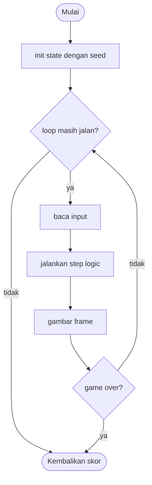

# @TITLE@ - design brief

**Owner:** @OWNER@  **Folder:** `games/@ID@/`  **Created:** @DATE@

> Cara pakai template ini: ganti semua `TODO(@OWNER@)` dengan isi yang sebenarnya, lalu hapus petunjuk berbentuk kutipan (baris yang diawali `>`). Tulis untuk teman satu tim yang belum pernah membuka kode game ini: kalimat pendek, istilah dijelaskan, dan angka diambil dari kode, bukan dari ingatan. Contoh isi yang sudah lengkap: `games/time_shooter/GAME.md`.

## Hook
TODO(@OWNER@): satu atau dua kalimat. Apa satu ide cerdas dari game ini?

## Penjelasan sederhana
> 2-4 paragraf pendek. Mulai dari apa yang dialami pemain, lalu apa yang dikerjakan komputer di baliknya, lalu kenapa kode dipisah jadi logic dan front-end. Pakai satu perumpamaan sehari-hari kalau membantu. Tutup dengan satu baris "Kalau cuma punya 1 menit: ...".

TODO(@OWNER@): jelaskan game ini tanpa jargon dulu.

## Kontrol
WASD / panah: bergerak. TODO: tulis kontrol yang sebenarnya (kontrol ini juga tampil di kartu menu lewat `GameDef.controls`).

## Aturan dan skor
TODO(@OWNER@): bagaimana cara menang, kalah, dan mendapat skor? Tulis rumus skor persis seperti di kode.

## Cara kerja per frame
> Daftar bernomor yang mengikuti SATU frame sesuai urutan di kode: baca input, `@ID@_step()`, menggambar. Sebut nama fungsi dan field yang sebenarnya.

TODO(@OWNER@): urutan langkah dalam satu frame.

## Peta file
| File | Isinya | Edit di sini kalau ... |
|------|--------|------------------------|
| `@ID@_logic.h` | struct `@ID@_State` dan fungsi publik (`init`, `step`, `is_over`, `score`) | menambah field state atau fungsi publik |
| `@ID@_logic.c` | semua aturan game (tanpa raylib) | mengubah aturan atau angka keseimbangan |
| `@ID@_game.c` | loop raylib, menggambar, `GameDef` (judul, kontrol di menu, urutan, ranked) | mengubah tampilan atau teks di menu |
| `tests/test_@ID@.c` | unit test (hanya logic) | menambah atau mengubah aturan |
| `CMakeLists.txt` | mendaftarkan game ke build lewat `arcade_add_game(...)` | menambah file `.c` atau test baru |
| `GAME.md` | dokumen ini | aturan atau kode berubah |
| `AGENTS.md` | instruksi untuk AI agent (tidak diterjemahkan) | jarang; ikuti aturan di file itu |

## Data penting (struct)
> Satu tabel per struct. Cantumkan SEMUA field struct state utama: nama, tipe, artinya (satuan, rentang nilai, siapa yang mengisi).

| Field | Tipe | Artinya |
|-------|------|---------|
| TODO | TODO | TODO |

## Fungsi-fungsi penting
| Fungsi | Tugas | Dipanggil dari |
|--------|-------|----------------|
| `@ID@_init` | TODO | TODO |
| `@ID@_step` | TODO | TODO |

## Angka yang bisa diutak-atik
> Hanya konstanta yang benar-benar ada di kode, termasuk angka langsung di dalam fungsi (tulis "angka langsung di dalam fungsi X").

| Konstanta | Nilai sekarang | File | Efek kalau diubah |
|-----------|----------------|------|-------------------|
| TODO | TODO | TODO | TODO |

## Cara menjalankan dan menguji
```bash
# test logic saja (tanpa raylib, ~1 detik)
cmake --preset logic && cmake --build --preset logic && ctest --preset logic -R "^@ID@\."

# main game-nya
cmake --preset dev && cmake --build --preset dev && build/dev/bin/arCade

# smoke run headless: jalankan game 300 frame dan simpan screenshot PNG
cmake --preset headless && cmake --build --preset headless && build/headless/bin/arCade --smoke @ID@ --frames 300 --out smoke-out
```

| Test | Menjaga aturan apa |
|------|--------------------|
| TODO | TODO |

## Jebakan dan hal yang perlu diingat
> 4-8 poin: aturan yang tidak boleh dilanggar, hal yang kelihatan seperti bug tapi memang disengaja, dan "kalau kamu mengubah X, ingat Y".

- TODO(@OWNER@): tulis invarian game ini (batas nilai, batas array, aturan menang/kalah, apa pun yang harus tetap benar).

## Langkah implementasi (Implementation steps)
1. TODO(@OWNER@): kembangkan `@ID@_State` dan `@ID@_step()` dengan mekanik yang sebenarnya (hanya di logic).
2. TODO(@OWNER@): tulis unit test untuk setiap aturan di `tests/test_@ID@.c`.
3. TODO(@OWNER@): gambar di `@ID@_game.c` (pakai helper `gfx_*` dan palet neon dari `arcade/gfx.h`).
4. TODO(@OWNER@): isi pseudocode, flowchart, dan tabel konsep di bawah.

## Pseudocode (untuk laporan)
```
PROSEDUR step(state, input, dt)
    JIKA game sudah selesai MAKA KEMBALI
    perbarui dunia game memakai input dan dt
    cek tabrakan dan perbarui skor
AKHIR PROSEDUR
```

## Flowchart (untuk laporan)


## Konsep kuliah yang dipakai (untuk Bab I laporan)
| Konsep (Pertemuan) | Di mana (file : fungsi) |
|--------------------|-------------------------|
| Struct (13) | `@ID@_logic.h` : `@ID@_State` |
| Percabangan (5) | `@ID@_logic.c` : `@ID@_step` |
| Fungsi (11) | `@ID@_logic.c` : `respawn_pellet` |
| TODO | TODO |
