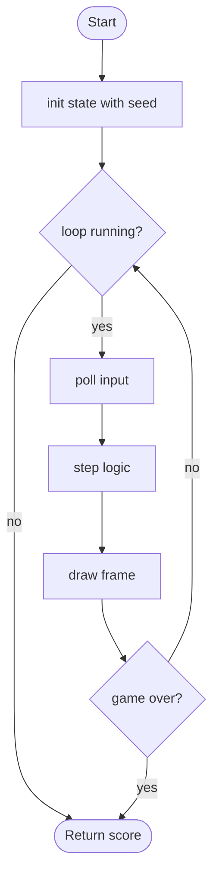

# @TITLE@ - design brief

**Owner:** @OWNER@  **Folder:** `games/@ID@/`  **Created:** @DATE@

## Hook
TODO(@OWNER@): one or two sentences. What is the single clever idea?

## Controls
WASD / arrows: move. TODO: list the real controls (they appear on the menu card via `GameDef.controls`).

## Rules and scoring
TODO(@OWNER@): how do you win, lose, and score?

## Implementation steps
1. TODO(@OWNER@): extend `@ID@_State` and `@ID@_step()` with the real mechanic (logic only).
2. TODO(@OWNER@): write a unit test for each rule in `tests/test_@ID@.c`.
3. TODO(@OWNER@): draw it in `@ID@_game.c` (use `gfx_*` helpers, neon palette from `arcade/gfx.h`).
4. TODO(@OWNER@): fill in the pseudocode, flowchart and concept table below.

## Pseudocode (for the report)
```
PROCEDURE step(state, input, dt)
    IF game is over THEN RETURN
    update the world using input and dt
    check collisions and update the score
END PROCEDURE
```

## Flowchart (for the report)


## Course concepts used (feeds Bab I of the report)
| Concept (Pertemuan) | Where (file : function) |
|---------------------|-------------------------|
| Struct (13) | `@ID@_logic.h` : `@ID@_State` |
| Percabangan (5) | `@ID@_logic.c` : `@ID@_step` |
| Fungsi (11) | `@ID@_logic.c` : `respawn_pellet` |
| TODO | TODO |
