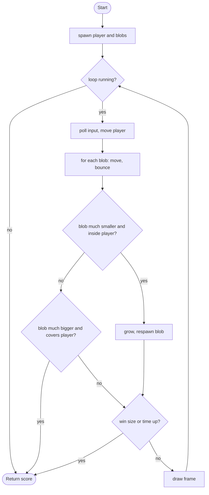

# Absorb and Grow - design brief

**Owner:** Member 6 (also report editor)  **Folder:** `games/absorb_grow/`  **Status:** placeholder (core loop works)

## Hook
Katamari in a petri dish: swallow anything clearly smaller than you, run from anything clearly bigger. Everything you absorb adds to your area, and newly spawned blobs are sized relative to you, so there is always food and always danger.

## Controls
WASD / arrows move (bigger = slower).

## Rules and scoring
Green blobs are edible, red are dangerous, yellow are about your size (harmless). Reach radius 150 to win, or survive 90 s. Score = 10 x radius + 5 per blob + a 500-point win bonus plus time left.

## Implementation steps
1. World that scrolls: make the arena bigger than the screen and add a camera offset (positions stay in world space in the logic; the front-end subtracts the camera).
2. Variety: blob kinds (fast, spiky = hurts when touched, poison), stored as a `kind` enum in `ag_Blob`.
3. Growth stages: at certain sizes the background and music change (array of stage thresholds, `switch` on stage).
4. Skin the blobs with a few polygons or a trail (struct array of past positions).
5. Tests: add one per new blob kind.

## Pseudocode (for the report)
```
PROCEDURE step(input, dt)
    time_left <- time_left - dt
    move the player (speed falls as radius grows), keep inside the arena
    FOR each blob
        move it and bounce off the arena edges
        d <- distance(blob, player)
        IF player.r > 1.1 * blob.r AND d < player.r - 0.3 * blob.r THEN
            player.r <- sqrt(player.r^2 + 0.7 * blob.r^2); absorbed <- absorbed + 1; respawn the blob
        ELSE IF blob.r > 1.1 * player.r AND d < blob.r - 0.3 * player.r THEN game over
    IF player.r >= 150 THEN win
    IF time_left <= 0 THEN game over
END PROCEDURE
```

## Flowchart (for the report)


## Course concepts used
| Concept (Pertemuan) | Where (file : function) |
|---------------------|-------------------------|
| Array of structs (9, 13) | `absorb_grow_State.blobs[AG_MAX_BLOBS]` of `ag_Blob` |
| Math function (12) | `sqrtf` area growth in `absorb_grow_step`, `vec2_dist` |
| Operator (4) | area formula, size comparisons (`1.1 * r`) |
| Perulangan (6) | loop over blobs in `absorb_grow_step` |
| Percabangan (5) | swallow / get swallowed / harmless cases |
| Fungsi (11) | `spawn_blob`, `absorb_grow_score` |
