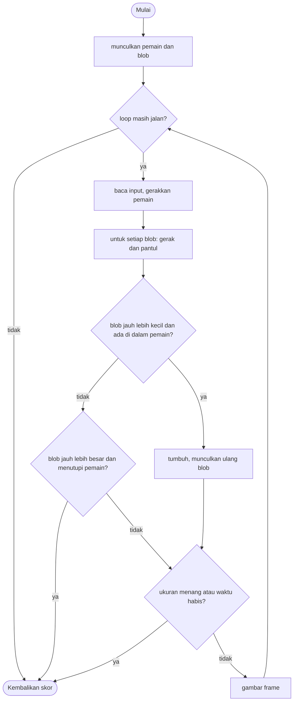

# Absorb and Grow - design brief

**Owner:** Member 6 (juga editor laporan)  **Folder:** `games/absorb_grow/`  **Status:** placeholder (loop utama sudah jalan)

## Hook
Katamari di cawan petri: telan apa pun yang jelas lebih kecil darimu, lari dari apa pun yang jelas lebih besar. Semua yang kamu serap menambah luasmu, dan blob baru selalu dibuat dengan ukuran relatif terhadap kamu, jadi selalu ada makanan dan selalu ada bahaya.

## Penjelasan sederhana
Kamu adalah satu lingkaran (blob) di arena seukuran layar yang penuh lingkaran lain yang melayang pelan. Aturannya sederhana: lingkaran yang jauh lebih kecil bisa kamu telan, yang jauh lebih besar akan menelanmu, dan yang ukurannya mirip tidak berbahaya. Warna di layar memberi tahu hubungan itu: hijau = bisa dimakan, merah = bahaya, kuning = mirip ukuranmu.

Setiap kali menelan sesuatu, **luasmu** bertambah (bukan jari-jarinya), dan sebagian luas hilang (hanya 70% yang masuk). Blob yang sudah ditelan langsung muncul lagi di tempat lain, dan ukurannya ditentukan dari ukuranmu saat itu (0,35x sampai 1,7x jari-jarimu). Karena itu dunia ikut "tumbuh" bersamamu: tidak pernah kehabisan makanan, tapi juga tidak pernah aman.

Game berakhir kalau kamu mencapai jari-jari 150 (menang), waktu 90 detik habis, atau kamu ditelan blob yang lebih besar.

Aturan ada di `absorb_grow_logic.c` (tanpa raylib, bisa di-test di terminal). `absorb_grow_game.c` hanya menggambar lingkaran, bar progres, dan partikel.

**Kalau cuma punya 1 menit:** inti game ada di dua baris di `absorb_grow_step`: syarat menelan (`s->r > b->r * 1.1f && d < s->r - b->r * 0.3f`) dan rumus pertumbuhan (`r = sqrt(r^2 + 0.7 * b.r^2)`). Ukuran blob baru yang relatif terhadap pemain ada di `spawn_blob`.

## Kontrol
WASD / panah untuk bergerak (makin besar, makin lambat).

## Aturan dan skor
Blob hijau bisa dimakan, merah berbahaya, kuning seukuranmu (tidak berbahaya). Capai jari-jari 150 untuk menang, atau bertahan 90 detik. Skor = 10 x jari-jari + 5 per blob + bonus menang 500 poin ditambah sisa waktu.

Rumus persisnya (`absorb_grow_score`): `(int)(r * 10) + absorbed * 5 + (menang ? 500 + (int)(time_left * 10) : 0)`. Jadi sisa waktu bernilai 10 poin per detik, dan skor tetap terisi walaupun kamu kalah (hanya tanpa bonus menang).

Aturan "jelas lebih kecil / lebih besar" memakai selisih 10% (faktor 1,1):
- **Menelan**: `r > blob.r * 1.1` dan jarak pusat `d < r - blob.r * 0.3`. Jadi pusat blob harus cukup dalam di dalam tubuhmu, bukan sekadar bersentuhan.
- **Ditelan**: `blob.r > r * 1.1` dan `d < blob.r - r * 0.3`. Game over.
- Selain itu tidak terjadi apa-apa.

## Cara kerja per frame
1. `arcade_poll(&in)` mengisi `ArcadeInput` (arah gerak `move_x`, `move_y`).
2. `absorb_grow_step(&s, &in, ARC_DT)`:
   1. Kalau `over` sudah `true`, langsung keluar. `time_left -= dt`.
   2. Kecepatan pemain `speed = max(90, 230 - r)` px/detik (makin besar makin lambat). Pemain bergerak sesuai arah input yang dinormalisasi, lalu dijaga tetap di dalam arena (x antara `r` dan lebar layar - `r`; y antara `TOP_MARGIN + r` dan tinggi layar - `r`).
   3. Untuk **setiap blob**: bergerak sebesar `vel * dt`; kalau menyentuh tepi arena, kecepatannya dibalik (memantul); posisinya dijaga di dalam arena; lalu dicek hubungannya dengan pemain:
      - kalau bisa ditelan: `r = sqrt(r^2 + 0.7 * b.r^2)`, `absorbed++`, `absorb_events++`, `last_absorb` diisi, dan blob muncul ulang lewat `spawn_blob`
      - kalau blob itu yang menelan pemain: `over = true` dan langsung selesai (`return`)
   4. Kalau `r >= AG_WIN_R`: `won = over = true`.
   5. Kalau `time_left <= 0`: `time_left = 0` dan `over = true`.
3. Front-end membandingkan `absorb_events` dengan hitungan terakhirnya; kalau berubah, ia memicu burst partikel di `last_absorb`. Lalu `draw()` menggambar backdrop, semua blob (warna menurut hubungan ukuran dengan pemain), pemain, dan bar "SIZE" di kiri bawah (progres `r / AG_WIN_R`). HUD menampilkan sisa waktu dan jumlah blob yang dimakan.
4. Kalau `absorb_grow_is_over()` bernilai `true`, loop berhenti.

## Peta file
| File | Isinya | Edit di sini kalau ... |
|------|--------|------------------------|
| `absorb_grow_logic.h` | Konstanta `AG_*`, struct `ag_Blob` dan `absorb_grow_State`, fungsi publik | menambah field state atau mengubah konstanta utama |
| `absorb_grow_logic.c` | `spawn_blob`, gerak pemain dan blob, aturan menelan/ditelan, skor | mengubah aturan atau keseimbangan |
| `absorb_grow_game.c` | Loop raylib, menggambar blob/pemain/bar progres, partikel, HUD, `game_absorb_grow_def` | mengubah tampilan atau teks di menu |
| `tests/test_absorb_grow.c` | 8 unit test (hanya logic) | menambah atau mengubah aturan |
| `CMakeLists.txt` | Mendaftarkan game ke build | menambah file `.c` atau test baru |
| `GAME.md` | Dokumen ini | aturan atau kode berubah |
| `AGENTS.md` | Instruksi untuk AI agent (tidak diterjemahkan) | jarang; ikuti aturan di file itu |

## Data penting (struct)
`ag_Blob`: satu blob selain pemain.

| Field | Tipe | Artinya |
|-------|------|---------|
| `pos` | `Vec2` | posisi pusat (piksel) |
| `vel` | `Vec2` | kecepatan melayang (piksel per detik), acak antara -30 dan 30 per sumbu |
| `r` | `float` | jari-jari (piksel) |

`absorb_grow_State`: seluruh keadaan game.

| Field | Tipe | Artinya |
|-------|------|---------|
| `pos` | `Vec2` | posisi pusat pemain |
| `r` | `float` | jari-jari pemain (awal `AG_START_R`) |
| `blobs[AG_MAX_BLOBS]` | `ag_Blob` | semua blob lain (selalu 40; yang ditelan langsung muncul ulang) |
| `absorbed` | `int` | jumlah blob yang sudah ditelan (+5 poin tiap blob) |
| `time_left` | `float` | sisa waktu dalam detik |
| `over`, `won` | `bool` | status akhir; `won` hanya `true` kalau mencapai `AG_WIN_R` |
| `last_absorb` | `Vec2` | posisi blob yang terakhir ditelan (untuk partikel di front-end) |
| `absorb_events` | `int` | naik satu setiap blob ditelan; front-end membandingkannya untuk memicu efek |
| `rng` | `Rng` | pengacak deterministik, di-seed dari `ctx->seed` |

## Fungsi-fungsi penting
| Fungsi | Tugas | Dipanggil dari |
|--------|-------|----------------|
| `absorb_grow_init(s, seed)` | Menaruh pemain di tengah layar, mengisi 40 blob, dan menjadikan setiap blob ke-7 (indeks 0, 7, 14, ...) "blob besar yang menakutkan" dengan jari-jari 30-60 | `play()`, test |
| `absorb_grow_step(s, in, dt)` | Satu langkah logic (lihat "Cara kerja per frame") | `play()` tiap frame, test |
| `absorb_grow_is_over(s)` | Mengembalikan `s->over` | `play()` |
| `absorb_grow_score(s)` | Rumus skor di atas | HUD, hasil akhir |
| `spawn_blob(s, b)` (static) | Mengatur ukuran blob (`r * U(0,35 .. 1,7)`, dijepit 5-200), mencari posisi acak sampai 8 kali yang jaraknya dari pemain > `r pemain + r blob + 80`, dan mengacak kecepatan | `absorb_grow_init`, `absorb_grow_step` |

## Angka yang bisa diutak-atik
| Konstanta | Nilai sekarang | File | Efek kalau diubah |
|-----------|----------------|------|-------------------|
| `AG_MAX_BLOBS` | `40` | `absorb_grow_logic.h` | jumlah blob di arena |
| `AG_START_R` | `14` px | `absorb_grow_logic.h` | jari-jari awal pemain (juga memengaruhi ukuran blob awal) |
| `AG_WIN_R` | `150` px | `absorb_grow_logic.h` | jari-jari yang menandakan menang (juga panjang bar "SIZE") |
| `AG_TIME` | `90` detik | `absorb_grow_logic.h` | batas waktu |
| `TOP_MARGIN` | `44` px | `absorb_grow_logic.c` | batas atas arena (pemain dan blob tidak masuk ke atas garis ini) |
| kecepatan pemain (angka langsung di `absorb_grow_step`) | `max(90, 230 - r)` px/detik | `absorb_grow_logic.c` | makin besar makin lambat; di r >= 140 kecepatannya tetap 90 |
| faktor "jelas lebih kecil/besar" (angka langsung di `absorb_grow_step`) | `1.1` | `absorb_grow_logic.c` | selisih ukuran minimal untuk menelan atau ditelan. **Harus sama** dengan perbandingan warna di `draw` |
| faktor tumpang tindih (angka langsung di `absorb_grow_step`) | `0.3` | `absorb_grow_logic.c` | seberapa dalam pusat blob harus masuk sebelum tertelan |
| efisiensi serapan (angka langsung di `absorb_grow_step`) | `0.7` | `absorb_grow_logic.c` | porsi luas blob yang menambah luas pemain; makin kecil, game makin lama |
| rentang ukuran blob baru (angka langsung di `spawn_blob`) | `0.35 .. 1.7` kali `r` pemain, dijepit `5 .. 200` | `absorb_grow_logic.c` | seberapa banyak "makanan" dan "bahaya" yang muncul |
| jarak aman spawn (angka langsung di `spawn_blob`) | `80` px, 8 percobaan | `absorb_grow_logic.c` | seberapa jauh blob baru dari pemain |
| kecepatan blob (angka langsung di `spawn_blob`) | `-30 .. 30` px/detik per sumbu | `absorb_grow_logic.c` | seberapa cepat blob melayang |
| blob besar awal (angka langsung di `absorb_grow_init`) | setiap blob ke-7, `r = 30 .. 60` | `absorb_grow_logic.c` | jumlah dan ukuran ancaman di awal |
| rumus skor (angka langsung di `absorb_grow_score`) | `10`/jari-jari, `5`/blob, bonus menang `500` + `10`/detik sisa | `absorb_grow_logic.c` | keseimbangan skor |

## Cara menjalankan dan menguji
```bash
# test logic saja (tanpa raylib, ~1 detik)
cmake --preset logic && cmake --build --preset logic && ctest --preset logic -R "^absorb_grow\."

# main game-nya
cmake --preset dev && cmake --build --preset dev && build/dev/bin/arCade

# smoke run headless: jalankan game 300 frame dan simpan screenshot PNG
cmake --preset headless && cmake --build --preset headless && build/headless/bin/arCade --smoke absorb_grow --frames 300 --out smoke-out
```

| Test | Menjaga aturan apa |
|------|--------------------|
| `test_init_is_sane` | Jari-jari awal benar, blob berukuran 5-200, dan tidak ada blob yang muncul tepat di atas pemain |
| `test_swallowing_a_small_blob_adds_area` | Menelan blob kecil menambah luas sesuai rumus `sqrt(r^2 + 0.7 b^2)`, menambah `absorbed` dan `absorb_events`, dan blob muncul ulang |
| `test_a_big_blob_ends_the_game` | Blob yang jauh lebih besar membuat game over (bukan menang) |
| `test_similar_size_is_harmless` | Blob seukuran pemain tidak membahayakan dan tidak bisa ditelan |
| `test_reaching_the_win_size` | Mencapai `AG_WIN_R` membuat `won` dan game selesai, dengan skor termasuk bonus menang |
| `test_time_runs_out` | Setelah 90 detik tanpa menang: game over, `won` false, `time_left` 0 |
| `test_monkey_never_shrinks_or_leaves_the_arena` | 6000 langkah input acak: jari-jari tidak pernah mengecil, pemain tidak keluar layar, skor >= 0 |
| `test_deterministic` | Seed dan input yang sama menghasilkan skor dan jumlah `absorbed` yang sama |

## Jebakan dan hal yang perlu diingat
- **Arena = layar.** Logic memakai `ARC_SCREEN_W` / `ARC_SCREEN_H` langsung sebagai batas arena dan area spawn; tidak ada ukuran "dunia" yang terpisah dari layar. Kamera, scroll, atau zoom butuh refactor di sini (lihat TODO).
- **Batas ukuran pemain di arena sekarang.** Tinggi area main 676 px (720 - `TOP_MARGIN`), jadi jari-jari di atas 338 tidak muat dan `arc_clampf` bisa bekerja dengan batas terbalik. Ini tidak terjadi sekarang karena game selesai di `AG_WIN_R = 150`, tapi akan muncul kalau batas menang dihapus.
- Perbandingan 1,1 di logic dan di warna `draw` (hijau/merah/kuning) harus sama. Kalau salah satu diubah, ubah yang lain, atau warna di layar berbohong.
- Pertumbuhan memakai **luas**, bukan jari-jari. Ukuran blob baru relatif terhadap pemain, jadi pertumbuhan cenderung eksponensial (lihat catatan di TODO).
- Blob tidak saling bertabrakan, hanya berinteraksi dengan pemain. Blob juga bisa muncul menumpuk dengan blob lain.
- `spawn_blob` mencoba 8 kali; kalau semua gagal, posisi percobaan terakhir tetap dipakai, jadi blob bisa sesekali muncul agak dekat pemain.
- Blob besar awal (setiap blob ke-7) diberi ukuran **setelah** `spawn_blob`, jadi posisinya dipilih berdasarkan ukuran lamanya.
- Skor naik walaupun kalah. HUD memperlihatkan skor berjalan.
- Game ini `ranked = true`, `order = 60`.

## Langkah implementasi (Implementation steps)

### Prioritas dari diskusi tim
Tiga ide di bawah adalah **opsi** untuk membuat game lebih lama dan lebih seru. Belum ada yang dipilih, dan ketiganya tidak saling meniadakan.

Pengukuran kasar untuk konteks (harness C sementara, bukan bagian repo; bot sederhana yang mengejar blob hijau terdekat dan menjauhi blob merah, 100 seed): bot menang di 86 seed, mati di 10, kehabisan waktu di 4. Waktu menang rata-rata ± 46 detik (tercepat ± 20 detik, terlama ± 83 detik). Secara hitungan, dibutuhkan ± 19 blob hijau berukuran rata-rata untuk tumbuh dari jari-jari 14 ke 150. Batas waktu 90 detik jarang tercapai; game biasanya selesai lebih dulu karena menang.

- [ ] **Opsi A: kecilkan semuanya secara default supaya game lebih lama.**
  - Catatan: mengecilkan **hanya** `AG_START_R` kurang berpengaruh, karena blob baru selalu relatif terhadap ukuran pemain dan pertumbuhan bersifat logaritmik: perkiraan jumlah blob untuk menang adalah ± 19 (mulai dari r = 14), ± 22 (r = 9), dan ± 28 (r = 4). Kalau **semua** ukuran dikecilkan dengan faktor yang sama (`AG_START_R`, `AG_WIN_R`, batas ukuran blob 5-200, dan rumus kecepatan), jumlah blob yang harus dimakan hampir tidak berubah (rasio `AG_WIN_R / AG_START_R` sama); yang berubah adalah jarak tempuh relatif terhadap arena. Untuk membuat game benar-benar lebih lama, tuas yang lebih efektif adalah efisiensi serapan (`0.7`), rentang ukuran blob baru (`0.35 .. 1.7`), atau menaikkan `AG_WIN_R`.
- [ ] **Opsi B: jangan batasi skor, supaya game tidak langsung selesai** (mode tanpa akhir).
  - Catatan: sekarang game selesai saat `r >= AG_WIN_R` atau 90 detik habis. Kalau batas menang dihapus, game hanya berakhir karena ditelan atau waktu habis (batas waktu juga perlu dipikirkan ulang), dan skor terus naik. Hati-hati dengan batas arena: pemain tidak muat lagi di atas r = 338 (lihat "Jebakan"), dan ukuran blob dijepit maksimal 200. Jadi mode tanpa batas secara praktis menuntut opsi C atau ukuran dunia yang lebih besar dari layar.
- [ ] **Opsi C: saat kamu begitu besar sampai memenuhi layar, kamera zoom out jauh dan ternyata kamu belum yang terbesar** (mengingatkan pada Tasty Planet).
  - Catatan: logic belum punya konsep ukuran dunia atau kamera; arena adalah layar. Opsi ini dekat dengan langkah 1 di bawah (dunia yang bisa di-scroll dengan offset kamera) dan langkah 3 (tahap pertumbuhan: latar dan musik berubah). Kira-kira yang dibutuhkan: ukuran dunia sebagai field state, faktor zoom di front-end yang dihitung dari jari-jari pemain, dan blob yang jauh lebih besar dari 200 px setelah zoom.

### Langkah dari design awal
1. Dunia yang bisa di-scroll: buat arena lebih besar dari layar dan tambah offset kamera (posisi tetap di ruang dunia di logic; front-end yang mengurangkan kamera).
2. Variasi: jenis blob (cepat, berduri = menyakitkan kalau disentuh, beracun), disimpan sebagai enum `kind` di `ag_Blob`.
3. Tahap pertumbuhan: di ukuran tertentu latar dan musik berubah (array ambang tahap, `switch` pada tahap).
4. Beri "kulit" pada blob dengan beberapa poligon atau jejak (array of struct berisi posisi lampau).
5. Test: tambahkan satu test untuk setiap jenis blob baru.

## Pseudocode (untuk laporan)
```
PROSEDUR step(input, dt)
    time_left <- time_left - dt
    gerakkan pemain (makin besar jari-jari, makin lambat), jaga tetap di dalam arena
    UNTUK SETIAP blob
        gerakkan dan pantulkan di tepi arena
        d <- jarak(blob, pemain)
        JIKA player.r > 1.1 * blob.r DAN d < player.r - 0.3 * blob.r MAKA
            player.r <- sqrt(player.r^2 + 0.7 * blob.r^2); absorbed <- absorbed + 1; munculkan ulang blob
        JIKA TIDAK, JIKA blob.r > 1.1 * player.r DAN d < blob.r - 0.3 * player.r MAKA game over
    JIKA player.r >= 150 MAKA menang
    JIKA time_left <= 0 MAKA game over
AKHIR PROSEDUR
```

## Flowchart (untuk laporan)


## Konsep kuliah yang dipakai
| Konsep (Pertemuan) | Di mana (file : fungsi) |
|--------------------|-------------------------|
| Array of struct (9, 13) | `absorb_grow_State.blobs[AG_MAX_BLOBS]` berisi `ag_Blob` |
| Fungsi matematika (12) | `sqrtf` untuk pertumbuhan luas di `absorb_grow_step`, `vec2_dist` |
| Operator (4) | rumus luas, perbandingan ukuran (`1.1 * r`) |
| Perulangan (6) | loop atas blob di `absorb_grow_step` |
| Percabangan (5) | kasus menelan / ditelan / tidak berbahaya |
| Fungsi (11) | `spawn_blob`, `absorb_grow_score` |
