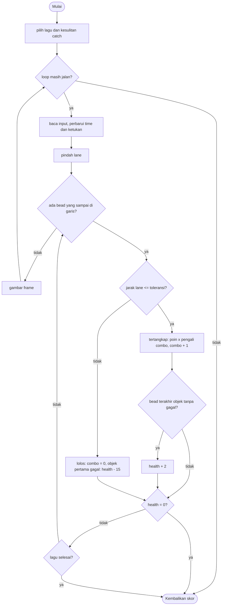

# Beat Catch - design brief

**Owner:** Member 5  **Folder:** `games/beat_catch/`  **Status:** jalan: 9 lagu x 3 kesulitan (chart catch dari voice pemain), combo, health, leaderboard sendiri

## Hook
Kebalikan Beat Dodge: **tangkap, jangan hindari.** Setiap bunyi melodi pemain punya lingkaran yang jatuh ke garis, dan kamu harus sudah berdiri di lane-nya tepat saat lingkaran itu sampai. Lagunya sama persis dengan Beat Dodge, tetapi game, skor, dan leaderboard-nya terpisah.

## Penjelasan sederhana
Bayangkan lingkaran-lingkaran **kosong** (cincin) yang jatuh dari atas layar ke sebuah garis di bawah. Kamu adalah sebuah **cangkir** yang bisa digeser ke kiri dan kanan antar lane. Saat sebuah cincin menyentuh garis:

- kamu ada di lane yang tepat: cincin **tertangkap**, kamu dapat poin, dan combo naik;
- kamu ada di lane lain: cincin **lolos**, combo putus, dan kalau ini objek baru yang gagal, health berkurang.

Not yang cepat dan berurutan tidak digambar sebagai banyak cincin terpisah, tetapi disambung menjadi satu **ribbon** (pita) yang berkelok di antara beberapa lane. Ribbon dinilai sebagai **satu objek**, tetapi setiap cincin di dalamnya dinilai sendiri-sendiri. Aturan kunci ribbon: kalau ribbon itu **pindah lane**, kamu tidak perlu mengikuti tiap cincinnya. Kamu boleh berdiri satu lane dari sebuah cincin dan cincin itu tetap tertangkap, jadi ribbon yang menyentuh tiga lane tertangkap seluruhnya dari lane tengahnya. Kalau ribbon itu **tetap di satu lane**, kamu harus berdiri tepat di lane itu. Aturan ini ada di satu fungsi, `bd_catch_tolerance()`.

Game ini **tidak punya format lagu, jam, atau layar pilih lagu sendiri**. Ia memakai ulang modul Beat Dodge:

- `beat_dodge_logic.[ch]`: format lagu, `bd_Run` (jam, lane pemain, kapan sebuah bead sampai di garis), daftar lagu, menu, dan cek "apakah chart ini bisa dimainkan manusia". Di sini hanya aturan *tangkap* yang baru.
- `beat_dodge_ui.h`: layar pilih lagu, pemutaran musik, dan penggambaran lapangan, dipakai bersama. Fungsinya ditulis di `beat_dodge_game.c`, satu-satunya file yang boleh memakai raylib, dan header-nya tidak berisi tipe raylib supaya game ini bisa memakainya.

Satu lagu punya enam chart: tiga untuk dodge (dari kedua voice melodi) dan tiga untuk catch (hanya dari voice pemain, "Boyfriend"). Beat Catch hanya menampilkan chart catch.

**Kalau cuma punya 1 menit:** `bd_catch_tolerance()` dipakai oleh dua pihak sekaligus: aturan main (`judge_bead`) dan pemeriksa kelayakan chart (`bd_chart_playable`). Kalau dua-duanya tidak sepakat, chart yang dinyatakan "bisa dimainkan" bisa jadi tidak bisa ditangkap.

Istilah:

| Istilah | Artinya |
|---------|---------|
| bead | satu not di chart: satu step yang punya lane |
| ribbon | rangkaian bead yang disambung (huruf `a` sampai `e` di file lagu) |
| objek | satu ribbon, atau satu bead tunggal. Health dan jarak dihitung per objek, penilaian per bead |
| span | selisih lane terkecil dan terbesar yang disentuh sebuah objek (0 untuk bead tunggal atau ribbon di satu lane) |
| toleransi | berapa lane dari sebuah bead kamu boleh berdiri dan tetap menangkapnya: 0 bila span 0, 1 bila span lebih dari 0 |
| combo | jumlah bead yang tertangkap berturut-turut |

## Kontrol
- Saat main: Left/Right (atau A/D) pindah satu lane. Tombol `1` sampai `4` (sebanyak jumlah lane di chart) langsung loncat ke lane itu.
- Layar pilih lagu: Up/Down memilih lagu, Left/Right memilih kesulitan, Enter atau Space mulai, Esc kembali ke hub. Mouse: klik lagu atau kesulitan, klik PLAY, roda mouse menggulir lagu. Lagu yang tidak punya chart catch tampil redup di daftar. Saat ini itu hanya "Practice" (`default.txt`, format lama dengan satu chart dodge); 9 lagu lainnya punya tiga chart catch.

## Aturan dan skor
Setiap bead dinilai **tepat saat ia sampai di garis**. Tidak ada jendela waktu: yang dihitung hanya lane pemain pada saat itu.

- **Tertangkap:** `|lane pemain - lane bead| <= toleransi`. Bead tunggal poin dasar `BC_LONE_POINTS` = 10, bead di dalam ribbon `BC_RIBBON_POINTS` = 5. Poin dikali **pengali combo**: `1 + min(combo / 10, 3)`, jadi x1 untuk 10 bead pertama, x2 untuk bead ke-11 sampai 20, x3, lalu x4 dari bead ke-31 berturut-turut. `combo` di rumus adalah jumlah bead yang sudah tertangkap berturut-turut *sebelum* bead ini.
- **Lolos (tidak tertangkap):** combo kembali ke 0 dan layar berkedip merah. Kalau ini bead pertama yang gagal dari objeknya, health berkurang `BC_HEALTH_PER_MISS` = 15. **Satu objek hanya memotong health sekali**, berapa pun beadnya yang gagal.
- **Health:** mulai 100. Objek yang tertangkap **seluruhnya** menambah `BC_HEALTH_PER_CLEAN_OBJECT` = 2 (tidak pernah di atas 100), dihitung di bead terakhir objek itu. Health 0 berarti game over.
- **Bertahan sampai lagu selesai** (`time >= end_time`) memberi bonus `BC_FINISH_PER_HEALTH` = 5 poin per health yang tersisa. Kalau game over, bonus ini tidak diberikan.

Skor yang ditampilkan dinormalkan supaya adil antar lagu:

```
skor = 1000 * multiplier * points / max_points      (hitungan bilangan bulat)
max_points = 5 * 100 + jumlah poin kalau SEMUA bead tertangkap (combo tidak pernah putus)
multiplier : easy 1.0, normal 1.5, hard 2.0
```

`max_points` tidak ditulis sebagai rumus terpisah: `reset_rules()` memutar ulang permainan sempurna lewat fungsi yang sama dengan yang dipakai saat bermain (`award_bead`, `award_finish`). Karena itu skor sempurna selalu persis **1000 x multiplier** (1000 / 1500 / 2000), dan skor tidak bisa lebih dari itu. Skor Beat Catch dan Beat Dodge **tidak sebanding**: leaderboard dan skornya terpisah.

## Cara kerja per frame
**Sebelum loop utama** (`play()` di `beat_catch_game.c`):

1. `bd_songlist_load()` memuat `assets/beatmaps/songs.txt`. Kalau tidak ada lagu yang berhasil dimuat, game memakai lagu latihan bawaan (`beat_catch_init(s, seed)`: `bd_song_default(seed)` dengan chart pertamanya dijadikan chart catch).
2. Mode normal: `bd_ui_select_song()` menampilkan layar pilih lagu (hanya chart catch). Mode headless (smoke): `bd_ui_preview_select()` menggambar layar itu sebentar untuk screenshot, lalu game langsung memakai lagu kedua di daftar pada chart catch terakhirnya (hard), tanpa audio.
3. `beat_catch_use_song()` memanggil `bd_run_start()` (jam, lane awal di tengah) lalu `reset_rules()` (health 100, combo 0, `max_points`, multiplier).
4. `bd_ui_music_start()`: kalau ada audio dan melodi, melodi di-render synthesizer menjadi WAV di memori dan dimainkan. Not yang punya bead di chart yang dipilih berbunyi sebagai lead terang, yang lain sebagai backing pelan (`bd_song_to_synth`). Tanpa melodi tapi ada audio: tick metronom.

**Setiap frame:**

1. `arcade_poll(&in)`.
2. Kalau ada musik: `bd_ui_music_time()` memberi posisi lagu, lalu `beat_catch_sync()` menyamakan `time` **hanya** kalau selisihnya lebih dari 0,15 detik.
3. `beat_catch_step(s, &in, ARC_DT)`:
   1. Kalau `over`, keluar.
   2. `bd_run_tick()`: `time += dt`, ketukan baru, kedip merah berkurang, geser lane.
   3. `catch_flash` berkurang.
   4. **Loop `while`** menilai semua bead yang kini sampai di garis (`time >= bd_run_arrival(next_hit)`), kenapa `while`: sinkronisasi audio bisa membuat `time` melompat. Step kosong dilewati. `judge_bead()` menilai satu bead: tertangkap atau lolos, poin, combo, health.
   5. Kalau belum game over dan `time >= end_time`: `won = true`, `over = true`, bonus health ditambahkan.
4. Front-end membunyikan nada rendah setiap `missed` bertambah, atau tick metronom kalau tidak ada musik.
5. `draw_game()`: `bd_ui_draw_field()` (lane, cincin dan ribbon, cangkir, cincin tangkapan di garis), kedip merah, bar health, combo dan pengali, bar progres lagu, judul lagu 2,6 detik pertama. Lalu HUD dan `arcade_frame_end()`.
6. Kalau `beat_catch_is_over()`, loop berhenti. `score = beat_catch_score(s)`, `finished = true`. Esc di tengah lagu: `finished = false`, skor tidak dicatat.

## Peta file
| File | Isinya | Edit di sini kalau ... |
|------|--------|------------------------|
| `beat_catch_logic.h` | `beat_catch_State`, konstanta `BC_*`, fungsi publik | mengubah angka keseimbangan atau menambah field state |
| `beat_catch_logic.c` | `judge_bead`, `award_bead`, `award_finish`, `reset_rules`, `beat_catch_step`, skor | mengubah aturan tangkap, combo, health |
| `beat_catch_game.c` | loop `play()`, health bar, combo, bunyi "lolos", `game_beat_catch_def` | mengubah tampilan khusus Beat Catch |
| `tests/test_beat_catch.c` | 19 unit test | mengubah aturan |
| `CMakeLists.txt` | mendaftarkan game dan **menautkan** pustaka Beat Dodge | menambah file |
| `../beat_dodge/beat_dodge_logic.[ch]` | format lagu, `bd_Run`, `bd_catch_tolerance`, `bd_chart_playable`, menu | mengubah format lagu atau aturan kelayakan chart |
| `../beat_dodge/beat_dodge_ui.h`, `beat_dodge_game.c` | layar pilih lagu, musik, penggambaran lapangan (dipakai bersama) | mengubah tampilan bersama |
| `../beat_dodge/beat_dodge_convert.[ch]` | pembuat chart catch dari MIDI | mengubah cara chart catch dibuat |
| `../../assets/beatmaps/` | 9 lagu yang sama dengan Beat Dodge | menambah lagu |

## Data penting (struct)
`beat_catch_State`: seluruh keadaan saat bermain (sekitar 34 KB karena `bd_Run` menyalin lagunya, jadi harus `static`).

| Field | Tipe | Artinya |
|-------|------|---------|
| `run` | `bd_Run` | bagian yang sama dengan Beat Dodge: salinan lagu, `time`, `lane`, `next_hit`, `lead`, `end_time`, `over`, `won`, `hit_flash` |
| `health` | `int` | 100 sampai 0 |
| `combo`, `best_combo` | `int` | bead tertangkap berturut-turut dan rekor lagu ini |
| `caught`, `missed` | `int` | jumlah **bead** |
| `missed_objects` | `int` | jumlah **objek** yang punya bead gagal (masing-masing memotong health sekali) |
| `points`, `max_points` | `int` | poin mentah dan poin sempurna (untuk normalisasi) |
| `multiplier` | `float` | multiplier kesulitan, bukan pengali combo |
| `obj_missed` | `bool` | objek yang sedang dinilai sudah memotong health |
| `catch_flash`, `catch_lane` | `float`, `int` | untuk cincin yang melebar di garis saat bead tertangkap (hanya tampilan) |

## Fungsi-fungsi penting
| Fungsi | Tugas | Dipanggil dari |
|--------|-------|----------------|
| `beat_catch_init(s, seed)` | lagu latihan bawaan, chart-nya jadi catch | `play()` kalau tidak ada lagu, test |
| `beat_catch_use_song(s, song, chart)` | mulai lagu: `bd_run_start` + `reset_rules` | `play()`, test |
| `beat_catch_step(s, in, dt)` | satu langkah logic | `play()` tiap frame, test |
| `judge_bead(s, c, step)` (static) | satu bead: toleransi, poin, combo, health, bead terakhir objek | `beat_catch_step` |
| `beat_catch_combo_multiplier(combo)` | `1 + min(combo / 10, 3)` | `award_bead`, HUD, test |
| `award_bead`, `award_finish` (static) | **satu-satunya** tempat angka poin berada | `judge_bead`, `reset_rules` |
| `beat_catch_score(s)` | skor ternormalisasi, bilangan bulat | HUD, hasil akhir |
| `bd_catch_tolerance(span)`, `bd_chart_object_span()` | toleransi menurut span objek | `judge_bead`, `bd_chart_playable`, konverter |
| `bd_ui_*` | layar pilih lagu, musik, penggambaran | `beat_catch_game.c` |

## Angka yang bisa diutak-atik
Semua angka aturan ada di `beat_catch_logic.h` dan **hanya** di sana. Mengubahnya tidak merusak `max_points`, karena `max_points` dihitung dengan memutar ulang permainan sempurna.

| Konstanta | Nilai | Efek kalau diubah |
|-----------|-------|-------------------|
| `BC_START_HEALTH` | `100` | health awal dan batas atas |
| `BC_HEALTH_PER_CLEAN_OBJECT` | `2` | pemulihan per objek yang tertangkap seluruhnya |
| `BC_HEALTH_PER_MISS` | `15` | hukuman per objek yang punya bead gagal. Rasio 2 : 15 berarti pemain bertahan kalau menangkap sekitar 88% objek atau lebih |
| `BC_LONE_POINTS` / `BC_RIBBON_POINTS` | `10` / `5` | poin dasar bead tunggal dan bead ribbon |
| `BC_COMBO_STEP`, `BC_MAX_COMBO_BONUS` | `10`, `3` | pengali naik tiap 10 bead berturut-turut sampai x4 |
| `BC_FINISH_PER_HEALTH` | `5` | bonus per health di akhir lagu |
| `bd_catch_tolerance` | span 0 -> 0, lainnya -> 1 | seberapa jauh dari sebuah bead kamu boleh berdiri. **Ini juga mengubah chart mana yang dianggap bisa dimainkan**, jadi bangun ulang lagu (`bash tools/songs/build_songs.sh`) |
| multiplier | easy `1.0`, normal `1.5`, hard `2.0` | `bd_chart_multiplier` |
| `k_preset[]` (catch) | easy 3 lane, normal 4 lane, hard 4 lane | `beat_dodge_convert.c` |

Seluruh angka health dan toleransi adalah **titik awal untuk diuji main**, bukan hasil playtest manusia. Alat ukurnya adalah bot (lihat di bawah). Kalau game terasa terlalu mudah atau terlalu keras, ubah `BC_HEALTH_PER_MISS` dulu.

## Cara menjalankan dan menguji
```bash
# test logic saja (tanpa raylib, ~1 detik)
cmake --preset logic && cmake --build --preset logic && ctest --preset logic -R "^beat_catch\."

# main game-nya
cmake --preset dev && cmake --build --preset dev && build/dev/bin/arCade

# smoke run headless (juga menulis beat_catch_select.png, layar pilih lagu)
cmake --preset headless && cmake --build --preset headless && build/headless/bin/arCade --smoke beat_catch --frames 420 --out smoke-out
```

`tests/test_beat_catch.c` (19 test, dijalankan CTest sebagai `beat_catch.test_beat_catch`):

| Test | Menjaga aturan apa |
|------|--------------------|
| `test_init_is_sane` | lagu latihan: chart catch, health 100, skor 0 |
| `test_a_lone_bead_needs_the_exact_lane` | bead tunggal: lane tepat tertangkap, selisih satu lane lolos dan memotong health |
| `test_a_ribbon_that_changes_lane_is_caught_from_its_middle` | ribbon yang pindah lane tertangkap dari lane tengah, poin 5 per bead |
| `test_a_ribbon_in_one_lane_needs_that_exact_lane` | ribbon yang tetap di satu lane: toleransi 0 |
| `test_a_ribbon_costs_exactly_one_penalty` | satu objek memotong health sekali, berapa pun beadnya yang gagal |
| `test_the_combo_multiplier_steps_at_10_20_and_30` | pengali x1, x2, x3, x4 dan berhenti di x4 |
| `test_a_miss_resets_the_combo` | satu bead gagal memutus combo, pengali mulai dari x1 lagi |
| `test_health_is_counted_per_object_and_never_above_the_start` | ribbon enam bead hanya memulihkan sekali, batas atas 100 |
| `test_zero_health_ends_the_run` | tujuh objek gagal berturut-turut: game over, kalah, skor 0 |
| `test_surviving_the_song_pays_for_the_health_left` | bonus 5 per health, poin = `max_points` untuk permainan sempurna |
| `test_the_perfect_bot_scores_the_ceiling` | easy 1000, normal 1500, hard 2000, persis |
| `test_standing_in_a_corner_loses_and_scores_almost_nothing` | pemain yang hanya berdiri di lane 0 pada chart 4 lane kalah, menangkap kurang dari 8 bead, skor di bawah 150 |
| `test_default_song_perfect_bot_wins` | lagu latihan bisa ditangkap sempurna |
| `test_sync_only_fixes_large_drift` | selisih 0,05 detik diabaikan, 0,5 detik diikuti |
| `test_the_clock_and_the_arrival_match_beat_dodge` | waktu tiba sebuah bead dan nilai `bd_catch_tolerance` (0 dan 2 -> 0 dan 1) sama dengan yang dipakai Beat Dodge |
| `test_the_human_speed_bot_clears_every_shipped_catch_chart` | bot yang mengikuti jalur `bd_chart_plan` dengan satu ketukan panah tiap 0,1 detik menang di **semua** chart catch yang dikirim, dengan kurang dari 10% objek gagal |
| `test_the_perfect_bot_scores_the_ceiling_on_shipped_charts` | semua chart catch yang dikirim: tangkap semua, skor `1000 * multiplier` |
| `test_standing_still_loses_on_every_shipped_catch_chart` | diam saja di lane awal kalah di semua chart catch yang dikirim |
| `test_monkey_is_safe` | input acak: lane, health, poin, combo selalu dalam batas |

## Jebakan dan hal yang perlu diingat
- **Satu sumber toleransi.** `bd_catch_tolerance` dipakai oleh aturan, oleh `bd_chart_playable`/`bd_chart_plan`, dan oleh konverter. Jangan menulis angka 0 atau 1 di tempat lain.
- **CMake:** `beat_catch` *menautkan* `game_beat_dodge_logic` (dan `game_beat_dodge` untuk front-end). Jangan mendaftarkan `beat_dodge_logic.c` lagi di `CMakeLists.txt` game ini: tautan akan gagal karena simbol ganda.
- **`beat_dodge_ui.h` tidak boleh memuat tipe raylib.** `tools/check_repo.sh` melarang raylib di semua file selain `*_game.c`. Fungsi `bd_ui_*` diimplementasikan di `beat_dodge_game.c` dan hanya memakai `int`, `float`, `bool`, dan struct logic.
- **`BD_AUDIO_OFFSET_S` bersama.** Sinkronisasi musik memakai nilai yang sama dengan Beat Dodge (0,0). Jangan menggesernya hanya untuk satu game.
- **Skor tidak sebanding dengan Beat Dodge.** Leaderboard dikunci oleh `GameDef.id` (`beat_catch`), jadi skor dua game ini tidak pernah tercampur. Format file leaderboard tidak berubah. Skor Beat Dodge lama juga berada di skala yang berbeda dari skor Beat Dodge sekarang.
- **"Practice" tidak punya chart catch** (`default.txt` masih format lama, hanya chart dodge), jadi ia tampil redup di menu Beat Catch. Lagu latihan bawaan `beat_catch_init()` hanya dipakai kalau tidak ada satu pun file lagu yang berhasil dimuat.
- **Audio belum diverifikasi** di sandbox build (tidak ada perangkat suara). Yang sudah dites: logic, kebenaran chart, dan tampilan lewat screenshot headless.
- Game ini `ranked = true`, `order = 55` (tepat setelah Beat Dodge yang `50`).

## Langkah implementasi (Implementation steps)

### Hasil pengukuran (9 lagu, rata-rata per kesulitan)
Dihitung dengan memainkan chart asli lewat `beat_catch_step`, dan chart-nya diukur dengan `build/logic/bin/midi2beatmap --metrics assets/beatmaps/fnf/*.txt`.

| Ukuran | easy | normal | hard |
|--------|------|--------|------|
| Lane | 3 | 4 | 4 |
| Bead per chart | 197 | 204 | 219 |
| Objek per chart (ribbon + bead tunggal) | 47 (38 + 9) | 54 (38 + 16) | 69 (38 + 31) |
| Bead per detik | 2,09 | 2,17 | 2,34 |
| Bot kecepatan manusia (ikut `bd_chart_plan`, satu ketukan panah tiap 0,1 detik): bead tertangkap, objek gagal | 100%, 0 | 100%, 0 | 100%, 0 |
| Bot sempurna | 1000 | 1500 | 2000 |
| Diam di lane awal: game over pada | 32% lagu | 32% lagu | 22% lagu |
| Diam di lane awal: skor | 20 | 63 | 51 |

### Keputusan dan penyimpangan dari rencana (dan kenapa)
1. **Toleransi menurut span objek, bukan "1 untuk semua bead ribbon".** Rencana awal memberi toleransi 1 pada setiap bead ribbon. Tes pertama memperlihatkan bahwa dengan 3 lane, pemain yang berdiri diam di lane tengah mendapat skor penuh 1000 di Roses easy, karena ribbon yang berada di satu lane pun tetap tertangkap dari lane sebelahnya. Sekarang ribbon yang tetap di satu lane (span 0) butuh lane tepat, dan hanya ribbon yang benar-benar pindah lane (span 1 atau 2) ditangkap dari tengahnya. Argumennya tetap sama: tidak ada yang bisa mengikuti perpindahan lane tiap 80 ms. Chart catch dibuat ulang dengan pemeriksa kelayakan yang sama.
2. **Health per objek, bukan per bead.** Rencana awal memulihkan +2 per bead dan memotong 6 per objek. Dengan ribbon yang rata-rata 5 sampai 6 bead, satu ribbon yang tertangkap memulihkan sepuluh kali lebih banyak daripada bead tunggal. Dengan model per bead itu, pemain yang berdiri diam tetap bisa bertahan di sebagian chart. Sekarang pemulihan +2 per objek yang tertangkap seluruhnya dan hukuman 15 per objek yang gagal: pemain yang diam kalah di semua 27 chart catch (9 lagu x 3 kesulitan), sedangkan bot kecepatan manusia menang tanpa satu pun objek gagal. Alat ukurnya adalah bot, bukan playtest manusia: kalau terlalu keras, kurangi `BC_HEALTH_PER_MISS`.
3. **Combo dipertahankan** (keputusan pemilik): menghitung bead, bukan objek, dan pengali memakai combo *sebelum* bead itu.
4. **Skor dalam bilangan bulat.** `1000 * multiplier * points / max_points` dihitung dengan `long long`, supaya skor sempurna persis sama dengan batasnya (versi `float` bisa menghasilkan 1999 pada chart dengan poin besar). Dipakai juga oleh Beat Dodge.
5. **Lane:** easy 3, normal 4, hard 4 sesuai rencana. Chart catch hard tidak punya jeda minimum antar bead tunggal, yang membatasi hanya cek lane terjangkau (`BD_HUMAN_STEP_SEC` = 0,12 detik per lane).

### Ide berikutnya (belum dikerjakan)
- [ ] Playtest manusia untuk mengatur `BC_HEALTH_PER_MISS` dan `BC_HEALTH_PER_CLEAN_OBJECT`.
- [ ] Leaderboard per lagu (sekarang satu leaderboard per game).
- [ ] Not panjang (hold): bead yang harus ditahan.

## Pseudocode (untuk laporan)
```
PROSEDUR nilai_bead(state, chart, step)          (bead sampai di garis)
    JIKA bead ini mulai objek baru MAKA objek_gagal <- salah
    toleransi <- 0 JIKA objek bead ini tetap di satu lane, JIKA TIDAK 1
    JIKA |lane pemain - lane bead| <= toleransi MAKA
        poin <- poin + (10 JIKA bead tunggal, 5 JIKA bead ribbon) * (1 + min(combo / 10, 3))
        combo <- combo + 1
    JIKA TIDAK
        combo <- 0
        JIKA objek_gagal = salah MAKA
            objek_gagal <- benar; health <- max(0, health - 15)
            JIKA health = 0 MAKA game over
    JIKA bead ini bead terakhir objeknya DAN objek_gagal = salah MAKA
        health <- min(100, health + 2)
AKHIR PROSEDUR

PROSEDUR step(state, input, dt)
    JIKA game over MAKA KEMBALI
    majukan waktu, ketukan, dan lane pemain
    SELAMA bead berikutnya sudah sampai di garis DAN belum game over
        JIKA step itu berisi bead MAKA nilai_bead
        pindah ke step berikutnya
    JIKA belum game over DAN time >= end_time MAKA
        menang; poin <- poin + 5 * health
AKHIR PROSEDUR
```

## Flowchart (untuk laporan)


## Konsep kuliah yang dipakai (untuk Bab I laporan)
| Konsep (Pertemuan) | Di mana (file : fungsi) |
|--------------------|-------------------------|
| Struct (13) | `beat_catch_State`, `bd_Run`, `bd_Chart` |
| Array (9) | `bd_Chart.lane[]` dan `link[]`: satu elemen per step |
| Percabangan (5) | tertangkap atau lolos di `judge_bead`, bead terakhir objek |
| Perulangan (6) | loop `while` yang menilai bead yang sudah tiba, di `beat_catch_step`; loop yang memutar ulang permainan sempurna di `reset_rules` |
| Fungsi dan modularitas (10) | satu `bd_catch_tolerance` dipakai aturan dan pemeriksa chart; `award_bead` dan `award_finish` |
| File handling (13) | memakai ulang `bd_song_load` dan `bd_songlist_load` |
| Matematika (12) | pengali combo `1 + min(combo / 10, 3)`, normalisasi skor dengan bilangan bulat, nilai absolut `abs()` untuk jarak lane |
