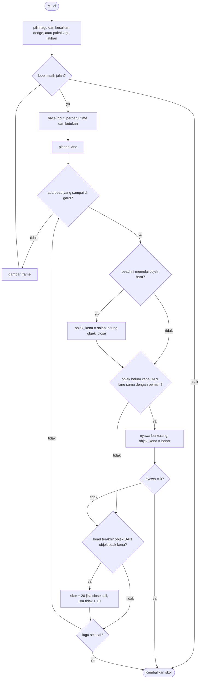

# Beat Dodge - design brief

**Owner:** Member 5  **Folder:** `games/beat_dodge/`  **Status:** jalan: 9 lagu dari MIDI (plus lagu latihan), 3 kesulitan, chart dodge 3-4 lane dengan ribbon, aturan satu nyawa per objek, skor "close call", musik hasil sintesis (synthesised)

## Hook
Rhythm bullet-dodger: rintangan jatuh melalui beberapa lane dan sampai di garis pemain **tepat pada bunyi lagu**. Setiap bunyi melodi yang kamu dengar punya rintangan yang bisa kamu lihat, dan semakin dekat kamu lewat tanpa tersentuh, semakin besar poinnya.

## Penjelasan sederhana
Bayangkan lingkaran-lingkaran bercahaya yang jatuh dari atas layar ke sebuah garis di bawah. Kamu berdiri di salah satu lane (jalur) sebagai segitiga putih. Saat sebuah lingkaran menyentuh garis, ada dua kemungkinan:

- lingkaran itu ada di lane yang sama dengan kamu: **kena**, nyawa berkurang 1;
- lingkaran itu ada di lane lain: kamu lolos.

Not yang cepat dan berurutan tidak digambar sebagai banyak lingkaran terpisah. Mereka disambung menjadi satu **ribbon** (pita) yang berkelok di antara beberapa lane. Ribbon adalah **satu objek**: seluruh ribbon hanya bisa memotong **satu nyawa**, dan kalau ia lewat tanpa menyentuhmu, ia dihitung **satu kali** untuk skor. Tetapi setiap lingkaran di dalam ribbon tetap dinilai sendiri saat tiba di garis, jadi kamu harus menyingkir dari semuanya.

Hadiahnya ada di jarak. Kalau kamu lolos dari sebuah objek dan tadinya berdiri di salah satu lane yang disentuh objek itu (paling lama 0,3 detik sebelum objek itu tiba), itu **close call**: poinnya 20, bukan 10. Tidak ada combo. Cara bermain yang menang adalah berani menunggu di dekat bahaya lalu menyingkir tepat waktu, bukan berdiri di lane yang aman sepanjang lagu.

Yang membuat game ini "rhythm game" adalah lagunya. Setiap lagu punya **melodi** (daftar not: kapan bunyi, berapa lama, nada apa), dan dari not-not itu dibuat **chart**, yaitu daftar kapan dan di lane mana rintangan muncul. Musiknya dimainkan dari melodi yang sama. Not yang punya rintangan berbunyi sebagai **lead** yang terang, not lainnya sebagai **backing** yang pelan, jadi yang kamu dengar jelas adalah yang kamu lihat.

**Satu-satunya jam di game ini adalah variabel `time`** (detik sejak lagu mulai, ada di `bd_Run`). Kapan sebuah rintangan sampai di garis dihitung dengan rumus `lead + step * step_sec` (`bd_run_arrival()`), dan posisi vertikalnya di layar adalah interpolasi linear dari waktu itu (`bd_run_obstacle_y()`). Tidak ada kecepatan jatuh yang disimpan di mana pun. Akibatnya, makin tinggi BPM lagunya, makin cepat lingkaran jatuh, karena waktu jatuhnya selalu `BD_LEAD_BEATS` = 3 ketukan.

Istilah yang akan sering muncul:

| Istilah | Artinya |
|---------|---------|
| song (`bd_Song`) | satu lagu: judul, BPM, sampai 6 chart, dan melodi |
| chart (`bd_Chart`) | satu kesulitan sebuah lagu (easy / normal / hard) untuk satu jenis game: dodge atau catch. Berisi jumlah lane dan daftar bead |
| step | satu "kotak waktu" di chart; satu karakter di file lagu = satu step. Di lagu hasil konversi, 1 step = 1/4 ketukan (not 16th) |
| bead | satu not di chart: satu step yang punya lane (satu lingkaran) |
| ribbon | rangkaian bead yang disambung (huruf `a` sampai `e` di file lagu) |
| objek | satu ribbon, atau satu bead tunggal. Nyawa, jarak, dan skor dihitung per objek, penilaian per bead |
| lane | jalur vertikal tempat bead jatuh dan pemain berdiri (3 sampai 5 lane) |
| lead | waktu jatuh sebuah bead dari atas ke garis pemain (3 ketukan) |
| close call | objek yang dilewati tanpa kena, setelah pemain berdiri di salah satu lane-nya dalam 0,3 detik sebelum bead pertamanya tiba |
| melodi (`notes[]`) | not untuk musik; dibunyikan oleh synthesizer bawaan, bukan file audio |

Kodenya dibagi lima bagian. `beat_dodge_logic.c` berisi aturan Beat Dodge, format file lagu, jam bersama (`bd_Run`), pemeriksa "apakah chart bisa dimainkan manusia", dan logic menu (semuanya tanpa raylib). `beat_dodge_convert.c` mengubah MIDI menjadi lagu (dipakai oleh tool `midi2beatmap` dan test, bukan oleh game saat dimainkan). `beat_dodge_game.c` adalah satu-satunya file yang memakai raylib: layar main, dan juga layar pilih lagu, pemutaran musik, dan penggambaran lapangan yang **dipakai bersama** dengan Beat Catch lewat `beat_dodge_ui.h`. Game kembarannya, `games/beat_catch/`, memakai ulang semua ini; lihat `games/beat_catch/GAME.md`.

**Kalau cuma punya 1 menit:** semua posisi dan tabrakan dihitung dari `bd_run_arrival()`. Jangan menghitung dari jumlah frame atau kecepatan piksel; kalau tidak, musik dan rintangan tidak sinkron lagi.

## Kontrol
- Saat main: Left/Right (atau A/D) pindah satu lane. Tombol `1` sampai `4` (maksimal sebanyak jumlah lane di chart, bisa sampai `5`) langsung loncat ke lane itu. Kamu punya 3 nyawa.
- Layar pilih lagu: Up/Down (atau W/S) memilih lagu, Left/Right memilih kesulitan, Enter atau Space mulai, Esc kembali ke hub. Mouse: klik lagu atau kesulitan, klik PLAY, roda mouse menggulir lagu. Menu Beat Dodge hanya menawarkan chart dodge. Kartu kesulitan menampilkan jumlah **objek** (bukan bead) dan kata "ribbon".

## Aturan dan skor
Setiap bead dinilai **tepat pada saat ia sampai di garis pemain**. Tidak ada "jendela" waktu untuk kena atau tidak: yang dilihat hanya lane pemain pada saat itu, jadi kamu boleh pindah lane sampai frame terakhir sebelum bead tiba.

- **Lane sama = kena:** `hits++`, nyawa -1, layar berkedip merah 0,35 detik. Nyawa 0 berarti game over. **Satu objek hanya memotong satu nyawa:** setelah bead pertama yang mengenaimu, sisa bead objek itu diabaikan. Bead pertama objek berikutnya dinilai lagi dari awal.
- **Objek lolos tanpa kena** (dinilai di bead terakhirnya): `dodged++` dan poin `award_object(close_call)`: **10**, atau **20** kalau close call. Objek yang mengenaimu tidak memberi poin dan tidak dihitung `dodged`.
- **Close call:** pada saat bead pertama objek tiba, kamu pernah berdiri di salah satu lane yang disentuh objek itu (bead mana pun miliknya) dalam `BD_CLOSE_WINDOW_SEC` = 0,30 detik terakhir. Dicatat oleh `bd_Run.last_in_lane[]`, waktu terakhir pemain berdiri di tiap lane. Layar menampilkan "CLOSE!" dan hitungan "close calls".
- **Bertahan sampai lagu selesai** (`time >= end_time`) memberi bonus 50 poin per nyawa yang tersisa (`award_finish`). Kalau game over, bonus ini tidak diberikan.
- **Tidak ada combo.** Tidak ada hukuman untuk berpindah lane atau untuk diam; yang rugi hanya yang kena, dan yang diam di lane aman hanya dapat 10 per objek.

Skor yang ditampilkan dinormalkan supaya adil antar lagu, dalam **bilangan bulat**:

```
skor = 1000 * multiplier * points / max_points
max_points = 3 * 50 + 20 * N          (N = jumlah objek di chart: semua close call, tidak ada nyawa hilang)
multiplier : easy 1.0, normal 1.5, hard 2.0
```

`max_points` tidak ditulis sebagai rumus terpisah: `reset_rules()` memutar ulang permainan sempurna lewat fungsi yang sama dengan saat bermain (`award_object`, `award_finish`), jadi permainan sempurna selalu persis **1000 x multiplier**: 1000 di easy, 1500 di normal, 2000 di hard. Perhitungannya memakai `long long`, sehingga tidak ada selisih pembulatan. Ceiling itu adalah batas atas, bukan target: kebanyakan pemain akan berada di bawahnya. Pemain yang hanya berdiri di lane aman dan tidak pernah kena memperoleh sekitar separuh poin maksimal (10 dari 20 per objek, ditambah bonus nyawa).

**Skala skor berubah.** Skor Beat Dodge dari versi lama (combo x4, `max_points = 90 + 40 * N`) tidak sebanding dengan skor sekarang. Leaderboard-nya tetap satu (id `beat_dodge`) dan format file tidak berubah, jadi catatan lama ikut muncul di sana dengan skala yang lama.

## Cara kerja per frame
**Sebelum loop utama** (`play()` di `beat_dodge_game.c`):

1. `bd_songlist_load()` membaca `assets/beatmaps/songs.txt` dan memuat setiap lagu yang tercantum. Kalau tidak ada lagu yang berhasil dimuat, game memakai lagu latihan bawaan (`beat_dodge_init()`, dibuat acak dari `ctx->seed`).
2. Mode normal: `bd_ui_select_song()` menampilkan layar pilih lagu (hanya chart dodge) sampai pemain memilih lagu, atau Esc untuk batal. Mode headless (smoke run): `bd_ui_preview_select()` menggambar layar itu sebentar untuk screenshot, lalu game langsung memakai lagu kedua di daftar pada chart dodge terakhirnya (hard), tanpa audio.
3. `beat_dodge_use_song()` memanggil `bd_run_start()` (salinan lagu, jumlah lane, `spb`, `step_sec`, `lead`, `end_time`, lane awal di tengah) lalu `reset_rules()` (3 nyawa, `max_points`, multiplier).
4. `bd_ui_music_start()`: kalau ada perangkat audio dan lagunya punya melodi, melodi di-render synthesizer menjadi WAV di memori lalu dimainkan lewat `LoadMusicStreamFromMemory`. Not yang punya bead di chart yang dipilih berbunyi sebagai lead (voice 0), yang lain sebagai backing pelan (voice 3). Kalau tidak ada melodi tapi ada audio, game memainkan tick metronom tiap ketukan.

**Setiap frame:**

1. `arcade_poll(&in)` membaca input.
2. Kalau ada musik: `bd_ui_music_time()` memberi posisi lagu, lalu `beat_dodge_sync(s, waktu_musik)` supaya `time` mengikuti jam audio. Fungsi ini **hanya** menimpa `time` kalau selisihnya lebih dari 0,15 detik, supaya selisih kecil tidak membuat tampilan bergetar. Posisi lagu baru dipakai setelah musik berjalan lebih dari 0,5 detik.
3. `beat_dodge_step(s, &in, ARC_DT)`. Urutan di dalamnya:
   1. Kalau `over` sudah `true`, langsung keluar.
   2. `bd_run_tick()`: `time += dt`, nomor ketukan (`beat_event` menyala satu frame kalau ketukan baru dimulai), kedip merah berkurang, lane digeser (Left/Right, tombol angka), dan `last_in_lane[]` diperbarui.
   3. `close_flash` berkurang.
   4. **Loop `while`** menilai semua bead yang kini sampai di garis (`time >= bd_run_arrival(next_hit)`). Kenapa `while` dan bukan `if`: kalau `time` melompat karena sinkronisasi audio, bisa ada lebih dari satu bead yang harus dinilai sekaligus. Step kosong (`-1`) hanya dilewati. `judge_bead()` menilai satu bead: kalau ia memulai objek baru, `obj_hit` direset dan `obj_close` dihitung (`is_close_call`); kena atau tidak; kalau ini bead terakhir objek yang tidak kena, objek itu dihitung dan poinnya diberikan.
   5. Kalau belum game over dan `time >= end_time`: `won = true`, `over = true`, dan bonus 50 per nyawa ditambahkan.
4. Kalau tidak ada musik tapi ada audio, tick metronom dibunyikan saat `beat_event`.
5. `draw_game()`: `bd_ui_draw_field()` (backdrop, lane dengan denyut ketukan, bead dan ribbon yang masih jatuh, pemain), kedip merah, nyawa, teks "CLOSE!" dan "close calls", bar progres lagu di bawah HUD, judul lagu selama 2,6 detik pertama. Lalu HUD dan `arcade_frame_end()`.
6. Kalau `beat_dodge_is_over()`, loop berhenti. Hasil: `score = beat_dodge_score(s)` dan `finished = true`. Kalau pemain menekan Esc di tengah lagu, `finished = false` sehingga skor tidak dicatat.

## Peta file
| File | Isinya | Edit di sini kalau ... |
|------|--------|------------------------|
| `beat_dodge_logic.h` | Struct `bd_Chart`, `bd_Note`, `bd_Song`, `bd_SongList`, `bd_Menu`, `bd_Reach`, `bd_Run`, `beat_dodge_State`, konstanta `BD_*`, dan **dokumentasi format file lagu** (komentar di bagian atas) | mengubah struct, batas, atau format lagu |
| `beat_dodge_logic.c` | Lagu bawaan, `bd_song_load` / `bd_song_save`, daftar lagu, menu, `bd_Run`, cek lane yang terjangkau, `bd_catch_tolerance`, dan aturan Beat Dodge (`judge_bead`, `award_*`, `beat_dodge_step`, skor) | mengubah aturan, skor, atau validasi file |
| `beat_dodge_convert.h/.c` | Konversi MIDI ke lagu: memilih track pemain, ribbon, penipisan per kesulitan, pemetaan pitch ke lane (dynamic programming), validasi dan perbaikan, ukuran chart (`bd_chart_metrics`) | mengubah cara chart dibuat dari melodi |
| `beat_dodge_ui.h` | Antarmuka bagian tampilan yang dipakai bersama dengan Beat Catch (tanpa tipe raylib) | menambah fungsi tampilan bersama |
| `beat_dodge_game.c` | Layar main Beat Dodge, `game_beat_dodge_def`, dan **implementasi** `bd_ui_*`: layar pilih lagu, pemutaran musik (WAV di memori), penggambaran lapangan | mengubah tampilan atau teks menu |
| `tests/test_beat_dodge.c` | 34 unit test untuk logic dan semua lagu yang dikirim | mengubah aturan, format, atau menambah lagu |
| `tests/test_beat_dodge_convert.c` | 9 unit test untuk konverter MIDI | mengubah konverter |
| `CMakeLists.txt` | Mendaftarkan game (`LOGIC` memuat dua file `.c`, `TESTS` dua file test) | menambah file baru |
| `GAME.md`, `AGENTS.md` | Dokumen ini, dan instruksi AI agent (tidak diterjemahkan) | lihat catatan masing-masing |
| `../../assets/beatmaps/` | `songs.txt` (daftar lagu di menu), `default.txt` (Practice, format lama), `fnf/*.txt` (9 lagu hasil konversi) | menambah atau mengganti lagu |
| `../../tools/midi2beatmap.c`, `../../tools/songs/` | Program konversi MIDI (`--report`, `--metrics`), skrip `build_songs.sh`, `songs.list`, dan file `.mid` sumber | membangun ulang lagu |
| `../../core/src/midi.c`, `synth.c` | Pembaca file MIDI dan synthesizer (bukan bagian game ini, tapi dipakai) | jarang |
| `../../docs/SONGS.md` | Panduan menambah lagu dan status verifikasi audio | menambah lagu |
| `../beat_catch/` | Game kembaran yang memakai modul ini | lihat `games/beat_catch/GAME.md` |

## Data penting (struct)
`bd_Chart`: satu kesulitan untuk satu jenis game.

| Field | Tipe | Artinya |
|-------|------|---------|
| `name` | `char[12]` | nama kesulitan: `"easy"`, `"normal"`, `"hard"`. Nama ini juga menentukan multiplier skor (`bd_chart_multiplier`) |
| `kind` | `bd_ChartKind` | `BD_CHART_DODGE` (default) atau `BD_CHART_CATCH` |
| `lanes` | `int` | jumlah lane (2 sampai 5) |
| `length` | `int` | jumlah step |
| `lane[BD_MAX_STEPS]` | `int8_t` | per step: `-1` = kosong, selain itu nomor lane bead (0 = paling kiri) |
| `link[BD_MAX_STEPS]` | `uint8_t` | `1` = bead ini melanjutkan objek bead sebelumnya (anggota ribbon) |

`bd_Note`: satu not melodi.

| Field | Tipe | Artinya |
|-------|------|---------|
| `start`, `len` | `uint16_t` | kapan mulai dan berapa lama, dalam satuan 1/24 ketukan (`BD_CLOCKS_PER_BEAT`) |
| `pitch` | `uint8_t` | nada MIDI (21 sampai 108) |
| `voice` | `uint8_t` | jenis suara synthesizer (0 sampai 3). Hasil konversi: 0 = track lawan, 1 = track pemain; saat dimainkan, `bd_song_to_synth` mengganti suaranya menjadi 0 (lead) atau 3 (backing) |

`bd_Song`: satu lagu (sekitar 34 KB, jadi jangan dibuat sebagai variabel lokal biasa).

| Field | Tipe | Artinya |
|-------|------|---------|
| `title` | `char[48]` | judul |
| `bpm` | `int` | ketukan per menit (harus 60 sampai 220) |
| `steps` | `int` | jumlah step per ketukan (1 sampai 8). Lagu hasil konversi memakai 4 |
| `chart_count`, `charts[BD_MAX_CHARTS]` | `int`, `bd_Chart` | chart yang tersedia (maksimal 6: 3 dodge dan 3 catch) |
| `note_count`, `notes[1536]` | `int`, `bd_Note` | melodi (boleh kosong, lalu game memakai metronom) |

`bd_SongList` (sekitar 544 KB, `static` di `beat_dodge_game.c`): `count` lagu yang berhasil dimuat, `skipped` file yang rusak, dan `songs[BD_MAX_SONGS]` (maksimal 16 lagu). `bd_Menu`: `song`, `chart`, `chosen` (sudah memilih), dan `kind` (jenis chart yang ditawarkan menu itu). `bd_Reach`: lane mana saja yang masih bisa dipijak (lihat "cek lane yang terjangkau").

`bd_Run`: bagian run yang tidak bergantung pada aturan satu game. Beat Dodge dan Beat Catch sama-sama menanamnya di state mereka.

| Field | Tipe | Artinya |
|-------|------|---------|
| `song`, `chart` | `bd_Song`, `int` | salinan lagu yang dimainkan dan indeks chart-nya |
| `lanes`, `length` | `int` | jumlah lane dan step chart yang dimainkan |
| `time` | `float` | detik sejak mulai. Bead di step 0 baru tiba di `time = lead` |
| `spb` | `float` | detik per ketukan = `60 / bpm` |
| `step_sec` | `float` | detik per step = `spb / steps` |
| `lead` | `float` | waktu jatuh satu bead = `BD_LEAD_BEATS * spb` |
| `end_time` | `float` | lagu selesai (menang) saat `time` mencapai ini |
| `next_hit` | `int` | step pertama yang beadnya belum sampai di garis |
| `last_beat`, `beat_event` | `int`, `bool` | nomor ketukan frame sebelumnya, dan penanda "ketukan baru" untuk satu frame |
| `lane` | `int` | lane pemain |
| `last_in_lane[BD_MAX_LANES]` | `float` | waktu terakhir pemain berdiri di tiap lane (-1000 = belum pernah) |
| `hit_flash` | `float` | sisa detik kedip merah |
| `over`, `won` | `bool` | selesai, dan selesai karena menang |

`beat_dodge_State`: seluruh keadaan saat bermain (sekitar 34 KB karena `bd_Run` menyalin lagunya).

| Field | Tipe | Artinya |
|-------|------|---------|
| `run` | `bd_Run` | jam dan chart yang dimainkan (tabel di atas) |
| `lives` | `int` | nyawa tersisa (mulai `BD_START_LIVES` = 3) |
| `dodged` | `int` | **objek** yang lolos tanpa kena |
| `hits` | `int` | nyawa yang hilang (satu per objek yang mengenai) |
| `close_calls` | `int` | dari `dodged`, berapa yang close call |
| `points`, `max_points` | `int` | poin mentah dan poin sempurna (untuk normalisasi) |
| `multiplier` | `float` | multiplier kesulitan |
| `obj_hit`, `obj_close` | `bool` | objek yang sedang dinilai sudah mengenai pemain, dan apakah ia close call |
| `close_flash` | `float` | sisa detik tulisan "CLOSE!" |

### Format file lagu (versi 3)
File teks. Baris yang diawali `#` adalah komentar. Contoh (diperpendek dari `assets/beatmaps/fnf/bopeebo.txt`):

```
title Bopeebo
bpm 100
steps 4
chart easy 3
2...1...1.......2...1...1.......
chart hard 4 catch
2.1a0...3b......
melody
0 12 63 0
24 6 70 1
```

- `steps 4`: tiap karakter di chart = 1/4 ketukan. Harus ditulis **sebelum** chart pertama.
- `chart <nama> <lane> [catch]`: memulai sebuah chart. Kata ketiga `catch` membuatnya chart Beat Catch (`dodge` adalah default). Baris-baris pola sesudahnya disambung jadi satu: `.` = kosong, `0` sampai `4` = bead di lane itu yang **memulai objek baru**, `a` sampai `e` = bead di lane 0 sampai 4 yang **melanjutkan objek** bead sebelumnya (ribbon). Boleh ada step kosong di antara bead satu ribbon.
- `melody`: sesudahnya satu not per baris: `start len pitch voice` (start dan len dalam 1/24 ketukan).
- File versi 1 (hanya `bpm` dan baris pola, seperti `default.txt`) dan versi 2 (tanpa huruf dan tanpa `catch`) masih valid: otomatis menjadi chart dodge tanpa ribbon.
- **Parser ketat**: kalau ada satu saja baris yang salah (direktif tidak dikenal, lane yang tidak ada, BPM di luar 60 sampai 220, chart kurang dari 8 step, huruf ribbon tanpa bead di depannya, kata ketiga yang tidak dikenal, dan seterusnya), seluruh file ditolak dan `out` tidak disentuh. Ini disengaja supaya typo langsung ketahuan.

### Cek lane yang terjangkau (`bd_Reach`)
Ini pemeriksa "apakah chart bisa dimainkan manusia". Manusia dimodelkan butuh `BD_HUMAN_STEP_SEC` = 0,12 detik per langkah lane (ketukan panah; tombol angka adalah bonus yang tidak diandalkan). `bd_Reach.lane[]` berisi lane yang masih mungkin ditempati pemain. Di antara dua bead, kumpulan itu melebar `floor(dt / 0,12)` lane ke kiri dan ke kanan. Di sebuah bead: untuk chart dodge, lane bead itu dihapus; untuk chart catch, hanya lane dalam toleransi bead (`bd_catch_tolerance`) yang tersisa. **Chart dinyatakan bisa dimainkan kalau dan hanya kalau kumpulan itu tidak pernah kosong** (`bd_chart_playable`). `bd_chart_plan` menghasilkan satu jalur yang bisa diikuti manusia, dipakai test untuk bot kecepatan manusia. Konverter tidak pernah menghasilkan chart yang gagal cek ini, dan setiap lagu yang dikirim dites.

## Fungsi-fungsi penting
| Fungsi | Tugas | Dipanggil dari |
|--------|-------|----------------|
| `beat_dodge_init(s, seed)` | Memuat lagu latihan bawaan (`bd_song_default`) dan memulai | `play()` kalau tidak ada lagu, dan test |
| `beat_dodge_use_song(s, song, chart)` | `bd_run_start` + `reset_rules` | `play()`, test |
| `beat_dodge_step(s, in, dt)` | Satu langkah logic: jam, menilai bead, menang | `play()` tiap frame, test |
| `judge_bead(s, c, step)` (static) | Menilai satu bead: kena, satu nyawa per objek, close call, poin objek | `beat_dodge_step` |
| `award_object`, `award_finish` (static) | **Satu-satunya** tempat angka poin berada (10/20 dan 50) | `judge_bead`, `reset_rules`, `beat_dodge_step` |
| `beat_dodge_sync(s, clock)` | Mengikuti jam eksternal (musik) kalau selisihnya > 0,15 detik | `play()` |
| `beat_dodge_score(s)` | Skor ternormalisasi, bilangan bulat | HUD dan hasil akhir |
| `bd_run_start`, `bd_run_tick`, `bd_run_sync` | Jam, ketukan, lane pemain; dipakai bersama dengan Beat Catch | kedua game |
| `bd_run_arrival(r, step)`, `bd_run_obstacle_y(r, step)` | `lead + step * step_sec` dan posisi y (interpolasi linear antara `BD_TOP_Y` dan `BD_PLAYER_Y`) | gambar, penilaian, test |
| `bd_chart_objects`, `bd_chart_beads`, `bd_chart_in_ribbon`, `bd_chart_next_bead`, `bd_chart_object_span` | Menghitung dan menelusuri objek, bead, dan ribbon di chart | aturan, konverter, tampilan, test |
| `bd_catch_tolerance(span)` | Toleransi lane untuk chart catch (0 atau 1) | Beat Catch, cek lane terjangkau |
| `bd_chart_playable`, `bd_chart_plan`, `bd_reach_*` | Cek lane yang terjangkau (lihat di atas) | konverter, test |
| `bd_song_load(path, out)` / `bd_song_save(path, song)` | Baca dan tulis file lagu; load menolak file yang rusak | daftar lagu, test |
| `bd_songlist_load(dir, out)` | Memuat semua lagu yang disebut di `<dir>/songs.txt` dan melewati yang rusak | `play()`, test |
| `bd_menu_init`, `bd_menu_step`, `bd_menu_move_song`, `bd_menu_pick_chart` | Logic layar pilih lagu untuk satu jenis chart | `bd_ui_select_song`, test |
| `bd_song_seconds(song, chart)` | Kapan chart selesai: `(3 + max(panjang chart, panjang melodi dalam ketukan) + 1) * spb` | `bd_run_start`, layar pilih lagu |
| `bd_song_to_synth(song, chart, delay, out)` | Mengubah melodi menjadi not untuk synthesizer, digeser `delay` detik (= `lead`). Not yang langkahnya punya bead menjadi lead (voice 0), sisanya backing (voice 3) | `bd_ui_music_start`, test |
| `bd_note_step(start, steps_per_beat)` | Step chart tempat sebuah not jatuh (pembulatan setengah-ke-genap). **Satu fungsi** untuk konverter, ukuran, dan audio | konverter, `bd_song_to_synth` |
| `bd_convert_midi(...)` (di `beat_dodge_convert.c`) | MIDI menjadi `bd_Song` dengan 6 chart | `tools/midi2beatmap.c`, test |
| `bd_chart_metrics(song, chart, out)` | Ukuran chart (bead per detik, burst tanpa ribbon, lane kosong, ...) | `midi2beatmap --report/--metrics`, test |

## Angka yang bisa diutak-atik
| Konstanta | Nilai sekarang | File | Efek kalau diubah |
|-----------|----------------|------|-------------------|
| `BD_LEAD_BEATS` | `3.0` ketukan | `beat_dodge_logic.h` | waktu jatuh bead; makin kecil, makin cepat dan makin sulit |
| `BD_START_LIVES` | `3` | `beat_dodge_logic.h` | jumlah nyawa (juga masuk ke `max_points`) |
| `BD_CLOSE_WINDOW_SEC` | `0.30` detik | `beat_dodge_logic.h` | seberapa dekat kamu harus menunggu supaya dihitung close call |
| `BD_HUMAN_STEP_SEC` | `0.12` detik | `beat_dodge_logic.h` | kecepatan manusia model; mengubahnya mengubah chart mana yang dianggap bisa dimainkan, jadi bangun ulang lagu |
| `award_object` | `10` / `20` poin | `beat_dodge_logic.c` | poin objek biasa dan close call. `max_points` ikut berubah otomatis |
| `award_finish` | `50` poin per nyawa | `beat_dodge_logic.c` | bonus menang. `max_points` ikut berubah otomatis |
| `BD_TOP_Y` / `BD_PLAYER_Y` | `60` / `580` px | `beat_dodge_logic.h` | awal jatuh dan posisi garis pemain (hanya tampilan, penilaian tetap berdasarkan waktu) |
| `BD_MAX_LANES` | `5` | `beat_dodge_logic.h` | batas lane per chart |
| `BD_MAX_STEPS` | `2048` | `beat_dodge_logic.h` | batas panjang chart; lagu 100 BPM dengan 4 step/ketukan muat sekitar 5 menit |
| `BD_MAX_CHARTS` | `6` | `beat_dodge_logic.h` | batas chart per lagu: 3 dodge dan 3 catch (menentukan ukuran `bd_Song`) |
| `BD_MAX_NOTES` | `1536` | `beat_dodge_logic.h` | batas not melodi per lagu |
| `BD_MAX_SONGS` | `16` | `beat_dodge_logic.h` | batas lagu di menu |
| `BD_CLOCKS_PER_BEAT` | `24` | `beat_dodge_logic.h` | satuan waktu melodi (resolusi jam MIDI); jangan diubah tanpa membangun ulang semua lagu |
| `k_preset[]` (dodge) | easy: 3 lane, grid 4, jeda 0,55 s, lebar ribbon 1. normal: 3 lane, grid 2, 0,45 s, lebar 2. hard: 4 lane, grid 1, 0,30 s, lebar 3 | `beat_dodge_convert.c` | cara chart dibuat dari melodi (lalu jalankan `bash tools/songs/build_songs.sh`) |
| `BD_RIBBON_GAP_SEC`, `BD_RIBBON_MAX_SEC` | `0.25` / `1.2` detik | `beat_dodge_convert.h` | not yang berjarak sampai 0,25 detik disambung jadi ribbon; satu ribbon paling panjang 1,2 detik |
| `FOLD_STARVE_SEC`, `FOLD_STARVE_WEIGHT` | `3.0` detik / `0.5` | `beat_dodge_convert.c` | penalti untuk lane yang dibiarkan menunggu (melawan camping) |
| `STEPS_PER_BEAT` | `4` | `beat_dodge_convert.c` | resolusi chart hasil konversi (not 16th) |
| multiplier | easy `1.0`, normal `1.5`, hard `2.0` | `bd_chart_multiplier` di `beat_dodge_logic.c` | bobot skor per kesulitan |
| kedip merah | `0.35` detik; tulisan "CLOSE!" `0.6` detik | `beat_dodge_logic.c` | hanya tampilan |
| ambang sinkron | `0.15` detik | `bd_run_sync` di `beat_dodge_logic.c` | seberapa besar selisih sebelum `time` ikut jam audio |
| lagu latihan | 64 step, 120 BPM, 4 step awal kosong lalu sekitar 65% rintangan | `bd_song_default` di `beat_dodge_logic.c` | hanya dipakai kalau tidak ada file lagu |
| `BD_AUDIO_OFFSET_S` | `0.0` detik | `beat_dodge_game.c` | geser musik kalau terdengar lebih cepat atau lambat dari rintangan. Dipakai bersama Beat Catch; keputusan pemilik: sinkron audio sudah baik, jangan diubah |
| volume musik | `0.85` | `bd_ui_music_start` di `beat_dodge_game.c` | hanya audio |
| jarak antar lane | 220 px (3 lane), 190 px (4 lane), 165 px (5 lane) | `lane_spacing` di `beat_dodge_game.c` | hanya tampilan |

## Cara menjalankan dan menguji
```bash
# test logic saja (tanpa raylib, ~1 detik)
cmake --preset logic && cmake --build --preset logic && ctest --preset logic -R "^beat_dodge\."

# main game-nya
cmake --preset dev && cmake --build --preset dev && build/dev/bin/arCade

# smoke run headless: jalankan game 420 frame dan simpan screenshot PNG
# (juga menulis beat_dodge_select.png, yaitu layar pilih lagu)
cmake --preset headless && cmake --build --preset headless && build/headless/bin/arCade --smoke beat_dodge --frames 420 --out smoke-out

# ukuran chart semua lagu (bead per detik, burst, lane kosong, dst.)
build/logic/bin/midi2beatmap --metrics assets/beatmaps/fnf/*.txt
```

Dua program test dijalankan oleh CTest sebagai `beat_dodge.test_beat_dodge` dan `beat_dodge.test_beat_dodge_convert`.

`tests/test_beat_dodge.c` (34 test):

| Test | Menjaga aturan apa |
|------|--------------------|
| `test_default_song_is_valid` | Lagu bawaan: 120 BPM, 1 chart 3 lane, lebih dari 10 rintangan, 4 step pertama kosong |
| `test_parser_v2` | Format dengan `steps`, dua chart, baris pola yang disambung, dan melodi terbaca benar |
| `test_parser_still_reads_the_first_file_format` | File versi 1 (hanya `bpm` + pola) tetap terbaca sebagai chart `normal` |
| `test_parser_rejects_bad_files` | 20 jenis file rusak ditolak (13 lama dan 7 baru di versi 3), dan hasil `out` tidak berubah |
| `test_save_and_load_round_trip` | `bd_song_save` lalu `bd_song_load` menghasilkan data yang sama persis |
| `test_parser_v3_ribbons_and_catch_charts` | Huruf ribbon, `link[]`, kata `catch`, jumlah bead dan objek, `bd_chart_next_bead`, `bd_chart_in_ribbon` |
| `test_parser_v1_and_v2_files_have_no_ribbons_and_dodge_kind` | File lama: semua chart dodge, tidak ada ribbon |
| `test_ribbon_save_round_trip` | Ribbon dan jenis chart selamat dari simpan lalu muat |
| `test_reach_steps_per_time` | `bd_reach_steps`: 0,119 detik = 0 langkah, 0,12 = 1, 0,36 = 3 (tanpa galat float) |
| `test_reach_dodge_playable` | Chart dodge yang menyisakan satu lane bebas dinyatakan bisa dimainkan |
| `test_reach_dodge_unplayable_when_a_ribbon_covers_every_lane` | Ribbon yang menutup semua lane membuat chart tidak bisa dimainkan, dan `fail_step` menunjuk bead yang mengosongkan |
| `test_reach_catch_unplayable_by_distance` | Chart catch yang butuh pindah dua lane dalam 0,125 detik tidak bisa dimainkan; dua langkah (0,25 detik) bisa |
| `test_object_span_and_catch_tolerance` | `bd_chart_object_span` (0 untuk bead tunggal, 2 untuk ribbon tiga lane) dan `bd_catch_tolerance` (0 / 1 / 1) |
| `test_plan_is_a_path_a_human_can_follow` | Jalur dari `bd_chart_plan`: tidak pernah di lane bead (dodge), dalam jangkauan langkah, dan toleransi di catch |
| `test_obstacles_arrive_exactly_on_the_beat` | Bead step 10 tiba tepat di `lead + 10 * step_sec`; nyawa baru berkurang setelah waktu itu |
| `test_perfect_play_never_loses_a_life` | Bot yang selalu menyingkir menang di lagu bawaan tanpa kehilangan nyawa |
| `test_a_ribbon_costs_exactly_one_life` | Ribbon empat bead di lane pemain hanya memotong satu nyawa, objek yang kena tidak memberi poin, dua ribbon = dua nyawa |
| `test_the_next_object_is_judged_again_after_a_hit` | Bead tunggal yang datang sesudah ribbon yang kena adalah objek baru: nyawa kedua |
| `test_the_close_call_window` | Menunggu di lane objek dan pergi 0,20 detik sebelum tiba = close call (20); 0,50 detik = biasa (10) |
| `test_close_call_bot_scores_the_maximum` | Bot yang selalu menunggu di lane objek berikutnya lalu menyingkir: semua objek close call, skor persis 1500 (normal) |
| `test_a_camper_scores_about_half` | Pemain yang diam di lane yang tidak dipakai chart: menang, 0 close call, poin 50% sampai 62% dari maksimal |
| `test_the_human_speed_bot_clears_every_shipped_dodge_chart` | Bot yang mengikuti `bd_chart_plan` dengan satu ketukan panah tiap 0,1 detik menang **tanpa kena** di semua chart dodge yang dikirim |
| `test_the_teleport_bot_is_never_hit_on_shipped_charts` | Bot yang bisa loncat lane tidak pernah kena, dan lebih dari separuh objeknya close call |
| `test_standing_still_loses_all_lives` | Diam saja di lagu bawaan: nyawa habis, kalah, skor < 600 |
| `test_lanes_keys_and_clamping` | Tombol angka, tombol yang lane-nya tidak ada diabaikan, dan lane dibatasi di tepi |
| `test_sync_only_fixes_large_drift` | Selisih 0,05 detik diabaikan, selisih 0,5 detik diikuti |
| `test_beat_event_fires_once_per_beat` | Dalam 2 detik pada 120 BPM, `beat_event` menyala 4 atau 5 kali |
| `test_song_to_synth_uses_beats_not_seconds` | Not melodi dikonversi dari ketukan ke detik dengan benar dan digeser `delay` |
| `test_notes_with_a_bead_are_lead_and_the_rest_is_backing` | Not yang langkahnya punya bead = voice 0; yang lain = voice 3; dua not di satu step sama-sama lead |
| `test_every_lead_note_has_a_bead_in_every_shipped_chart` | Untuk semua chart yang dikirim: lead tepat bila ada bead, dan di chart dodge lebih dari separuh not adalah lead |
| `test_menu` | Down mengganti lagu dan mulai di chart ke-2, Right dibatasi di chart terakhir, lagu berputar, Enter memilih |
| `test_menu_only_offers_charts_of_its_own_kind` | Menu catch melewati lagu tanpa chart catch dan tidak pernah masuk ke chart dodge, dan sebaliknya |
| `test_every_shipped_song_is_playable` | **Semua** chart di `songs.txt`: lane valid, >= 20 bead, durasi < 300 detik, lolos cek lane terjangkau dan punya jalur, tidak ada burst tanpa ribbon, tidak ada lane yang diabaikan >= 40 detik, dan jendela 5 detik berlane kosong rata-rata < 45% |
| `test_monkey_is_safe` | Input acak di lagu bawaan dan di lagu penuh ribbon: lane, nyawa, dan skor selalu dalam batas |

`tests/test_beat_dodge_convert.c` (9 test):

| Test | Menjaga aturan apa |
|------|--------------------|
| `test_basic_conversion` | Judul, BPM, 6 chart (3 dodge lalu 3 catch) dengan nama dan jumlah lane yang benar (3 / 3 / 4 untuk dodge, 3 / 4 / 4 untuk catch), voice pemain dan lawan, semuanya lolos cek lane terjangkau |
| `test_lone_notes_are_thinned_by_grid_and_minimum_gap` | Bead tunggal menghormati grid dan jeda minimum tiap kesulitan |
| `test_rapid_notes_become_ribbons_that_obey_the_span_cap` | 200 not di setiap 16th: setiap bunyi tetap punya bead, semuanya menjadi ribbon (>= 25 ribbon, masing-masing paling lama 1,2 detik), lebarnya tidak melebihi batas 1 / 2 / 3 lane, tidak ada burst tanpa ribbon |
| `test_catch_charts_use_the_player_voice_only` | Chart catch hanya berisi step milik not pemain, chart dodge mendengar kedua voice, dan catch easy lebih tipis dari catch normal |
| `test_hostile_songs_still_give_playable_charts` | Enam lagu acak (500 not, pitch melompat empat oktaf, 100 atau 190 BPM): keenam chart lolos cek lane terjangkau, tidak ada ribbon yang hilang, tidak ada burst tanpa ribbon |
| `test_lanes_follow_pitch` | Pitch rendah di kiri, tinggi di kanan, semua lane terpakai |
| `test_same_pitch_always_same_lane_and_same_step_dedupes` | Pitch yang sama selalu satu lane; dua not di step yang sama jadi satu (not pemain menang) |
| `test_player_track_selection_and_errors` | Pemilihan track pemain dan pesan error (tempo gila, lagu terlalu panjang) |
| `test_converted_song_is_playable` | Keenam chart lagu hasil konversi lolos cek lane terjangkau dan punya jalur yang bisa diikuti manusia (`bd_chart_plan`) |

## Jebakan dan hal yang perlu diingat
- **Waktu selalu dari `time`, `step_sec`, dan `lead`**, tidak pernah dari hitungan frame. Bead ke-`i` tiba di `lead + i * step_sec`; gambar (`bd_run_obstacle_y`) dan penilaian harus tetap memakai `bd_run_arrival()`, kalau tidak, yang kamu lihat dan yang dihitung tidak sama.
- **Jangan menulis 3 lane secara langsung**; pakai `s->run.lanes`. Ada chart 3 dan 4 lane (dan format mendukung 2 sampai 5).
- **Angka poin hanya ada di `award_object` dan `award_finish`.** `max_points` memutar ulang permainan sempurna lewat dua fungsi itu, jadi mengubah angkanya tidak merusak skor 1000. Jangan menulis angka poin di tempat lain.
- **Satu nyawa per objek.** Kalau bead pertama sebuah ribbon sudah mengenaimu, bead sisanya tidak dinilai lagi. `obj_hit` dan `obj_close` direset hanya di bead yang `link`-nya 0, yaitu awal objek baru.
- **Close call memakai `last_in_lane[]`**, yang diperbarui oleh `bd_run_tick`. Kalau kamu mengubah cara pemain berpindah lane, pastikan `last_in_lane` tetap diperbarui.
- **Modul ini dipakai Beat Catch.** Mengubah `bd_Run`, format lagu, `bd_catch_tolerance`, atau `bd_chart_playable` berarti mengubah Beat Catch juga; jalankan `ctest --preset logic` penuh dan bangun ulang lagu (`bash tools/songs/build_songs.sh`) kalau cek kelayakan berubah.
- **`beat_dodge_ui.h` tidak boleh memuat tipe raylib.** `tools/check_repo.sh` melarang raylib di semua file selain `*_game.c`; fungsi `bd_ui_*` diimplementasikan di `beat_dodge_game.c`.
- **Nama fungsi lama.** `bd_beatmap_load`, `bd_BeatMap`, dan `bd_song_to_synth(song, delay, out)` yang ada di dokumen versi lama sudah tidak ada. Sekarang: `bd_song_load`, `bd_Chart` / `bd_Song`, dan `bd_song_to_synth(song, chart, delay, out)`.
- Lagu berakhir saat **melodi** selesai, bukan saat bead terakhir. `bd_song_seconds` mengambil yang lebih lambat antara chart dan melodi, ditambah 1 ketukan penutup. Jadi di akhir lagu ada waktu tanpa rintangan.
- Aturan jeda antar objek: bead tunggal menghormati jeda minimum tiap kesulitan (0,55 / 0,45 / 0,30 detik), dan bead dalam satu ribbon paling jauh 0,25 detik satu sama lain. Ribbon memang boleh rapat; itulah gunanya ribbon.
- `bd_song_load` memakai variabel `static` besar di dalam fungsi supaya tidak membebani stack. Dua lagu tidak bisa dimuat bersamaan dari dua tempat, tapi game ini memuatnya berurutan, jadi aman.
- `bd_song_load` menolak seluruh file kalau ada satu baris salah. File lagu yang dibuat tangan harus rapi: `steps` sebelum chart pertama, nama chart kurang dari 12 karakter, dan chart minimal 8 step.
- Nyawa habis tetap `finished = true`, jadi skor sampai titik itu dicatat ke leaderboard. Menekan Esc di tengah lagu tidak mencatat apa pun.
- Leaderboard hanya satu untuk game ini (id `beat_dodge`), bukan per lagu. Skor sudah dinormalkan terhadap jumlah objek, jadi masih bisa dibandingkan antar lagu, tapi multiplier kesulitan memengaruhinya.
- **Audio belum diverifikasi** di sandbox build (tidak ada perangkat suara). Yang sudah dites: parsing, konversi, kebenaran chart, ketepatan waktu synth, pembagian lead/backing, dan tampilan lewat screenshot headless.
- Game ini `ranked = true`, `order = 50`.

## Langkah implementasi (Implementation steps)

### Keputusan pemilik (tidak dibuka ulang)
Daftar "Prioritas dari diskusi tim" yang lama (game terlalu mudah dan membosankan) sudah diputuskan:
- **Sinkron 1-ke-1** berarti setiap bunyi yang terdengar punya objek yang terlihat. Bunyi yang cepat tidak dibuang atau dijadikan bunyi tanpa rintangan; ia digambar sebagai **ribbon** (bead yang disambung), dan ribbon dihitung sebagai satu objek untuk nyawa, jarak, dan skor. Dengan begitu aturan jeda 0,2 detik yang lama tetap terjaga untuk objek, dan tidak ada lonjakan kesulitan.
- **"Catch the beat"** menjadi **game terpisah**, Beat Catch (`games/beat_catch/`), dengan skor dan leaderboard sendiri. Beat Dodge tidak berubah menjadi game menangkap.
- **Combo dihapus dari Beat Dodge** (tetap ada di Beat Catch). Penggantinya adalah poin close call.
- **Sinkron audio** sudah baik; `BD_AUDIO_OFFSET_S` tidak diubah.

Masalah aslinya nyata sebagian: pemain "pemalas" bisa melewati 73 sampai 86% rintangan tanpa menekan tombol, karena nada yang berulang jatuh di lane yang sama dan satu rintangan hanya menutup satu lane. Diam total tidak menang, tetapi tidak ada alasan untuk bergerak.

**Data pengukuran awal** (9 lagu FNF, rata-rata; Practice tidak dihitung; memainkan chart asli lewat `beat_dodge_step` dengan bot sederhana):

| Ukuran | easy | normal | hard |
|--------|------|--------|------|
| Rintangan per detik | 1,09 | 1,60 | 2,27 |
| Rintangan sebagai persen dari not melodi | 27% | 37% | 53% |
| Rintangan yang lane-nya sama dengan rintangan sebelumnya | 47% | 48% | 44% |
| Bot pemalas: perpindahan lane per rintangan | 0,27 | 0,23 | 0,14 |
| Bagian lane tersibuk dari semua rintangan | 34% sampai 49% | 34% sampai 43% | 27% sampai 49% |
| Diam di lane awal: game over pada | 11% lagu | 11% lagu | 13% lagu |
| Diam di lane yang paling jarang kena: game over pada | 18% lagu | 13% lagu | 22% lagu |
| Kalau aturan dibalik jadi "catch": rintangan yang butuh pindah lane | 53% | 52% | 56% |

**Baseline Fase 0** (sebelum ribbon; angka "sebelum" untuk setiap gate). Direproduksi oleh program, bukan skrip luar: `build/logic/bin/midi2beatmap --metrics assets/beatmaps/fnf/*.txt` (9 lagu FNF, Practice tidak dihitung). Definisi ada di lampiran A rencana implementasi dan di komentar `bd_ChartMetrics` (`beat_dodge_convert.h`).

| Ukuran | easy | normal | hard |
|--------|------|--------|------|
| Lane | 3 | 3 | 4 |
| Rintangan per detik (dibagi waktu rintangan terakhir) | 1,10 | 1,62 | 2,29 |
| Onset yang terdengar dan punya rintangan | 29% | 40% | 56% |
| Burst 3 not atau lebih yang tampil dengan 0 atau 1 rintangan (311 burst) | 60% | 41% | 17% |
| Rintangan berikutnya di lane yang sama | 47% | 48% | 44% |
| Rintangan yang dihindari bot pemalas tanpa menekan tombol | 73% | 77% | 86% |
| Jendela 5 detik dengan satu lane kosong | 64% | 45% | 65% |
| Jendela 10 detik dengan satu lane kosong | 29% | 18% | 30% |

Catatan pengukuran: pembagi "rintangan per detik" adalah waktu rintangan terakhir (cocok dengan 1,10 / 1,62 / 2,29 di rencana; pembagi "dari yang pertama sampai yang terakhir" memberi angka 5% lebih tinggi). Onset memakai pembulatan setengah-ke-genap seperti `round()` di Python (`bd_note_step`), karena hanya itu yang menghasilkan tepat 311 burst. Jendela memakai batas inklusif; dua sel (normal dan hard 5 detik) selisih 1 poin dari rencana (44 dan 64). Tumpang tindih dua voice: 12% ketukan.

**Hasil Fase 1: cek lane yang terjangkau (oracle).** Manusia model: `BD_HUMAN_STEP_SEC` = 0,12 detik per langkah lane. Dijalankan pada 27 chart yang dikirim sebelum ribbon (`midi2beatmap --metrics`): **27 dari 27 lolos** (9 per kesulitan), jadi 0,12 detik tidak perlu dirundingkan dengan pemilik. Baseline anti-camping: waktu terlama satu lane tanpa rintangan rata-rata 23,7 detik (easy), 19,1 (normal), 24,0 (hard); terlama 41,0 / 26,4 / 40,4 detik.

**Hasil Fase 2: converter dengan ribbon, chart catch, dan perbaikan.** Setiap lagu sekarang punya enam chart (3 dodge dari kedua voice, 3 catch dari voice pemain). Rata-rata sembilan lagu setelah dikonversi ulang (`midi2beatmap --metrics assets/beatmaps/fnf/*.txt`), dibandingkan dengan baseline Fase 0 (`easy / normal / hard`, chart dodge):

| Ukuran | Baseline | Sekarang |
|--------|----------|----------|
| Burst yang tak punya ribbon | 60% / 41% / 17% | **0% / 0% / 0%** (dijamin oleh konstruksi) |
| Bunyi yang punya objek (covered) | 29% / 40% / 56% | 89% / 90% / 98% |
| Jendela 5 detik dengan lane kosong | 64% / 44% / 64% | **23% / 28% / 38%** |
| Jendela 10 detik dengan lane kosong | 29% / 18% / 30% | 7% / 10% / 14% |
| Waktu terlama satu lane kosong (rata-rata) | 23,7 / 19,1 / 24,0 detik | 11,1 / 16,1 / 19,0 detik |
| Waktu terlama satu lane kosong (terlama) | 41,0 / 26,4 / 40,4 detik | 26,4 / 26,4 / 26,1 detik |
| Chart lolos cek lane terjangkau | 27 dari 27 | 54 dari 54 (27 dodge + 27 catch) |

Catatan:
1. Jumlah bead per detik naik (1,10 / 1,62 / 2,29 menjadi 3,9 / 4,0 / 4,3) karena setiap bunyi cepat sekarang punya bead. Jumlah OBJEK, yang menentukan kesulitan, jauh lebih kecil karena satu ribbon adalah satu objek: rata-rata per chart 84 / 88 / 113 objek (easy / normal / hard) dari 370 / 375 / 400 bead.
2. Rantai nada dengan selisih paling besar 0,25 detik dipotong menjadi ribbon sepanjang paling lama 1,2 detik pada celah terbesar, dengan minimal dua bead di tiap sisi. Karena itu tidak ada ribbon yang berisi satu bead dan tidak ada ribbon yang dibuang.
3. Perbaikan (repair) hampir tidak pernah bekerja: dari 2610 ribbon di 54 chart hanya 1 yang harus dipindah ke jendela lane lain dan 0 nada tunggal yang dibuang, karena jarak antar objek sudah lebih dari 0,25 detik. Lipatan karena batas lebar (span cap) terjadi pada 1361 ribbon.
4. Lipatan juga melawan camping: jendela lane yang membiarkan lane yang lama menunggu tidak tersentuh diberi penalti (`FOLD_STARVE_SEC`, `FOLD_STARVE_WEIGHT`). Tanpa itu jendela 5 detik easy kosong 73%, jadi lebih buruk daripada baseline.
5. **Drum bead tidak dipakai.** Rencana memintanya hanya bila hard tetap di atas 40%; hasilnya 38%. Dalam percobaan, bead tunggal di ketukan pada lane yang kosong lebih dari 4 detik menurunkan angka menjadi 11% / 20% / 29%, tetapi menambah bead yang tidak punya nada melodi, jadi tidak dikirim.
6. Hard dengan 3 lane dicoba juga: jendela 5 detik kosong 27% (4 lane: 38%), tetapi same-lane 54% (4 lane: 39%). Tetap 4 lane sesuai rencana.
7. Pembagian lane lewat DP sekarang meminimalkan jumlah kuadrat ukuran kelompok, bukan hanya kelompok tersibuk. Pada Eggnog hard satu lane sebelumnya hampir tidak dipakai (2 bead dalam 90 detik) karena satu nada mengisi satu lane penuh.
8. Pada chart catch, "lane kosong" tidak berarti apa-apa (pemain justru harus pergi ke bead), jadi ukuran itu tidak dipakai sebagai syarat untuk catch.

**Hasil Fase 3: aturan, skor, dan audio Beat Dodge.** Dibuktikan oleh bot di `tests/test_beat_dodge.c` dan satu pengukuran terpisah memainkan chart dodge asli lewat `beat_dodge_step`:

| Pemain | Hasil di semua 27 chart dodge yang dikirim |
|--------|--------------------------------------------|
| Bot kecepatan manusia (ikut `bd_chart_plan`, satu ketukan panah tiap 0,1 detik) | menang, tidak pernah kena, tiga nyawa utuh |
| Bot teleport yang menunggu di lane objek berikutnya | tidak pernah kena, lebih dari separuh objeknya close call |
| Diam di lane awal | kalah di 27 dari 27 chart; game over pada kira-kira 14% (easy), 10% (normal), 12% (hard) lagu; skor rata-rata 28 / 15 / 48 dari 1000 / 1500 / 2000 |

Camper (berdiri di lane yang tidak pernah dipakai chart) menang tetapi hanya mendapat 50% sampai 62% poin maksimal dan nol close call, jadi bermain berani memang lebih menguntungkan. Pembagian audio: setiap lead note punya bead di chartnya (dites di semua chart yang dikirim), dan di chart dodge lebih dari separuh not adalah lead.

Catatan keputusan dan penyimpangan dari rencana: **drum bead tidak dikirim** (lihat catatan 5), **lane hard 4** (catatan 6), **jeda ribbon 0,25 detik** (bukan 0,20 detik di rencana), **rest di dalam ribbon diizinkan**, dan **skor memakai bilangan bulat** (versi `float` bisa menghasilkan 1999 untuk permainan sempurna pada chart dengan poin besar).

### Langkah dari design awal
1. Audio asli: muat file `.ogg`/`.wav` dari `assets/` (raylib `LoadMusicStream`) dan gerakkan `beat_dodge_step` dari jam musik supaya beat tetap terkunci ke audio (sisakan fallback ke step tetap untuk run headless). *(Sebagian sudah ada: musik disintesis di memori dan `beat_dodge_sync` mengikuti jam audio. Yang belum: memuat file audio sungguhan.)*
2. Editor beat map di dalam game (rekam ketukan saat lagu berjalan, simpan ke `ctx->data_dir` dengan format teks yang sama).
3. Rintangan yang lebih kaya: dinding panjang, diagonal yang bergerak. *(Ribbon sudah memberi objek panjang yang berkelok antar lane; yang belum: rintangan yang menutup beberapa lane sekaligus di satu waktu.)*
4. Pilih lagu dari menu. *(Selesai: `songs.txt`, `bd_songlist_load`, `bd_menu_step`, `bd_ui_select_song`. Daftar lagu dibaca dari file indeks, bukan dengan menelusuri folder, karena C standar tidak bisa membaca isi folder.)*
5. Kunci leaderboard per lagu: ubah pemakaian `GameDef.id` atau tulis `id:lagu` sebagai nama game di leaderboard.
6. Playtest manusia untuk menyetel `BD_CLOSE_WINDOW_SEC` (0,30 detik) dan hadiah close call (20 berbanding 10).

## Pseudocode (untuk laporan)
```
PROSEDUR nilai_bead(state, chart, step)          (bead sampai di garis)
    JIKA bead ini mulai objek baru MAKA
        objek_kena <- salah
        objek_close <- benar JIKA pemain berdiri di salah satu lane objek ini dalam 0,3 detik sebelum bead pertamanya tiba
    JIKA objek_kena = salah DAN lane bead = lane pemain MAKA
        objek_kena <- benar; nyawa <- nyawa - 1
        JIKA nyawa = 0 MAKA game over
    JIKA bead ini bead terakhir objeknya DAN objek_kena = salah MAKA
        skor <- skor + (20 JIKA objek_close, JIKA TIDAK 10)
AKHIR PROSEDUR

PROSEDUR step(state, input, dt)
    JIKA game over MAKA KEMBALI
    time <- time + dt
    JIKA ketukan baru dimulai MAKA beat_event <- benar (front-end memainkan tick)
    geser lane pemain dengan kiri/kanan (dibatasi 0..lanes-1), atau loncat dengan tombol angka
    SELAMA bead berikutnya sudah sampai di garis pemain DAN belum game over
        JIKA step itu berisi bead MAKA nilai_bead
        pindah ke step berikutnya
    JIKA belum game over DAN time >= end_time MAKA
        menang; skor <- skor + 50 * nyawa
AKHIR PROSEDUR

PROSEDUR buat_chart(steps, preset)          (di konverter MIDI)
    sambung not yang berjarak <= 0,25 detik menjadi ribbon (paling panjang 1,2 detik)
    tipiskan not tunggal: hanya posisi grid preset dan jarak >= jeda minimum preset
    bagi pitch yang dipakai menjadi preset.lanes kelompok bertetangga (dynamic programming)
    UNTUK SETIAP ribbon: lipat lane-nya ke jendela selebar batas preset
    jalankan cek lane terjangkau; ribbon yang membuat pemain tidak punya tempat berdiri dipindah ke jendela lain
AKHIR PROSEDUR
```

## Flowchart (untuk laporan)


## Konsep kuliah yang dipakai
| Konsep (Pertemuan) | Di mana (file : fungsi) |
|--------------------|-------------------------|
| File handling (13) | `beat_dodge_logic.c` : `bd_song_load` (`fgets` + parsing), `bd_song_save`, `bd_songlist_load` |
| Array + string (9) | `bd_Chart.lane[]` dan `link[]`, membaca karakter pola di `add_pattern`, `sscanf` untuk not melodi |
| Struct (13) | `bd_Chart`, `bd_Song`, `bd_Run`, `beat_dodge_State` |
| Matematika (12) | `bd_run_obstacle_y` (interpolasi linear), `bd_reach_steps` (langkah lane per waktu), normalisasi skor dengan bilangan bulat, `gfx_make_tone` (bunyi `sinf` untuk metronom) |
| Perulangan (6) | loop `while` yang menilai bead yang sudah tiba, di `beat_dodge_step`; loop yang memutar ulang permainan sempurna di `reset_rules` |
| Percabangan (5) | kena / lolos / close call di `judge_bead` |
| Fungsi dan modularitas (10) | `award_object` dan `award_finish` sebagai satu-satunya tempat angka poin; `bd_Run` dan `bd_ui_*` dipakai dua game |
| Algoritma (dynamic programming) | `partition_pitches` di `beat_dodge_convert.c` membagi pitch menjadi kelompok lane |

## Songs (tambahan)
Bagian ini menjelaskan sistem lagu yang ditambahkan setelah design awal.

- **File lagu:** `assets/beatmaps/*.txt` dan `fnf/*.txt`, ditambah indeks `songs.txt`. Format lengkap ada di komentar atas `beat_dodge_logic.h` (ringkasannya di bagian "Format file lagu" di atas). Daftar di menu mengikuti urutan baris di `songs.txt`.
- **Kesulitan = penipisan not tunggal yang berbeda, dengan ribbon sebagai pengganti not cepat yang dibuang:** satu melodi dipakai untuk enam chart. Skor dinormalkan jadi 1000 untuk permainan sempurna, dikali x1,0 / x1,5 / x2,0.

| Kesulitan (dodge) | Lane | Posisi step bead tunggal | Jeda minimum | Lebar ribbon | Multiplier | Objek per chart (rata-rata 9 lagu) |
|-------------------|------|--------------------------|--------------|--------------|------------|------------------------------------|
| easy | 3 | tiap ketukan penuh (grid 4) | 0,55 detik | 1 lane | x1,0 | 84 |
| normal | 3 | tiap not 8th (grid 2) | 0,45 detik | sampai 2 lane | x1,5 | 88 |
| hard | 4 | tiap not 16th (grid 1) | 0,30 detik | sampai 3 lane | x2,0 | 113 |

- **Daftar lagu** (jumlah objek chart dodge easy / normal / hard; BPM): Practice (120, hanya chart normal: 30), Bopeebo (100: 76 / 82 / 114), Satin Panties (110: 91 / 106 / 110), Roses (120: 85 / 85 / 89), High (125: 94 / 109 / 117), Eggnog (150: 72 / 73 / 113), South (165: 57 / 57 / 80), Dad Battle (180: 68 / 68 / 104), M.I.L.F (180: 103 / 103 / 153), Thorns (190: 110 / 110 / 138). Jumlah objek chart catch ada di `games/beat_catch/GAME.md`.
- **Kenapa lane diturunkan dari pitch:** file MIDI Friday Night Funkin' hanya menyimpan melodi (waktu dan nada), bukan lane panah. Konverter menaruh nada rendah di kiri dan nada tinggi di kanan, lalu menyeimbangkan supaya tiap lane kira-kira sama sering dipakai. Jumlah lane adalah keputusan gameplay, bukan data dari lagu.
- **Cara konversi, versi singkat:** `core/src/midi.c` membaca not tiap track, `beat_dodge_convert.c` menggabungkan track lawan dan pemain, menjatuhkan tiap not ke step 16th terdekat (kalau dua not jatuh ke step yang sama, not pemain yang dipakai), menyambung not cepat menjadi ribbon, menipiskan not tunggal per kesulitan, memetakan pitch ke lane, memvalidasi dengan cek lane terjangkau, dan menyimpan seluruh melodi untuk musik. Chart catch dibuat dengan cara yang sama dari voice pemain saja.
- **Menambah atau membangun ulang lagu:**
  ```bash
  cmake --preset logic && cmake --build --preset logic          # membangun build/logic/bin/midi2beatmap
  build/logic/bin/midi2beatmap my.mid --report                  # track, bead per detik dan ukuran tiap chart
  build/logic/bin/midi2beatmap my.mid -o assets/beatmaps/my_song.txt --title "My Song"
  echo my_song.txt >> assets/beatmaps/songs.txt                 # tampil di menu sesuai urutan ini
  bash tools/songs/build_songs.sh                               # bangun ulang semua lagu FNF dari tools/songs/fnf/*.mid
  ```
