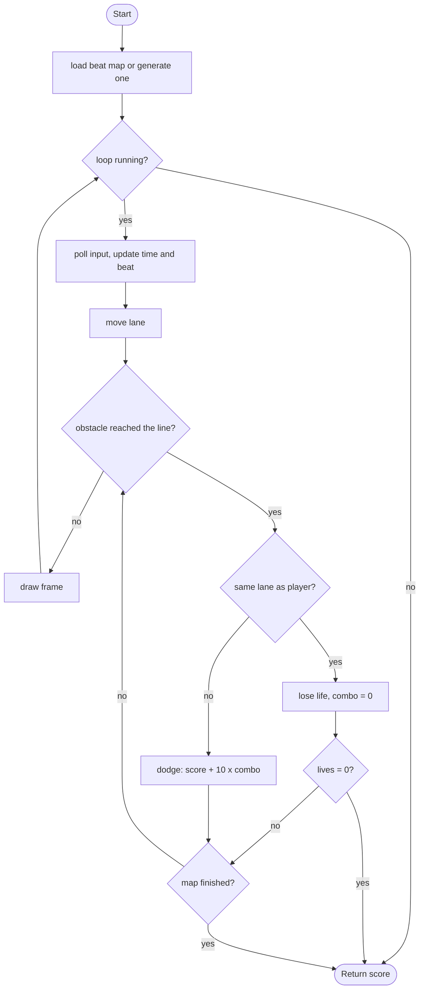

# Beat Dodge - design brief

**Owner:** Member 5  **Folder:** `games/beat_dodge/`  **Status:** songs from MIDI (9 included), 3 difficulties, 3-4 lane charts, synthesised music

## Hook
A rhythm bullet-dodger: obstacles fall down three lanes and arrive at your line exactly on the beat of the song. The song is a beat map text file anyone can write.

## Controls
Left/Right (A/D) switch lane. You have 3 lives.

## Rules and scoring
Each obstacle is resolved when it reaches the player line: same lane = hit (lose a life, combo reset); different lane = dodge (+10 x combo multiplier, max x4). Surviving the whole map gives +50 per life left.

## Implementation steps
1. Real audio: load an `.ogg`/`.wav` from `assets/` (raylib `LoadMusicStream`) and drive `beat_dodge_step` from the music clock so the beat stays locked to the audio (keep a fallback to the fixed step for headless runs).
2. Beat map editor in the game (record taps while the song plays, save to `ctx->data_dir` as the same text format).
3. Richer obstacles: two lanes at once, long "walls", moving diagonals; extend `bd_BeatMap` with a second array or a struct per beat.
4. Pick the song from a menu: list `assets/beatmaps/*.txt` (file handling + array of titles).
5. Per-song leaderboard key: change the `GameDef.id` usage or write `id:song` as the leaderboard game name.

## Pseudocode (for the report)
```
PROCEDURE step(input, dt)
    time <- time + dt
    IF a new beat started THEN raise beat_event (play a tick)
    move the player's lane with left/right (clamped to 0..2)
    WHILE the next obstacle has reached the player line
        IF obstacle lane = player lane THEN lives <- lives - 1; combo <- 0; IF lives = 0 THEN game over
        ELSE dodged <- dodged + 1; combo <- combo + 1; score <- score + 10 * min(combo, 4)
        move on to the next obstacle
    IF all obstacles are resolved THEN win (+50 per life)
END PROCEDURE
```

## Flowchart (for the report)


## Course concepts used
| Concept (Pertemuan) | Where (file : function) |
|---------------------|-------------------------|
| File handling (13) | `beat_dodge_logic.c` : `bd_beatmap_load` (fgets + parsing) |
| Array + string (9) | `bd_BeatMap.lane[]`, parsing characters in `bd_beatmap_load` |
| Struct (13) | `bd_BeatMap`, `beat_dodge_State` |
| Math (12) | `beat_dodge_obstacle_y` (linear interpolation), `gfx_make_tone` (`sinf` synthesised beep) |
| Perulangan (6) | the `while` loop that resolves arrived obstacles |
| Percabangan (5) | hit / dodge logic in `beat_dodge_step` |


## Songs (added)
- Song files: `assets/beatmaps/*.txt` + index `songs.txt`; format in `beat_dodge_logic.h`. Convert MIDI with `tools/midi2beatmap` / `tools/songs/build_songs.sh`.
- Difficulty = thinning of the same notes: easy (quarter notes, gap >= 0.55 s, 3 lanes), normal (8ths, 0.45 s, 3 lanes), hard (16ths, 0.30 s, 4 lanes). Score is normalised to 1000 for a perfect run times x1.0 / x1.5 / x2.0.
- Controls: Left/Right or `1`-`4` (direct lane). Song select: Up/Down song, Left/Right difficulty, Enter.
- Course concepts added: file parsing of binary MIDI (`core/src/midi.c`), sorting (`qsort`/insertion), dynamic programming (`partition_pitches`), arrays of structs, math functions (`sinf`, `powf`) in the synth.
