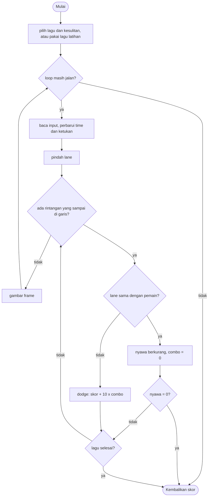

# Beat Dodge - design brief

**Owner:** Member 5  **Folder:** `games/beat_dodge/`  **Status:** lagu dari MIDI (9 lagu disertakan, plus 1 lagu latihan), 3 tingkat kesulitan, chart 3-4 lane, musik hasil sintesis (synthesised)

## Hook
Rhythm bullet-dodger: rintangan jatuh melalui beberapa lane dan sampai di garis pemain **tepat pada ketukan lagu**. Lagunya adalah file teks beat map yang bisa ditulis siapa saja.

## Penjelasan sederhana
Bayangkan lingkaran-lingkaran bercahaya yang jatuh dari atas layar ke sebuah garis di bawah. Kamu berdiri di salah satu lane (jalur) sebagai segitiga putih. Pada saat sebuah lingkaran menyentuh garis, ada dua kemungkinan:

- lingkaran itu ada di lane yang sama dengan kamu: **kena**, nyawa berkurang 1 dan combo kembali ke 0;
- lingkaran itu ada di lane lain: kamu **berhasil menghindar (dodge)**, dapat skor, dan combo naik.

Yang membuat game ini "rhythm game" adalah lagunya. Setiap lagu punya **melodi** (daftar not: kapan bunyi, berapa lama, nada apa), dan dari not-not itu dibuat **chart**, yaitu daftar kapan dan di lane mana rintangan muncul. Musiknya dimainkan dari melodi yang sama, jadi lingkaran sampai di garis tepat saat not-nya berbunyi.

**Satu-satunya jam di game ini adalah variabel `time`** (detik sejak lagu mulai). Kapan sebuah rintangan sampai di garis dihitung dengan rumus `lead + step * step_sec` (`beat_dodge_arrival()`), dan posisi vertikalnya di layar adalah interpolasi linear dari waktu itu (`beat_dodge_obstacle_y()`). Tidak ada kecepatan jatuh yang disimpan di mana pun. Akibatnya, makin tinggi BPM lagunya, makin cepat lingkaran jatuh, karena waktu jatuhnya selalu `BD_LEAD_BEATS` = 3 ketukan.

Istilah yang akan sering muncul:

| Istilah | Artinya |
|---------|---------|
| song (`bd_Song`) | satu lagu: judul, BPM, 1 sampai 3 chart, dan melodi |
| chart (`bd_Chart`) | satu tingkat kesulitan sebuah lagu (easy / normal / hard): jumlah lane + daftar rintangan |
| step | satu "kotak waktu" di chart; satu karakter di file lagu = satu step. Di lagu hasil konversi, 1 step = 1/4 ketukan (not 16th) |
| lane | jalur vertikal tempat rintangan jatuh dan pemain berdiri (3 sampai 5 lane) |
| lead | waktu jatuh sebuah rintangan dari atas ke garis pemain (3 ketukan) |
| melodi (`notes[]`) | not untuk musik; dibunyikan oleh synthesizer bawaan, bukan file audio |

Kodenya dibagi tiga bagian. `beat_dodge_logic.c` berisi aturan game, format file lagu, dan logic menu pilih lagu (semuanya tanpa raylib). `beat_dodge_convert.c` mengubah file MIDI menjadi lagu (dipakai oleh tool `midi2beatmap` dan unit test, bukan oleh game saat dimainkan). `beat_dodge_game.c` menggambar layar pilih lagu dan layar main, serta memutar musik.

**Kalau cuma punya 1 menit:** semua posisi dan tabrakan dihitung dari `beat_dodge_arrival()`. Jangan menghitung dari jumlah frame atau kecepatan piksel; kalau tidak, musik dan rintangan tidak sinkron lagi.

## Kontrol
- Saat main: Left/Right (atau A/D) pindah satu lane. Tombol `1` sampai `4` (maksimal sebanyak jumlah lane di chart, bisa sampai `5`) langsung loncat ke lane itu. Kamu punya 3 nyawa.
- Layar pilih lagu: Up/Down (atau W/S) memilih lagu, Left/Right memilih kesulitan, Enter atau Space mulai, Esc kembali ke hub.

## Aturan dan skor
Setiap rintangan dinilai **tepat pada saat ia sampai di garis pemain**. Tidak ada "jendela" waktu: yang dilihat hanya lane pemain pada saat itu, jadi kamu boleh pindah lane sampai frame terakhir sebelum rintangan tiba.

- **Lane sama = kena** (`hits++`, nyawa -1, combo jadi 0, layar berkedip merah 0,35 detik). Nyawa 0 berarti game over.
- **Lane berbeda = dodge** (`dodged++`, combo +1, skor `+10 * min(combo, 4)`, jadi maksimal x4 per rintangan).
- **Bertahan sampai lagu selesai** (`time >= end_time`) memberi bonus `+50` per nyawa yang tersisa. Kalau game over, bonus ini tidak diberikan.
- Tidak ada hukuman untuk berpindah lane atau untuk diam. Kamu hanya rugi kalau kena.

Skor yang ditampilkan dinormalkan supaya adil antar lagu:

```
skor = (int)(1000 * multiplier * points / max_points)
max_points = 3 * 50 + jumlah skor dodge kalau semua rintangan dihindari tanpa kena
           = 90 + 40 * N       (N = jumlah rintangan di chart, kalau N >= 3; dicek lewat program kecil)
multiplier : easy 1.0, normal 1.5, hard 2.0
```

Jadi permainan sempurna (tanpa kena sama sekali) selalu bernilai **1000 x multiplier**: 1000 di easy, 1500 di normal, 2000 di hard. Contoh: kena satu kali berarti combo putus dan bonus nyawa berkurang 50, jadi skor akhir pasti di bawah itu.

## Cara kerja per frame
**Sebelum loop utama** (`play()` di `beat_dodge_game.c`):

1. `bd_songlist_load()` membaca `assets/beatmaps/songs.txt` dan memuat setiap lagu yang tercantum. Kalau tidak ada lagu yang berhasil dimuat, game memakai lagu latihan bawaan (`beat_dodge_init()`, dibuat acak dari `ctx->seed`).
2. Mode normal: `select_song()` menampilkan layar pilih lagu sampai pemain menekan Enter/Space (atau Esc untuk batal). Mode headless (smoke run): tanpa menu dan tanpa audio, langsung lagu ke-2 di daftar pada chart terakhir (hard).
3. `beat_dodge_use_song()` menyiapkan state (`restart()`): jumlah lane, `spb` (detik per ketukan), `step_sec`, `lead`, `end_time`, 3 nyawa, dan `max_points`.
4. `audio_start()`: kalau ada perangkat audio dan lagunya punya melodi, melodi di-render oleh synthesizer menjadi WAV di memori lalu dimainkan lewat `LoadMusicStreamFromMemory`. Kalau tidak ada melodi tapi ada audio, game memainkan tick metronom tiap ketukan.

**Setiap frame:**

1. `arcade_poll(&in)` membaca input.
2. Kalau ada musik: `UpdateMusicStream()`, lalu `beat_dodge_sync(s, waktu_musik)` supaya `time` mengikuti jam audio. Fungsi ini **hanya** menimpa `time` kalau selisihnya lebih dari 0,15 detik, supaya selisih kecil tidak membuat tampilan bergetar. Sinkronisasi baru dipakai setelah musik berjalan lebih dari 0,5 detik.
3. `beat_dodge_step(s, &in, ARC_DT)`. Urutan di dalamnya:
   1. Kalau `over` sudah `true`, langsung keluar.
   2. `time += dt`; sisa kedip merah berkurang.
   3. Hitung nomor ketukan (`(int)(time / spb)`). Kalau berbeda dari frame sebelumnya, `beat_event = true` untuk satu frame (dipakai untuk tick metronom).
   4. Proses input lane: Left/Right menggeser satu lane (dibatasi 0 sampai `lanes - 1`), tombol angka loncat langsung.
   5. **Loop `while`** menilai semua rintangan yang kini sudah sampai di garis (`time >= arrival(next_hit)`). Kenapa `while` dan bukan `if`: kalau `time` melompat karena sinkronisasi audio, bisa ada lebih dari satu rintangan yang harus dinilai sekaligus. Step kosong (`-1`) hanya dilewati.
   6. Kalau belum game over dan `time >= end_time`: `won = true`, `over = true`, dan bonus `+50` per nyawa ditambahkan.
4. Kalau ada musik, tick metronom tidak dibunyikan. Kalau tidak ada musik tapi ada audio, tick dibunyikan saat `beat_event`.
5. `draw_game()` menggambar backdrop, tiap lane (dengan lingkaran denyut yang mengikuti ketukan), rintangan yang sudah muncul (dari `next_hit` sampai step pertama yang belum muncul), pemain, kedip merah, nyawa, combo, bar progres lagu di bawah HUD, dan judul lagu selama 2,6 detik pertama. Lalu HUD dan `arcade_frame_end()`.
6. Kalau `beat_dodge_is_over()`, loop berhenti. Hasil: `score = beat_dodge_score(s)` dan `finished = true`. Kalau pemain menekan Esc di tengah lagu, `finished = false` sehingga skor tidak dicatat.

## Peta file
| File | Isinya | Edit di sini kalau ... |
|------|--------|------------------------|
| `beat_dodge_logic.h` | Struct `bd_Chart`, `bd_Note`, `bd_Song`, `bd_SongList`, `bd_Menu`, `beat_dodge_State`, konstanta `BD_*`, dan **dokumentasi format file lagu** (komentar di bagian atas) | mengubah struct, batas, atau format lagu |
| `beat_dodge_logic.c` | Lagu bawaan, `bd_song_load` / `bd_song_save`, daftar lagu, menu, dan semua aturan main (`beat_dodge_step`, skor) | mengubah aturan, skor, atau validasi file |
| `beat_dodge_convert.h/.c` | Konversi MIDI ke lagu: memilih track pemain, memipihkan not ke grid 16th, menipiskan per kesulitan, memetakan pitch ke lane dengan dynamic programming | mengubah cara chart dibuat dari melodi |
| `beat_dodge_game.c` | Layar pilih lagu, pemutaran musik (WAV di memori), menggambar, `game_beat_dodge_def` | mengubah tampilan atau teks menu |
| `tests/test_beat_dodge.c` | 15 unit test untuk logic dan semua lagu yang dikirim | mengubah aturan, format, atau menambah lagu |
| `tests/test_beat_dodge_convert.c` | 6 unit test untuk konverter MIDI | mengubah konverter |
| `CMakeLists.txt` | Mendaftarkan game (`LOGIC` memuat dua file `.c`, `TESTS` dua file test) | menambah file baru |
| `GAME.md`, `AGENTS.md` | Dokumen ini, dan instruksi AI agent (tidak diterjemahkan) | lihat catatan masing-masing |
| `../../assets/beatmaps/` | `songs.txt` (daftar lagu di menu), `default.txt` (lagu latihan), `fnf/*.txt` (9 lagu hasil konversi) | menambah atau mengganti lagu |
| `../../tools/midi2beatmap.c`, `../../tools/songs/` | Program konversi MIDI, skrip `build_songs.sh`, `songs.list`, dan file `.mid` sumber | membangun ulang lagu |
| `../../core/src/midi.c`, `synth.c` | Pembaca file MIDI dan synthesizer (bukan bagian game ini, tapi dipakai) | jarang |
| `../../docs/SONGS.md` | Panduan menambah lagu dan status verifikasi audio | menambah lagu |

## Data penting (struct)
`bd_Chart`: satu tingkat kesulitan.

| Field | Tipe | Artinya |
|-------|------|---------|
| `name` | `char[12]` | nama kesulitan: `"easy"`, `"normal"`, `"hard"`. Nama ini juga menentukan multiplier skor (`bd_chart_multiplier`) |
| `lanes` | `int` | jumlah lane (2 sampai 5) |
| `length` | `int` | jumlah step |
| `lane[BD_MAX_STEPS]` | `int8_t` | per step: `-1` = kosong, selain itu nomor lane rintangan (0 = paling kiri) |

`bd_Note`: satu not melodi.

| Field | Tipe | Artinya |
|-------|------|---------|
| `start`, `len` | `uint16_t` | kapan mulai dan berapa lama, dalam satuan 1/24 ketukan (`BD_CLOCKS_PER_BEAT`) |
| `pitch` | `uint8_t` | nada MIDI (21 sampai 108) |
| `voice` | `uint8_t` | jenis suara synthesizer (0 sampai 3). Hasil konversi: 0 = track lawan, 1 = track pemain |

`bd_Song`: satu lagu (sekitar 15 KB, jadi jangan dibuat sebagai variabel lokal biasa).

| Field | Tipe | Artinya |
|-------|------|---------|
| `title` | `char[48]` | judul |
| `bpm` | `int` | ketukan per menit (harus 60 sampai 220) |
| `steps` | `int` | jumlah step per ketukan (1 sampai 8). Lagu hasil konversi memakai 4 |
| `chart_count`, `charts[3]` | `int`, `bd_Chart` | chart yang tersedia |
| `note_count`, `notes[1536]` | `int`, `bd_Note` | melodi (boleh kosong, lalu game memakai metronom) |

`bd_SongList` (sekitar 250 KB, `static` di `beat_dodge_game.c`): `count` lagu yang berhasil dimuat, `skipped` file yang rusak, dan `songs[BD_MAX_SONGS]` (maksimal 16 lagu). `bd_Menu`: `song`, `chart`, dan `chosen` (sudah menekan Enter).

`beat_dodge_State`: seluruh keadaan saat bermain (sekitar 15 KB).

| Field | Tipe | Artinya |
|-------|------|---------|
| `song`, `chart` | `bd_Song`, `int` | salinan lagu yang dimainkan dan indeks chart-nya |
| `lanes`, `length` | `int` | jumlah lane dan step chart yang dimainkan |
| `time` | `float` | detik sejak mulai. Rintangan di step 0 baru tiba di `time = lead` |
| `spb` | `float` | detik per ketukan = `60 / bpm` |
| `step_sec` | `float` | detik per step = `spb / steps` |
| `lead` | `float` | waktu jatuh satu rintangan = `BD_LEAD_BEATS * spb` |
| `end_time` | `float` | lagu selesai (menang) saat `time` mencapai ini |
| `next_hit` | `int` | step pertama yang rintangannya belum sampai di garis |
| `last_beat`, `beat_event` | `int`, `bool` | nomor ketukan frame sebelumnya, dan penanda "ketukan baru" untuk satu frame |
| `lane` | `int` | lane pemain |
| `lives`, `dodged`, `hits`, `combo`, `best_combo` | `int` | nyawa dan statistik |
| `points`, `max_points` | `int` | poin mentah dan poin maksimal (untuk normalisasi) |
| `multiplier` | `float` | multiplier kesulitan |
| `hit_flash` | `float` | sisa detik kedip merah setelah kena |
| `over`, `won` | `bool` | selesai, dan selesai karena menang |

### Format file lagu
File teks. Baris yang diawali `#` adalah komentar. Contoh (diperpendek dari `assets/beatmaps/fnf/bopeebo.txt`):

```
title Bopeebo
bpm 100
steps 4
chart easy 3
2...1...1.......2...1...1.......
chart hard 4
2.1.0...3.......
melody
0 12 63 0
24 6 70 1
```

- `steps 4`: tiap karakter di chart = 1/4 ketukan. Harus ditulis **sebelum** chart pertama.
- `chart <nama> <lane>`: memulai sebuah chart. Baris-baris pola sesudahnya disambung jadi satu: `.` = kosong, `0` sampai `4` = rintangan di lane itu (angkanya tidak boleh melebihi jumlah lane).
- `melody`: sesudahnya satu not per baris: `start len pitch voice` (start dan len dalam 1/24 ketukan).
- File versi pertama yang hanya berisi `bpm` dan baris pola (seperti `default.txt`) masih valid: otomatis menjadi 1 chart `normal` 3 lane dengan 1 step per ketukan.
- **Parser ketat**: kalau ada satu saja baris yang salah (direktif tidak dikenal, lane yang tidak ada, BPM di luar 60 sampai 220, chart kurang dari 8 step, dan seterusnya), seluruh file ditolak dan `out` tidak disentuh. Ini disengaja supaya typo langsung ketahuan.

## Fungsi-fungsi penting
| Fungsi | Tugas | Dipanggil dari |
|--------|-------|----------------|
| `beat_dodge_init(s, seed)` | Memuat lagu latihan bawaan (`bd_song_default`) dan memulai | `play()` kalau tidak ada lagu, dan test |
| `beat_dodge_use_song(s, song, chart)` | Menyalin lagu ke state lalu `restart()` (hitung `spb`, `lead`, `end_time`, `max_points`, dst.) | `play()`, test |
| `beat_dodge_step(s, in, dt)` | Satu langkah logic: waktu, ketukan, input lane, menilai rintangan, menang | `play()` tiap frame, test |
| `beat_dodge_sync(s, clock)` | Mengikuti jam eksternal (musik) kalau selisihnya > 0,15 detik | `play()` |
| `beat_dodge_arrival(s, step)` | `lead + step * step_sec`: kapan rintangan step itu sampai di garis | gambar, penilaian, test |
| `beat_dodge_obstacle_y(s, step)` | Posisi y rintangan (interpolasi linear antara `BD_TOP_Y` dan `BD_PLAYER_Y`) | `draw_game()` |
| `beat_dodge_score(s)` | Skor ternormalisasi (lihat rumus di atas) | HUD dan hasil akhir |
| `bd_song_load(path, out)` / `bd_song_save(path, song)` | Baca dan tulis file lagu; load menolak file yang rusak | daftar lagu, test |
| `bd_songlist_load(dir, out)` | Memuat semua lagu yang disebut di `<dir>/songs.txt` dan melewati yang rusak | `play()`, test |
| `bd_menu_init`, `bd_menu_step` | Logic layar pilih lagu (Up/Down lagu, Left/Right kesulitan, Enter mulai) | `select_song()`, test |
| `bd_song_seconds(song, chart)` | Kapan chart selesai: `(3 + max(panjang chart, panjang melodi dalam ketukan) + 1) * spb` | `restart()`, layar pilih lagu |
| `bd_song_to_synth(song, delay, out)` | Mengubah melodi menjadi not untuk synthesizer, digeser `delay` detik (= `lead`) | `audio_start()`, test |
| `bd_convert_midi(...)` (di `beat_dodge_convert.c`) | MIDI menjadi `bd_Song` dengan 3 chart | `tools/midi2beatmap.c`, test |
| `partition_pitches(...)` (static) | Dynamic programming yang membagi pitch yang berurutan menjadi kelompok lane dengan kelompok tersibuk sekecil mungkin | `build_lane_map` |

## Angka yang bisa diutak-atik
| Konstanta | Nilai sekarang | File | Efek kalau diubah |
|-----------|----------------|------|-------------------|
| `BD_LEAD_BEATS` | `3.0` ketukan | `beat_dodge_logic.h` | waktu jatuh rintangan; makin kecil, makin cepat dan makin sulit |
| `BD_START_LIVES` | `3` | `beat_dodge_logic.h` | jumlah nyawa (juga masuk ke `max_points`) |
| `BD_TOP_Y` / `BD_PLAYER_Y` | `60` / `580` px | `beat_dodge_logic.h` | awal jatuh dan posisi garis pemain (hanya tampilan, penilaian tetap berdasarkan waktu) |
| `BD_MAX_LANES` | `5` | `beat_dodge_logic.h` | batas lane per chart |
| `BD_MAX_STEPS` | `2048` | `beat_dodge_logic.h` | batas panjang chart; lagu 100 BPM dengan 4 step/ketukan muat sekitar 5 menit |
| `BD_MAX_CHARTS` | `3` | `beat_dodge_logic.h` | batas chart per lagu (menentukan ukuran `bd_Song`) |
| `BD_MAX_NOTES` | `1536` | `beat_dodge_logic.h` | batas not melodi per lagu |
| `BD_MAX_SONGS` | `16` | `beat_dodge_logic.h` | batas lagu di menu |
| `BD_CLOCKS_PER_BEAT` | `24` | `beat_dodge_logic.h` | satuan waktu melodi (resolusi jam MIDI); jangan diubah tanpa membangun ulang semua lagu |
| `k_preset[]` | easy: 3 lane, grid 4, jeda 0,55 s. normal: 3 lane, grid 2, 0,45 s. hard: 4 lane, grid 1, 0,30 s | `beat_dodge_convert.c` | cara chart dibuat dari melodi (lalu jalankan `bash tools/songs/build_songs.sh`) |
| `STEPS_PER_BEAT` | `4` | `beat_dodge_convert.c` | resolusi chart hasil konversi (not 16th) |
| multiplier | easy `1.0`, normal `1.5`, hard `2.0` | `bd_chart_multiplier` di `beat_dodge_logic.c` | bobot skor per kesulitan |
| batas combo | `4` (angka langsung, ada di **dua** tempat: `restart()` dan `beat_dodge_step()`) | `beat_dodge_logic.c` | skor maksimal per dodge |
| bonus nyawa | `50` per nyawa (angka langsung, **dua** tempat: `restart()` dan `beat_dodge_step()`) | `beat_dodge_logic.c` | bonus menang |
| kedip merah | `0.35` detik | `beat_dodge_logic.c` | hanya tampilan |
| ambang sinkron | `0.15` detik | `beat_dodge_sync` di `beat_dodge_logic.c` | seberapa besar selisih sebelum `time` ikut jam audio |
| lagu latihan | 64 step, 120 BPM, 4 step awal kosong lalu sekitar 65% rintangan | `bd_song_default` di `beat_dodge_logic.c` | hanya dipakai kalau tidak ada file lagu |
| `BD_AUDIO_OFFSET_S` | `0.0` detik | `beat_dodge_game.c` | geser musik kalau terdengar lebih cepat atau lambat dari rintangan |
| volume musik | `0.85` | `audio_start` di `beat_dodge_game.c` | hanya audio |
| jarak antar lane | 220 px (3 lane), 190 px (4 lane), 165 px (5 lane) | `lane_spacing` di `beat_dodge_game.c` | hanya tampilan |

## Cara menjalankan dan menguji
```bash
# test logic saja (tanpa raylib, ~1 detik)
cmake --preset logic && cmake --build --preset logic && ctest --preset logic -R "^beat_dodge\."

# main game-nya
cmake --preset dev && cmake --build --preset dev && build/dev/bin/arCade

# smoke run headless: jalankan game 420 frame dan simpan screenshot PNG
# (juga menulis beat_dodge_select.png, yaitu layar pilih lagu)
cmake --preset headless && cmake --build --preset headless && build/headless/bin/arCade --smoke beat_dodge --frames 420 --out smoke-out
```

Dua program test dijalankan oleh CTest sebagai `beat_dodge.test_beat_dodge` dan `beat_dodge.test_beat_dodge_convert`.

`tests/test_beat_dodge.c` (15 test):

| Test | Menjaga aturan apa |
|------|--------------------|
| `test_default_song_is_valid` | Lagu bawaan: 120 BPM, 1 chart 3 lane, lebih dari 10 rintangan, 4 step pertama kosong |
| `test_parser_v2` | Format baru terbaca benar: judul, BPM, steps, dua chart, baris pola yang disambung, melodi |
| `test_parser_still_reads_the_first_file_format` | File versi pertama (hanya `bpm` + pola) tetap terbaca sebagai chart `normal` |
| `test_parser_rejects_bad_files` | 13 jenis file rusak ditolak, dan hasil `out` tidak berubah |
| `test_save_and_load_round_trip` | `bd_song_save` lalu `bd_song_load` menghasilkan data yang sama persis |
| `test_obstacles_arrive_exactly_on_the_beat` | Rintangan step 10 tiba tepat di `lead + 10 * step_sec`; nyawa baru berkurang setelah waktu itu |
| `test_perfect_play_wins_and_scores_the_maximum` | Bot yang selalu menyingkir menang dengan 3 nyawa utuh dan skor 1500 (normal) |
| `test_standing_still_loses_all_lives` | Diam saja di lagu bawaan: nyawa habis, kalah, skor < 600 |
| `test_lanes_keys_and_clamping` | Tombol angka, tombol yang lane-nya tidak ada diabaikan, dan lane dibatasi di tepi |
| `test_sync_only_fixes_large_drift` | Selisih 0,05 detik diabaikan, selisih 0,5 detik diikuti |
| `test_beat_event_fires_once_per_beat` | Dalam 2 detik pada 120 BPM, `beat_event` menyala 4 atau 5 kali |
| `test_song_to_synth_uses_beats_not_seconds` | Not melodi dikonversi dari ketukan ke detik dengan benar dan digeser `delay` |
| `test_menu` | Down mengganti lagu dan mulai di chart ke-2, Right dibatasi di chart terakhir, lagu berputar, Enter memilih |
| `test_every_shipped_song_is_playable` | **Semua** lagu di `songs.txt` dan semua chart-nya: lane valid, jarak antar rintangan >= 0,2 detik, >= 20 rintangan, durasi < 300 detik, dan bot sempurna menang tanpa kena dengan skor `1000 * multiplier` |
| `test_monkey_is_safe` | 5000 langkah input acak: lane, nyawa, dan skor selalu dalam batas |

`tests/test_beat_dodge_convert.c` (6 test): konversi dasar (judul, BPM, 3 chart, voice player vs lawan), penipisan menghormati jeda minimum per kesulitan (dan easy hanya di posisi ketukan penuh, normal hanya di posisi not 8th), lane mengikuti pitch (rendah di kiri, tinggi di kanan, semua lane terpakai), pitch yang sama selalu satu lane dan not yang jatuh di step yang sama di-dedupe (not pemain menang), pemilihan track pemain dan pesan error (tempo gila, lagu terlalu panjang), dan lagu hasil konversi bisa dimainkan sempurna di ketiga chart.

## Jebakan dan hal yang perlu diingat
- **Waktu selalu dari `time`, `step_sec`, dan `lead`**, tidak pernah dari hitungan frame. Rintangan ke-`i` tiba di `lead + i * step_sec`; gambar (`beat_dodge_obstacle_y`) dan penilaian harus tetap memakai `beat_dodge_arrival()`, kalau tidak, yang kamu lihat dan yang dihitung tidak sama.
- **Jangan menulis 3 lane secara langsung**; pakai `s->lanes`. Ada chart 3 dan 4 lane (dan format mendukung 2 sampai 5).
- Angka batas combo `4` dan bonus nyawa `50` ditulis langsung di dua fungsi (`restart()` dan `beat_dodge_step()`). Kalau salah satu diubah, ubah keduanya, atau `max_points` tidak lagi sama dengan skor maksimum yang sebenarnya dan skor sempurna tidak lagi 1000.
- **Nama fungsi lama.** `GAME.md` versi lama dan `AGENTS.md` masih menyebut `bd_beatmap_load` dan `bd_BeatMap`. Di kode sekarang namanya `bd_song_load` dan `bd_Chart` / `bd_Song`.
- Lagu berakhir saat **melodi** selesai, bukan saat rintangan terakhir. `bd_song_seconds` mengambil yang lebih lambat antara chart dan melodi, ditambah 1 ketukan penutup. Jadi di akhir lagu ada waktu tanpa rintangan.
- Aturan "tidak ada dua rintangan lebih dekat dari 0,2 detik" ada di `AGENTS.md` folder ini dan **dicek oleh `test_every_shipped_song_is_playable`**. Kalau suatu saat chart dibuat lebih padat (lihat item TODO di bawah), aturan dan test ini ikut berubah.
- `bd_song_load` memakai variabel `static` besar di dalam fungsi supaya tidak membebani stack. Dua lagu tidak bisa dimuat bersamaan dari dua tempat, tapi game ini memuatnya berurutan, jadi aman.
- `bd_song_load` menolak seluruh file kalau ada satu baris salah. File lagu yang dibuat tangan harus rapi: `steps` sebelum chart pertama, nama chart kurang dari 12 karakter, dan chart minimal 8 step.
- Nyawa habis tetap `finished = true`, jadi skor sampai titik itu dicatat ke leaderboard. Menekan Esc di tengah lagu tidak mencatat apa pun.
- Leaderboard hanya satu untuk game ini (id `beat_dodge`), bukan per lagu. Skor sudah dinormalkan terhadap jumlah rintangan, jadi masih bisa dibandingkan antar lagu, tapi multiplier kesulitan memengaruhinya.
- **Audio belum diverifikasi** di sandbox build (tidak ada perangkat suara). Yang sudah dites hanya parsing, konversi, kebenaran chart, ketepatan waktu synth, dan tampilan lewat screenshot headless. Kalau musik terdengar lebih cepat atau lambat dari rintangan, ubah `BD_AUDIO_OFFSET_S` di `beat_dodge_game.c`.
- Mode headless (smoke) memakai lagu ke-2 di daftar pada chart terakhir, tanpa audio.
- Game ini `ranked = true`, `order = 50`.

## Langkah implementasi (Implementation steps)

### Prioritas dari diskusi tim
- [ ] **Terlalu mudah dan membosankan.** Ide-ide dari tim (belum ada keputusan, ini daftar opsi):
  1. **Masalah yang dilihat:** not cenderung berada di tempat yang sama, sehingga pemain bisa diam di sebagian besar waktu dan tetap menang, terutama kalau ada 4 lane.
  2. **Ide A, sinkron 1-ke-1:** buat not beat tersinkron satu-ke-satu dengan rintangan supaya lebih menantang dan lebih terasa selaras dengan beat. Bisa sebagai kesulitan baru, atau jadikan versi "real-time" itu sebagai kesulitan hard lalu geser yang lain (hard sekarang menjadi medium, medium sekarang menjadi easy).
  3. **Ide B, "catch the beat":** ubah game menjadi game menangkap beat, bukan menghindar, supaya kita bisa "berima" dengan beat dan bukan menghindarinya.
  - **Pertanyaan yang perlu dikonfirmasi:** di Ide A, "the real-time one" belum jelas. Catatan di bawah mengasumsikan artinya chart 1-ke-1 dengan melodi (setiap not yang terdengar jadi rintangan). Kalau maksudnya hal lain, koreksi dulu sebelum mengubah apa pun.
  - **Catatan, apakah masalahnya nyata?** Sebagian benar. Dengan bot "pemalas" (hanya pindah kalau rintangan berikutnya ada di lane-nya), sekitar 73 sampai 86% rintangan tidak butuh tekanan tombol sama sekali (lihat tabel). Contoh paling ekstrem: Thorns hard punya 304 rintangan tetapi bot hanya perlu 6 kali pindah lane. Namun "diam total" tidak menang: berdiri diam di satu lane (lane awal, atau lane yang paling jarang dilewati rintangan) kalah di semua 28 chart yang diukur, rata-rata pada 11 sampai 22% awal lagu.
  - **Catatan, kenapa terjadi:** chart dibuat dengan menipiskan melodi (hanya posisi grid tertentu dan jeda minimum), lalu lane ditentukan dari pitch, sehingga nada yang berulang jatuh di lane yang sama. Akibatnya rintangan berikutnya ada di lane yang sama dengan rintangan sebelumnya pada 44 sampai 48% kasus (kalau acak murni: 33% untuk 3 lane, 25% untuk 4 lane). Selain itu, satu rintangan hanya menutup 1 dari 3 atau 4 lane, jadi dengan 4 lane makin banyak lane yang aman. Penilaian juga hanya melihat lane pada satu saat, dan tidak ada hukuman kalau diam.
  - **Catatan, Ide A (1-ke-1):** diukur dari file lagu, melodi (dua track digabung, satu not per step 16th) rata-rata sekitar 4,4 not per detik (kisaran 1,6 sampai 5,5), sedangkan chart hard sekarang rata-rata 2,3 rintangan per detik. Banyak not yang berjarak kurang dari 0,2 detik (contoh: di Satin Panties 265 dari 428 jarak antar-not, di Thorns 468 dari 553). Karena itu chart 1-ke-1 dari seluruh melodi **melanggar aturan jeda 0,2 detik** di `AGENTS.md` dan test `test_every_shipped_song_is_playable`, dan kemungkinan terlalu cepat untuk dimainkan. Kalau hanya memakai track pemain (voice 1), rata-ratanya 2,35 per detik, mirip hard, tapi not-nya datang bergerombol (banyak yang berjarak < 0,3 detik). Aturan jeda 0,2 detik harus diputuskan ulang oleh tim; jangan dilonggarkan diam-diam.
  - **Catatan, menggeser kesulitan:** sekarang ada 3 slot (`BD_MAX_CHARTS = 3`, `k_preset[3]` di konverter, multiplier berdasarkan nama, menu mulai di chart ke-2). Kalau "real-time" menjadi hard baru dan yang lama bergeser, easy yang sekarang terbuang. Kalau ingin menjaga 4 kesulitan, `BD_MAX_CHARTS` perlu 4 (sekitar +2 KB per lagu, +33 KB untuk `bd_SongList`), tambahkan preset, bangun ulang lagu (`bash tools/songs/build_songs.sh`), dan perbarui test yang menulis 3 nama atau jeda minimum langsung. Layar pilih lagu menggambar tiap kesulitan setinggi 84 px dengan jarak 100 px di panel yang bawahnya di y = 632, jadi baris ke-4 akan mulai di y = 550 dan berakhir di y = 634 (perlu dicek tampilannya).
  - **Catatan, Ide B (catch):** secara teknis ini perubahan terkecil: di `beat_dodge_step`, kondisi `l == s->lane` ditukar (lane sama = tangkap, lane beda = lewat dan nyawa berkurang). Format file, chart, konverter, dan musik tidak berubah. Yang ikut berubah: bot `play_perfectly` di kedua file test (harus bergerak *ke* lane rintangan), makna `hits` / `dodged`, dan tampilan rintangan (supaya terbaca sebagai "tangkap"). Dari data, di mode ini sekitar 52 sampai 56% rintangan butuh pindah lane (dibanding 14 sampai 27% di mode dodge), rata-rata 0,62 sampai 0,82 langkah lane per rintangan, dan 10 sampai 21% rintangan berjarak 2 lane atau lebih dari rintangan sebelumnya (butuh 2 tekanan panah, atau satu tombol angka). Diam di satu lane tidak lagi bisa menang.
  - **Opsi lain yang sudah ada di daftar bawah:** rintangan yang menutup beberapa lane sekaligus (langkah 3) juga menyerang masalah "diam saja", karena lane yang aman jadi lebih jarang dan lebih sering berpindah.

**Data pengukuran** (9 lagu FNF, rata-rata; Practice tidak dihitung; memainkan chart asli lewat `beat_dodge_step` dengan bot sederhana):

| Ukuran | easy | normal | hard |
|--------|------|--------|------|
| Rintangan per detik | 1,09 | 1,60 | 2,27 |
| Rintangan sebagai persen dari not melodi | 27% | 37% | 53% |
| Rintangan yang lane-nya sama dengan rintangan sebelumnya | 47% | 48% | 44% |
| Bot pemalas: perpindahan lane per rintangan | 0,27 | 0,23 | 0,14 |
| Bagian lane tersibuk dari semua rintangan | 34% sampai 49% | 34% sampai 43% | 27% sampai 49% |
| Diam di lane awal: game over pada | 11% lagu | 11% lagu | 13% lagu |
| Diam di lane yang paling jarang kena: game over pada | 18% lagu | 13% lagu | 22% lagu |
| Kalau aturan dibalik jadi "catch": rintangan yang butuh pindah lane | 53% | 52% | 56% |

### Langkah dari design awal
1. Audio asli: muat file `.ogg`/`.wav` dari `assets/` (raylib `LoadMusicStream`) dan gerakkan `beat_dodge_step` dari jam musik supaya beat tetap terkunci ke audio (sisakan fallback ke step tetap untuk run headless). *(Sebagian sudah ada: musik disintesis di memori dan `beat_dodge_sync` mengikuti jam audio. Yang belum: memuat file audio sungguhan.)*
2. Editor beat map di dalam game (rekam ketukan saat lagu berjalan, simpan ke `ctx->data_dir` dengan format teks yang sama).
3. Rintangan yang lebih kaya: dua lane sekaligus, "dinding" panjang, diagonal yang bergerak; perluas `bd_Chart` dengan array kedua atau satu struct per ketukan.
4. Pilih lagu dari menu: daftar `assets/beatmaps/*.txt` (file handling + array judul). *(Sudah selesai lewat `songs.txt` dan layar pilih lagu: `bd_songlist_load`, `bd_menu_step`, `select_song`. Daftar lagu dibaca dari file indeks, bukan dengan menelusuri folder, karena C standar tidak bisa membaca isi folder.)*
5. Kunci leaderboard per lagu: ubah pemakaian `GameDef.id` atau tulis `id:lagu` sebagai nama game di leaderboard.

## Pseudocode (untuk laporan)
```
PROSEDUR step(state, input, dt)
    JIKA game over MAKA KEMBALI
    time <- time + dt
    JIKA ketukan baru dimulai MAKA beat_event <- benar (front-end memainkan tick)
    geser lane pemain dengan kiri/kanan (dibatasi 0..lanes-1), atau loncat dengan tombol angka
    SELAMA rintangan berikutnya sudah sampai di garis pemain DAN belum game over
        JIKA step itu berisi rintangan MAKA
            JIKA lane rintangan = lane pemain MAKA
                nyawa <- nyawa - 1; combo <- 0
                JIKA nyawa = 0 MAKA game over
            JIKA TIDAK
                dodged <- dodged + 1; combo <- combo + 1
                skor <- skor + 10 * min(combo, 4)
        pindah ke step berikutnya
    JIKA belum game over DAN time >= end_time MAKA
        menang; skor <- skor + 50 * nyawa
AKHIR PROSEDUR

PROSEDUR buat_chart(steps, preset)          (di konverter MIDI)
    terakhir <- minus tak hingga
    UNTUK SETIAP step berisi not, berurutan menurut waktu
        JIKA nomor step habis dibagi preset.grid DAN jaraknya dari terakhir >= preset.jeda MAKA
            simpan not itu sebagai rintangan; terakhir <- nomor step itu
    bagi pitch yang dipakai menjadi preset.lanes kelompok bertetangga (dynamic programming)
        supaya kelompok tersibuk sesedikit mungkin
    UNTUK SETIAP rintangan: lane <- kelompok dari pitch-nya
AKHIR PROSEDUR
```

## Flowchart (untuk laporan)


## Konsep kuliah yang dipakai
| Konsep (Pertemuan) | Di mana (file : fungsi) |
|--------------------|-------------------------|
| File handling (13) | `beat_dodge_logic.c` : `bd_song_load` (`fgets` + parsing), `bd_song_save`, `bd_songlist_load` |
| Array + string (9) | `bd_Chart.lane[]`, membaca karakter pola di `add_pattern`, `sscanf` untuk not melodi |
| Struct (13) | `bd_Chart`, `bd_Song`, `beat_dodge_State` |
| Matematika (12) | `beat_dodge_obstacle_y` (interpolasi linear), `gfx_make_tone` (bunyi `sinf` untuk metronom) |
| Perulangan (6) | loop `while` yang menilai rintangan yang sudah tiba, di `beat_dodge_step` |
| Percabangan (5) | logika kena / dodge di `beat_dodge_step` |

## Songs (tambahan)
Bagian ini menjelaskan sistem lagu yang ditambahkan setelah design awal.

- **File lagu:** `assets/beatmaps/*.txt` dan `fnf/*.txt`, ditambah indeks `songs.txt`. Format lengkap ada di komentar atas `beat_dodge_logic.h` (ringkasannya di bagian "Format file lagu" di atas). Daftar di menu mengikuti urutan baris di `songs.txt`.
- **Kesulitan = penipisan not yang sama:** satu melodi dipakai untuk tiga chart. Skor dinormalkan jadi 1000 untuk permainan sempurna, dikali x1,0 / x1,5 / x2,0.

| Kesulitan | Lane | Posisi step yang boleh | Jeda minimum | Multiplier | Rintangan per detik (rata-rata 9 lagu) |
|-----------|------|------------------------|--------------|------------|----------------------------------------|
| easy | 3 | tiap ketukan penuh (grid 4) | 0,55 detik | x1,0 | 1,09 |
| normal | 3 | tiap not 8th (grid 2) | 0,45 detik | x1,5 | 1,60 |
| hard | 4 | tiap not 16th (grid 1) | 0,30 detik | x2,0 | 2,27 |

- **Daftar lagu** (jumlah rintangan easy / normal / hard; BPM): Practice (120, hanya chart normal: 30), Bopeebo (100: 78 / 84 / 116), Satin Panties (110: 79 / 152 / 188), Roses (120: 79 / 155 / 202), High (125: 93 / 173 / 201), Eggnog (150: 92 / 138 / 225), South (165: 96 / 120 / 192), Dad Battle (180: 100 / 124 / 189), M.I.L.F (180: 132 / 196 / 296), Thorns (190: 160 / 206 / 304).
- **Kenapa lane diturunkan dari pitch:** file MIDI Friday Night Funkin' hanya menyimpan melodi (waktu dan nada), bukan lane panah. Konverter menaruh nada rendah di kiri dan nada tinggi di kanan, lalu menyeimbangkan supaya tiap lane kira-kira sama sering dipakai. Jumlah lane adalah keputusan gameplay, bukan data dari lagu.
- **Cara konversi, versi singkat:** `core/src/midi.c` membaca not tiap track, `beat_dodge_convert.c` menggabungkan track lawan dan pemain, menjatuhkan tiap not ke step 16th terdekat (kalau dua not jatuh ke step yang sama, not pemain yang dipakai), menipiskannya per kesulitan, memetakan pitch ke lane, dan menyimpan seluruh melodi untuk musik.
- **Menambah atau membangun ulang lagu:**
  ```bash
  cmake --preset logic && cmake --build --preset logic          # membangun build/logic/bin/midi2beatmap
  build/logic/bin/midi2beatmap my.mid --report                  # track, dan rintangan per detik tiap kesulitan
  build/logic/bin/midi2beatmap my.mid -o assets/beatmaps/my_song.txt --title "My Song"
  echo my_song.txt >> assets/beatmaps/songs.txt                 # tampil di menu sesuai urutan ini
  bash tools/songs/build_songs.sh                               # bangun ulang semua lagu FNF dari tools/songs/fnf/*.mid
  ```
  Opsi `--player TEKS` memilih track pemain lewat sebagian namanya (default: "boyfriend" atau "bf", kalau tidak ada maka track terakhir). Hanya tempo pertama yang dipakai (tool memberi peringatan kalau ada perubahan tempo). Detail lain ada di `docs/SONGS.md`.
- **Konsep kuliah tambahan:** parsing file MIDI biner (`core/src/midi.c`), sorting (`qsort` di `bd_convert_midi`), dynamic programming (`partition_pitches`), array of struct, dan fungsi matematika (`sinf`, `powf`) di synthesizer (`core/src/synth.c`).
