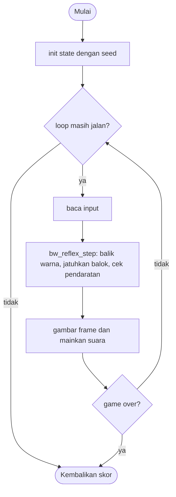

# BW Reflex - design brief

**Owner:** Leader  **Folder:** `games/bw_reflex/`  **Created:** 2026-11-12  **Asal mekanik:** `g03_bwreflex` di proyek `simple-games` (hanya aturan; tidak ada kode, gambar, suara, teks atau font yang disalin)

## Hook
Satu ketukan membalik warna dasar layar: cocokkan hitam atau putih dengan balok yang jatuh sebelum mendarat.

## Penjelasan sederhana
Sebuah balok hitam atau putih jatuh dari atas. Di bawah ada "dasar" yang juga hitam atau putih. Setiap klik (atau tombol apa saja) membalik warna dasar. Saat balok mendarat, warna dasar harus sama dengan warna balok. Kalau sama, kamu dapat 1 poin dan balok berikutnya jatuh sedikit lebih cepat. Kalau beda, game selesai.

Di balik layar, `bw_reflex_step()` menggeser balok ke bawah sedikit demi sedikit tiap frame, lalu mengecek apakah sisi bawah balok sudah melewati garis dasar. Hanya saat itu warna dibandingkan. Menggambar dipisah di `bw_reflex_game.c`, jadi aturan bisa diuji tanpa raylib. Mirip lampu lalu lintas: yang dicek hanya warnanya pada saat kendaraan sampai di garis.

Kalau cuma punya 1 menit: balok jatuh, kamu klik untuk menyamakan warna dasar, cocok = +1 dan lebih cepat, tidak cocok = selesai.

## Kontrol
Klik mouse atau tombol apa saja (spasi, panah, huruf): balik warna dasar. Klik di mana saja di jendela dihitung. Tidak ada jeda (pause).

## Aturan dan skor
- Mulai: dasar hitam, kecepatan 4.0, pengali `mult` 0.07.
- Balok mendarat saat `block_y + 40 > h - base_h + 1.5`.
- Warna sama: `score += 1`, `speed *= (1 + mult)`, `mult *= 0.9625`, balok baru jatuh.
- Warna beda: `over = true`; setelah jeda tampil 0.9 detik `is_over()` menjadi true.
- **Skor = jumlah balok yang cocok.**
- Indeks nada = `skor_lama % 8` (skor sebelum ditambah).

## Cara kerja per frame
1. `arcade_poll()` mengisi `ArcadeInput`.
2. `bw_reflex_step()`: kalau ada klik/tombol, `base_white` dibalik dan `flips++`.
3. Balok turun `(h - base_h) * speed * k / 400` dengan `k = dt * 50`.
4. Kalau balok mendarat: bandingkan warna, naikkan skor dan kecepatan, atau set `over`.
5. Front-end membandingkan `flips` dan `matches` dengan frame lalu untuk memainkan suara.
6. Gambar: panel abu-abu, dasar, kata warna, angka skor, balok, gutter kiri dan kanan, HUD.

## Peta file
| File | Isinya | Edit di sini kalau ... |
|---|---|---|
| `bw_reflex_logic.h` | struct `bw_reflex_State` dan fungsi publik (`init`, `init_sized`, `step`, `is_over`, `score`) | menambah field state atau fungsi publik |
| `bw_reflex_logic.c` | semua aturan game (tanpa raylib) | mengubah aturan atau angka keseimbangan |
| `bw_reflex_game.c` | loop raylib, menggambar, suara, `GameDef` (judul, kontrol di menu, urutan, ranked) | mengubah tampilan, suara, atau teks di menu |
| `tests/test_bw_reflex.c` | unit test (hanya logic) | menambah atau mengubah aturan |
| `CMakeLists.txt` | mendaftarkan game lewat `arcade_add_game(...)` | menambah file `.c` atau test baru |
| `GAME.md` | dokumen ini | aturan atau kode berubah |
| `AGENTS.md` | instruksi untuk AI agent (tidak diterjemahkan) | jarang; ikuti aturan di file itu |

## Data penting (struct)
| Field | Tipe | Artinya |
|---|---|---|
| `w`, `h` | int | ukuran lapangan (480 x 684 di game, 480 x 800 di tes) |
| `base_h` | int | tinggi dasar = round(h / 6) |
| `base_white` | int | 1 = dasar putih, 0 = hitam |
| `block_white` | int | warna balok yang sedang jatuh |
| `block_y` | float | pusat y balok, mulai -40 (di atas layar) |
| `speed`, `mult` | float | kecepatan jatuh dan laju pertumbuhannya |
| `score` | int | balok yang cocok |
| `over`, `over_t` | bool, float | aturan bilang selesai, dan detik sejak itu (untuk jeda tampil) |
| `flips`, `matches`, `last_note` | int | penghitung kejadian untuk suara di front-end |
| `rng` | Rng | pengacak warna balok (dari `ctx->seed`) |

## Fungsi-fungsi penting
| Fungsi | Tugas | Dipanggil dari |
|---|---|---|
| `bw_reflex_init_sized` | mengisi state awal untuk ukuran lapangan tertentu | `bw_reflex_init`, tes |
| `bw_reflex_init` | memanggil `init_sized` dengan 480 x 684 | `play()` |
| `bw_reflex_step` | satu langkah: balik warna, jatuhkan balok, cek pendaratan | `play()`, tes |
| `bw_reflex_contact_y` | garis pendaratan `h - base_h + 1.5` | `step`, tes |
| `bw_reflex_is_over`, `bw_reflex_score` | status akhir dan skor | `play()`, hub |

## Angka yang bisa diutak-atik
| Konstanta | Nilai sekarang | File | Efek kalau diubah |
|---|---|---|---|
| `BW_SPEED0` | 4.0 | `bw_reflex_logic.c` | kecepatan awal |
| `BW_MULT0` | 0.07 | `bw_reflex_logic.c` | seberapa cepat kecepatan naik di awal |
| `BW_MULT_DECAY` | 0.9625 | `bw_reflex_logic.c` | makin kecil = kecepatan cepat berhenti naik |
| `BW_BLOCK` | 80 px | `bw_reflex_logic.h` | ukuran balok |
| `BW_OVER_DELAY` | 0.9 s | `bw_reflex_logic.h` | lama kekalahan ditampilkan sebelum hub mencatat skor |
| angka langsung di dalam `init_sized` | `h / 6` | `bw_reflex_logic.c` | tinggi dasar |

## Cara menjalankan dan menguji
```bash
# test logic saja (tanpa raylib, ~1 detik)
cmake --preset logic && cmake --build --preset logic && ctest --preset logic -R "^bw_reflex\."

# main game-nya
cmake --preset dev && cmake --build --preset dev && build/dev/bin/arCade

# smoke run headless: jalankan game 300 frame dan simpan screenshot PNG
cmake --preset headless && cmake --build --preset headless && build/headless/bin/arCade --smoke bw_reflex --frames 300 --out smoke-out
```

| Test | Menjaga aturan apa |
|---|---|
| `test_init_is_sane` | state awal benar |
| `test_spec_geometry_at_480x800` | base_h 133, garis 668.5, jatuh 6.67 px per tick |
| `test_same_seed_same_result` | deterministik |
| `test_monkey_never_breaks_invariants` | 20 seed x 5000 frame, tidak ada NaN, nada 0..7 |
| `test_speed_law` | kecepatan 4.28 lalu 4.5684 dan mult menyusut |
| `test_note_index_uses_old_score` | nada = skor lama % 8, berulang setelah 8 |
| `test_fall_time_at_60hz` | pendaratan pertama sekitar 2.0 detik di 60 fps |
| `test_mismatch_ends_the_game_after_reveal` | warna beda mengakhiri game setelah jeda tampil |
| `test_any_input_flips_and_flips_back` | klik dan tombol huruf sama-sama membalik |

## Jebakan dan hal yang perlu diingat
- Panel lapangan sengaja **abu-abu** (bukan palet neon) karena hitam dan putih adalah mekanik utama; di latar gelap balok hitam tidak terlihat.
- Kata WARNA di dasar digambar dengan warna balok, jadi hilang saat dasar sudah sama. Ini perilaku asli, bukan bug.
- Penyimpangan dari simple-games: garis pendaratan memakai `h - base_h + 1.5` (versi asli beda 0.5 px untuk `base_h` ganjil).
- Penyimpangan: suara kalah selalu dimainkan (di aslinya hanya kalau Post It sudah dimainkan lebih dulu); jeda tampil 0.9 detik ditambahkan supaya pemain melihat warna yang salah.
- Penyimpangan: tidak ada tombol "play again" dan tidak ada ranking online; hub yang mencatat skor.
- Semua per-tick di aslinya (50 Hz) dikali `k = dt * 50`; kalau mengubah kecepatan, ingat tes memakai `dt = 0.02`.
- Nada: tangga nada C mayor (262 sampai 523 Hz) dibuat dengan `gfx_make_tone()`, bukan file suara.

## Langkah implementasi (Implementation steps)
1. Aturan sudah ada di `bw_reflex_State` dan `bw_reflex_step()` (hanya di logic). Konstanta ditulis sebagai `#define` di `bw_reflex_logic.c`.
2. Setiap aturan punya unit test di `tests/test_bw_reflex.c`; tes memakai `bw_reflex_init_sized(480, 800)` supaya vektor uji spesifikasi asli berlaku apa adanya.
3. Tampilan ada di `bw_reflex_game.c`: panel 480 x 684 di tengah, aturan di gutter kiri, statistik di gutter kanan. Suara dibuat dari `gfx_make_tone()`.
4. Kalau menambah aturan: tulis tesnya dulu, lalu ubah logic, lalu perbarui bagian Jebakan dan tabel di dokumen ini.

## Pseudocode (untuk laporan)
```
PROSEDUR step(s, input, dt)
    JIKA s.over MAKA s.over_t += dt; KEMBALI
    JIKA ada klik atau tombol MAKA s.base_white = 1 - s.base_white
    s.block_y += (h - base_h) * speed * (dt * 50) / 400
    JIKA s.block_y + 40 > h - base_h + 1.5 MAKA
        JIKA block_white == base_white MAKA
            last_note = score MOD 8; score += 1
            speed *= 1 + mult; mult *= 0.9625; balok baru
        SELAIN ITU
            s.over = benar
AKHIR PROSEDUR
```

## Flowchart (untuk laporan)


## Konsep kuliah yang dipakai (untuk Bab I laporan)
| Konsep (Pertemuan) | Di mana (file : fungsi) |
|---|---|
| Struct (13) | `bw_reflex_logic.h` : `bw_reflex_State` |
| Percabangan (5) | `bw_reflex_logic.c` : `bw_reflex_step` (cocok atau tidak cocok) |
| Fungsi (11) | `bw_reflex_logic.c` : `flip_requested`, `new_block` |
| Perulangan (6-7) | `bw_reflex_game.c` : loop `while (arcade_loop_running())` |
| Array (9) | `bw_reflex_game.c` : `k_scale[8]` dan `notes[8]` |
| Pointer (12) | `bw_reflex_step(bw_reflex_State *s, ...)` mengubah state lewat pointer |
