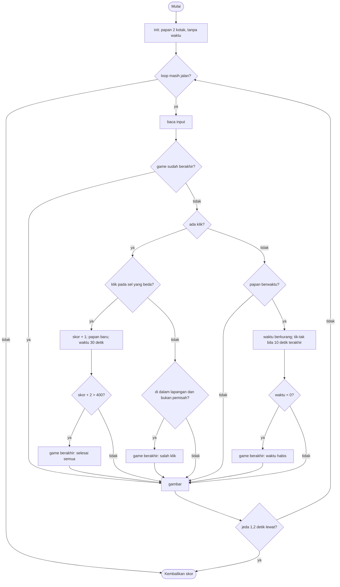

# A Different Color - design brief

**Owner:** Leader  **Folder:** `games/different_color/`  **Created:** 2026-11-12  **Status:** v1 sudah jalan (dua papan, satu sel beda warna, papan makin besar, batas waktu 30 detik)

## Hook
Dua papan berisi kotak-kotak berwarna acak, satu di atas dan satu di bawah. Papan bawah adalah salinan papan atas, kecuali **satu** kotak yang warnanya berbeda. Temukan dan klik kotak itu (di papan mana pun). Benar: +1 dan papan berikutnya punya lebih banyak kotak. Salah klik: selesai. Setelah papan pertama, kamu hanya punya 30 detik per papan.

## Penjelasan sederhana
Bayangkan permainan "temukan perbedaannya" yang hanya punya satu perbedaan dan makin lama makin ramai. Papan pertama hanya dua kotak, jadi mudah dan **tanpa batas waktu** (waktu untuk membiasakan diri). Tiap papan yang kamu selesaikan menambah satu kotak, dan jumlah kolom dan baris tumbuh seperti persegi yang makin besar, sampai 20 x 20 = 400 kotak.

Warna kotak dipilih acak, dengan dua syarat supaya adil: tidak boleh abu-abu (selisih antar-kanal kurang dari 0,1) dan tidak boleh gelap (semua kanal di bawah 0,5). Warna kotak yang berbeda dipilih acak juga, dan baru diterima kalau cukup beda dari warna aslinya: jumlah selisih tiga kanal minimal 0,3 **dan** selisih kecerahannya (luma) minimal 0,2. Jadi "beda sedikit" di teks bantuan bukan berarti nyaris sama; bedanya cukup nyata, dan kesulitan datang dari banyaknya kotak.

Klik boleh meleset 8 px dari tepi kotak di tiap sisi. Klik di strip putih pemisah, di luar papan, atau di tepi lapangan **diabaikan** dan tidak mengakhiri game; hanya klik di dalam area papan pada kotak yang salah yang mengakhiri game. Waktu tidak berjalan pada frame klik, sehingga papan baru mulai tepat dari 30,0 detik.

Aturan ada di `different_color_logic.c` (tanpa raylib, bisa di-test di terminal). `different_color_game.c` hanya menggambar dan meneruskan klik.

**Kalau cuma punya 1 menit:** `different_color_new_board` membuat papan baru (ukuran grid, warna, sel yang beda); `different_color_click` memutuskan benar, salah, atau diabaikan; `different_color_step` meneruskan klik dan menjalankan jam 30 detik.

## Kontrol
Klik kiri pada kotak yang beda warna, di papan atas atau papan bawah. Tidak ada tombol lain. Esc keluar.

## Aturan dan skor
Skor = jumlah papan yang diselesaikan. Game berakhir kalau kamu salah klik, waktu papan habis (mulai papan kedua), atau papan 20 x 20 selesai.

Detail dari kode:
- **Ukuran papan:** papan ke-`score` punya `n = score + 2` kotak asli. `cols = ceil(sqrt(n))`, `rows = ceil(n / cols)`. Contoh: 2 kotak menjadi 2 x 1, 3 dan 4 menjadi 2 x 2, 5 dan 6 menjadi 3 x 2, 7 sampai 9 menjadi 3 x 3. Seluruh `cols * rows` kotak diberi warna (grid selalu persegi panjang penuh), tetapi kotak yang beda hanya dipilih dari `n` kotak asli.
- **Ukuran kotak di lapangan 480 x 684:** `rectw = (w - 32) / cols`, `recth = ((h - 48 - 128) / rows) * 0,5` (dua papan berbagi tinggi). Papan atas mulai di `y = 80` (`DC_Y1`), papan bawah di `y2 = h/2 + 8`. Di test (480 x 800): `rectw = 224`, `recth = 312`, `y2 = 408` untuk papan 2 x 1.
- **Sel yang beda:** indeks acak `dif` di `0..n-1` (urutan baris); papan bawah sama dengan atas kecuali sel itu, yang warnanya `odd`. Pusat sel di papan atas dari `different_color_odd_center`; di papan bawah ditambah `y2 - 80`.
- **Klik:** `fire_pressed` mengubah posisi mouse menjadi koordinat lapangan (satu kali, di `step`) lalu memanggil `different_color_click`. Benar kalau klik dalam jarak `lebar kotak / 2 + 8` dari pusat sel di sumbu x **dan** `tinggi kotak / 2 + 8` di sumbu y, di papan atas atau bawah.
- **Salah klik** mengakhiri game hanya kalau klik berada di dalam lapangan (`x` dari 17 sampai `w - 16`, `y` dari 81 sampai `h - 80`) dan bukan di strip pemisah (`y` dari `y2 - 16` sampai `y2`).
- **Waktu:** papan pertama tidak berwaktu (`timed = false`). Dari papan kedua, `time_left = 30` detik dan berkurang tiap frame yang bukan frame klik. `time_left < 0` berarti `timed_out` dan game berakhir.
- **Tik-tak:** saat sisa waktu `<= 9,999` detik, tiap 0,5 detik `ticks++` (front-end bergantian memainkan "tick" dan "tack").
- **Batas 400 kotak:** setelah klik benar, kalau `score + 2 > 400` game berakhir dengan `capped` ("ALL BOARDS SOLVED!"). Itu terjadi saat skor mencapai 399, yaitu papan 20 x 20 selesai; array tidak pernah terlewati.
- `different_color_is_over` baru `true` 1,2 detik (`DC_OVER_DELAY`) setelah `over`, supaya cincin di sel yang beda terlihat.

## Cara kerja per frame
1. `arcade_poll(&in)` mengisi `ArcadeInput`. Hanya `fire_pressed` (klik), `aim_x`, dan `aim_y` yang dipakai.
2. `different_color_step(&s, &in, ARC_DT)`:
   1. Kalau `over` sudah `true`: `over_t += dt`, keluar.
   2. Kalau `fire_pressed`: ubah posisi mouse ke koordinat lapangan, panggil `different_color_click`, dan **keluar** (frame klik tidak menggerakkan jam).
   3. Kalau papan belum berwaktu, keluar.
   4. `time_left -= dt`, `tick_t += dt`. Kalau `time_left <= 9,999` dan `tick_t >= 0,5`, `ticks++` dan `tick_t = 0`.
   5. Kalau `time_left < 0`: `timed_out` dan `end_game`.
3. `different_color_click(&s, lx, ly)`: benar: `score++`, `solved++`, cek batas 400, `timed = true`, `time_left = 30`, `different_color_new_board`; salah: `misses++` dan `end_game`; sisanya (strip pemisah, margin, di luar area) diabaikan.
4. Front-end membandingkan `solved` dan `ticks` dengan frame lalu untuk memutar bunyi (chime saat benar, tik atau tak, nada kalah), lalu menggambar dua papan, strip putih pemisah, bilah waktu (hijau, kuning, atau merah menurut sisa waktu), tulisan "Tap the different block" di papan pertama, cincin di sel yang beda saat game berakhir, dan pesan "WRONG CELL!", "TIME UP!", atau "ALL BOARDS SOLVED!".
5. Kalau `different_color_is_over(&s)` bernilai `true`, loop berhenti dan skor dikembalikan.

## Peta file
| File | Isinya | Edit di sini kalau ... |
|------|--------|------------------------|
| `different_color_logic.h` | Konstanta `DC_*`, struct `different_color_State`, fungsi publik dan aturan murni | menambah field state atau mengubah ukuran |
| `different_color_logic.c` | `different_color_new_board`, `different_color_click`, `different_color_step`, aturan warna dan grid | mengubah aturan warna, grid, waktu, atau toleransi klik |
| `different_color_game.c` | Loop raylib, menggambar papan, bilah waktu, cincin, bunyi, `game_different_color_def` | mengubah tampilan atau teks |
| `tests/test_different_color.c` | 15 unit test (hanya logic) | menambah atau mengubah aturan |
| `CMakeLists.txt` | Mendaftarkan game ke build | menambah file `.c` atau test baru |
| `core/include/arcade/playfield.h` | Lapangan potret 480 x 684 yang dipakai bersama | jarang |
| `GAME.md` | Dokumen ini | aturan atau kode berubah |
| `AGENTS.md` | Instruksi untuk AI agent (tidak diterjemahkan) | jarang; ikuti aturan di file itu |

## Data penting (struct)
`different_color_State`: seluruh keadaan game. Koordinat lokal lapangan; warna berupa tiga `float` 0..1 (front-end mengubahnya).

| Field | Tipe | Artinya |
|-------|------|---------|
| `w`, `h` | `int` | ukuran lapangan |
| `y2` | `float` | y atas papan bawah (`h/2 + 8`) |
| `n`, `cols`, `rows` | `int` | jumlah kotak asli, kolom, dan baris grid |
| `rectw`, `recth` | `float` | ukuran satu kotak |
| `dif` | `int` | indeks sel yang beda (urutan baris) |
| `cell[][3]` | `float` | warna tiap sel (papan atas, dan papan bawah kecuali `dif`); 400 sel |
| `odd[3]` | `float` | warna sel yang beda di papan bawah |
| `timed` | `bool` | papan ini berwaktu (salah pada papan pertama) |
| `time_left`, `tick_t` | `float` | sisa detik; detik sejak tik-tak terakhir |
| `score` | `int` | papan yang sudah diselesaikan |
| `over`, `capped`, `timed_out` | `bool` | game berakhir; karena 400 kotak; karena waktu habis |
| `over_t` | `float` | detik sejak berakhir |
| `solved`, `ticks`, `misses` | `int` | penghitung kejadian untuk bunyi |
| `rng` | `Rng` | pengacak deterministik: warna dan sel yang beda |

## Fungsi-fungsi penting
| Fungsi | Tugas | Dipanggil dari |
|--------|-------|----------------|
| `different_color_init(s, seed)` / `_init_sized(s, seed, w, h)` | Mengosongkan state dan membuat papan pertama | `play()`, test |
| `different_color_step(s, in, dt)` | Satu langkah logic | `play()` tiap frame, test |
| `different_color_is_over(s)` / `different_color_score(s)` | Status selesai (setelah jeda 1,2 detik) dan skor | `play()` |
| `different_color_click(s, lx, ly)` | Memutuskan klik benar, salah, atau diabaikan (koordinat lapangan) | `different_color_step`, test |
| `different_color_new_board(s)` | Menghitung grid dan mengisi warna papan untuk skor sekarang | `init`, `different_color_click` |
| `different_color_odd_center(s)` | Pusat sel yang beda di papan atas | `different_color_click`, front-end, test |
| `different_color_grid_for_score(score, &cols, &rows)` | Ukuran grid untuk skor tertentu (fungsi murni) | `new_board`, test |
| `different_color_random_color_ok(r, g, b)` | Warna acak diterima kalau bukan abu-abu dan bukan gelap | `random_color`, test |
| `different_color_diff_ok(c1, c2)` | Dua warna cukup berbeda untuk dianggap adil | `odd_color_for`, test |
| `random_color(s, c)`, `odd_color_for(s, base, out)` (static) | Menarik warna dengan penolakan (maksimal 10.000 percobaan) | `new_board` |
| `end_game(s)` (static) | Menandai selesai | `click`, `step` |

## Angka yang bisa diutak-atik
| Konstanta | Nilai sekarang | File | Efek kalau diubah |
|-----------|----------------|------|-------------------|
| `DC_MAX_CELLS` | `400` | `different_color_logic.h` | ukuran array warna dan batas akhir game |
| `DC_X1` / `DC_Y1` | `16` / `80` px | `different_color_logic.h` | margin kiri papan dan y atas papan atas |
| `DC_TIME_LIMIT` | `30` detik | `different_color_logic.h` | waktu per papan (dari papan kedua) |
| `DC_WARN_TIME` | `9.999` detik | `different_color_logic.h` | kapan tik-tak mulai |
| `DC_OVER_DELAY` | `1.2` detik | `different_color_logic.h` | lama cincin terlihat sebelum game ditutup |
| `DC_TOLERANCE` | `8` px | `different_color_logic.c` | seberapa jauh klik boleh meleset dari sel |
| `DC_MAX_TRIES` | `10000` | `different_color_logic.c` | batas percobaan penarikan warna (supaya tidak berputar selamanya) |
| batas abu-abu dan gelap (angka langsung di `random_color_ok`) | selisih `< 0,1`; semua kanal `< 0,5` | `different_color_logic.c` | warna acak mana yang diterima |
| batas beda warna (angka langsung di `diff_ok`) | jumlah selisih `>= 0,3`; selisih luma `>= 0,2` | `different_color_logic.c` | seberapa nyata sel yang beda terlihat |
| ukuran papan (angka langsung di `new_board`) | `w - 32`, `h - 48 - 128`, faktor `0,5` | `different_color_logic.c` | tata letak dua papan |
| pemisah (angka langsung di `click`) | strip `y2 - 16 .. y2` | `different_color_logic.c` | area aman yang tidak menghitung salah klik |
| bunyi (di `play`) | chime 880 Hz, tik 1400 Hz, tak 1000 Hz, kalah 160 Hz | `different_color_game.c` | hanya bunyi |

## Cara menjalankan dan menguji
```bash
# test logic saja (tanpa raylib, ~1 detik)
cmake --preset logic && cmake --build --preset logic && ctest --preset logic -R "^different_color\."

# main game-nya
cmake --preset dev && cmake --build --preset dev && build/dev/bin/arCade

# smoke run headless: jalankan game 300 frame dan simpan screenshot PNG
cmake --preset headless && cmake --build --preset headless && build/headless/bin/arCade --smoke different_color --frames 300 --out smoke-out
```

| Test | Menjaga aturan apa |
|------|--------------------|
| `test_init_is_sane` | Awal game: belum selesai, skor 0, dua kotak, tanpa waktu, sel yang beda di dalam jangkauan |
| `test_grid_table` | Tabel ukuran grid untuk skor 0, 1, 2, ... (kolom dan baris) |
| `test_spec_geometry_at_480x800` | Di 480 x 800: `rectw = 224`, `recth = 312`, `y2 = 408`; pusat sel kedua di `(352, 236)` |
| `test_colour_acceptance_vectors` | Warna acak: 0,5/0/0 diterima, terlalu gelap dan terlalu abu-abu ditolak; warna beda: selisih luma 0,1728 dan 0,0996 ditolak, 0,2814 diterima |
| `test_generated_boards_follow_the_colour_rules` | Papan yang dibuat: grid muat di array dan memuat `n` sel, setiap warna lolos aturan, warna yang beda cukup berbeda |
| `test_both_boards_accept_the_odd_cell` | Mengklik sel yang beda di papan atas atau bawah sama-sama benar (skor 1 lalu 2, mulai berwaktu) |
| `test_wrong_cell_ends_the_game` | Klik sel lain: `over`, `misses = 1`, skor tetap, `is_over` setelah jeda |
| `test_separator_and_outside_are_ignored` | Strip pemisah, area di atas papan, dan margin kiri tidak mengakhiri game |
| `test_click_in_a_gutter_is_ignored` | Klik di panel samping (di luar lapangan, dalam piksel layar) tidak berpengaruh |
| `test_first_board_is_untimed_then_30_seconds` | 50 detik menunggu di papan pertama tidak apa-apa; papan kedua mulai tepat 30,0 detik; waktu habis berarti `timed_out` |
| `test_tick_tack_every_half_second_in_the_last_10_seconds` | Setelah peringatan mulai (sisa 10 detik), lima detik menghasilkan sekitar 10 tik-tak (9 sampai 11) |
| `test_cap_ends_the_game_at_400_cells` | Papan 400 kotak (20 x 20) masih normal; menyelesaikannya (skor 399) mengakhiri game dengan `capped` |
| `test_perfect_player_reaches_the_cap` | Pemain yang selalu benar sampai ke batas: skor 399 dan `capped` |
| `test_same_seed_same_result` | Seed sama menghasilkan papan dan warna yang sama |
| `test_monkey_never_breaks_invariants` | Input acak: skor, `dif`, ukuran grid, dan `time_left` selalu valid |

## Jebakan dan hal yang perlu diingat
- **"Beda sedikit" di teks bantuan menyesatkan.** Aturannya mewajibkan selisih jumlah kanal minimal 0,3 dan selisih luma minimal 0,2, yang terlihat jelas. Jangan memperkecil ambang tanpa memikirkan keadilan: `test_generated_boards_follow_the_colour_rules` mengunci ambang itu.
- Papan bawah adalah salinan papan atas kecuali satu sel, jadi pemain membandingkan dua papan. Warna sel `dif` di papan atas ada di `cell[dif]`, dan di papan bawah di `odd`.
- Klik memakai koordinat lapangan, bukan layar. `step` mengubahnya sekali dengan `arc_pf_from_screen`; klik di panel samping (di luar lapangan) harus tidak berpengaruh (ada test).
- Frame klik tidak menggerakkan jam. Itu disengaja supaya papan baru mulai persis di 30,0 detik dan test bisa mengandalkannya.
- Papan pertama tanpa waktu sehingga game bisa menunggu selamanya di layar pertama. Itu asli dari spesifikasi dan memberi waktu membiasakan diri.
- Untuk papan yang bukan persegi penuh (misalnya 5 kotak di grid 3 x 2), kotak kelebihan tetap diwarnai tetapi tidak pernah menjadi sel yang beda.
- Penarikan warna memakai penolakan (`DC_MAX_TRIES`); kalau gagal 10.000 kali, dipakai warna cadangan. Dalam praktik tidak pernah terjadi, tetapi cabang itu harus tetap ada supaya game tidak berputar selamanya.
- Lebar kotak turun makin kecil di papan besar. Di 20 x 20 di lapangan 480 piksel, satu kotak sekitar 22 x 13 px, jadi toleransi klik 8 px berarti banyak.
- Game ini `order = 130`.

## Langkah implementasi (Implementation steps)
Daftar ini adalah pengembangan dari v1.

1. Tampilkan sisa waktu juga sebagai angka di dalam lapangan (sekarang hanya bilah dan panel kanan).
2. Hukuman waktu, bukan kalah: salah klik mengurangi beberapa detik, dengan batas jumlah salah.
3. Tingkat kesulitan: ambang `diff_ok` makin kecil seiring skor (bedanya makin halus).
4. Mode buta warna: sel yang beda berbeda bentuk atau pola, bukan hanya warna.
5. Papan yang tidak persegi penuh: kotak kelebihan disembunyikan, bukan diwarnai.

## Pseudocode (untuk laporan)
```
PROSEDUR new_board()
    n <- skor + 2
    kolom <- atas(akar(n)); baris <- atas(n / kolom)
    dif <- acak(0 .. n-1)
    UNTUK tiap sel dalam kolom * baris
        warna[sel] <- warna acak (bukan abu-abu, bukan gelap)
        JIKA sel = dif MAKA odd <- warna acak yang cukup beda dari warna[sel]

PROSEDUR click(x, y)
    JIKA game berakhir MAKA KEMBALI
    JIKA klik dekat sel dif di papan atas ATAU di papan bawah MAKA
        skor <- skor + 1
        JIKA skor + 2 > 400 MAKA game berakhir (penuh); KEMBALI
        waktu <- 30; berwaktu <- benar; new_board()
    JIKA TIDAK JIKA klik di dalam lapangan DAN bukan di strip pemisah MAKA
        game berakhir (salah klik)

PROSEDUR step(input, dt)
    JIKA game berakhir MAKA hitung waktu; KEMBALI
    JIKA ada klik MAKA click(posisi mouse di lapangan); KEMBALI
    JIKA papan berwaktu MAKA
        waktu <- waktu - dt
        JIKA waktu <= 9.999 DAN sudah 0.5 detik MAKA tik-tak
        JIKA waktu < 0 MAKA game berakhir (waktu habis)
```

## Flowchart (untuk laporan)


## Konsep kuliah yang dipakai
| Konsep (Pertemuan) | Di mana (file : fungsi) |
|--------------------|-------------------------|
| Struct (13) | `different_color_logic.h` : `different_color_State` |
| Array 2 dimensi (9) | `cell[DC_MAX_CELLS][3]` (sel x tiga kanal warna); grid `cols x rows` yang dibaca dengan indeks baris (`dif / cols`, `dif % cols`) |
| Perulangan (6) | `new_board` (loop atas sel), `random_color` dan `odd_color_for` (penolakan dengan batas percobaan) |
| Percabangan (5) | `click` (benar, salah, diabaikan), `step` (waktu), `random_color_ok` dan `diff_ok` |
| Prosedur, fungsi (11) | `grid_for_score`, `random_color_ok`, `diff_ok`, `odd_center` (fungsi murni yang bisa di-test sendiri) |
| Pointer (10) | `different_color_grid_for_score(..., int *cols, int *rows)` mengisi dua hasil; `const float c1[3]` sebagai parameter array |
| Fungsi matematika (12) | `sqrt` (ukuran grid), `fabsf` (jarak klik, selisih warna), luma `0,299 R + 0,587 G + 0,114 B` |
