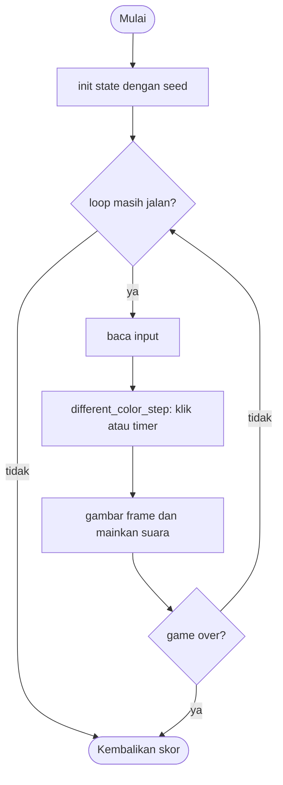

# A Different Color - design brief

**Owner:** Leader  **Folder:** `games/different_color/`  **Created:** 2026-11-12  **Asal mekanik:** `g04_finddiffsq` di proyek `simple-games` (hanya aturan; tidak ada kode, gambar, suara, teks atau font yang disalin)

## Hook
Dua papan penuh kotak berwarna acak, satu kotak di papan bawah warnanya sedikit berbeda. Temukan dia, lalu papan makin besar.

## Penjelasan sederhana
Layar punya dua papan: atas dan bawah. Papan bawah adalah salinan papan atas, kecuali satu kotak yang warnanya sedikit berbeda. Klik kotak itu di papan mana saja. Benar: skor +1 dan papan berikutnya punya satu kotak lebih banyak. Salah klik di kotak lain: game selesai. Papan pertama tanpa batas waktu; papan berikutnya hanya 30 detik.

Di balik layar, komputer membuat warna acak lalu menolak warna yang terlalu abu-abu atau terlalu gelap (rejection sampling), dan menolak warna "beda" yang masih terlalu mirip. Ukuran papan dihitung dari skor dengan rumus akar kuadrat. Seperti permainan mencari perbedaan dua gambar, tapi gambarnya dibuat oleh rumus.

Kalau cuma punya 1 menit: cari satu kotak yang warnanya lain, klik, ulangi dengan papan yang makin besar.

## Kontrol
Klik mouse pada kotak yang berbeda (papan atas atau bawah). Klik di luar lapangan (misalnya area samping) diabaikan, begitu pula klik pada garis putih pemisah.

## Aturan dan skor
- Papan ke-`score` punya `n = score + 2` kotak; `cols = (int)(sqrt(n) - 1e-7) + 1`, `rows = (int)(n / cols - 1e-7) + 1`.
- Kotak berbeda dipilih acak `dif` dalam `0..n-1`; warnanya lolos `different_color_diff_ok` (jarak Manhattan >= 0.3 dan selisih luma >= 0.2).
- Klik pada kotak berbeda (atas atau bawah, toleransi 8 px): `score++`, papan baru, timer 30 detik mulai.
- Klik di lapangan selain kotak itu dan selain garis pemisah: **game selesai**.
- Waktu habis (mulai dari papan kedua): selesai.
- Setelah selesai, cincin tampil 1.2 detik pada kotak berbeda di kedua papan.
- Batas 400 kotak: menyelesaikan papan 400 kotak (skor 399) mengakhiri game.
- **Skor = jumlah papan yang diselesaikan.**

## Cara kerja per frame
1. `arcade_poll()` mengisi `ArcadeInput`.
2. `different_color_step()`: jika `fire_pressed`, posisi mouse diubah ke koordinat lapangan (`arc_pf_from_screen`) lalu `different_color_click()`; frame klik tidak menjalankan timer.
3. Jika papan sudah berjalan dengan timer: `time_left -= dt`, tick-tack tiap 0.5 detik saat sisa <= 9.999 detik.
4. Waktu habis: `timed_out`, `over`.
5. Front-end membandingkan `solved` dan `ticks` untuk suara, menggambar dua papan, pemisah, bar waktu, cincin saat selesai.

## Peta file
| File | Isinya | Edit di sini kalau ... |
|---|---|---|
| `different_color_logic.h` | struct `different_color_State` dan fungsi publik (`init`, `init_sized`, `step`, `is_over`, `score`) | menambah field state atau fungsi publik |
| `different_color_logic.c` | semua aturan game (tanpa raylib) | mengubah aturan atau angka keseimbangan |
| `different_color_game.c` | loop raylib, menggambar, suara, `GameDef` (judul, kontrol di menu, urutan, ranked) | mengubah tampilan, suara, atau teks di menu |
| `tests/test_different_color.c` | unit test (hanya logic) | menambah atau mengubah aturan |
| `CMakeLists.txt` | mendaftarkan game lewat `arcade_add_game(...)` | menambah file `.c` atau test baru |
| `GAME.md` | dokumen ini | aturan atau kode berubah |
| `AGENTS.md` | instruksi untuk AI agent (tidak diterjemahkan) | jarang; ikuti aturan di file itu |

## Data penting (struct)
| Field | Tipe | Artinya |
|---|---|---|
| `w`, `h`, `y2` | int, float | ukuran lapangan dan atas papan bawah (`h / 2 + 8`) |
| `n`, `cols`, `rows` | int | jumlah kotak nyata dan ukuran grid |
| `rectw`, `recth` | float | ukuran satu kotak |
| `dif` | int | indeks kotak berbeda (baris demi baris) |
| `cell[400][3]` | float | warna RGB 0..1 tiap kotak papan atas (dan papan bawah, kecuali `dif`) |
| `odd[3]` | float | warna kotak berbeda di papan bawah |
| `timed`, `time_left`, `tick_t` | bool, float | timer 30 detik (mati di papan pertama) dan penghitung tick-tack |
| `score` | int | papan yang diselesaikan |
| `over`, `capped`, `timed_out`, `over_t` | bool, float | alasan dan waktu sejak selesai |
| `solved`, `ticks`, `misses` | int | penghitung kejadian untuk suara |

## Fungsi-fungsi penting
| Fungsi | Tugas | Dipanggil dari |
|---|---|---|
| `different_color_grid_for_score` | rumus cols dan rows dari skor | `new_board`, tes |
| `different_color_random_color_ok`, `different_color_diff_ok` | aturan warna (tidak abu-abu, tidak gelap, cukup beda) | pembuat warna, tes |
| `different_color_new_board` | membuat papan untuk skor sekarang | `init_sized`, `click` |
| `different_color_click` | logika klik: benar, salah, pemisah, di luar | `step`, tes |
| `different_color_odd_center` | pusat kotak berbeda (papan atas) | `click`, front-end |
| `different_color_step` | klik dan timer | `play()` |

## Angka yang bisa diutak-atik
| Konstanta | Nilai sekarang | File | Efek kalau diubah |
|---|---|---|---|
| `DC_TIME_LIMIT` | 30 s | `different_color_logic.h` | waktu per papan |
| `DC_WARN_TIME` | 9.999 s | `different_color_logic.h` | kapan tick-tack mulai |
| `DC_MAX_CELLS` | 400 | `different_color_logic.h` | batas array dan akhir game |
| `DC_OVER_DELAY` | 1.2 s | `different_color_logic.h` | lama cincin ditampilkan sebelum skor dicatat |
| `DC_TOLERANCE` | 8 px | `different_color_logic.c` | toleransi klik di sekitar kotak |
| angka langsung `0.3`, `0.2`, `0.1`, `0.5` | di `diff_ok` dan `random_color_ok` | `different_color_logic.c` | seberapa mirip atau abu-abu warna yang ditolak |

## Cara menjalankan dan menguji
```bash
# test logic saja (tanpa raylib, ~1 detik)
cmake --preset logic && cmake --build --preset logic && ctest --preset logic -R "^different_color\."

# main game-nya
cmake --preset dev && cmake --build --preset dev && build/dev/bin/arCade

# smoke run headless: jalankan game 300 frame dan simpan screenshot PNG
cmake --preset headless && cmake --build --preset headless && build/headless/bin/arCade --smoke different_color --frames 300 --out smoke-out
```

| Test | Menjaga aturan apa |
|---|---|
| `test_grid_table` | tabel cols x rows menurut skor (vektor spesifikasi) |
| `test_spec_geometry_at_480x800` | rectw 224, recth 312, y2 408, pusat (352, 236) |
| `test_colour_acceptance_vectors` | warna ditolak/diterima persis seperti spesifikasi |
| `test_generated_boards_follow_the_colour_rules` | 30 seed x 12 papan: semua warna lolos aturan |
| `test_both_boards_accept_the_odd_cell` | klik di papan atas dan bawah sama-sama benar |
| `test_wrong_cell_ends_the_game` | salah klik mengakhiri game setelah tampilan cincin |
| `test_separator_and_outside_are_ignored` | pemisah dan area luar diabaikan |
| `test_click_in_a_gutter_is_ignored` | klik di gutter (koordinat layar) diabaikan |
| `test_first_board_is_untimed_then_30_seconds` | papan pertama tanpa timer; 30 detik setelahnya |
| `test_tick_tack_every_half_second_in_the_last_10_seconds` | tick tiap 0.5 detik |
| `test_cap_ends_the_game_at_400_cells`, `test_perfect_player_reaches_the_cap` | batas 400 kotak; pemain sempurna mengakhiri game sendiri |
| `test_same_seed_same_result`, `test_monkey_never_breaks_invariants` | deterministik; tidak ada indeks keluar batas |

## Jebakan dan hal yang perlu diingat
- Warna disimpan sebagai tiga float di logic; hanya front-end yang membuat `Color`.
- Semua sel grid diwarnai, termasuk sel ekstra di luar `n` (grid adalah persegi panjang penuh); `dif` selalu < `n`.
- Penyimpangan dari simple-games: batas 400 kotak (aslinya tanpa batas, array tetap di sini); bayangan dekoratif "ubin timbul" tidak dibuat.
- Penyimpangan: klik diproses saat tombol ditekan (aslinya saat dilepas), dan klik di gutter diabaikan karena lapangan lebih sempit dari layar.
- Penyimpangan: frame yang berisi klik tidak menjalankan timer, sehingga papan baru mulai tepat 30.000 detik.
- Penyimpangan: pengambilan warna dibatasi 10000 percobaan lalu memakai warna cadangan, supaya tidak mungkin berputar tanpa akhir.
- Panel lapangan memakai warna gelap neon; hanya sel-selnya yang berwarna acak.

## Langkah implementasi (Implementation steps)
1. Aturan sudah ada di `different_color_State` dan `different_color_step()` (hanya di logic). Konstanta ditulis sebagai `#define` di `different_color_logic.c`.
2. Setiap aturan punya unit test di `tests/test_different_color.c`; tes memakai `different_color_init_sized(480, 800)` supaya vektor uji spesifikasi asli berlaku apa adanya.
3. Tampilan ada di `different_color_game.c`: panel 480 x 684 di tengah, aturan di gutter kiri, statistik di gutter kanan. Suara dibuat dari `gfx_make_tone()`.
4. Kalau menambah aturan: tulis tesnya dulu, lalu ubah logic, lalu perbarui bagian Jebakan dan tabel di dokumen ini.

## Pseudocode (untuk laporan)
```
PROSEDUR click(s, x, y)
    JIKA over MAKA KEMBALI
    JIKA (x, y) mengenai kotak berbeda di papan atas ATAU bawah MAKA
        score += 1
        JIKA score + 2 > 400 MAKA over = benar; KEMBALI
        timed = benar; time_left = 30; new_board
    SELAIN ITU JIKA (x, y) di dalam lapangan DAN bukan di garis pemisah MAKA
        over = benar
AKHIR PROSEDUR
```

## Flowchart (untuk laporan)


## Konsep kuliah yang dipakai (untuk Bab I laporan)
| Konsep (Pertemuan) | Di mana (file : fungsi) |
|---|---|
| Struct (13) | `different_color_logic.h` : `different_color_State` |
| Array 2 dimensi (9-10) | `different_color_logic.h` : `cell[400][3]` (kotak x kanal warna) |
| Perulangan (6-7) | `different_color_logic.c` : `new_board`, `random_color` (rejection sampling) |
| Percabangan (5) | `different_color_logic.c` : `different_color_click` |
| Fungsi (11) | `different_color_logic.c` : `luma`, `odd_color_for` |
| Pointer (12) | `odd_color_for(..., float out[3])` mengisi hasil lewat parameter |
