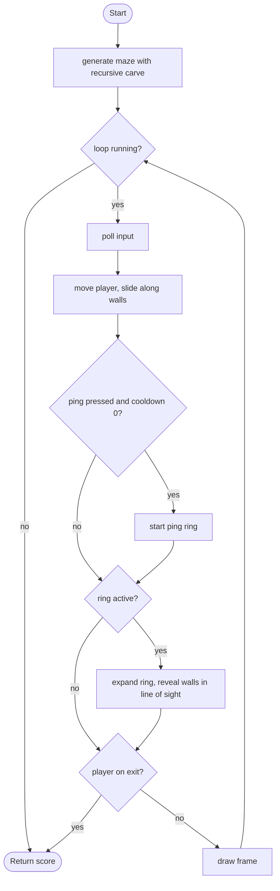

# Echo Maze - design brief

**Owner:** Member 2  **Folder:** `games/echo_maze/`  **Status:** placeholder (generator, sonar and line of sight work)

## Hook
The screen is black. Press Space to send a sonar ping: an expanding ring lights up the walls it reaches (only walls in line of sight). Navigate from the top-left to the green exit using as few pings as you can.

## Controls
WASD / arrows move. Space pings (1 s cooldown).

## Rules and scoring
Reach the exit tile to win. Score = 3000 - 8 per second - 60 per ping (minimum 100). The maze is generated from the seed with recursive backtracking, so every maze is solvable.

## Implementation steps
1. Levels and difficulty: bigger mazes (`EM_W`/`EM_H`, keep them odd), time limit, more pings = shorter range.
2. Enemies that hunt by sound: they move toward the last ping origin (array of structs + BFS path from the maze grid).
3. Better visuals in `echo_maze_game.c`: fade/flicker walls, a wavy ring, footstep "pulses".
4. Sound: a synthesized ping with `gfx_make_tone()` (check `arcade_audio_ready()`).
5. Tests: add one per rule (see `tests/test_echo_maze.c`).

## Pseudocode (for the report)
```
PROCEDURE carve(x, y)            // recursion
    mark (x, y) as floor
    FOR each direction in random order
        IF the cell two steps away is still a wall THEN
            knock down the wall in between
            carve(that cell)
END PROCEDURE

PROCEDURE advance_ping()
    old <- ring radius; ring radius <- ring radius + speed * dt
    FOR each wall tile (and the exit)
        IF distance to ping origin is between old and new radius AND line of sight is clear THEN
            reveal the tile for 3 seconds
```

## Flowchart (for the report)


## Course concepts used
| Concept (Pertemuan) | Where (file : function) |
|---------------------|-------------------------|
| Rekursif (12) | `echo_maze_logic.c` : `carve` |
| Array 2D (9) | `echo_maze_logic.h` : `wall[EM_H][EM_W]`, `reveal[][]` |
| Math function (12) | `vec2_dist` -> `sqrtf` (ping distance), `echo_maze_los_clear` |
| Perulangan (6) | `advance_ping` (nested loops over tiles), `echo_maze_los_clear` |
| Percabangan (5) | `echo_maze_step`, `blocked` |
| Struct (13) | `echo_maze_State` |
