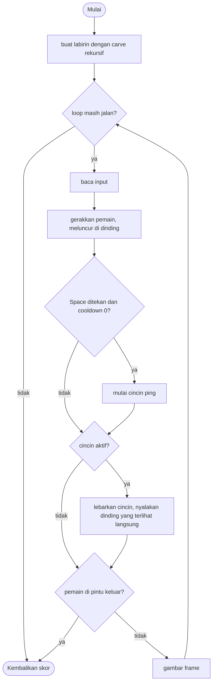

# Echo Maze - design brief

**Owner:** Member 2  **Folder:** `games/echo_maze/`  **Status:** placeholder (generator, sonar, dan line of sight sudah jalan)

## Hook
Layar hitam pekat. Tekan Space untuk mengirim sonar ping: cincin yang melebar menerangi dinding yang ia capai (hanya dinding yang terlihat langsung, alias line of sight). Cari jalan dari pojok kiri atas ke pintu keluar hijau dengan ping sesedikit mungkin.

## Penjelasan sederhana
Bayangkan kamu berjalan di labirin gelap sambil membawa peluit. Kamu tidak bisa melihat apa pun, tapi setiap kali meniup peluit, gelombang suara menyebar ke segala arah dan "menyentuh" dinding di sekitarmu. Dinding yang tersentuh menyala sebentar (3 detik) lalu padam lagi. Dinding yang tersembunyi di balik dinding lain tidak ikut menyala, sama seperti suara yang terhalang tembok.

Di kode, labirinnya adalah tabel 2D (`wall[17][31]`) berisi 1 (dinding) atau 0 (lantai), dibuat dari seed dengan algoritma recursive backtracking, jadi setiap labirin pasti punya jalan ke pintu keluar. Ping adalah sebuah lingkaran yang radiusnya membesar tiap frame. Setiap kali radius itu melewati sebuah tile dinding, kode mengecek apakah ada garis lurus tanpa halangan dari pemain ke tile itu (`echo_maze_los_clear`). Kalau ada, tile itu diberi timer 3 detik (`reveal`). Front-end hanya menggambar tile yang timer-nya masih menyala.

Seperti game lain di proyek ini, aturan ada di `echo_maze_logic.c` (tanpa raylib, bisa di-test di terminal) dan tampilan ada di `echo_maze_game.c`.

**Kalau cuma punya 1 menit:** `advance_ping` adalah jantung game ini. Ia memutuskan dinding mana yang menyala; kalau perilaku ping terasa aneh, mulai dari fungsi itu dan `echo_maze_los_clear`.

## Kontrol
WASD / panah untuk bergerak. Space untuk ping (cooldown 1 detik).

## Aturan dan skor
Capai tile pintu keluar untuk menang. Skor = 3000 - 8 per detik - 60 per ping (minimal 100). Labirin dibuat dari seed dengan recursive backtracking, jadi setiap labirin pasti bisa diselesaikan.

Detail tambahan dari kode:
- Pemain mulai di tile (1, 1) (kiri atas). Pintu keluar ada di tile `(EM_W - 2, EM_H - 2)` = (29, 15), pojok kanan bawah.
- Skor baru dihitung setelah menang. Selama bermain, `echo_maze_score` mengembalikan 0 (HUD juga menampilkan 0 sampai game selesai).
- Pintu keluar tidak terlihat sampai ping mengenainya (lingkaran hijau menyala 3 detik).

## Cara kerja per frame
1. `arcade_poll(&in)` mengisi `ArcadeInput` (arah gerak dan `action_pressed` untuk Space).
2. `echo_maze_step(&s, &in, ARC_DT)` berjalan dengan urutan ini:
   1. Kalau `won` sudah `true`, langsung keluar.
   2. `time += dt`. Timer `ping_cooldown` dan `exit_glow` dikurangi, begitu juga `reveal` untuk **semua** tile (dikurangi sampai 0).
   3. Pemain bergerak, **satu sumbu per satu** (x dulu, lalu y). Kalau posisi baru menabrak dinding (`blocked`), sumbu itu dibatalkan. Efeknya pemain "meluncur" di sepanjang dinding, tidak menempel.
   4. Kalau Space baru ditekan dan `ping_cooldown <= 0`: ping dimulai di posisi pemain (`ping_origin`, radius 0), `pings++`, cooldown diisi 1 detik.
   5. Kalau `pinging`, `advance_ping` memperbesar radius sebesar `EM_PING_SPEED * dt` (± 8,7 px per frame) dan menyalakan tile yang baru dilewati cincin (lihat bagian fungsi).
   6. Kalau tile tempat pemain berdiri adalah pintu keluar, `won = true`.
3. Front-end `draw()` menggambar: tile dinding yang `reveal`-nya > 0 (makin lama makin pudar), lingkaran hijau di pintu keluar kalau `exit_glow > 0`, tiga garis cincin ping (memudar seiring radius), lalu titik pemain. Tulisan "press SPACE to ping" muncul selama belum pernah ping.
4. Kalau `echo_maze_is_over()` bernilai `true`, loop berhenti dan skor dikirim ke hub.

## Peta file
| File | Isinya | Edit di sini kalau ... |
|------|--------|------------------------|
| `echo_maze_logic.h` | Konstanta `EM_*`, struct `echo_maze_State`, 4 fungsi publik + 2 helper (`echo_maze_tile_center`, `echo_maze_los_clear`) | menambah field state atau mengubah ukuran labirin/ping |
| `echo_maze_logic.c` | Generator labirin (`carve`), gerak pemain, ping (`advance_ping`), line of sight, skor | mengubah aturan atau angka keseimbangan |
| `echo_maze_game.c` | Loop raylib, menggambar tile/cincin/pemain, HUD, `game_echo_maze_def` | mengubah tampilan atau teks di menu |
| `tests/test_echo_maze.c` | 7 unit test (hanya logic) | menambah atau mengubah aturan |
| `CMakeLists.txt` | Mendaftarkan game ke build | menambah file `.c` atau test baru |
| `GAME.md` | Dokumen ini | aturan atau kode berubah |
| `AGENTS.md` | Instruksi untuk AI agent (tidak diterjemahkan) | jarang; ikuti aturan di file itu |

## Data penting (struct)
`echo_maze_State`: seluruh keadaan game.

| Field | Tipe | Artinya |
|-------|------|---------|
| `wall[EM_H][EM_W]` | `uint8_t` | peta labirin: 1 = dinding, 0 = lantai |
| `reveal[EM_H][EM_W]` | `float` | sisa detik tile dinding itu masih terlihat (0 = gelap) |
| `player` | `Vec2` | posisi pemain dalam piksel (bukan indeks tile) |
| `ping_origin` | `Vec2` | titik asal ping terakhir (posisi pemain saat Space ditekan, bukan pusat tile) |
| `ping_r` | `float` | radius cincin ping saat ini (piksel) |
| `pinging` | `bool` | `true` selama cincin masih melebar (sampai radius > `EM_PING_RANGE`) |
| `ping_cooldown` | `float` | sisa detik sebelum boleh ping lagi |
| `exit_glow` | `float` | sisa detik pintu keluar terlihat setelah terkena ping |
| `pings` | `int` | jumlah ping yang sudah dipakai (mengurangi skor) |
| `time` | `float` | detik yang sudah berlalu sejak mulai (mengurangi skor) |
| `won` | `bool` | `true` kalau pemain sudah sampai pintu keluar |
| `rng` | `Rng` | pengacak deterministik; hanya dipakai saat membuat labirin |

## Fungsi-fungsi penting
| Fungsi | Tugas | Dipanggil dari |
|--------|-------|----------------|
| `echo_maze_init(s, seed)` | Mengisi semua tile dengan dinding, mengosongkan `reveal`, membuat labirin dengan `carve(1, 1)`, menaruh pemain di tile (1, 1) | `play()`, test |
| `echo_maze_step(s, in, dt)` | Satu langkah logic (lihat "Cara kerja per frame") | `play()` tiap frame, test |
| `echo_maze_is_over(s)` | Mengembalikan `s->won` | `play()` |
| `echo_maze_score(s)` | 0 kalau belum menang, selain itu `max(100, 3000 - 8*detik - 60*ping)` | HUD, hasil akhir |
| `echo_maze_tile_center(tx, ty)` | Mengubah indeks tile menjadi posisi piksel pusat tile | logic, front-end, test |
| `echo_maze_los_clear(s, from, tx, ty)` | `true` kalau garis dari `from` ke pusat tile (tx, ty) tidak terhalang dinding lain | `advance_ping`, test |
| `carve(s, cx, cy)` (static) | Rekursif: tandai lantai, acak 4 arah, bongkar dinding ke sel tetangga (2 langkah) yang belum dikunjungi lalu masuk ke sana. Kedalaman rekursi maksimal 120 sel | `echo_maze_init` |
| `advance_ping(s, dt)` (static) | Membesarkan radius ping, lalu untuk setiap dinding (dan pintu keluar) yang jarak pusatnya ke `ping_origin` ada di antara radius lama dan baru **dan** `los_clear`, set `reveal = 3 detik` (pintu keluar: `exit_glow`) | `echo_maze_step` |
| `blocked(s, x, y)` (static) | `true` kalau kotak pemain (±`PLAYER_R`) menyentuh dinding di salah satu dari 4 sudutnya | `echo_maze_step` |

Cara `echo_maze_los_clear` bekerja: dari titik `from` ia melangkah ke pusat tile target dengan langkah **6 px**, mulai 4 px dari awal. Kalau salah satu titik sampel jatuh di tile dinding selain tile target (atau di luar grid), hasilnya `false`. Jadi yang dicek hanya garis lurus ke **titik tengah** tile.

## Angka yang bisa diutak-atik
| Konstanta | Nilai sekarang | File | Efek kalau diubah |
|-----------|----------------|------|-------------------|
| `EM_W` / `EM_H` | `31` / `17` tile | `echo_maze_logic.h` | ukuran labirin; **harus ganjil** supaya generator jalan. Ukuran sekarang pas dengan layar 1280x720 |
| `EM_TILE` | `40` px | `echo_maze_logic.h` | ukuran satu tile |
| `EM_OX` / `EM_OY` | `20` / `38` px | `echo_maze_logic.h` | posisi labirin di layar (offset tile (0, 0)) |
| `EM_PING_SPEED` | `520` px/detik | `echo_maze_logic.h` | kecepatan cincin melebar |
| `EM_PING_RANGE` | `720` px (18 tile) | `echo_maze_logic.h` | jangkauan maksimal ping; cincin hidup 720/520 ≈ 1,38 detik |
| `EM_PING_COOLDOWN` | `1.0` detik | `echo_maze_logic.h` | jeda antar ping |
| `EM_REVEAL_TIME` | `3.0` detik | `echo_maze_logic.h` | berapa lama dinding dan pintu keluar tetap terlihat |
| `PLAYER_SPEED` | `170` px/detik | `echo_maze_logic.c` | kecepatan pemain |
| `PLAYER_R` | `10` px | `echo_maze_logic.c` | setengah lebar kotak tabrakan pemain |
| langkah sampel LOS (angka langsung di `echo_maze_los_clear`) | mulai `4`, langkah `6` px | `echo_maze_logic.c` | makin kecil makin teliti tapi lebih berat |
| rumus skor (angka langsung di `echo_maze_score`) | `3000`, `8`/detik, `60`/ping, minimal `100` | `echo_maze_logic.c` | keseimbangan skor |
| tile awal dan pintu keluar | `(1, 1)` dan `(EM_W-2, EM_H-2)` | `echo_maze_logic.c` | posisi mulai dan tujuan |
| warna dinding (angka langsung di `draw`) | alpha `0.10 + 0.55 * sisa/3` | `echo_maze_game.c` | hanya tampilan |

## Cara menjalankan dan menguji
```bash
# test logic saja (tanpa raylib, ~1 detik)
cmake --preset logic && cmake --build --preset logic && ctest --preset logic -R "^echo_maze\."

# main game-nya
cmake --preset dev && cmake --build --preset dev && build/dev/bin/arCade

# smoke run headless: jalankan game 300 frame dan simpan screenshot PNG
cmake --preset headless && cmake --build --preset headless && build/headless/bin/arCade --smoke echo_maze --frames 300 --out smoke-out
```

| Test | Menjaga aturan apa |
|------|--------------------|
| `test_maze_is_a_perfect_maze` | 25 seed: border selalu dinding, semua lantai saling terhubung, pintu keluar terjangkau, dan jumlah lantai = 239 (120 sel + 119 lorong, tidak ada loop) |
| `test_same_seed_same_maze` | Seed sama menghasilkan labirin sama, seed beda menghasilkan labirin beda |
| `test_player_cannot_enter_walls` | Menekan tiap arah selama 4 detik tidak pernah membuat pemain masuk dinding |
| `test_ping_reveals_visible_walls_but_not_hidden_ones` | Dinding yang terlihat menyala, dinding di baliknya tidak (dan `los_clear` setuju) |
| `test_ping_cooldown` | Menekan Space terus dalam 10 frame hanya menghitung 1 ping; setelah ± 1 detik ping kedua bisa |
| `test_reaching_the_exit_wins_and_scores` | Skor 0 sebelum menang; sampai di pintu keluar berarti game over dan skor >= 100 |
| `test_monkey_is_safe` | 6000 langkah input acak (monkey): pemain tidak pernah keluar grid atau masuk dinding |

## Jebakan dan hal yang perlu diingat
- **`EM_W` dan `EM_H` harus ganjil.** Generator bekerja di kisi koordinat ganjil, dan test memeriksa jumlah lantai dengan rumus `2 * (EM_W/2) * (EM_H/2) - 1`. Ukuran labirin saat ini (1240 x 680 px + offset) sudah pas dengan layar 1280 x 720; ukuran lebih besar perlu `EM_TILE` lebih kecil.
- Posisi pemain dan ping disimpan dalam **piksel**, bukan indeks tile. Pakai `echo_maze_tile_center` untuk mengubah tile menjadi piksel.
- Ping baru (cooldown 1 detik) bisa dimulai saat cincin lama masih melebar (hidup ± 1,38 detik). Cincin lama langsung hilang karena `ping_r` dan `ping_origin` ditimpa, tapi dinding yang sudah menyala tetap menyala sampai timer-nya habis.
- Kamera dan tata letak tidak bergerak: seluruh labirin selalu ada di layar.
- Menu menampilkan kontrol dari `GameDef.controls`; kalau kontrol berubah, ubah teks itu juga.
- HUD menampilkan skor 0 sampai menang karena `echo_maze_score` memang mengembalikan 0 sebelum `won`.
- Dinding yang menyala **bukan** semua dinding yang kamu "lihat". Lihat catatan di bagian TODO di bawah (pengecekan hanya ke titik tengah tile).

## Langkah implementasi (Implementation steps)

### Prioritas dari diskusi tim
- [ ] **Ping tidak menyalakan semua dinding di jalurnya** (belum yakin apakah ini memang disengaja).
  - Catatan: sebagian memang disengaja: desainnya hanya menyalakan dinding yang terlihat langsung (line of sight), dan test `test_ping_reveals_visible_walls_but_not_hidden_ones` menjaga itu. Tapi cara cek-nya terlalu ketat: `echo_maze_los_clear` hanya menembak satu garis ke **titik tengah** tile, dan garis itu terhalang dinding tetangga di baris yang sama. Akibatnya dinding di sisi lorong yang dilihat dari sudut miring tidak menyala.
  - Hasil pengukuran kasar (20 seed x 15 posisi ping acak, harness C sementara, bukan bagian repo): rata-rata ± 15 tile dinding per ping punya bagian sisi yang terlihat langsung, tapi hanya ± 7,8 (± 52%) yang menyala. Di lorong lurus sepanjang 20 tile, hanya 3 tile pertama di tiap sisi yang menyala, padahal ke-20 tile bisa terlihat dengan sudut miring. Cincin sendiri tidak melewatkan tile: dari ± 2.100 dinding yang garis ke titik tengahnya benar-benar bersih, hanya 7 yang tidak menyala.
  - Opsi (belum diputuskan): (a) cek beberapa titik per tile (sudut atau tengah sisi) di `echo_maze_los_clear`; (b) ganti dengan ray casting ke banyak arah dan nyalakan tile dinding pertama yang terkena tiap sinar. Kalau lebih banyak dinding menyala, labirin jadi lebih mudah, jadi rumus skor mungkin perlu disesuaikan.
- [ ] **Bikin lebih seru**: sekarang game ini hanya kabur dari labirin, tidak ada hal lain. Usul tim: tambahkan sesuatu yang lain, mungkin trade-off makin sering ping makin ada risikonya.
  - Catatan: sekarang ping hanya "mahal" di skor (-60 per ping dan 1 detik cooldown), bukan di gameplay, jadi tidak ada alasan untuk menahan diri selain skor. Dua usul yang sudah ada di daftar bawah memang trade-off: langkah 2 (musuh yang memburu asal suara ping, jadi makin sering ping makin berbahaya) dan langkah 1 (makin banyak ping, jangkauan makin pendek).
  - Opsi lain yang bisa dipertimbangkan: item atau kunci tersembunyi yang hanya terlihat lewat ping, jumlah ping terbatas, atau ping yang meninggalkan "bunyi" yang bisa didengar musuh. Semua ini masih ide, belum keputusan.

### Langkah dari design awal
1. Level dan tingkat kesulitan: labirin lebih besar (`EM_W`/`EM_H`, tetap ganjil), batas waktu, makin banyak ping makin pendek jangkauannya.
2. Musuh yang berburu lewat suara: bergerak ke arah titik asal ping terakhir (array of struct + jalur BFS dari grid labirin).
3. Visual lebih bagus di `echo_maze_game.c`: dinding yang memudar atau berkedip, cincin bergelombang, "denyut" langkah kaki.
4. Suara: ping hasil sintesis dengan `gfx_make_tone()` (cek `arcade_audio_ready()`).
5. Test: tambahkan satu test per aturan (lihat `tests/test_echo_maze.c`).

## Pseudocode (untuk laporan)
```
PROSEDUR carve(x, y)            // rekursif
    tandai (x, y) sebagai lantai
    UNTUK SETIAP arah dalam urutan acak
        JIKA sel dua langkah di arah itu masih dinding MAKA
            bongkar dinding di antaranya
            carve(sel itu)
AKHIR PROSEDUR

PROSEDUR advance_ping()
    lama <- radius cincin; radius cincin <- radius cincin + kecepatan * dt
    UNTUK SETIAP tile dinding (dan pintu keluar)
        JIKA jarak ke titik asal ping ada di antara lama dan radius baru DAN garis pandang bebas MAKA
            tampilkan tile itu selama 3 detik
```

## Flowchart (untuk laporan)


## Konsep kuliah yang dipakai
| Konsep (Pertemuan) | Di mana (file : fungsi) |
|--------------------|-------------------------|
| Rekursif (12) | `echo_maze_logic.c` : `carve` |
| Array 2D (9) | `echo_maze_logic.h` : `wall[EM_H][EM_W]`, `reveal[][]` |
| Fungsi matematika (12) | `vec2_dist` -> `sqrtf` (jarak ping), `echo_maze_los_clear` |
| Perulangan (6) | `advance_ping` (loop bersarang di seluruh tile), `echo_maze_los_clear` |
| Percabangan (5) | `echo_maze_step`, `blocked` |
| Struct (13) | `echo_maze_State` |
