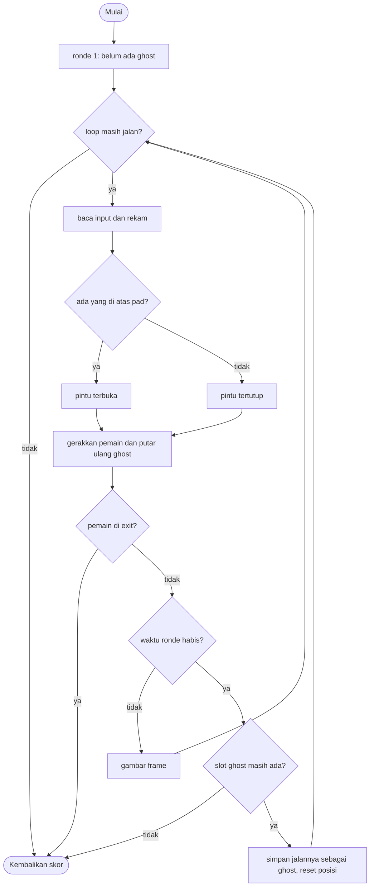

# Ghost Loop - design brief

**Owner:** Member 4  **Folder:** `games/ghost_loop/`  **Status:** placeholder (record/replay dan satu puzzle pintu sudah jalan)

## Hook
Setiap ronde berlangsung 8 detik dan direkam. Di ronde berikutnya, ronde-ronde sebelumnya diputar ulang sebagai ghost yang bergerak persis seperti yang kamu lakukan. Bekerja samalah dengan dirimu di masa lalu: di ronde 1 kamu berdiri di atas pad; di ronde 2 ghost-mu yang menahan pad, pintu terbuka, dan kamu berjalan ke exit.

## Penjelasan sederhana
Bayangkan kamu merekam dirimu sendiri memakai "kaset": setiap 1/60 detik, game mencatat tombol arah apa yang sedang kamu tekan. Ronde 1 selesai (8 detik habis), lalu ronde 2 dimulai dari awal. Kali ini ada satu "hantu" (ghost) yang memutar ulang kaset ronde 1 tanpa bantuanmu, sementara kamu bermain normal dan direkam lagi. Ghost bisa menginjak pad dan menahan pintu terbuka, padahal kamu sendiri sedang berada di tempat lain.

Yang direkam adalah **input** (arah kiri/kanan/atas/bawah per langkah), bukan posisi. Karena simulasi selalu berjalan dengan langkah tetap yang persis sama, memutar ulang input yang sama akan menghasilkan gerakan yang sama persis. Itu sebabnya `dt` sengaja diabaikan di `ghost_loop_step`. Kalau pintu pada saat replay dalam keadaan berbeda dari saat rekaman, ghost bisa menyimpang (menabrak pintu tertutup); itulah inti puzzle-nya.

Pemain dan ghost memakai fungsi gerak yang sama (`move_actor`), jadi aturan fisika untuk keduanya otomatis identik.

Aturan ada di `ghost_loop_logic.c` (tanpa raylib, bisa di-test di terminal). `ghost_loop_game.c` hanya menggambar dan meneruskan input.

**Kalau cuma punya 1 menit:** semua ghost dihitung ulang dari langkah 0 tiap ronde dengan memutar `ghost_moves[g][step]`. Jangan pernah memakai `dt` atau waktu nyata di logic game ini, karena itu merusak replay.

## Kontrol
WASD / panah untuk bergerak.

## Aturan dan skor
Capai exit sebelum ronde habis. Ronde yang habis tanpa menang berubah menjadi ghost (maksimal 4 ghost, setelah itu kamu kalah). Skor = 1500 - 300 per ronde - langkah yang dipakai (minimal 100), jadi lebih sedikit ronde dan lebih cepat berarti lebih baik.

Rumus persisnya (di `ghost_loop_step` saat menang): `max(100, 1500 - 300 * round - step)`, dengan `round` mulai dari 0 dan `step` jumlah langkah di ronde terakhir (60 langkah = 1 detik). Kalau kalah, skor 0.

Ronde ke-5 adalah yang terakhir: setelah 4 ronde gagal sudah ada 4 ghost, dan kalau ronde ke-5 habis tanpa menang, game selesai (kalah).

## Cara kerja per frame
1. `arcade_poll(&in)` mengisi `ArcadeInput` (yang dipakai: `move_x`, `move_y`).
2. `ghost_loop_step(&s, &in, ARC_DT)`. Parameter `dt` diabaikan; satu langkah selalu 1/60 detik. Urutannya:
   1. Kalau `won` atau `lost` sudah `true`, langsung keluar.
   2. Input diubah menjadi `gl_Move` lewat `sign8` (nilai > 0,1 jadi 1, < -0,1 jadi -1, selain itu 0) dan disimpan di `recording[step]`.
   3. `door_open = pad_pressed(s)`: `true` kalau pemain **atau** salah satu ghost berjarak kurang dari `GL_PAD_R` dari pad. Pengecekan memakai posisi di awal langkah (sebelum bergerak).
   4. Pemain bergerak dengan `move_actor`. Lalu setiap ghost bergerak dengan `move_actor` memakai `ghost_moves[g][step]`. Semuanya memakai nilai `door_open` yang sama.
   5. Kalau pemain berjarak kurang dari `GL_EXIT_R` dari exit: `won = true`, hitung skor, selesai.
   6. `step++`. Kalau `step` mencapai `GL_ROUND_STEPS` (480), panggil `end_round`.
3. `end_round`: kalau sudah ada 4 ghost, `lost = true`. Selain itu seluruh `recording` disalin ke `ghost_moves[ghost_count]`, `ghost_count++`, `round++`, lalu `begin_round` (step 0, pintu tertutup, pemain dan semua ghost kembali ke titik awal, `recording` dikosongkan).
4. Front-end `draw()` menggambar: ruangan, pad (kuning, hijau saat pintu terbuka), pintu (magenta, hampir transparan saat terbuka), exit, ghost (cyan setengah transparan), pemain (putih), dan bar timer ronde di bawah ruangan (mengecil dari penuh ke kosong). HUD menampilkan `round` dan `ghosts`.
5. Kalau `ghost_loop_is_over()` bernilai `true` (menang atau kalah), loop berhenti.

Cara kerja `move_actor(p, m, door_open)` (dipakai pemain dan ghost): arah `m` dinormalisasi (diagonal tidak lebih cepat), posisi maju sejauh `GL_SPEED * ARC_DT` (± 3,67 px per langkah), dijaga tetap di dalam ruangan, dan kalau pintu tertutup serta posisi baru masuk ke area pintu padahal posisi lama di luar, gerakan dibatalkan. Jadi pintu hanya menghalangi **masuk**.

## Peta file
| File | Isinya | Edit di sini kalau ... |
|------|--------|------------------------|
| `ghost_loop_logic.h` | Konstanta `GL_*` (ruangan, pad, pintu, exit), struct `gl_Move` dan `ghost_loop_State`, fungsi publik | menambah field state atau mengubah tata letak ruangan |
| `ghost_loop_logic.c` | `move_actor`, `pad_pressed`, `begin_round`, `end_round`, `ghost_loop_step`, skor | mengubah aturan atau skor |
| `ghost_loop_game.c` | Loop raylib, menggambar ruangan/ghost/timer, HUD, `game_ghost_loop_def` | mengubah tampilan atau teks di menu |
| `tests/test_ghost_loop.c` | 5 unit test (hanya logic) | menambah atau mengubah aturan |
| `CMakeLists.txt` | Mendaftarkan game ke build | menambah file `.c` atau test baru |
| `GAME.md` | Dokumen ini | aturan atau kode berubah |
| `AGENTS.md` | Instruksi untuk AI agent (tidak diterjemahkan) | jarang; ikuti aturan di file itu |

## Data penting (struct)
`gl_Move`: satu langkah input.

| Field | Tipe | Artinya |
|-------|------|---------|
| `mx`, `my` | `int8_t` | arah per sumbu: -1, 0, atau 1. Hanya ini yang dibutuhkan ghost untuk memutar ulang satu ronde |

`ghost_loop_State`: seluruh keadaan game.

| Field | Tipe | Artinya |
|-------|------|---------|
| `recording[GL_ROUND_STEPS]` | `gl_Move` | input ronde yang sedang berjalan |
| `ghost_moves[GL_MAX_GHOSTS][GL_ROUND_STEPS]` | `gl_Move` | input ronde-ronde yang sudah selesai; satu baris = satu ghost |
| `ghost_count` | `int` | jumlah ghost yang sudah ada (0-4) |
| `player` | `Vec2` | posisi pemain (piksel) |
| `ghost_pos[GL_MAX_GHOSTS]` | `Vec2` | posisi tiap ghost saat ini |
| `step` | `int` | nomor langkah dalam ronde ini (0 sampai 479) |
| `round` | `int` | nomor ronde, mulai dari 0 |
| `door_open` | `bool` | `true` kalau ada yang berdiri di pad pada langkah ini |
| `won`, `lost` | `bool` | status akhir game |
| `score` | `int` | skor (baru diisi saat menang; 0 selama bermain dan saat kalah) |

## Fungsi-fungsi penting
| Fungsi | Tugas | Dipanggil dari |
|--------|-------|----------------|
| `ghost_loop_init(s, seed)` | Mengosongkan state dan memulai ronde pertama (`seed` sekarang diabaikan) | `play()`, test |
| `ghost_loop_step(s, in, dt)` | Satu langkah simulasi (lihat "Cara kerja per frame") | `play()` tiap frame, test |
| `ghost_loop_is_over(s)` / `ghost_loop_score(s)` | Status selesai (menang atau kalah) dan skor | `play()` |
| `move_actor(p, m, door_open)` (static) | Satu langkah gerak untuk pemain **atau** ghost | `ghost_loop_step` |
| `pad_pressed(s)` (static) | Apakah pemain atau ghost menginjak pad | `ghost_loop_step` |
| `overlaps_door(p)` (static) | Apakah lingkaran pemain beririsan dengan persegi panjang pintu | `move_actor` |
| `begin_round(s)` (static) | Mereset langkah, pintu, posisi, dan `recording` | `ghost_loop_init`, `end_round` |
| `end_round(s)` (static) | Mengubah rekaman jadi ghost baru atau menetapkan kalah | `ghost_loop_step` |
| `sign8(v)` (static) | Mengubah input analog menjadi -1, 0, atau 1 (ambang 0,1) | `ghost_loop_step` |

## Angka yang bisa diutak-atik
| Konstanta | Nilai sekarang | File | Efek kalau diubah |
|-----------|----------------|------|-------------------|
| `GL_ROUND_STEPS` | `480` (8 detik) | `ghost_loop_logic.h` | panjang ronde; juga ukuran array rekaman |
| `GL_MAX_GHOSTS` | `4` | `ghost_loop_logic.h` | jumlah ghost maksimal (jumlah ronde = ini + 1) |
| `GL_SPEED` | `220` px/detik | `ghost_loop_logic.h` | kecepatan pemain dan ghost |
| `GL_R` | `12` px | `ghost_loop_logic.h` | radius pemain dan ghost |
| `GL_ROOM_X0/X1/Y0/Y1` | `120` / `1160` / `80` / `680` | `ghost_loop_logic.h` | batas ruangan |
| `GL_START_X/Y` | `200` / `500` | `ghost_loop_logic.h` | titik awal pemain dan ghost |
| `GL_PAD_X/Y/R` | `300` / `200` / `36` | `ghost_loop_logic.h` | posisi dan jangkauan pad |
| `GL_DOOR_X/W/Y0/Y1` | `880` / `30` / `200` / `560` | `ghost_loop_logic.h` | posisi dan ukuran pintu |
| `GL_EXIT_X/Y/R` | `1040` / `380` / `36` | `ghost_loop_logic.h` | posisi dan jangkauan exit |
| rumus skor (angka langsung di `ghost_loop_step`) | `1500`, `300` per ronde, minimal `100` | `ghost_loop_logic.c` | keseimbangan skor |
| ambang input (angka langsung di `sign8`) | `0.1` | `ghost_loop_logic.c` | seberapa kecil input analog dianggap bergerak |
| tinggi bar timer (angka langsung di `draw`) | `8` px di y = `690` | `ghost_loop_game.c` | hanya tampilan |

## Cara menjalankan dan menguji
```bash
# test logic saja (tanpa raylib, ~1 detik)
cmake --preset logic && cmake --build --preset logic && ctest --preset logic -R "^ghost_loop\."

# main game-nya
cmake --preset dev && cmake --build --preset dev && build/dev/bin/arCade

# smoke run headless: jalankan game 300 frame dan simpan screenshot PNG
cmake --preset headless && cmake --build --preset headless && build/headless/bin/arCade --smoke ghost_loop --frames 300 --out smoke-out
```

| Test | Menjaga aturan apa |
|------|--------------------|
| `test_closed_door_blocks_a_solo_run` | Pemain yang mendorong **lurus** ke arah exit tertahan pintu; ronde gagal itu menjadi ghost (`round == 1`, `ghost_count == 1`) |
| `test_ghost_holds_the_pad_and_player_wins_in_round_two` | Ronde 1: berdiri di pad sampai ronde habis. Ronde 2: ghost menahan pad, pemain berjalan ke exit dan menang dengan skor di antara 100 dan 1500 |
| `test_ghost_replays_the_recorded_run_exactly` | Ghost mengulang jalur ronde sebelumnya persis sama (selisih < 0,001 px) |
| `test_running_out_of_ghosts_loses` | Setelah ronde terakhir habis tanpa menang: `lost`, game selesai, skor 0 |
| `test_monkey_stays_in_the_room` | 6000 langkah input acak (monkey): pemain tidak keluar ruangan dan `step` selalu valid |

## Jebakan dan hal yang perlu diingat
- **Ghost memutar ulang input, bukan posisi.** Kalau keadaan pintu saat replay berbeda dari saat rekaman, ghost menyimpang. Itu bagian dari puzzle, tapi harus di-test (langkah 5 di bawah).
- **Jangan pakai `dt` atau waktu nyata di logic.** Simulasi harus maju dalam langkah tetap supaya replay identik; itu sebabnya `dt` diabaikan.
- Pemain dan ghost harus selalu lewat `move_actor`. Kalau gerak pemain diberi aturan khusus, ghost tidak lagi menirunya dengan benar.
- Pintu hanya menghalangi **masuk** (`!overlaps_door(p)` di `move_actor`): kalau posisi lama sudah berada di area pintu, gerakan tidak ditahan.
- `door_open` ditentukan dari posisi di **awal** langkah, lalu dipakai oleh pemain dan semua ghost pada langkah yang sama.
- Sisa `recording` yang tidak terisi bernilai 0 (`begin_round` mengosongkannya), jadi ghost yang rekamannya lebih pendek akan diam di tempat setelah rekamannya habis. Sekarang ronde selalu penuh 480 langkah, jadi kasus ini belum terjadi.
- Tata letak ruangan dibaca dari konstanta `GL_*`, bukan dari data level, dan `seed` diabaikan. Fungsi `pad_pressed`, `overlaps_door`, `start_pos`, front-end `draw`, dan test semuanya membaca konstanta itu langsung.
- Pintu saat ini **tidak menutup seluruh tinggi ruangan**, jadi bisa dilewati dari atas atau bawah (lihat TODO di bawah).
- HUD menampilkan skor 0 sampai game selesai.

## Langkah implementasi (Implementation steps)

### Prioritas dari diskusi tim
- [ ] **Perbaiki level tutorial.** (Detail "apa yang rusak" belum disebutkan; catatan di bawah berasal dari analisis kode.)
  - Catatan, **masalah yang terbukti**: pintu bisa dilewati tanpa ghost sama sekali. Pintu hanya membentang di y = 200 sampai 560, sedangkan ruangan membentang di y = 80 sampai 680. Ada celah bebas di atas pintu (y = 92 sampai 188) dan di bawahnya (y = 572 sampai 668) yang cukup untuk pemain berdiameter 24 px. Hasil uji dengan skrip gerak sederhana (harness C sementara, bukan bagian repo): turun ke y = 620, jalan ke kanan, lalu naik ke exit memenangkan **ronde 1** di langkah 317 dengan skor 1183 tanpa pernah menyentuh pad; lewat atas di langkah 394 dengan skor 1106.
  - `test_closed_door_blocks_a_solo_run` tidak menangkap ini karena pemain skrip-nya hanya mendorong lurus ke pintu. Setelah celah ditutup, test itu sebaiknya diperkuat dengan percobaan memutar lewat atas dan bawah.
  - Opsi (belum diputuskan): panjangkan pintu sampai seluruh tinggi ruangan (`GL_DOOR_Y0 = GL_ROOM_Y0`, `GL_DOOR_Y1 = GL_ROOM_Y1`; front-end menggambar pintu dari konstanta yang sama, jadi tampilannya ikut berubah), atau tambah dinding di atas dan bawah pintu.
  - Hal lain di level ini: tidak ada penjelasan di layar tentang pad dan pintu selain teks di kartu menu. Pada solusi yang dimaksud, ronde 1 berarti berjalan ke pad lalu **menunggu** sampai 8 detik habis (lihat usul timer di bawah).
- [ ] **Tambah level yang lebih cerdik.** Lihat langkah 1 dan 2 di bawah (mekanik baru dan struktur level; tidak diduplikasi).
  - Catatan: sekarang hanya ada satu tata letak yang tertanam di `#define`. Untuk banyak level, langkah 2 (struct `gl_Level`) perlu dikerjakan lebih dulu; `pad_pressed`, `overlaps_door`, `start_pos`, `draw`, dan test membaca konstanta `GL_*` langsung. Bahan untuk level yang lebih cerdik sudah ada di langkah 1: beberapa pad dan pintu, tombol yang harus ditahan beberapa saat, kotak yang didorong. "Cerdik" belum didefinisikan lebih jauh oleh tim.
- [ ] **Ronde berakhir karena pemain memicunya sendiri, bukan karena timer.** Usul, belum diputuskan; tim sendiri belum yakin ini ide yang bagus.
  - Pertimbangan, **sisi baik**: menghilangkan waktu menunggu (sekarang menahan pad berarti diam sampai 480 langkah habis). Format rekaman sudah mendukungnya: sisa `recording` bernilai 0, jadi ghost otomatis diam setelah rekamannya habis (misalnya tetap berdiri di pad). Timer 8 detik bisa dipertahankan sebagai batas maksimum.
  - Pertimbangan, **sisi buruk atau yang perlu dipikirkan**: perlu input baru untuk mengakhiri ronde (`ArcadeInput.action_pressed` belum dipakai di game ini); tekan tidak sengaja akan menghabiskan satu dari 4 slot ghost; mengakhiri ronde di langkah 0 membuat ghost yang diam di titik awal (hanya "mahal" 300 poin); tekanan waktu berkurang sehingga puzzle yang bergantung pada waktu (ghost harus ada di tempat X pada detik Y) kehilangan sebagian maknanya; bar timer di front-end perlu diberi arti baru; dan test yang memakai `idle_until_next_round` perlu dicek ulang.
  - Perubahan di kode: kondisi `end_round` di `ghost_loop_step` (sekarang hanya `step >= GL_ROUND_STEPS`) ditambah pemicu dari input.

### Langkah dari design awal
1. Mekanik lebih banyak: beberapa pad dan pintu, tombol yang harus ditahan beberapa saat, kotak yang didorong (kembangkan `move_actor` dan state).
2. Level: pindahkan konstanta tata letak ke struct `gl_Level` dan array of level (dimuat dari `assets/levels/*.txt` dengan file I/O).
3. Simpan replay kemenangan ke `ctx->data_dir` (tulis array `gl_Move` dengan `fwrite`/`fprintf`) dan putar ulang dari menu.
4. Visual di `ghost_loop_game.c`: jejak ghost (simpan posisi terakhir), efek rewind di awal ronde, partikel di pad.
5. Hati-hati: ghost memutar ulang INPUT, jadi ghost menyimpang kalau pintu berada dalam keadaan berbeda dari saat rekaman. Itu puzzle-nya, tapi tetap di-test (`tests/test_ghost_loop.c`).

## Pseudocode (untuk laporan)
```
PROSEDUR step(input)
    rekam input langkah ini (-1/0/1 per sumbu)
    door_open <- ada yang (pemain atau ghost mana pun) berdiri di pad
    gerakkan pemain sesuai input
    UNTUK SETIAP ghost: gerakkan sesuai input rekamannya pada langkah ini      // fungsi gerak yang sama
    JIKA pemain menyentuh exit MAKA menang
    step <- step + 1
    JIKA step = panjang ronde MAKA end_round()

PROSEDUR end_round()
    JIKA tidak ada slot ghost tersisa MAKA kalah
    JIKA TIDAK simpan rekaman sebagai ghost baru; round <- round + 1; reset posisi
AKHIR PROSEDUR
```

## Flowchart (untuk laporan)


## Konsep kuliah yang dipakai
| Konsep (Pertemuan) | Di mana (file : fungsi) |
|--------------------|-------------------------|
| Array 2D berisi struct (9, 13) | `ghost_loop_logic.h` : `ghost_moves[GL_MAX_GHOSTS][GL_ROUND_STEPS]` |
| Struct (13) | `gl_Move`, `ghost_loop_State` |
| Fungsi (11) | `move_actor` (dipakai bersama oleh pemain dan ghost), `end_round` |
| Perulangan (6) | `ghost_loop_step` (loop atas ghost), `pad_pressed` |
| Percabangan (5) | logika pintu dan menang di `ghost_loop_step` |
| File handling (13) | TODO: simpan/muat replay (langkah 3 di atas) |
