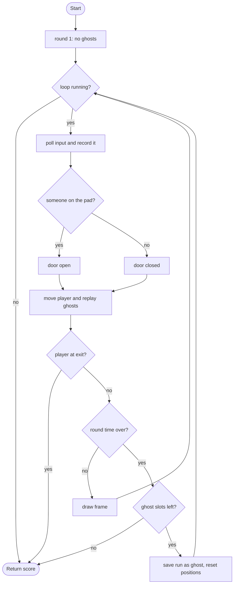

# Ghost Loop - design brief

**Owner:** Member 4  **Folder:** `games/ghost_loop/`  **Status:** placeholder (record/replay and one door puzzle work)

## Hook
Every round lasts 8 seconds and is recorded. Next round, your previous runs replay as ghosts that move exactly as you did. Cooperate with your past self: round 1 you stand on the pad; round 2 the ghost holds the pad, the door opens, and you walk to the exit.

## Controls
WASD / arrows move.

## Rules and scoring
Reach the exit before the round ends. A round that ends without winning becomes a ghost (up to 4 ghosts, then you lose). Score = 1500 - 300 per round - steps taken (min 100), so fewer rounds and faster runs win.

## Implementation steps
1. More mechanics: several pads and doors, buttons that must be held for a duration, boxes to push (extend `move_actor` and the state).
2. Levels: move the layout constants into a `gl_Level` struct and an array of levels (loaded from `assets/levels/*.txt` with file I/O).
3. Save a winning replay to `ctx->data_dir` (write the `gl_Move` arrays with `fwrite`/`fprintf`) and replay it from the menu.
4. Visuals in `ghost_loop_game.c`: ghost trails (store recent positions), a rewind effect at round start, particles on the pad.
5. Careful: ghosts replay INPUTS, so a ghost diverges if a door was in a different state than during its recording. That is the puzzle, but test it (`tests/test_ghost_loop.c`).

## Pseudocode (for the report)
```
PROCEDURE step(input)
    record this step's input (-1/0/1 per axis)
    door_open <- someone (player or any ghost) stands on the pad
    move the player by the input
    FOR each ghost: move it by its recorded input for this step      // same move function
    IF player touches the exit THEN win
    step <- step + 1
    IF step = round length THEN end_round()

PROCEDURE end_round()
    IF no ghost slot left THEN lose
    ELSE save the recording as a new ghost; round <- round + 1; reset positions
```

## Flowchart (for the report)


## Course concepts used
| Concept (Pertemuan) | Where (file : function) |
|---------------------|-------------------------|
| Array 2D of structs (9, 13) | `ghost_loop_logic.h` : `ghost_moves[GL_MAX_GHOSTS][GL_ROUND_STEPS]` |
| Struct (13) | `gl_Move`, `ghost_loop_State` |
| Fungsi (11) | `move_actor` (shared by player and ghosts), `end_round` |
| Perulangan (6) | `ghost_loop_step` (ghost loop), `pad_pressed` |
| Percabangan (5) | door and win logic in `ghost_loop_step` |
| File handling (13) | TODO: save/load replays (step 3 above) |
