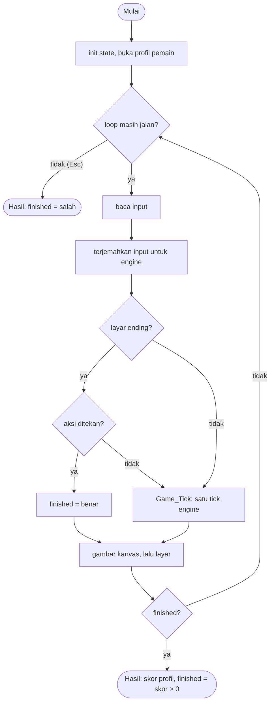

# Gritty Golf - design brief

**Owner:** zaxx-q (upstream author)  **Folder:** `games/gritty_golf/`  **Status:** v1 sudah jalan (25 level, progres tersimpan per pemain)

## Hook
Mini-golf pixel di mana bolanya bisa kamu **bekukan di udara**: tekan satu tombol untuk menghentikannya, bidik, atur tenaga, lalu tembak. Jatah tembakanmu cuma tiga kali per percobaan, jadi setiap pukulan harus dipikirkan.

## Penjelasan sederhana
Bayangkan main golf mini di meja kecil. Bola sedang meluncur, lalu kamu menekan tombol: bola langsung berhenti di tempat dan sebuah panah muncul, berputar pelan. Tekan lagi untuk mengunci arah panah, lalu sebuah bar tenaga naik-turun; tekan sekali lagi pada saat yang pas dan bola ditembakkan. Tujuannya menyentuh bendera. Setiap tembakan memakai satu dari tiga "strike". Kena jebakan atau jatuh keluar arena membuat levelnya diulang. Lantai dan dinding memantulkan bola, tombol di lantai membuka gerbang, dan kelelawar (bat) mengisi ulang strike-mu. Ada 25 level buatan tangan.

Folder `gg/` berisi *engine* aslinya: fisika bola, data level, dan file save. Engine itu disalin apa adanya dan tidak diubah (lihat `gg/VENDORED.md`). Di atasnya ada tiga lapis buatan arCade:
- `gritty_golf_logic.[ch]`: **adapter** murni. Tugasnya menerjemahkan `ArcadeInput` (mouse dan satu karakter ketikan) menjadi tombol yang dimengerti engine, menjalankan engine satu langkah, dan membuka atau menyimpan profil pemain. Tidak ada raylib di sini, jadi bisa di-test di terminal.
- `gritty_golf_render_game.c`: menggambar kanvas 256x256 ke sebuah render texture, lalu menampilkannya 2x (512x512) di tengah layar dengan panel samping gaya arCade.
- `gritty_golf_audio_game.c`: efek suara. Hub-lah yang memegang perangkat audio, jadi game ini hanya memuat dan memutar suaranya.

Ibaratnya engine adalah mesin permainan arcade yang sudah jadi, dan adapter adalah papan tombol baru yang dipasang di depannya supaya cocok dengan kabinet arCade.

**Kalau cuma punya 1 menit:** `translate_input` mengubah input arCade menjadi `Input` engine, `gritty_golf_step` memanggil `Game_Tick` satu kali per frame, dan `gritty_golf_score` mengambil skor dari `Save_Score`.

## Kontrol
- **Space / Enter / klik di area permainan:** tekan 1 = bekukan bola dan mulai membidik, tekan 2 = kunci sudut, tekan 3 = kunci tenaga dan tembak (di layar "ALL COURSES CLEARED": selesaikan permainan).
- **R** (atau ikon retry / tombol RESTART): ulangi level. **L** (atau ikon stages / tombol STAGES): buka atau tutup pilih level. **P** (atau tombol AIM ASSIST): tampilkan lintasan perkiraan. **M**: bisukan suara. **F** (atau tombol FINISH & SUBMIT): selesai dan kirim skor, harus ditekan dua kali (lihat bawah).
- **Esc:** selalu kembali ke menu hub (tidak ada yang tercatat).
- Tombol Z/X/C dan gamepad dari versi aslinya sengaja dihapus: arCade hanya mengirim mouse, Space/Enter, dan satu karakter ketikan.

Ringkasan kontrol ini juga tampil di kartu menu lewat `GameDef.controls`.

## Aturan dan skor
Cara main: sentuh bendera di setiap level. Tiap percobaan punya **3 strike** (`STRIKES_MAX`). Satu tembakan memakai satu strike, pickup bat mengisi ulang, dan jebakan atau jatuh keluar arena mengulang level. Selesai satu level, transisi berlian membawamu ke level berikutnya. Setelah level ke-25 muncul layar ending.

Skor adalah skor profil pemain, dihitung oleh `Save_Score` di `gg/save.c`:

```
skor = 1000 * (jumlah level selesai)
     -   40 * (jumlah tembakan terbaik semua level)
     -    2 * (jumlah detik terbaik semua level)
skor = 0 kalau hasilnya negatif
```

"Terbaik" artinya rekor per level, jadi skor hanya naik kalau kamu menyelesaikan level baru atau memperbaiki rekor lama; memainkan ulang dengan hasil lebih buruk tidak menurunkannya. **Skor lebih tinggi lebih baik** (`ranked = true`).

Detail dari kode:
- **Selesai** adalah keputusan pemain: tekan Space/Enter/klik di layar ending, atau tekan `F` (atau tombol FINISH & SUBMIT) **dua kali**. Tekan pertama "mengunci" selama `GG_FINISH_CONFIRM_FRAMES` = 180 langkah (3 detik) dan bar kecil di tombol menunjukkan sisa waktunya; tekan kedua dalam jendela itu baru menyelesaikan. Klik nyasar tidak mengakhiri permainan. Layar ending tidak butuh tekan kedua karena layarnya sendiri sudah konfirmasi.
- Hasil yang dikirim ke hub: `score = gritty_golf_score(...)`, `finished = is_over && score > 0`. Keluar dengan Esc, atau selesai tanpa satu pun level selesai, tidak mencatat apa-apa.
- Progres (level selesai dan rekor tembakan dan waktu) disimpan per pemain di `<data_dir>/gritty_save_<nama>.dat`. Engine menulisnya otomatis begitu sebuah level selesai (`write_save` di `gg/game.c`), jadi progres tetap ada walaupun kamu keluar dengan Esc; yang tidak dikirim hanya skor ke leaderboard hub. Pengaturan aim assist tidak disimpan: setiap permainan mulai dengan aim assist mati.
- Saat dibuka lagi, permainan lanjut di level pertama yang belum selesai; level lain dipilih lewat pilih level.

## Cara kerja per frame
1. `arcade_poll(&in)` mengisi `ArcadeInput`. Yang dipakai: `aim_x`/`aim_y` (posisi mouse di layar), `fire_pressed` (klik kiri), `action_pressed` (Space/Enter), dan `typed` (satu karakter yang baru diketik).
2. `gritty_golf_step(&s, &in, ARC_DT)` (parameter `dt` diabaikan, engine selalu maju tepat satu tick 1/60 detik):
   1. Kalau engine belum siap atau `finished` sudah `true`, langsung keluar.
   2. `translate_input` mengisi `Input` engine:
      - `take_key` memeriksa karakter yang diketik. Tombol baru dihitung kalau sudah 6 frame (`TYPED_QUIET_FRAMES`) tidak ada ketikan, supaya menahan tombol (auto-repeat sistem operasi) tidak membuat aim assist berkedip.
      - Posisi mouse diubah ke koordinat kanvas dengan `gritty_golf_to_canvas`, dan `panel_button_at` mencari apakah klik jatuh di salah satu dari 4 tombol panel kanan.
      - Kalau pilih level terbuka: `L`, tombol STAGES, atau ikon X menutupnya; klik pada sebuah kotak level memilihnya; tombol permainan lain diabaikan.
      - Kalau tidak: `R` atau ikon retry mengulang, `L` atau ikon stages membuka pilih level, Space/Enter atau klik di kanvas menjadi `action`. Klik pada ikon atau tombol panel tidak pernah menembak.
   3. Kalau layar sedang ending: `action` dipakai untuk `finished = true` (kalau transisi selesai) dan **tidak** diteruskan ke engine, jadi engine tidak pernah memulai ulang kampanye sendiri.
   4. `Game_Tick(&s->game, &cmd)` menjalankan engine satu tick (fisika, pickup, tombol, bendera, transisi, simpan progres).
   5. `frames++`, dan `finish_armed` berkurang satu kalau sedang menyala.
3. Kalau `s.mute_toggled`, `Audio_ToggleMute()` dipanggil dan flag dihapus.
4. `gritty_golf_front_render_canvas` menggambar kanvas 256x256 ke render texture. Ini **harus sebelum** `BeginDrawing()`, karena render texture tidak boleh aktif bersamaan dengan frame layar.
5. `BeginDrawing()`, `gritty_golf_front_draw_screen` (latar, HUD lewat `gfx_hud`, panel kiri dan kanan, kanvas 2x dengan filter titik), `arcade_frame_end()`.
6. Kalau `gritty_golf_is_over(&s)`, keluar dari loop. Sesudah loop: audio, front-end, lalu `gritty_golf_shutdown` (juga menyimpan progres yang belum tertulis).

Sebelum loop (hanya di permainan sungguhan, bukan `--smoke`): `gritty_golf_open_profile` memuat profil pemain, `gritty_golf_show_splash` menampilkan kartu judul 1,8 detik, dan `Audio_Init` memuat suara kalau ada perangkat audio.

## Peta file
| File | Isinya | Edit di sini kalau ... |
|------|--------|------------------------|
| `gritty_golf_logic.h` | `gritty_golf_State`, konstanta layout, fungsi publik adapter | menambah field state atau fungsi publik |
| `gritty_golf_logic.c` | terjemahan input, layout (persegi klik), profil, `step` (tanpa raylib) | mengubah tombol, area klik, atau cara profil dibuka |
| `gritty_golf_game.c` | loop raylib dan `GameDef` (judul, kontrol di menu, urutan, ranked) | mengubah urutan frame atau teks di menu |
| `gritty_golf_render_game.c` | menggambar: aset, dunia, UI kanvas, panel samping, blit 2x | mengubah tampilan |
| `gritty_golf_audio_game.c` | efek suara (`Audio_*` yang dipanggil engine) | mengubah suara atau volume |
| `gritty_golf_front.h` | antarmuka tanpa raylib antara `_game.c` dan dua file di atas | menambah fungsi gambar atau suara baru |
| `gg/` | engine asli: fisika, level, save, font bitmap (jangan diubah, lihat `gg/VENDORED.md`) | hanya saat sinkron ulang dengan upstream |
| `tests/test_gritty_golf.c` | test adapter (`gritty_golf.adapter`) | mengubah input, layout, atau profil |
| `tests/gg/` | test bawaan engine (`gritty_golf.engine`) | hanya saat sinkron ulang |
| `CMakeLists.txt` | mendaftarkan game, engine, dan dua test | menambah file `.c` atau test baru |
| `GAME.md` | dokumen ini | aturan atau kode berubah |
| `AGENTS.md` | instruksi untuk AI agent (tidak diterjemahkan) | jarang; ikuti aturan di file itu |

Aset ada di `assets/gritty_golf/` (tekstur, font Silkscreen, 6 file WAV).

## Data penting (struct)
`gritty_golf_State` (`gritty_golf_logic.h`), state milik adapter:

| Field | Tipe | Artinya |
|-------|------|---------|
| `game` | `Game` | controller engine: level, bola, data save, layar yang aktif (lihat tabel berikutnya) |
| `seed` | `unsigned` | disimpan demi kontrak `init(s, seed)`; engine tidak punya keacakan, jadi tidak mengubah permainan |
| `ready` | `bool` | `true` kalau `game.level` sudah dialokasikan; `gritty_golf_shutdown` harus dipanggil tepat sekali |
| `finished` | `bool` | pemain sudah selesai (layar ending + aksi, atau submit yang dikonfirmasi) |
| `finish_armed` | `int` | sisa langkah di mana tekan kedua mengonfirmasi submit; 0 = tidak aktif |
| `mute_toggled` | `bool` | `M` ditekan; front-end membaca lalu menghapusnya |
| `frames` | `int` | jumlah langkah yang sudah dijalankan |
| `quiet_frames` | `int` | frame sejak ketikan terakhir (0..6), untuk meredam auto-repeat |
| `save_path` | `char[512]` | file profil; `""` = jangan pernah menulis ke disk (test dan smoke) |

Field penting `Game` (`gg/game.h`), milik engine:

| Field | Tipe | Artinya |
|-------|------|---------|
| `screen` | `ScreenId` | `SCREEN_SPLASH`, `SCREEN_PLAY`, `SCREEN_ENDING`, dst. |
| `level` / `level_idx` | `Level *` / `int` | level yang sedang dimainkan (objek heap milik `Game`) dan nomornya 0..24 |
| `player` | `Player` | bola, `state` (MOVING, AIMING, POWER), `aim_angle`, `power` 0..100, `strikes` 0..3, `strokes` |
| `tr` | `Transition` | transisi berlian antar level (`phase`, `time`, `target`) |
| `stage_select_open` | `bool` | dialog pilih level sedang terbuka (dunia berhenti) |
| `save` | `SaveData` | profil: `cleared_mask` (bit n = level n selesai), `best_strokes[25]`, `best_time[25]`, dst. |
| `settings` | `Settings` | `volume`, `aim_assist`, ... |
| `level_time` | `float` | detik yang dihabiskan di level ini |

`Input` engine (`gg/game.h`): `action`, `reset`, `toggle_assist`, `open_stage_select`, `close_stage_select`, `pick_stage` (-1 = tidak ada, 0..24 = level yang diklik).

## Fungsi-fungsi penting
| Fungsi | Tugas | Dipanggil dari |
|--------|-------|----------------|
| `gritty_golf_init` | profil "Player" kosong di memori, level 0, tanpa file | `play()`, test |
| `gritty_golf_open_profile` | memuat atau membuat `gritty_save_<nama>.dat`, file rusak diganti nama menjadi `.bad`, lanjut di level pertama yang belum selesai | `play()`, test |
| `gritty_golf_step` | satu tick: terjemahkan input, jalankan engine | `play()`, test |
| `translate_input` (static) | `ArcadeInput` menjadi `Input` engine | `gritty_golf_step` |
| `take_key` (static) | mengambil karakter ketikan dengan peredam auto-repeat | `translate_input` |
| `gritty_golf_request_finish` | tekan pertama menyalakan `finish_armed`, tekan kedua mengakhiri | `translate_input`, test |
| `gritty_golf_score` | `Save_Score` dari profil | `play()`, test |
| `gritty_golf_is_over` | apakah pemain sudah selesai | `play()`, test |
| `gritty_golf_rect_*` | satu fungsi per persegi klik, dipakai menggambar **dan** menangani klik | logic, render, test |
| `gritty_golf_to_canvas` | piksel layar menjadi piksel kanvas | `play()`, `translate_input` |
| `gritty_golf_shutdown` | membebaskan level di heap dan menyimpan progres | `play()`, test |
| `Game_Tick` (engine) | satu tick engine | `gritty_golf_step` |
| `Save_Score`, `Save_Load`, `Save_Write` (engine) | skor, baca, dan tulis file profil | adapter dan engine |

## Angka yang bisa diutak-atik
| Konstanta | Nilai sekarang | File | Efek kalau diubah |
|-----------|----------------|------|-------------------|
| `GG_VIEW_SCALE` | 2 | `gritty_golf_logic.h` | skala kanvas; 3x (768 px) tidak muat di layar 720 px, jadi tetap 2 |
| `GG_VIEW_X` / `GG_VIEW_Y` | 384 / 104 | `gritty_golf_logic.h` (dihitung) | posisi kanvas di layar 1280x720 |
| `GG_FINISH_CONFIRM_FRAMES` | 180 (3 detik) | `gritty_golf_logic.h` | lamanya jendela tekan kedua untuk submit |
| `TYPED_QUIET_FRAMES` | 6 | `gritty_golf_logic.c` | seberapa lama tombol huruf harus "sepi" supaya dihitung lagi |
| posisi tombol panel | `{936, 360 + 56*i, 296, 44}` | angka langsung di dalam `gritty_golf_rect_panel_button` | letak 4 tombol panel kanan |
| posisi kotak level | 5 x 5, ukuran 28 x 22, jarak 34 x 29 | angka langsung di dalam `gritty_golf_rect_stage_cell` | letak tombol pilih level |
| `SOUND_VOLUME` | 70 (persen) | `gritty_golf_game.c` | volume efek suara awal |
| `VOICES` | 4 | `gritty_golf_audio_game.c` | berapa salinan tiap efek yang bisa berbunyi bersamaan |
| rentang pitch | 0,8x sampai 1,2x | angka langsung di dalam `Audio_PlaySfx` | variasi nada efek (hanya suara, tidak memengaruhi aturan) |
| `STRIKES_MAX` | 3 | `gg/common.h` | jatah tembakan per percobaan |
| `GRAVITY`, `BOUNCE`, `LAUNCH_SCALE`, `AIM_SPEED`, `POWER_SPEED` | 980, 0,33, 6, 1,5 pi, 200 | `gg/common.h` | fisika. **Jangan diubah**: solusi di `tests/gg/solutions.h` bergantung pada angka ini |
| `1000`, `40`, `2` | bobot skor | angka langsung di dalam `Save_Score` (`gg/save.c`) | rumus skor (mengubahnya mengubah isi leaderboard) |
| `GameDef.order` | 85 | `gritty_golf_game.c` | urutan kartu di menu hub |

## Cara menjalankan dan menguji
```bash
# test logic saja (tanpa raylib, ~6 detik di build Debug)
cmake --preset logic && cmake --build --preset logic && ctest --preset logic -R "^gritty_golf\."

# main game-nya
cmake --preset dev && cmake --build --preset dev && build/dev/bin/arCade

# smoke run headless: jalankan game 300 frame dan simpan screenshot PNG
cmake --preset headless && cmake --build --preset headless && build/headless/bin/arCade --smoke gritty_golf --frames 300 --out smoke-out
```

Dua test terdaftar: `gritty_golf.engine` (test bawaan engine upstream, 12 file `test_*.c` di `tests/gg/`) dan `gritty_golf.adapter` (`tests/test_gritty_golf.c`, 21 test):

| Test | Menjaga aturan apa |
|------|--------------------|
| `test_canvas_geometry` | kanvas 512x512 tidak keluar dari layar 1280x720; konversi layar ke kanvas benar di pojok dan tengah; batas `in_canvas` tepat |
| `test_canvas_rects_fit`, `test_panel_buttons_fit` | ikon stages dan retry, dialog, tombol X, dan 25 kotak level berada di dalam batasnya dan tidak saling tumpang; tombol panel ada di kanan kanvas, di dalam layar, dan tidak menimpa kanvas atau satu sama lain (klik tombol tidak boleh ikut menembak) |
| `test_init_is_sane`, `test_score_formula` | state awal valid; skor mengikuti 1000/40/2 dan tidak pernah negatif |
| `test_action_runs_aim_lock_shoot` | tekan 1, 2, 3 = bidik, kunci sudut, tembak |
| `test_held_action_is_not_a_press` | menahan Space tidak dihitung sebagai tekan baru |
| `test_click_on_canvas_is_action_but_panels_are_not` | klik di kanvas menembak, klik di panel tidak |
| `test_canvas_icons`, `test_panel_buttons`, `test_stage_select_dialog` | ikon dan tombol panel bekerja, dialog pilih level menutup, memilih, dan membekukan dunia |
| `test_keys`, `test_typed_key_repeat_is_debounced` | R, L, P, F, M; auto-repeat tidak mengulang tombol |
| `test_finish_needs_a_confirmation` | submit butuh dua tekan dalam 180 langkah |
| `test_replay_of_level_zero_scores` | solusi level 0 dari `solutions.h` selesai dengan 1 tembakan, skor antara 900 dan 960, dan selesai satu level bukan akhir permainan |
| `test_full_campaign_ends_with_the_action_button` | 25 level selesai, layar ending, aksi mengakhiri permainan |
| `test_profile_roundtrip`, `test_all_cleared_profile_starts_on_the_last_level` | simpan dan muat profil (termasuk file rusak menjadi `.bad`), profil tamat mulai di level terakhir |
| `test_in_memory_run_writes_no_file` | tanpa `save_path`, tidak ada file yang ditulis |
| `test_same_input_same_result` | input yang sama menghasilkan hasil yang sama persis |
| `test_monkey_never_breaks_invariants`, `test_monkey_with_aim_assist` | input acak 20.000 dan 800 frame tidak merusak invarian atau menabrak batas array |

## Jebakan dan hal yang perlu diingat
- **`gg/` tidak boleh diedit atau diformat.** Hanya 7 patch yang sah (4 fungsional, 3 hanya komentar penekan cppcheck) dan semuanya tercatat di `gg/VENDORED.md`. Folder itu memang tidak memakai awalan `gritty_golf_`: itu pengecualian yang disengaja, sama seperti `sbx_` di sandbox.
- **Render texture digambar sebelum `BeginDrawing()`.** Memindahkannya ke dalam frame layar akan merusak gambar.
- **Blit kanvas harus tepat 2x dengan filter titik.** Skala bukan bilangan bulat membuat pixel art buram; tinggi sumber negatif dipakai karena render texture OpenGL terbalik.
- **Fisika harus deterministik.** Target logic memakai `-ffp-contract=off`; tanpa itu hasil replay bisa berbeda antar kompiler. Determinisme antar platform (MinGW, MSVC) belum diperiksa di sini.
- **ESC selalu ke hub.** Pilih level pindah ke `L` dan ikon di kanvas, karena di versi aslinya Esc membukanya.
- **Skor hanya naik.** Rekor adalah yang terbaik per level, jadi skor profil tidak turun walau kamu bermain lebih buruk. Itu sebabnya skor boleh dikirim kapan saja lewat FINISH.
- **`malloc` dibenarkan di sini:** engine membuat level aktif dengan `calloc` (`gg/level.c`) karena jumlah dinding, tombol, dan pickup tiap level berbeda. Tiap alokasi punya satu `free`, dan `gritty_golf_shutdown` adalah satu-satunya tempat melepasnya. State adapter sendiri `static` di `play()`.
- **Hub memegang perangkat audio.** Jangan panggil `InitAudioDevice`, `CloseAudioDevice`, atau `SetMasterVolume` di sini; volume dan bisu hanya diterapkan pada suara game ini.
- **Lisensi aset.** Data level berasal dari *Escada Games*; font Silkscreen memakai OFL 1.1.
- Di mode debug (tanpa optimisasi), aim assist menghitung lintasan sekitar 20x lebih lambat; itu sebabnya test panjang mematikannya.

## Langkah implementasi (Implementation steps)
Game ini adalah integrasi, jadi langkahnya berbeda dari game yang ditulis dari nol:
1. Salin engine upstream ke `gg/` tanpa perubahan, tambahkan 2 patch kecil (`Vec2` dari arCade, penulisan save opsional) dan catat di `gg/VENDORED.md`.
2. Tulis adapter di `gritty_golf_logic.[ch]`: terjemahan input, layout, profil, `init/step/is_over/score`. Tulis test untuk setiap aturan di `tests/test_gritty_golf.c`.
3. Gambar di `gritty_golf_render_game.c` (render texture 256x256, blit 2x, panel samping) dan suara di `gritty_golf_audio_game.c`; satukan di `gritty_golf_game.c`.
4. Jalankan test engine upstream sebagai `gritty_golf.engine` supaya perubahan apa pun pada engine ketahuan.
5. Isi pseudocode, flowchart, dan tabel konsep di bawah.

## Pseudocode (untuk laporan)
```
PROSEDUR step(state, input, dt)
    JIKA engine belum siap ATAU pemain sudah selesai MAKA KEMBALI
    cmd <- terjemahkan(input)          // Space/klik -> action, R/L/P/F/M, klik tombol panel
    JIKA layar = ending MAKA
        JIKA cmd.action DAN transisi selesai MAKA finished <- benar
        cmd.action <- salah             // engine tidak boleh memulai ulang kampanye
    AKHIR JIKA
    Game_Tick(game, cmd)                // fisika, pickup, bendera, transisi, simpan
    frames <- frames + 1
    JIKA finish_armed > 0 MAKA finish_armed <- finish_armed - 1
AKHIR PROSEDUR

PROSEDUR request_finish(state)
    JIKA finish_armed > 0 MAKA finished <- benar          // tekan kedua dalam 3 detik
    SELAIN ITU finish_armed <- 180                        // tekan pertama
AKHIR PROSEDUR

FUNGSI score(state) -> bilangan bulat
    s <- 1000 * level_selesai - 40 * tembakan_terbaik - 2 * detik_terbaik
    KEMBALI max(0, s)
AKHIR FUNGSI
```

## Flowchart (untuk laporan)


## Konsep kuliah yang dipakai (untuk Bab I laporan)
| Konsep (Pertemuan) | Di mana (file : fungsi) |
|--------------------|-------------------------|
| Struct (13) | `gritty_golf_logic.h` : `gritty_golf_State`, `gritty_golf_Rect`; `gg/game.h` : `Game`, `Input` |
| Enum (13) | `gritty_golf_logic.h` : `gritty_golf_PanelButton`; `gg/common.h` : `ScreenId` |
| Percabangan (5) | `gritty_golf_logic.c` : `translate_input`, `gritty_golf_step` |
| Perulangan (6) | `gritty_golf_logic.c` : `panel_button_at`, pencarian kotak level di `translate_input` |
| Fungsi (11) | `gritty_golf_logic.c` : `take_key`, `lower_key`, `join_path`, `gritty_golf_rect_stage_cell` |
| Array (9) | `gg/save.h` : `best_strokes[LEVEL_COUNT]`; `gg/player.h` : `trail[]` (ring buffer) |
| Pointer (10) | `gritty_golf_logic.c` : `gritty_golf_step(gritty_golf_State *s, ...)`, `translate_input(..., Input *out)` |
| File handling (13) | `gritty_golf_logic.c` : `gritty_golf_open_profile`; `gg/save.c` : `Save_Load`, `Save_Write` (checksum, file rusak diganti nama menjadi `.bad`) |
| Rekursif (12) | `gg/algo.c` : merge sort dan quick sort versi rekursif |
| Searching, sorting (14) | `gg/algo.c` : bubble, insertion, selection sort, pencarian linear dan binary; `gg/raster.c` memakai insertion sort |
