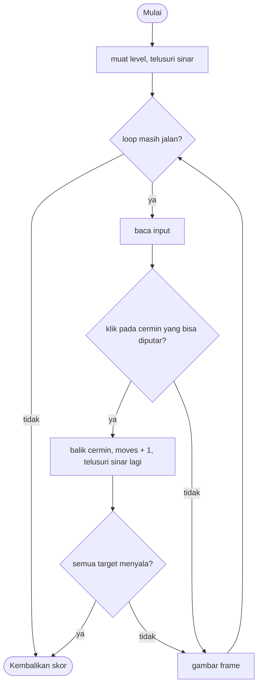

# Laser Mirrors - design brief

**Owner:** Member 3  **Folder:** `games/laser_mirrors/`  **Status:** placeholder (baru satu level, penelusuran sinar sudah jalan)

## Hook
Klik cermin kuning untuk membaliknya antara `/` dan `\` supaya sinar laser memantul ke semua target. Splitter membelah sinar jadi dua arah sekaligus.

## Penjelasan sederhana
Bayangkan senter laser di dalam ruangan berpetak yang penuh cermin kecil. Sinar berjalan lurus petak demi petak, dan setiap kali menabrak cermin ia berbelok. Tugasmu memutar cermin-cermin kuning (yang boleh diubah) sampai sinar mengenai semua target. Ada satu jenis petak khusus, splitter, yang membuat sinar lurus terus **dan** sekaligus keluar satu cabang baru ke arah lain.

Game ini tidak punya animasi atau timer. Tidak ada yang berubah sampai pemain mengklik. Setiap klik membalik satu cermin, lalu seluruh sinar dihitung ulang dari awal (`laser_mirrors_recompute`): kode berjalan dari emitter, menelusuri petak satu per satu (`trace`), mencatat petak mana yang dilalui sinar dan target mana yang kena. Kalau semua target kena, level selesai. Skor hanya bergantung pada jumlah klik (langkah), bukan waktu.

Aturan ada di `laser_mirrors_logic.c` (tanpa raylib, bisa di-test di terminal). `laser_mirrors_game.c` hanya menggambar hasil hitungan itu dan meneruskan klik mouse ke logic.

**Kalau cuma punya 1 menit:** `trace` adalah fungsi rekursif yang menelusuri sinar; ia berhenti kalau menabrak dinding, menabrak target, keluar papan, atau masuk ke petak yang sudah pernah dilewati dalam arah yang sama (supaya sinar yang terjebak di lingkaran cermin tidak berputar selamanya).

## Kontrol
Klik kiri pada cermin (kuning) yang bisa diputar.

## Aturan dan skor
Nyalakan semua target untuk menang. Skor = 1000 dikurangi 60 untuk setiap langkah di atas par (`LM_PAR_MOVES`), minimal 100. Sinar berhenti di dinding dan di target.

Rumus persisnya (`laser_mirrors_score`): `max(100, 1000 - 60 * max(0, moves - LM_PAR_MOVES))`. Skor 0 selama level belum selesai (HUD juga menampilkan 0 sampai menang).

Arti simbol di layar: cermin kuning = bisa diputar, cermin cyan = tetap, belah ketupat magenta = splitter, kotak merah = emitter (menembak ke kanan), lingkaran abu-abu = target belum kena (hijau kalau sudah kena), sinar berwarna merah.

## Cara kerja per frame
1. `arcade_poll(&in)` mengisi `ArcadeInput`. Yang dipakai game ini: `fire_pressed` (klik kiri baru ditekan) dan posisi mouse `aim_x`, `aim_y`.
2. `laser_mirrors_step(&s, &in, ARC_DT)`:
   1. Kalau level sudah `solved`, tidak ada yang terjadi lagi.
   2. Kalau tidak ada klik di frame ini, keluar (parameter `dt` tidak dipakai sama sekali).
   3. Posisi mouse diubah menjadi indeks petak: `(aim - offset) / LM_TILE`. Klik di kiri atau atas papan diabaikan.
   4. `laser_mirrors_toggle(s, tx, ty)`: kalau petak itu bukan cermin yang bisa diputar, tidak terjadi apa-apa. Kalau ya, cermin dibalik (`/` jadi `\` dan sebaliknya) dan `laser_mirrors_recompute` dipanggil. Kalau berhasil, `moves++`.
3. `laser_mirrors_recompute`: mengosongkan `beam` dan `lit`, memanggil `trace` dari emitter, menghitung `targets_lit`, lalu `solved = (semua target kena)`.
4. Front-end menggambar: backdrop, garis grid, sinar (`draw_beams`: untuk tiap petak dan tiap arah sinar yang lewat, gambar setengah masuk dan setengah keluar), cermin, target, splitter, lalu emitter. HUD menampilkan `targets x/y` dan `moves`.
5. Kalau `laser_mirrors_is_over()` bernilai `true`, loop berhenti dan skor dikirim ke hub.

## Peta file
| File | Isinya | Edit di sini kalau ... |
|------|--------|------------------------|
| `laser_mirrors_logic.h` | Konstanta `LM_*`, enum `LmCell`, struct `laser_mirrors_State`, fungsi publik | menambah jenis petak, field state, atau mengubah ukuran papan |
| `laser_mirrors_logic.c` | Level bawaan `k_level`, `trace`, `laser_mirrors_recompute`, `toggle`, `step`, skor, `can_solve` | mengubah level, aturan sinar, atau skor |
| `laser_mirrors_game.c` | Loop raylib, menggambar sinar/cermin/target, HUD, `game_laser_mirrors_def` | mengubah tampilan atau teks di menu |
| `tests/test_laser_mirrors.c` | 7 unit test (hanya logic) | menambah atau mengubah aturan atau level |
| `CMakeLists.txt` | Mendaftarkan game ke build | menambah file `.c` atau test baru |
| `GAME.md` | Dokumen ini | aturan atau kode berubah |
| `AGENTS.md` | Instruksi untuk AI agent (tidak diterjemahkan) | jarang; ikuti aturan di file itu |

## Data penting (struct)
`LmCell` (enum): jenis isi satu petak: `LM_EMPTY` (0), `LM_WALL`, `LM_SLASH` (`/`), `LM_BACK` (`\`), `LM_SPLIT`, `LM_TARGET`.

Arah sinar disimpan sebagai angka: `0` = kanan, `1` = bawah, `2` = kiri, `3` = atas.

`laser_mirrors_State`: seluruh keadaan game.

| Field | Tipe | Artinya |
|-------|------|---------|
| `cell[LM_H][LM_W]` | `uint8_t` | isi tiap petak (nilai `LmCell`) |
| `rotatable[LM_H][LM_W]` | `bool` | `true` kalau cermin di petak itu boleh diklik pemain (digambar kuning) |
| `beam[LM_H][LM_W]` | `uint8_t` | bitmask 4 bit per petak: bit `d` menyala berarti ada sinar yang melintas ke arah `d` |
| `lit[LM_H][LM_W]` | `bool` | target yang sudah kena sinar |
| `emitter_x`, `emitter_y`, `emitter_dir` | `int` | posisi petak emitter dan arah tembaknya (sekarang selalu `0` = kanan) |
| `targets`, `targets_lit` | `int` | jumlah target total dan yang sudah menyala |
| `moves` | `int` | jumlah klik yang berhasil membalik cermin |
| `solved` | `bool` | `true` kalau `targets_lit == targets` (dan `targets > 0`) |

## Fungsi-fungsi penting
| Fungsi | Tugas | Dipanggil dari |
|--------|-------|----------------|
| `laser_mirrors_init(s, seed)` | Membaca `k_level` (teks) dan mengisi `cell`, `rotatable`, emitter, jumlah target, lalu `recompute`. Parameter `seed` sekarang **diabaikan** | `play()`, test |
| `laser_mirrors_step(s, in, dt)` | Menerima klik, memanggil `toggle`, menambah `moves` | `play()` tiap frame, test |
| `laser_mirrors_toggle(s, tx, ty)` | Membalik cermin yang bisa diputar; `true` kalau berubah | `step`, test |
| `laser_mirrors_recompute(s)` | Menghitung ulang seluruh sinar dari emitter | `init`, `toggle`, test |
| `laser_mirrors_can_solve(s)` | Brute force: coba semua kombinasi cermin yang bisa diputar (maksimal 16 cermin = 65.536 kombinasi) dan cek apakah ada yang menyalakan semua target | test (validasi level) |
| `laser_mirrors_is_over(s)` / `laser_mirrors_score(s)` | Status selesai dan skor | `play()` |
| `trace(s, x, y, d)` (static) | Rekursif: jalan petak demi petak mulai dari (x, y) ke arah d dan memantulkan sinar. Di splitter, memanggil dirinya sendiri untuk cabang | `recompute` |

Aturan pantulan di `trace` (arah: 0 kanan, 1 bawah, 2 kiri, 3 atas):
- `/` : `d = 3 - d` (kanan <-> atas, kiri <-> bawah)
- `\` : `d = d ^ 1` (kanan <-> bawah, kiri <-> atas)
- Splitter: sinar lanjut lurus **dan** satu cabang keluar ke arah `3 - d` (seperti memantul dari `/`)
- Target: sinar berhenti dan target ditandai `lit`
- Dinding atau keluar papan: sinar berhenti

## Angka yang bisa diutak-atik
| Konstanta | Nilai sekarang | File | Efek kalau diubah |
|-----------|----------------|------|-------------------|
| `LM_W` / `LM_H` | `14` / `8` petak | `laser_mirrors_logic.h` | ukuran papan (untuk `k_level`: tiap baris harus tepat `LM_W` karakter, jumlah baris `LM_H`) |
| `LM_TILE` | `80` px | `laser_mirrors_logic.h` | ukuran satu petak |
| `LM_OX` / `LM_OY` | `80` / `60` px | `laser_mirrors_logic.h` | posisi papan di layar |
| `LM_PAR_MOVES` | `2` | `laser_mirrors_logic.h` | jumlah langkah par; sekarang berlaku untuk satu-satunya level |
| rumus skor (angka langsung di `laser_mirrors_score`) | `1000`, `60` per langkah di atas par, minimal `100` | `laser_mirrors_logic.c` | keseimbangan skor |
| batas `can_solve` (angka langsung di `laser_mirrors_can_solve`) | `16` cermin | `laser_mirrors_logic.c` | cermin ke-17 dan seterusnya diabaikan oleh pengecekan |
| `k_level` | 14 x 8 karakter | `laser_mirrors_logic.c` | level bawaan: `.` kosong, `#` dinding, `/` `\` cermin tetap, `r` `R` cermin yang bisa diputar (mulai `/` dan `\`), `S` splitter, `T` target, `E` emitter |

## Cara menjalankan dan menguji
```bash
# test logic saja (tanpa raylib, ~1 detik)
cmake --preset logic && cmake --build --preset logic && ctest --preset logic -R "^laser_mirrors\."

# main game-nya
cmake --preset dev && cmake --build --preset dev && build/dev/bin/arCade

# smoke run headless: jalankan game 300 frame dan simpan screenshot PNG
cmake --preset headless && cmake --build --preset headless && build/headless/bin/arCade --smoke laser_mirrors --frames 300 --out smoke-out
```

| Test | Menjaga aturan apa |
|------|--------------------|
| `test_initial_level_is_unsolved_but_solvable` | Level awal: 2 target, 0 menyala, belum selesai, tapi `can_solve` bernilai `true` |
| `test_toggling_both_mirrors_solves` | Membalik cermin di (4, 3) lalu (9, 4) menyalakan 1 lalu 2 target; splitter dan petak di luar papan tidak bisa diputar |
| `test_clicks_count_moves_and_score` | Dua klik = 2 langkah, game selesai, skor 1000 (par); klik di kiri papan diabaikan |
| `test_mirror_reflections` | `/` memantulkan kanan -> atas, `\` kanan -> bawah, dinding memblokir sinar |
| `test_splitter_branches` | Splitter menyalakan target di depan **dan** target di cabang atas |
| `test_mirror_loops_terminate` | Empat cermin yang membentuk kotak tertutup tidak membuat `recompute` menggantung |
| `test_random_grids_never_hang_or_leave_the_board` | 300 papan acak: tidak hang, dan `targets_lit <= targets` |

## Jebakan dan hal yang perlu diingat
- **Tiga test mengandung koordinat level bawaan** (cermin di (4, 3) dan (9, 4), 2 target, par 1000): `test_initial_level_is_unsolved_but_solvable`, `test_toggling_both_mirrors_solves`, `test_clicks_count_moves_and_score`. Kalau level pertama diubah atau `k_level` dijadikan array of levels, test ini ikut disesuaikan.
- `LM_PAR_MOVES` adalah satu angka global. Untuk banyak level, par harus per level (misalnya field di struct level).
- `laser_mirrors_can_solve` hanya mengembalikan `true` atau `false`, bukan jumlah langkah minimum. Untuk menghitung par otomatis, fungsi itu perlu dikembangkan (misalnya mencatat jumlah bit terkecil di mask yang menang).
- `laser_mirrors_init` mengabaikan `seed`, jadi level selalu sama. Kalau level dipilih dari `seed`, jaga agar tetap deterministik.
- Emitter selalu menembak ke kanan (`emitter_dir = 0` di-hardcode di `init`). Arah lain perlu perubahan di `init`.
- Sinar tidak dianimasikan; setiap frame menggambar hasil `beam[][]` langsung. Animasi "sinar bertumbuh" harus disimpan di front-end, bukan di logic.
- Satu petak bisa dilewati beberapa sinar sekaligus (bitmask `beam`), dan satu target cukup dikenai satu sinar dari arah mana pun.

## Langkah implementasi (Implementation steps)

### Prioritas dari diskusi tim
- [ ] **Perbaiki level tutorial.** (Detail "apa yang rusak" belum disebutkan.)
  - Catatan: level bawaan (`k_level`) dianalisis dengan harness C sementara (bukan bagian repo). Tidak ditemukan bug di logic: level bisa diselesaikan, par 2 memang minimum, dan hanya satu kombinasi yang menang (membalik **kedua** cermin; membalik satu saja baru menyalakan 1 dari 2 target).
  - Masalahnya lebih ke sisi "mengajarkan": hanya ada 2 cermin yang bisa diputar, jadi pemain bisa selesai hanya dengan mengklik keduanya tanpa perlu memahami pantulan. Level ini tidak memakai dinding atau cermin tetap, dan splitter-nya tetap (tidak diputar) sehingga tidak ada yang perlu dipikirkan. Satu-satunya petunjuk di layar adalah "click a yellow mirror to rotate it"; arti target, splitter, dan `/` vs `\` tidak dijelaskan. Tiga baris paling bawah papan (y = 5-7) kosong.
  - Opsi (belum diputuskan): pecah tutorial jadi beberapa level kecil yang memperkenalkan satu hal per level (satu cermin dan satu target, lalu splitter, lalu dinding atau cermin tetap), dan/atau tambah teks petunjuk per level. Karena tiga test memuat koordinat level ini, perubahan di level ini berarti ikut mengubah test (lihat "Jebakan").
- [ ] **Tambah lebih banyak level.** Lihat langkah 1 di bawah (sudah ada di daftar, tidak diduplikasi).
  - Catatan: `k_level` sekarang satu array string; tiap level baru perlu divalidasi dengan `laser_mirrors_can_solve()` dan punya par sendiri. Batas `can_solve` adalah 16 cermin yang bisa diputar. Lihat juga "Jebakan" soal `LM_PAR_MOVES` global dan test yang memuat koordinat level pertama.

### Langkah dari design awal
1. Lebih banyak level: ubah `k_level` menjadi array of level, pilih berdasarkan `seed` atau progres; validasi setiap level dengan `laser_mirrors_can_solve()` di sebuah test.
2. Jenis petak baru: filter warna, pintu yang menghalangi sinar, cermin yang bisa digeser (drag).
3. Efek sinar di `laser_mirrors_game.c`: sinar yang bertumbuh dengan animasi, glow "charge" pada target, partikel saat target menyala.
4. Ide level editor: simpan level sebagai teks di `assets/levels/` lalu baca dengan file I/O.
5. Test: setiap jenis petak baru butuh test pantulan seperti `test_mirror_reflections`.

## Pseudocode (untuk laporan)
```
PROSEDUR trace(x, y, d)         // rekursif
    SELAMA (x, y) masih di dalam papan
        JIKA petak adalah dinding MAKA KEMBALI
        JIKA petak ini sudah pernah dilewati ke arah d MAKA KEMBALI      // mencegah loop
        tandai (x, y, d)
        JIKA petak adalah target MAKA tandai target menyala; KEMBALI
        JIKA petak adalah '/' MAKA d <- 3 - d
        JIKA petak adalah '\' MAKA d <- d XOR 1
        JIKA petak adalah splitter MAKA trace(petak berikutnya ke arah 3 - d)   // cabang
        maju satu petak ke arah d
AKHIR PROSEDUR
```

## Flowchart (untuk laporan)


## Konsep kuliah yang dipakai
| Konsep (Pertemuan) | Di mana (file : fungsi) |
|--------------------|-------------------------|
| Rekursif (12) | `laser_mirrors_logic.c` : `trace` (cabang splitter) |
| Array 2D (9) | `laser_mirrors_State` : `cell[][]`, `beam[][]`, `lit[][]` |
| Enum (13) | `LmCell` |
| Operator bitwise (4) | `beam[y][x] \| (1u << d)`, `d ^ 1` |
| Perulangan (6) | loop di `trace`, `laser_mirrors_can_solve` (brute force atas bit mask) |
| Percabangan (5) | `switch` di `trace` dan `laser_mirrors_init` |
