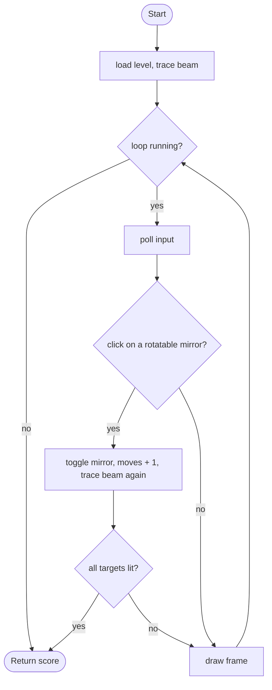

# Laser Mirrors - design brief

**Owner:** Member 3  **Folder:** `games/laser_mirrors/`  **Status:** placeholder (one level, tracing works)

## Hook
Click yellow mirrors to flip them between `/` and `\` so a laser bounces onto every target. A splitter sends the beam two ways at once.

## Controls
Left click a rotatable (yellow) mirror.

## Rules and scoring
Light all targets to win. Score = 1000 minus 60 per move above par (`LM_PAR_MOVES`), minimum 100. Beams stop at walls and at targets.

## Implementation steps
1. More levels: turn `k_level` into an array of levels, choose by `seed` or progression; validate each with `laser_mirrors_can_solve()` in a test.
2. New tiles: colour filters, beam-blocking doors, a movable mirror (drag it).
3. Beam polish in `laser_mirrors_game.c`: animated beam growth, target "charge" glow, particles when a target lights.
4. Level editor idea: save levels as text in `assets/levels/` and load with file I/O.
5. Tests: every new tile type needs a reflection test like `test_mirror_reflections`.

## Pseudocode (for the report)
```
PROCEDURE trace(x, y, d)         // recursion
    WHILE (x, y) is inside the board
        IF tile is a wall THEN RETURN
        IF this tile was already traced in direction d THEN RETURN      // stops loops
        mark (x, y, d)
        IF tile is a target THEN mark it lit; RETURN
        IF tile is '/' THEN d <- 3 - d
        IF tile is '\' THEN d <- d XOR 1
        IF tile is a splitter THEN trace(next tile in direction 3 - d)   // the branch
        move one tile in direction d
END PROCEDURE
```

## Flowchart (for the report)


## Course concepts used
| Concept (Pertemuan) | Where (file : function) |
|---------------------|-------------------------|
| Rekursif (12) | `laser_mirrors_logic.c` : `trace` (splitter branches) |
| Array 2D (9) | `laser_mirrors_State` : `cell[][]`, `beam[][]`, `lit[][]` |
| Enum (13) | `LmCell` |
| Operator bitwise (4) | `beam[y][x] \| (1u << d)`, `d ^ 1` |
| Perulangan (6) | `trace` loop, `laser_mirrors_can_solve` (brute-force over bit masks) |
| Percabangan (5) | `switch` in `trace` and `laser_mirrors_init` |
