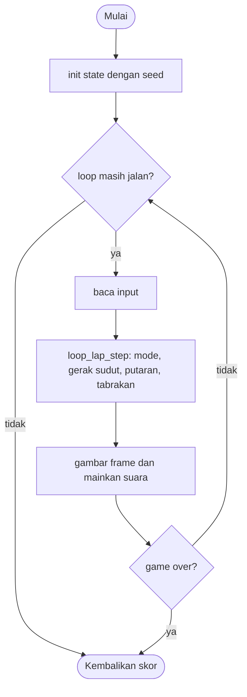

# Loop Lap - design brief

**Owner:** Leader  **Folder:** `games/loop_lap/`  **Created:** 2026-11-12  **Asal mekanik:** `g07_circlerace` di proyek `simple-games` (hanya aturan; tidak ada kode, gambar, suara, teks atau font yang disalin)

## Hook
Bolamu berputar sendiri di lingkaran atas; kamu hanya mengatur kecepatan dengan dua pedal supaya tidak menabrak musuh di lingkaran bawah.

## Penjelasan sederhana
Ada dua lingkaran yang saling tumpang tindih. Bolamu (cyan) berlari mengelilingi lingkaran atas tanpa henti. Musuh (magenta) berlari mengelilingi lingkaran bawah. Kamu tidak bisa berbelok; kamu hanya memilih kecepatan: tahan sisi kiri untuk mengerem (bola besar, lambat), tahan sisi kanan untuk tancap gas (bola kecil, cepat), atau lepas untuk kecepatan biasa. Setiap putaran penuh +1 dan sesekali musuh baru bergabung. Menyentuh musuh mengakhiri game.

Di balik layar, `loop_lap_step()` menambah sudut bola dengan kecepatan sudut sesuai mode (rem, biasa, gas), menghitung posisinya dengan cos dan sin, lalu membandingkan jarak ke tiap musuh dengan jumlah jari-jari kedua bola. Seperti dua pelari di lintasan yang berpotongan: kamu mengatur kapan sampai di titik pertemuan.

Kalau cuma punya 1 menit: tahan kanan untuk melaju, kiri untuk mengerem, dan lewati titik pertemuan kedua lingkaran saat tidak ada musuh di sana.

## Kontrol
Tahan mouse di setengah KANAN lapangan atau tekan Kanan, Atas, D, W, Spasi: gas. Tahan mouse di setengah KIRI atau tekan Kiri, Bawah, A, S: rem. Gas menang jika dua-duanya ditahan. P: jeda.

## Aturan dan skor
- Lingkaran atas (pemain) dan bawah (musuh) berjari-jari `3/8 * lebar`; pusatnya terpisah `1.25 * jari-jari` secara vertikal, jadi saling tumpang tindih.
- Kecepatan pemain per tick asli: rem `2pi/625` (bola 60 px), biasa `2pi/250` (48 px), gas `2pi/100` (36 px).
- Mulai di jam 12; putaran dihitung saat sudut melewati `2pi`: `score++`, kecepatan tidak naik.
- Musuh ke-i bergabung saat skor mencapai 1, 3, 8, 17, 31, 51, 78, 113 (maksimum 8); sudut dan kecepatan sudut diacak (`0.0067..0.0419` rad/tick).
- Tabrakan: jarak pusat <= `lebar_pemain/2 + 24 - 2` (rem 52, biasa 46, gas 40) mengakhiri game.
- Hampir tabrakan (jarak <= jumlah jari-jari + 16) memicu desis, paling sering sekali per detik.
- Setelah selesai, tabrakan ditampilkan 1.0 detik sebelum skor dicatat.
- **Skor = jumlah putaran.**

## Cara kerja per frame
1. `arcade_poll()` mengisi `ArcadeInput`.
2. `loop_lap_step()`: P membalik `paused`; jika jeda, selesai.
3. `loop_lap_mode_from_input()` memilih rem, biasa, atau gas dan mengatur ukuran bola.
4. Sudut pemain bertambah `kecepatan * dt * 50`; jika melewati `2pi`, putaran selesai dan musuh baru mungkin bergabung.
5. Sudut tiap musuh bertambah; semua posisi dihitung dari sudut; jarak diperiksa untuk tabrakan dan hampir tabrakan.
6. Front-end membandingkan `laps`, `joins`, `whooshes` untuk suara dan menggambar lingkaran, bola, pedal, bendera.

## Peta file
| File | Isinya | Edit di sini kalau ... |
|---|---|---|
| `loop_lap_logic.h` | struct `loop_lap_State` dan fungsi publik (`init`, `init_sized`, `step`, `is_over`, `score`) | menambah field state atau fungsi publik |
| `loop_lap_logic.c` | semua aturan game (tanpa raylib) | mengubah aturan atau angka keseimbangan |
| `loop_lap_game.c` | loop raylib, menggambar, suara, `GameDef` (judul, kontrol di menu, urutan, ranked) | mengubah tampilan, suara, atau teks di menu |
| `tests/test_loop_lap.c` | unit test (hanya logic) | menambah atau mengubah aturan |
| `CMakeLists.txt` | mendaftarkan game lewat `arcade_add_game(...)` | menambah file `.c` atau test baru |
| `GAME.md` | dokumen ini | aturan atau kode berubah |
| `AGENTS.md` | instruksi untuk AI agent (tidak diterjemahkan) | jarang; ikuti aturan di file itu |

## Data penting (struct)
| Field | Tipe | Artinya |
|---|---|---|
| `w`, `h`, `c1x`, `c1y`, `c1r`, `c2x`, `c2y`, `c2r` | int, float | ukuran lapangan dan geometri dua lingkaran |
| `my_a` | double | sudut pemain dalam radian (pi/2 = jam 12) |
| `mode`, `my_w` | int, float | rem/biasa/gas dan diameter bola pemain (60/48/36) |
| `score` | int | putaran |
| `enemy_n`, `ea[]`, `ew[]` | int, double[8] | jumlah musuh, sudut (tidak dibungkus) dan kecepatan sudutnya |
| `my_pos`, `enemy_pos[]` | Vec2 | posisi hasil hitung sudut, dipakai front-end dan tabrakan |
| `flash_t`, `near_cd` | float | detik sejak putaran (kilatan bendera) dan jeda desis |
| `paused`, `over`, `over_t` | bool, float | status jeda, akhir, waktu sejak akhir |
| `laps`, `joins`, `whooshes` | int | penghitung kejadian untuk suara |

## Fungsi-fungsi penting
| Fungsi | Tugas | Dipanggil dari |
|---|---|---|
| `loop_lap_mode_from_input` | tahan mouse/tombol menjadi rem, biasa, atau gas | `step`, tes |
| `loop_lap_hit_distance` | jarak sentuh dari lebar bola pemain | `step`, tes |
| `loop_lap_join_lap` | lap tempat musuh ke-i bergabung | tes, front-end |
| `update_positions` | sudut menjadi posisi (cos, sin) | `init_sized`, `step` |
| `finish_lap`, `new_enemy` | menutup putaran dan menambah musuh | `step` |
| `loop_lap_step` | mode, gerak, putaran, tabrakan, desis | `play()` |

## Angka yang bisa diutak-atik
| Konstanta | Nilai sekarang | File | Efek kalau diubah |
|---|---|---|---|
| `LL_SPEED_BRAKE/CRUISE/ACCEL` | 2pi/625, 2pi/250, 2pi/100 | `loop_lap_logic.c` | kecepatan tiap mode (waktu satu putaran 12.5 / 5 / 2 detik) |
| `LL_MAX_ENEMIES` | 8 | `loop_lap_logic.h` | jumlah maksimum musuh dan ukuran array |
| `k_join_lap[]` | 1, 3, 8, 17, 31, 51, 78, 113 | `loop_lap_logic.c` | kapan musuh baru bergabung |
| `LL_NEAR_EXTRA`, `LL_WHOOSH_COOLDOWN` | 16 px, 1 s | `loop_lap_logic.c` | kepekaan dan frekuensi desis |
| `LL_OVER_DELAY` | 1.0 s | `loop_lap_logic.h` | lama tabrakan ditampilkan sebelum skor dicatat |
| angka `0.03518584`, `0.00670206` | di `new_enemy` | `loop_lap_logic.c` | rentang kecepatan musuh |

## Cara menjalankan dan menguji
```bash
# test logic saja (tanpa raylib, ~1 detik)
cmake --preset logic && cmake --build --preset logic && ctest --preset logic -R "^loop_lap\."

# main game-nya
cmake --preset dev && cmake --build --preset dev && build/dev/bin/arCade

# smoke run headless: jalankan game 300 frame dan simpan screenshot PNG
cmake --preset headless && cmake --build --preset headless && build/headless/bin/arCade --smoke loop_lap --frames 300 --out smoke-out
```

| Test | Menjaga aturan apa |
|---|---|
| `test_geometry_at_480x800`, `test_geometry_fits_the_684_playfield` | pusat lingkaran dan posisi bola sesuai spesifikasi; muat di lapangan 684 |
| `test_input_mapping_table` | semua kombinasi mouse, spasi, panah, WASD; gas menang |
| `test_lap_times_at_50hz`, `test_lap_times_at_60hz` | putaran pertama 188 tick (225 frame), berikutnya 250 tick (300 frame) |
| `test_brake_and_accelerate_lap_lengths` | gas sekitar 100 tick, rem sekitar 625 tick, ukuran bola berubah |
| `test_hit_distances`, `test_collision_thresholds` | 52, 46, 40 px; tabrakan tepat di ambang (lingkaran sepusat) |
| `test_enemies_join_at_the_spec_laps`, `test_enemy_speed_range` | tabel lap bergabung, maksimum 8, rentang kecepatan |
| `test_near_miss_whoosh_is_rate_limited` | desis paling sering sekali per detik |
| `test_pause_with_p`, `test_crash_ends_the_game_after_the_reveal` | jeda dan akhir game |
| `test_accelerating_player_ends_the_game` | pemain skrip yang selalu gas akhirnya menabrak |
| `test_same_seed_same_result`, `test_monkey_never_breaks_invariants` | deterministik; 20 seed x 5000 frame tanpa NaN |

## Jebakan dan hal yang perlu diingat
- Tidak ada kenaikan kecepatan; tingkat kesulitan hanya jumlah musuh (0 sebelum lap 1).
- Sudut musuh tidak dibungkus; `double` dipakai agar akumulasi tetap akurat untuk waktu lama.
- Penyimpangan dari simple-games: tahan mouse ditentukan dari setengah lapangan saat ini (bukan dari posisi saat dilepas seperti kebiasaan aslinya), dan klik di gutter dihitung berdasarkan posisinya terhadap tengah lapangan.
- Penyimpangan: tombol jeda di layar diganti tombol P; tidak ada tombol play-again atau ranking online.
- Penyimpangan: desis hampir tabrakan dihitung dengan penghitung jeda 1 detik, bukan jam `time_ms`; bola dan lingkaran digambar dengan bentuk raylib, bukan sprite.
- Tabrakan diuji setelah semua sudut diperbarui pada frame itu, tidak per musuh seperti aslinya; selisihnya paling banyak satu tick.
- Pewarnaan: pemain cyan, musuh magenta, lingkaran magenta (palet neon arCade).

## Langkah implementasi (Implementation steps)
1. Aturan sudah ada di `loop_lap_State` dan `loop_lap_step()` (hanya di logic). Konstanta ditulis sebagai `#define` di `loop_lap_logic.c`.
2. Setiap aturan punya unit test di `tests/test_loop_lap.c`; tes memakai `loop_lap_init_sized(480, 800)` supaya vektor uji spesifikasi asli berlaku apa adanya.
3. Tampilan ada di `loop_lap_game.c`: panel 480 x 684 di tengah, aturan di gutter kiri, statistik di gutter kanan. Suara dibuat dari `gfx_make_tone()`.
4. Kalau menambah aturan: tulis tesnya dulu, lalu ubah logic, lalu perbarui bagian Jebakan dan tabel di dokumen ini.

## Pseudocode (untuk laporan)
```
PROSEDUR step(s, input, dt)
    JIKA over MAKA over_t += dt; KEMBALI
    JIKA tombol P MAKA paused = NOT paused
    JIKA paused MAKA KEMBALI
    mode = rem / biasa / gas dari input
    my_a += kecepatan(mode) * dt * 50
    JIKA my_a > 2pi MAKA my_a -= 2pi; score += 1; musuh baru jika lap = tabel
    UNTUK setiap musuh: ea += ew * dt * 50
    hitung semua posisi dari sudut
    UNTUK setiap musuh: JIKA jarak <= lebar_pemain/2 + 22 MAKA over = benar
AKHIR PROSEDUR
```

## Flowchart (untuk laporan)


## Konsep kuliah yang dipakai (untuk Bab I laporan)
| Konsep (Pertemuan) | Di mana (file : fungsi) |
|---|---|
| Struct (13) | `loop_lap_logic.h` : `loop_lap_State` |
| Array (9) | `loop_lap_logic.h` : `ea[]`, `ew[]`, `enemy_pos[]`; `k_join_lap[]` |
| Perulangan (6-7) | `loop_lap_logic.c` : `update_positions`, `loop_lap_step` (setiap musuh) |
| Percabangan (5) | `loop_lap_logic.c` : `loop_lap_mode_from_input` dan pemilihan mode |
| Fungsi (11) | `loop_lap_logic.c` : `loop_lap_hit_distance`, `finish_lap` |
| Trigonometri dan tipe data (3-4) | `loop_lap_logic.c` : `cos`, `sin`, `double` untuk sudut |
