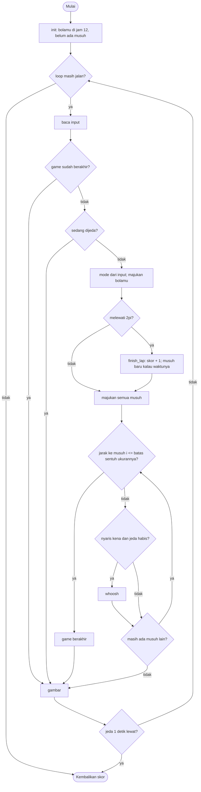

# Loop Lap - design brief

**Owner:** Nadif & Baim  **Folder:** `games/loop_lap/`  **Created:** 2026-11-12

## Hook
Bolamu berlari sendiri mengitari lingkaran atas. Kamu hanya mengendalikan satu hal: kecepatan. Lepas untuk kecepatan biasa, tahan untuk mengerem (bola besar dan lambat), atau gas (bola kecil dan cepat). Di lingkaran bawah yang tumpang tindih dengan lingkaranmu, musuh-musuh berputar dengan kecepatan dan ukuran masing-masing. Setiap lap menambah satu poin, dan makin banyak lap, makin banyak musuh. Menyentuh satu musuh berarti selesai.

## Penjelasan sederhana
Bayangkan dua lintasan lari berbentuk lingkaran yang saling memotong seperti angka 8 yang gemuk. Kamu berlari di lintasan atas, musuh di lintasan bawah. Kedua lintasan berpotongan di dua titik, dan di sanalah tabrakan bisa terjadi. Kamu tidak bisa membelok; yang bisa kamu lakukan hanya melambat atau mempercepat supaya tiba di titik potong **bukan** pada saat yang sama dengan musuh.

Tiap musuh yang bergabung mendapat tiga hal acak: sudut awal, kecepatan putar (selalu berlawanan arah jarum jam, antara lap 3 dan 18,7 detik), dan **ukuran** (diameter 32 sampai 64 px, rata-rata 48 px). Musuh besar menutup celah lebih lebar sehingga lebih sulit dihindari; musuh kecil lebih mudah dilewati. Karena rata-ratanya tetap 48 px (ukuran asli sebelum ukuran diacak), kesulitan rata-rata tidak berubah.

Bolamu sendiri berubah ukuran menurut mode: 60 px saat mengerem, 48 px saat biasa, 36 px saat gas. Rem membuatmu lebih mudah ditabrak (bola lebih besar) tapi lambat (lap 12,5 detik); gas membuatmu lebih sulit ditabrak (bola kecil) dan cepat (lap 2 detik), tapi kamu bisa meluncur masuk ke musuh.

Jarak sentuh dihitung dari ukuran kedua bola: `ukuran_bolamu / 2 + ukuran_musuh / 2 - 2` px antara dua pusat. Pengurang 2 px memaafkan sentuhan tipis. Ada juga zona "nyaris kena" 16 px di luar jarak sentuh yang memutar bunyi whoosh (paling sering sekali per detik).

Aturan ada di `loop_lap_logic.c` (tanpa raylib, bisa di-test di terminal). `loop_lap_game.c` hanya menggambar dan meneruskan input.

**Kalau cuma punya 1 menit:** `loop_lap_step` memajukan sudut bolamu dan semua musuh lalu menguji jarak; `finish_lap` menambah skor dan memanggil `new_enemy` pada lap yang tepat; `new_enemy` menarik sudut, kecepatan, lalu ukuran dari `rng`.

## Kontrol
Tahan klik kiri di **separuh kiri** layar untuk rem, di **separuh kanan** untuk gas. Atau A / panah kiri / S / panah bawah untuk rem, dan D / panah kanan / W / panah atas / Spasi / Enter untuk gas. Kalau rem dan gas diminta bersamaan, gas menang. Lepas semuanya untuk kecepatan biasa. P menjeda dan melanjutkan. Esc keluar.

## Aturan dan skor
Skor = jumlah lap (`score`). Satu lap selesai saat sudut bolamu melewati `2 pi`. Game berakhir kalau jarak bolamu ke salah satu musuh `<= my_w/2 + esize/2 - 2`.

Detail dari kode:
- **Geometri di lapangan 480 x 684:** jari-jari kedua lingkaran `c1r = 3/8 * w = 180`, pusat atas `(240, 229,5)`, pusat bawah `(240, 454,5)` (pusat berjarak 225 px, jadi lingkaran tumpang tindih). Bola berlari di jalur 3 px di dalam lingkaran (jari-jari 177). Di test (480 x 800): `c1y = 287,5`, `c2y = 512,5`.
- **Kecepatan bolamu** (rad per tick 50 Hz, dikali `k = dt * 50`): rem `2pi / 625` (lap 12,5 detik), biasa `2pi / 250` (5 detik), gas `2pi / 100` (2 detik). Ukuran bola 60 / 48 / 36 px.
- **Lap pertama lebih pendek.** Bolamu mulai di jam 12 (sudut `pi/2`) dan lap dihitung saat melewati `2 pi` (jam 3), jadi lap pertama hanya tiga perempat lingkaran: 188 tick (3,76 detik) pada kecepatan biasa, lalu 250 tick (5 detik) untuk lap berikutnya.
- **Musuh bergabung** di lap 1, 3, 8, 17, 31, 51, 78, dan 113 (maksimal 8). Tiap musuh: sudut awal acak `0..2pi`, kecepatan acak `0,00670206 .. 0,04188790` rad per tick (lap antara 3,0 dan 18,7 detik), ukuran acak `LL_ENEMY_W_MIN .. LL_ENEMY_W_MAX` (32 sampai 64 px). Sudut musuh tidak pernah dibungkus ke `0..2pi`.
- **Urutan penarikan acak:** sudut, kecepatan, **lalu** ukuran. Ukuran sengaja ditarik terakhir supaya untuk seed yang sama, sudut dan kecepatan musuh tetap seperti sebelum ukuran diacak.
- **Tabrakan:** `loop_lap_hit_distance(my_w, esize[i])` untuk tiap musuh dengan ukurannya sendiri. Kena memulai `over`.
- **Nyaris kena:** jarak `<= my_w/2 + esize[i]/2 + 16` dan `near_cd <= 0` menambah `whooshes` dan mengatur jeda 1 detik.
- **Jeda:** `P` membalik `paused`; saat jeda logic berhenti total.
- `loop_lap_is_over` baru `true` 1 detik (`LL_OVER_DELAY`) setelah `over`, supaya pemain melihat tabrakannya.

## Cara kerja per frame
1. `arcade_poll(&in)` mengisi `ArcadeInput`. Yang dipakai untuk kecepatan: tombol yang **ditahan** (`fire`, `action`, `move_x`, `move_y`) dan posisi mouse (`aim_x`, `aim_y`). Untuk jeda: `typed`.
2. `loop_lap_step(&s, &in, ARC_DT)`:
   1. Kalau `over` sudah `true`: `over_t += dt`, keluar.
   2. Kalau `P` ditekan, `paused` dibalik. Kalau `paused`, keluar.
   3. `set_mode` memilih rem / biasa / gas dari input lewat `loop_lap_mode_from_input` (fungsi murni) dan mengatur `my_w`.
   4. `k = dt * 50`; `flash_t += dt`; `near_cd -= dt`; `my_a += speed_of(mode) * k`. Kalau `my_a > 2 pi`: `finish_lap` (`my_a -= 2 pi`, `score++`, `laps++`, bendera berkedip, dan kalau `score` sama dengan lap bergabung berikutnya, `new_enemy`).
   5. Semua musuh maju: `ea[i] += ew[i] * k`. `update_positions` menghitung posisi layar bolamu dan semua musuh.
   6. Untuk tiap musuh: hitung jarak. Kalau `<= hit_distance(my_w, esize[i])`: `over`, keluar. Kalau tidak dan `near_cd <= 0` dan jarak `<= my_w/2 + esize[i]/2 + 16`: whoosh.
3. Front-end membandingkan `laps`, `joins`, `whooshes` dengan frame lalu untuk memutar bunyi, lalu menggambar dua lingkaran, bendera kotak-kotak di jam 3 yang berkedip tiap lap, bolamu (cyan) dan musuh (magenta; **tiap musuh digambar dengan ukurannya sendiri**), dua tombol BRAKE/GO yang menyala sesuai mode, tulisan PAUSED, dan panel kanan (lap, jumlah musuh, lap musuh berikutnya).
4. Kalau `loop_lap_is_over(&s)` bernilai `true`, loop berhenti dan skor dikembalikan.

## Peta file
| File | Isinya | Edit di sini kalau ... |
|------|--------|------------------------|
| `loop_lap_logic.h` | Konstanta `LL_*`, struct `loop_lap_State`, fungsi publik dan helper murni | menambah field state atau mengubah ukuran |
| `loop_lap_logic.c` | `loop_lap_step`, `finish_lap`, `new_enemy`, `update_positions`, `loop_lap_mode_from_input`, `loop_lap_hit_distance` | mengubah aturan, kecepatan, atau penarikan acak musuh |
| `loop_lap_game.c` | Loop raylib, menggambar lingkaran/bola/pedal/bendera/panel, bunyi, `game_loop_lap_def` | mengubah tampilan atau teks |
| `tests/test_loop_lap.c` | 24 unit test (hanya logic) | menambah atau mengubah aturan |
| `CMakeLists.txt` | Mendaftarkan game ke build | menambah file `.c` atau test baru |
| `core/include/arcade/playfield.h` | Lapangan potret 480 x 684 yang dipakai bersama | jarang |
| `GAME.md` | Dokumen ini | aturan atau kode berubah |
| `AGENTS.md` | Instruksi untuk AI agent (tidak diterjemahkan) | jarang; ikuti aturan di file itu |

## Data penting (struct)
`loop_lap_State`: seluruh keadaan game. Koordinat lokal lapangan.

| Field | Tipe | Artinya |
|-------|------|---------|
| `w`, `h` | `int` | ukuran lapangan (480 x 684 di game; 480 x 800 di test) |
| `c1x`, `c1y`, `c1r` | `float` | pusat dan jari-jari lingkaran atas (lintasanmu) |
| `c2x`, `c2y`, `c2r` | `float` | pusat dan jari-jari lingkaran bawah (lintasan musuh) |
| `my_a` | `double` | sudut bolamu (`pi/2` = jam 12); berlawanan arah jarum jam |
| `mode` | `int` | `LL_BRAKE` (-1), `LL_CRUISE` (0), `LL_ACCEL` (1) |
| `my_w` | `float` | diameter bolamu: 60 / 48 / 36 |
| `score` | `int` | jumlah lap |
| `enemy_n` | `int` | jumlah musuh yang sudah bergabung (maksimal 8) |
| `ea[]`, `ew[]` | `double` | sudut dan kecepatan sudut tiap musuh (rad per tick 50 Hz) |
| `esize[]` | `float` | **diameter tiap musuh dalam px (acak 32..64; slot kosong 48)**; juga ukuran hitbox dan gambar |
| `my_pos`, `enemy_pos[]` | `Vec2` | posisi bolamu dan tiap musuh di lapangan |
| `flash_t` | `float` | detik sejak lap terakhir (bendera berkedip 0,5 detik) |
| `near_cd` | `float` | jeda bunyi whoosh |
| `paused`, `over`, `over_t` | `bool`, `bool`, `float` | jeda; game berakhir; detik sejak berakhir |
| `laps`, `joins`, `whooshes` | `int` | penghitung kejadian untuk bunyi |
| `rng` | `Rng` | pengacak deterministik: sudut, kecepatan, dan ukuran musuh |

## Fungsi-fungsi penting
| Fungsi | Tugas | Dipanggil dari |
|--------|-------|----------------|
| `loop_lap_init(s, seed)` / `_init_sized(s, seed, w, h)` | Mengosongkan state, menghitung geometri, mengisi `esize[]` dengan 48 | `play()`, test |
| `loop_lap_step(s, in, dt)` | Satu langkah logic | `play()` tiap frame, test |
| `loop_lap_is_over(s)` / `loop_lap_score(s)` | Status selesai (setelah jeda 1 detik) dan skor | `play()` |
| `loop_lap_mode_from_input(in, w)` | Input yang ditahan menjadi rem / biasa / gas; gas menang | `loop_lap_step`, test |
| `loop_lap_hit_distance(my_w, enemy_w)` | Jarak pusat terjauh yang dihitung bersentuhan | `loop_lap_step`, test |
| `loop_lap_join_lap(i)` | Lap tempat musuh ke-i bergabung (1, 3, 8, 17, 31, 51, 78, 113) | `play()` (panel), test |
| `finish_lap(s)` (static) | Menyelesaikan lap: skor, bendera, dan musuh baru bila waktunya | `loop_lap_step` |
| `new_enemy(s)` (static) | Menarik sudut, kecepatan, lalu ukuran musuh baru | `finish_lap` |
| `update_positions(s)` (static) | Menghitung posisi dari sudut | `init`, `loop_lap_step` |
| `set_mode(s, mode)`, `speed_of(mode)` (static) | Ukuran bola dan kecepatan sesuai mode | `loop_lap_step` |

## Angka yang bisa diutak-atik
| Konstanta | Nilai sekarang | File | Efek kalau diubah |
|-----------|----------------|------|-------------------|
| `LL_MAX_ENEMIES` | `8` | `loop_lap_logic.h` | ukuran array musuh; harus sama dengan panjang `k_join_lap` |
| `LL_ENEMY_W` | `48` px | `loop_lap_logic.h` | ukuran rata-rata dan bawaan slot kosong |
| `LL_ENEMY_W_MIN` / `LL_ENEMY_W_MAX` | `32` / `64` px | `loop_lap_logic.h` | rentang ukuran acak musuh (jaga rata-rata tetap 48 supaya kesulitan rata-rata sama) |
| `LL_OVER_DELAY` | `1.0` detik | `loop_lap_logic.h` | lama tabrakan terlihat sebelum game ditutup |
| `k_join_lap` | `{1, 3, 8, 17, 31, 51, 78, 113}` | `loop_lap_logic.c` | lap tempat musuh bergabung |
| `LL_SPEED_BRAKE` / `_CRUISE` / `_ACCEL` | `2pi/625`, `2pi/250`, `2pi/100` rad per tick | `loop_lap_logic.c` | kecepatan bolamu (lap 12,5 / 5 / 2 detik) |
| `LL_PATH_INSET` | `3` px | `loop_lap_logic.c` | jalur bola di dalam lingkaran |
| `LL_NEAR_EXTRA` | `16` px | `loop_lap_logic.c` | lebar zona "nyaris kena" |
| `LL_WHOOSH_COOLDOWN` | `1.0` detik | `loop_lap_logic.c` | seberapa sering whoosh boleh berbunyi |
| rentang kecepatan musuh (angka langsung di `new_enemy`) | `0,00670206 + acak * 0,03518584` | `loop_lap_logic.c` | seberapa cepat musuh berputar |
| ukuran bolamu (angka langsung di `set_mode`) | `60` / `48` / `36` px | `loop_lap_logic.c` | kesulitan tiap mode |
| pengurang jarak sentuh (angka langsung di `loop_lap_hit_distance`) | `2` px | `loop_lap_logic.c` | seberapa dimaafkan sentuhan tipis |
| geometri (angka langsung di `init_sized`) | `c1r = 3/8 w`, pusat digeser `5/8 c1r` | `loop_lap_logic.c` | seberapa besar dua lingkaran tumpang tindih |
| nada bunyi (di `play`) | lap 1000 Hz, musuh baru 330 Hz, whoosh 300 Hz, kalah 110 Hz | `loop_lap_game.c` | hanya bunyi |

## Cara menjalankan dan menguji
```bash
# test logic saja (tanpa raylib, ~1 detik)
cmake --preset logic && cmake --build --preset logic && ctest --preset logic -R "^loop_lap\."

# main game-nya
cmake --preset dev && cmake --build --preset dev && build/dev/bin/arCade

# smoke run headless: jalankan game 300 frame dan simpan screenshot PNG
cmake --preset headless && cmake --build --preset headless && build/headless/bin/arCade --smoke loop_lap --frames 300 --out smoke-out
```

| Test | Menjaga aturan apa |
|------|--------------------|
| `test_init_is_sane` | Awal game: belum selesai, skor 0, tanpa musuh |
| `test_geometry_at_480x800` | Jari-jari 180, pusat atas 287,5 dan bawah 512,5; bolamu mulai di `(240, 110,5)` dan di jam 3 berada di `(417, 287,5)` |
| `test_geometry_fits_the_684_playfield` | Kedua lingkaran muat di dalam lapangan potret |
| `test_input_mapping_table` | Tabel input ke mode: separuh kiri/kanan layar, tombol A/D/W/S/panah/Spasi; gas menang |
| `test_lap_times_at_50hz` | Lap pertama 188 tick, lap berikutnya 250 tick pada kecepatan biasa |
| `test_lap_times_at_60hz` | Di 60 Hz: lap pertama sekitar 225 frame, berikutnya sekitar 300 frame |
| `test_brake_and_accelerate_lap_lengths` | Satu lap penuh rem 625 tick, gas 100 tick (plus minus satu), dan ukuran bola 60 / 36 |
| `test_hit_distances` | `hit_distance`: musuh 48 px memberi 52 / 46 / 40; musuh terkecil dan terbesar memberi 38 dan 54 untuk bola 48 px |
| `test_collision_thresholds` | Tepat di bawah dan di atas batas sentuh untuk rem, biasa, dan gas (musuh 48 px) |
| `test_enemies_join_at_the_spec_laps` | Musuh ke-i bergabung tepat di lap 1, 3, 8, 17, 31, 51, 78, 113 dan tidak lebih dari 8 |
| `test_enemy_sizes_are_random_within_the_range` | 60 seed x 8 musuh: semua ukuran di 32..64, seluruh rentang terpakai, rata-rata 48 plus minus 1,5 |
| `test_enemies_of_one_run_differ_in_size` | Delapan musuh dalam satu run hampir semuanya berukuran berbeda |
| `test_unused_slots_default_to_the_spec_size` | Slot yang belum terpakai berukuran 48, jadi kode yang menaikkan `enemy_n` manual melihat musuh standar |
| `test_adding_sizes_did_not_change_angle_or_speed` | Sudut dan kecepatan musuh pertama sama persis dengan penarikan acak sebelum ukuran ditambahkan |
| `test_collision_uses_the_enemys_own_size` | Jarak sama, musuh beda: yang besar menyentuh, yang kecil tidak; batas pas untuk gas lawan musuh terbesar dan rem lawan musuh terkecil |
| `test_near_miss_distance_uses_the_enemys_own_size` | Zona whoosh mengikuti ukuran musuh: 56 px untuk musuh 32, 72 px untuk musuh 64 |
| `test_same_seed_same_enemy_sizes` | Seed sama menghasilkan ukuran musuh yang sama |
| `test_enemy_speed_range` | Kecepatan musuh selalu di `0,00670206 .. 0,04188790` |
| `test_near_miss_whoosh_is_rate_limited` | Whoosh berbunyi saat 60 px (nyaris kena, tidak menyentuh) dan tidak berulang sebelum jeda 1 detik |
| `test_pause_with_p` | P membekukan game (sudut bolamu tidak berubah) dan menekan P lagi melanjutkannya |
| `test_crash_ends_the_game_after_the_reveal` | Musuh tepat di depan bola: `over` seketika, `is_over` baru setelah 1 detik |
| `test_accelerating_player_ends_the_game` | Pemain skrip yang hanya gas cepat atau lambat bertemu musuh: game berakhir dengan skor minimal 1 (tidak ada test yang bergantung pada monkey) |
| `test_same_seed_same_result` | Seed sama dan input sama menghasilkan hasil yang sama |
| `test_monkey_never_breaks_invariants` | Input acak: sudut, posisi, dan ukuran musuh selalu valid |

## Jebakan dan hal yang perlu diingat
- **`loop_lap_hit_distance` sekarang butuh dua argumen** (ukuran bolamu dan ukuran musuh). Kode lama yang memanggilnya dengan satu argumen tidak akan lagi dikompilasi.
- Ukuran musuh dipakai di tiga tempat dan harus tetap sama: tabrakan (`loop_lap_step`), zona nyaris kena (`loop_lap_step`), dan gambar (`loop_lap_game.c`). Hitbox sama dengan lingkaran yang digambar, kecuali pengurang 2 px.
- Ukuran ditarik **setelah** sudut dan kecepatan. Mengubah urutan itu mengubah sudut dan kecepatan musuh untuk seed yang sama, dan `test_adding_sizes_did_not_change_angle_or_speed` akan gagal.
- Test yang menaikkan `enemy_n` secara manual tidak melewati `new_enemy`, jadi ukuran musuh itu 48 (nilai bawaan `init`). Itu disengaja, supaya angka spesifikasi lama (52 / 46 / 40) tetap berlaku di test lama.
- Lap pertama hanya tiga perempat lingkaran (mulai di jam 12, garis lap di jam 3). Itu asli dari spesifikasi.
- Sudut musuh tidak dibungkus ke `0..2pi` (nilainya terus membesar). Dengan `double` itu aman untuk berjam-jam bermain.
- Musuh bergabung saat bolamu melewati jam 3 (garis lap), sekitar 109 px dari lintasan bawah, jadi musuh baru tidak pernah muncul langsung di atas bolamu.
- Rem membuat bola lebih besar (60 px) dan mudah kena, gas membuat bola kecil (36 px). Strategi bukan "selalu ngebut".
- Game ini `ranked = true`, `order = 150`.

## Langkah implementasi (Implementation steps)
Daftar ini adalah pengembangan dari v1.

1. Tampilkan ukuran dan kecepatan musuh yang akan datang sebelum bergabung (misalnya bayangan transparan satu lap sebelumnya).
2. Mode "hantu": musuh yang tahu posisi bolamu dan sengaja menghadang (butuh perilaku, bukan sekadar berputar).
3. Kecepatan musuh yang berubah pelan seiring lap (memakai `ew[i]` yang sudah per musuh).
4. Skor tambahan untuk nyaris kena (`whooshes`) sebagai bonus gaya.
5. Gunakan `esize[]` untuk mode kesulitan: rentang ukuran yang lebih lebar di tingkat sulit.

## Pseudocode (untuk laporan)
```
PROSEDUR new_enemy()
    sudut <- acak(0..1) * 2pi
    kecepatan <- acak(0..1) * 0.03518584 + 0.00670206
    ukuran <- 32 + acak(0..1) * (64 - 32)        // ditarik terakhir
    jumlah_musuh <- jumlah_musuh + 1

PROSEDUR finish_lap()
    sudut_ku <- sudut_ku - 2pi; skor <- skor + 1
    JIKA jumlah_musuh < 8 DAN skor = lap_gabung[jumlah_musuh] MAKA new_enemy()

PROSEDUR step(input, dt)
    JIKA game berakhir MAKA hitung waktu; KEMBALI
    JIKA tombol P MAKA balik jeda
    JIKA jeda MAKA KEMBALI
    mode <- rem / biasa / gas dari input (gas menang)
    sudut_ku <- sudut_ku + kecepatan(mode) * dt * 50
    JIKA sudut_ku > 2pi MAKA finish_lap()
    UNTUK tiap musuh: sudut <- sudut + kecepatan_musuh * dt * 50
    hitung semua posisi
    UNTUK tiap musuh
        d <- jarak(posisi_ku, posisi_musuh)
        JIKA d <= ukuran_ku/2 + ukuran_musuh/2 - 2 MAKA game berakhir; KEMBALI
        JIKA d <= ukuran_ku/2 + ukuran_musuh/2 + 16 DAN jeda_whoosh <= 0 MAKA whoosh
```

## Flowchart (untuk laporan)


## Konsep kuliah yang dipakai
| Konsep (Pertemuan) | Di mana (file : fungsi) |
|--------------------|-------------------------|
| Struct (13) | `loop_lap_logic.h` : `loop_lap_State`; `Vec2` untuk posisi |
| Array (9) | `ea[]`, `ew[]`, `esize[]`, `enemy_pos[]`, `k_join_lap[]` |
| Perulangan (6) | `loop_lap_step` (loop atas musuh untuk gerak dan tabrakan), `update_positions` |
| Percabangan (5) | `loop_lap_mode_from_input` (rem, biasa, gas), `finish_lap` (musuh baru atau tidak), `loop_lap_step` (kena, nyaris kena) |
| Prosedur, fungsi (11) | `new_enemy`, `finish_lap`, `set_mode`, `speed_of`, `loop_lap_hit_distance` (fungsi murni dengan dua parameter) |
| Pointer (10) | setiap parameter `loop_lap_State *s`, `const ArcadeInput *in` |
| Fungsi matematika (12) | `cos`, `sin` (posisi di lingkaran), `vec2_dist` (jarak), `asin` (di test) |
| Bilangan acak | `rng_float`, `rng_rangef`: sudut, kecepatan, dan ukuran musuh |
