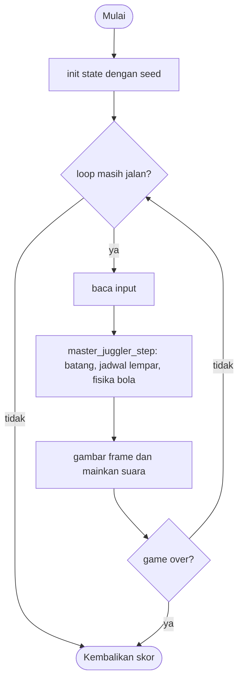

# Master Juggler - design brief

**Owner:** Leader  **Folder:** `games/master_juggler/`  **Created:** 2026-11-12  **Asal mekanik:** `g02_masterjuggler` di proyek `simple-games` (hanya aturan; tidak ada kode, gambar, suara, teks atau font yang disalin)

## Hook
Gerakkan trampolin dengan mouse dan pantulkan semua bola berkali-kali sampai berubah warna; makin tinggi level, makin banyak bola.

## Penjelasan sederhana
Sebuah batang (trampolin) mengikuti mouse. Bola dilempar ke atas dari batang itu. Tugasmu memantulkan tiap bola beberapa kali sebelum jatuh ke lantai: level 1 punya 1 bola dengan 3 pantulan, level 2 punya 2 bola dengan 6 pantulan, level 3 ke atas punya N bola dengan 9 pantulan. Bola berubah merah, kuning, hijau, lalu abu-abu dan memudar. Kalau semua bola level itu lolos, naik level. Kalau semua bola jatuh, kamu kehilangan 1 dari 3 nyawa dan mengulang level yang sama.

Di balik layar, `master_juggler_step()` memperbarui tiap bola dengan gravitasi, peredaman gerak mendatar, dan pantulan dinding, lalu menguji apakah bola menyentuh batang. Rumus pantulan memberi kecepatan mendatar sesuai jarak titik kena dari tengah batang, jadi kamu bisa "mengarahkan" bola. Seperti menjaga bola tetap di udara dengan raket yang kamu geser: kena di tepi, bola melenceng ke sana.

Kalau cuma punya 1 menit: geser batang ke bawah bola, pantulkan sampai bola abu-abu, klik untuk level berikutnya; tiga kali gagal total = selesai.

## Kontrol
Mouse: batang mengikuti posisi x pointer tanpa perlu klik. A/D atau panah kiri/kanan: menggeser batang saat pointer diam. Klik atau Spasi: mulai level (saat layar "click or Space to start").

## Aturan dan skor
- Level N melempar N bola; bola ke-i dilempar saat jam lempar `frmball >= (int)(100/N * i + 0.5)` (jam mulai di -10 tick).
- Gravitasi `0.2 * gheightf` per tick kuadrat, lemparan `-12 * gheightf`, redaman mendatar `0.98` per tick; dinding (x < 15 atau x > W-15): `spx *= -2.5` dan x dijepit.
- Pantulan: `|y - bar_y| < 20 * gheightf` dan `|x - bar_x| < 60`: `spy = -0.2*gheightf - spy`, `spx = (selisih_x + acak(-1..1)) / 10`.
- Tiap bola perlu `3 * min(N, 3)` pantulan; warna berubah di `mj`, `2*mj`, `3*mj`; bola selesai memudar 0.01 per tick dan tidak bisa hilang lagi.
- Bola pertama yang jatuh: semua bola menjadi abu-abu dan tidak ada pantulan lagi; saat semua bola level itu hilang, **nyawa berkurang 1** dan level diulang.
- **Nyawa habis (`MJ_LIVES = 3`): game selesai.** Menyelesaikan level 32 juga mengakhiri game.
- Setelah selesai, tampilan akhir 1.2 detik sebelum skor dicatat.
- **Skor = level tertinggi yang diselesaikan.**

## Cara kerja per frame
1. `arcade_poll()` mengisi `ArcadeInput`.
2. `master_juggler_step()`: batang mengikuti pointer jika pointer bergerak (atau frame pertama); jika tidak, A/D menggeser batang.
3. Jika `waiting`: klik atau Spasi memulai percobaan (`start_try`); selesai frame ini.
4. Jam lempar bertambah `dt * 50`; bola baru dilempar sesuai jadwal.
5. Tiap bola: `step_ball()` (gravitasi, gerak, dinding, memudar, jatuh, pantulan). Level selesai atau percobaan gagal menghentikan loop frame ini.
6. Front-end membandingkan `throws`, `hits`, `losses`, `levels_done`, `tries_lost` untuk suara dan menggambar bola menurut `master_juggler_stage()`.

## Peta file
| File | Isinya | Edit di sini kalau ... |
|---|---|---|
| `master_juggler_logic.h` | struct `master_juggler_State` dan fungsi publik (`init`, `init_sized`, `step`, `is_over`, `score`) | menambah field state atau fungsi publik |
| `master_juggler_logic.c` | semua aturan game (tanpa raylib) | mengubah aturan atau angka keseimbangan |
| `master_juggler_game.c` | loop raylib, menggambar, suara, `GameDef` (judul, kontrol di menu, urutan, ranked) | mengubah tampilan, suara, atau teks di menu |
| `tests/test_master_juggler.c` | unit test (hanya logic) | menambah atau mengubah aturan |
| `CMakeLists.txt` | mendaftarkan game lewat `arcade_add_game(...)` | menambah file `.c` atau test baru |
| `GAME.md` | dokumen ini | aturan atau kode berubah |
| `AGENTS.md` | instruksi untuk AI agent (tidak diterjemahkan) | jarang; ikuti aturan di file itu |

## Data penting (struct)
| Field | Tipe | Artinya |
|---|---|---|
| `w`, `h`, `base_h`, `bar_y`, `gh` | int, float | ukuran lapangan, tinggi lantai, y tepi atas batang, skala vertikal `gheightf` |
| `bar_x`, `last_aim_x`, `have_aim` | float, bool | posisi batang dan pelacak apakah pointer bergerak |
| `level`, `best`, `lives` | int | level dimainkan, level tertinggi selesai (= skor), nyawa |
| `waiting` | bool | layar "click or Space to start" |
| `nb`, `bl`, `mj` | int | bola dilempar, bola hilang, min(level, 3) |
| `frmball` | float | jam lempar, mulai -10 |
| `x[]`, `y[]`, `spx[]`, `spy[]`, `alpha[]` | float[32] | posisi, kecepatan, dan kepudaran tiap bola |
| `bounces[]`, `visible[]` | int[32], bool[32] | jumlah pantulan dan apakah bola masih ada |
| `first_lost` | bool | bola pertama sudah jatuh: semua abu-abu, tanpa pantulan |
| `since_bounce` | float | detik sejak pantulan terakhir (animasi pegas) |
| `over`, `capped`, `over_t` | bool, float | status akhir dan waktu sejak akhir |
| `throws`, `hits`, `losses`, `levels_done`, `tries_lost` | int | penghitung kejadian untuk suara |

## Fungsi-fungsi penting
| Fungsi | Tugas | Dipanggil dari |
|---|---|---|
| `master_juggler_stage` | tahap warna 0..3 dari jumlah pantulan dan level | front-end, tes |
| `master_juggler_launch_tick` | tick lemparan bola ke-i | `step`, tes |
| `move_bar` | batang mengikuti pointer atau keyboard, dijepit di dalam lapangan | `step` |
| `start_try`, `new_ball` | memulai percobaan dan melempar bola | `step` |
| `step_ball` | fisika satu bola dan aturan jatuh, pantul, memudar | `step` |
| `level_complete`, `try_failed` | naik level (atau berakhir di level 32) dan kehilangan nyawa | `step_ball` |

## Angka yang bisa diutak-atik
| Konstanta | Nilai sekarang | File | Efek kalau diubah |
|---|---|---|---|
| `MJ_LIVES` | 3 | `master_juggler_logic.h` | jumlah percobaan gagal sebelum game selesai (ATURAN BARU) |
| `MJ_MAX_LEVEL` | 32 | `master_juggler_logic.h` | level terakhir dan batas array bola |
| `MJ_KEY_SPEED` | 420 px/detik | `master_juggler_logic.c` | kecepatan batang dengan keyboard |
| `MJ_BAR_HIT_HALF_W` | 60 px | `master_juggler_logic.c` | setengah lebar area pantul batang |
| `MJ_OVER_DELAY` | 1.2 s | `master_juggler_logic.h` | lama tampilan akhir sebelum skor dicatat |
| angka `-2.5`, `0.98`, `0.2`, `-12` | di `step_ball`, `new_ball` | `master_juggler_logic.c` | pantulan dinding, redaman, gravitasi, kecepatan lempar |

## Cara menjalankan dan menguji
```bash
# test logic saja (tanpa raylib, ~1 detik)
cmake --preset logic && cmake --build --preset logic && ctest --preset logic -R "^master_juggler\."

# main game-nya
cmake --preset dev && cmake --build --preset dev && build/dev/bin/arCade

# smoke run headless: jalankan game 300 frame dan simpan screenshot PNG
cmake --preset headless && cmake --build --preset headless && build/headless/bin/arCade --smoke master_juggler --frames 300 --out smoke-out
```

| Test | Menjaga aturan apa |
|---|---|
| `test_spec_constants_at_480x800` | BASEH 133.33, BARY 634.67, gheightf 1.58476, lemparan -19.017, gravitasi 0.31695 |
| `test_launch_schedule_level_3`, `test_level_n_throws_n_balls` | jadwal 10, 43, 77 tick; level N melempar N bola |
| `test_free_flight_apex` | puncak lintasan sekitar 60 tick (118.7 px, hasil integrasi per tick) |
| `test_bounce_formula_and_offsets`, `test_no_bounce_outside_the_bar_width` | rumus pantulan dan lebar batang (offset 30 dan 59, 61 tidak memantul) |
| `test_wall_bounce_speeds_up`, `test_damping_is_098_per_tick` | dinding mengali -2.5; redaman sama di 50 Hz dan 60 Hz |
| `test_colour_stages_by_level` | kuning/hijau/abu-abu di mj, 2mj, 3mj untuk level 1, 2, 3+ |
| `test_a_following_player_completes_level_1`, `..._level_3` | pemain skrip yang mengikuti bola menyelesaikan level |
| `test_first_lost_ball_turns_everything_grey_and_stops_bouncing` | bola pertama jatuh: abu-abu dan tanpa pantulan |
| `test_all_balls_lost_costs_a_life_and_repeats_the_level` | semua bola hilang: nyawa -1, level sama |
| `test_zero_lives_ends_the_game_with_the_best_level`, `test_level_32_completion_ends_the_game` | nyawa 0 dan level 32 mengakhiri game |
| `test_hover_and_keyboard_control_of_the_bar` | hover tanpa klik, keyboard hanya saat pointer diam, batang tidak keluar lapangan |
| `test_same_seed_same_result`, `test_monkey_never_breaks_invariants` | deterministik; 20 seed x 5000 frame tanpa NaN |

## Jebakan dan hal yang perlu diingat
- ATURAN BARU: aslinya game ini tidak pernah berakhir (gagal hanya mengulang level). arCade butuh akhir, jadi ada 3 nyawa (`MJ_LIVES`). Skor tetap level tertinggi yang diselesaikan. Mudah diubah di satu konstanta.
- Batas 32 bola/level: menyelesaikan level 32 mengakhiri game (aslinya akan keluar dari array).
- Puncak lintasan di 480 x 800 adalah 118.7 px (hasil integrasi per tick yang sama dengan aslinya), bukan 109 px dari rumus kontinu `v^2 / 2g` yang tertulis di spesifikasi.
- Penyimpangan dari simple-games: satu bunyi pantul per pantulan (kebiasaan menguji bola terakhir dibuang), tanpa gulungan drum dan tepuk tangan; klik atau Spasi memulai level.
- Penyimpangan: batang dijepit agar seluruhnya di dalam lapangan (aslinya tanpa batas); bola di dinding (x = 15) tetap terjangkau karena jangkauan 60 px.
- Penyimpangan: redaman memakai `powf(0.98, k)`, pegas hanya hiasan dan dihitung dari `since_bounce`; tidak ada layar skor terpisah.
- Perlu uji main oleh manusia: rasa fisika (gravitasi, pantulan dinding, kecepatan batang keyboard) tidak bisa dinilai lewat tes.

## Langkah implementasi (Implementation steps)
1. Aturan sudah ada di `master_juggler_State` dan `master_juggler_step()` (hanya di logic). Konstanta ditulis sebagai `#define` di `master_juggler_logic.c`.
2. Setiap aturan punya unit test di `tests/test_master_juggler.c`; tes memakai `master_juggler_init_sized(480, 800)` supaya vektor uji spesifikasi asli berlaku apa adanya.
3. Tampilan ada di `master_juggler_game.c`: panel 480 x 684 di tengah, aturan di gutter kiri, statistik di gutter kanan. Suara dibuat dari `gfx_make_tone()`.
4. Kalau menambah aturan: tulis tesnya dulu, lalu ubah logic, lalu perbarui bagian Jebakan dan tabel di dokumen ini.

## Pseudocode (untuk laporan)
```
PROSEDUR step(s, input, dt)
    JIKA over MAKA over_t += dt; KEMBALI
    gerakkan batang (pointer atau keyboard)
    JIKA waiting MAKA JIKA klik atau Spasi MAKA mulai percobaan; KEMBALI
    frmball += dt * 50
    JIKA bola berikutnya sudah waktunya MAKA lempar
    UNTUK setiap bola i yang terlihat
        gravitasi, redaman, gerak, dinding
        JIKA selesai (pantulan >= 3*mj) MAKA memudar; JIKA bola terakhir hilang MAKA level naik
        SELAIN ITU JIKA jatuh MAKA bl += 1; JIKA semua hilang MAKA nyawa -= 1
        SELAIN ITU JIKA kena batang MAKA pantulkan
AKHIR PROSEDUR
```

## Flowchart (untuk laporan)


## Konsep kuliah yang dipakai (untuk Bab I laporan)
| Konsep (Pertemuan) | Di mana (file : fungsi) |
|---|---|
| Struct (13) | `master_juggler_logic.h` : `master_juggler_State` |
| Array (9) | `master_juggler_logic.h` : `x[]`, `y[]`, `spx[]`, `spy[]`, `bounces[]` (32 bola) |
| Perulangan (6-7) | `master_juggler_logic.c` : loop bola di `step`, `start_try` |
| Percabangan (5) | `master_juggler_logic.c` : `step_ball` (memudar, jatuh, pantul) |
| Fungsi (11) | `master_juggler_logic.c` : `master_juggler_stage`, `level_complete`, `try_failed` |
| Fisika dan tipe data (3-4) | `master_juggler_logic.c` : gravitasi, redaman `powf`, `float` per bola |
