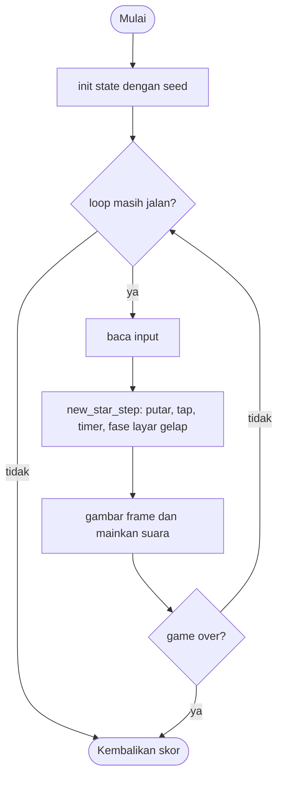

# New Star - design brief

**Owner:** Leader  **Folder:** `games/new_star/`  **Created:** 2026-11-12  **Asal mekanik:** `g10_newstar` di proyek `simple-games` (hanya aturan; tidak ada kode, gambar, suara, teks atau font yang disalin)

## Hook
Tiap ronde layar menggelap dan satu bintang baru muncul. Ketuk bintang yang baru saja muncul; mengetuk bintang lama mengakhiri permainan.

## Penjelasan sederhana
Ronde pertama hanya ada satu bintang di tengah. Ketuk, lalu layar memudar menjadi gelap, bintang kedua ditambahkan di tempat acak, dan layar kembali terang. Sekarang kamu harus mengetuk bintang yang BARU saja muncul. Tiap ronde menambah satu bintang. Mengetuk bintang yang sudah dikonfirmasi mengakhiri game. Mulai bintang ke-10, tiap ronde punya batas waktu: alarm setelah 10 detik, game selesai setelah 15 detik.

Di balik layar, `new_star_step()` menghitung waktu fase layar gelap dengan detik yang dijumlahkan dari `dt`, membuat bintang baru tepat di tengah fase gelap (1.05 detik setelah ketukan benar), dan baru mau menerima ketukan setelah 1.4 detik. Posisi bintang dipilih acak dengan penolakan: tidak boleh dekat angka skor atau menimpa bintang lain. Seperti permainan memori: kamu harus mengingat mana yang sudah kamu lihat.

Kalau cuma punya 1 menit: ketuk satu-satunya bintang, perhatikan bintang yang muncul saat layar gelap, ketuk bintang baru itu, ulangi.

## Kontrol
Klik mouse pada bintang. Klik di luar lapangan (gutter) diabaikan, dan semua klik diabaikan selama 1.4 detik pertama setelah ketukan benar. Area ketuk bintang adalah kotak selebar bintang ditambah 10 px di tiap sisi (rotasi diabaikan).

## Aturan dan skor
- Bintang 0 selalu di tengah, tipe 5, ukuran 56 px. Bintang berikutnya: posisi acak `x` di 38..W-38, `y` di 78..H-38, tipe acak 0..5 (ukuran 40, 32, 56, 48, 48, 56 px).
- Penolakan posisi (maksimum 2000 percobaan, lalu kandidat terakhir diterima): tidak boleh `|x - W/2| < 100` dan `|y - H/8| < 60` (zona angka skor), dan jarak ke tiap bintang lama harus `> (ukuran_baru + ukuran_lama) / 1.8`.
- Ketukan benar pada bintang baru: `score++`, layar gelap mulai. Alpha layar gelap: `sin(t * pi/2)` sampai 0.999 detik, 1.0 sampai 1.199, `sin((2.2 - t) * pi/2)` sampai 2.199, lalu hilang.
- Bintang baru dibuat saat `t >= 1.05` detik; ketukan diabaikan selama layar gelap tampil dan `t < 1.4` detik.
- Mengetuk bintang lama (yang sudah dikonfirmasi) mengakhiri game; mengetuk tempat kosong tidak berbuat apa-apa.
- Mulai bintang ke-10 (dan tidak sedang layar gelap): 10.001 detik sejak bintang muncul atau ketukan benar terakhir = alarm dan bintang bergetar; 15.001 detik = **game selesai**.
- Semua bintang berputar 150 derajat per detik searah jarum jam; wajah tidak berputar. Setelah selesai, bintang yang seharusnya diketuk berkedip 1.5 detik.
- Batas 512 bintang: mengonfirmasi bintang ke-512 mengakhiri game.
- **Skor = jumlah bintang baru yang ditemukan.**

## Cara kerja per frame
1. `arcade_poll()` mengisi `ArcadeInput`.
2. `new_star_step()`: bintang terbaru selalu berputar; jika `fire_pressed`, posisi mouse diubah ke koordinat lapangan dan `new_star_tap()` dipanggil.
3. Semua bintang berputar; jika alarm, tiap bintang digeser acak ke samping.
4. Waktu ronde `new_t` dan waktu layar gelap `phase_t` bertambah; mulai bintang ke-10 dicek alarm dan batas waktu.
5. Fase layar gelap: setelah 1.05 detik, jika semua bintang sudah dikonfirmasi, `new_star()` membuat bintang berikutnya; setelah 2.199 detik layar gelap hilang.
6. Front-end membandingkan `corrects`, `created`, `alarms` untuk suara dan menggambar bintang, wajah, dan layar gelap (`new_star_overlay_alpha`).

## Peta file
| File | Isinya | Edit di sini kalau ... |
|---|---|---|
| `new_star_logic.h` | struct `new_star_State` dan fungsi publik (`init`, `init_sized`, `step`, `is_over`, `score`) | menambah field state atau fungsi publik |
| `new_star_logic.c` | semua aturan game (tanpa raylib) | mengubah aturan atau angka keseimbangan |
| `new_star_game.c` | loop raylib, menggambar, suara, `GameDef` (judul, kontrol di menu, urutan, ranked) | mengubah tampilan, suara, atau teks di menu |
| `tests/test_new_star.c` | unit test (hanya logic) | menambah atau mengubah aturan |
| `CMakeLists.txt` | mendaftarkan game lewat `arcade_add_game(...)` | menambah file `.c` atau test baru |
| `GAME.md` | dokumen ini | aturan atau kode berubah |
| `AGENTS.md` | instruksi untuk AI agent (tidak diterjemahkan) | jarang; ikuti aturan di file itu |

## Data penting (struct)
| Field | Tipe | Artinya |
|---|---|---|
| `w`, `h`, `score_pos` | int, Vec2 | ukuran lapangan dan pusat zona angka skor (W/2, H/8) |
| `n`, `score` | int | bintang yang sudah dibuat dan yang sudah dikonfirmasi (= indeks bintang yang harus diketuk) |
| `x[]`, `y[]`, `size[]`, `type[]` | float[512], int[512] | posisi tetap, ukuran, dan tipe tiap bintang |
| `rot[]`, `shake[]` | float[512] | rotasi (derajat) dan geseran getar tiap bintang |
| `overlay`, `phase_t` | bool, float | layar gelap tampil dan detik sejak ketukan benar |
| `new_t`, `alarm` | float, bool | detik sejak bintang muncul atau ketukan benar, dan alarm sudah menyala |
| `over`, `capped`, `timed_out`, `over_t` | bool, float | alasan akhir dan waktu sejak akhir (kedip) |
| `corrects`, `alarms`, `created` | int | penghitung kejadian untuk suara |

## Fungsi-fungsi penting
| Fungsi | Tugas | Dipanggil dari |
|---|---|---|
| `new_star_overlay_alpha`, `new_star_overlay_visible` | alpha dan visibilitas layar gelap menurut waktu | `step`, front-end, tes |
| `new_star_type_size` | ukuran bintang menurut tipe | `new_star`, tes |
| `new_star` | membuat bintang berikutnya dengan penolakan posisi | `init_sized`, `step` |
| `new_star_tap` | ketukan: benar, bintang lama, atau tidak ada | `step`, tes |
| `new_star_step` | rotasi, getar, timer, fase layar gelap | `play()` |

## Angka yang bisa diutak-atik
| Konstanta | Nilai sekarang | File | Efek kalau diubah |
|---|---|---|---|
| `NS_TIMED_FROM` | 10 | `new_star_logic.h` | mulai bintang ke berapa ada batas waktu |
| `NS_ALARM_TIME`, `NS_LIMIT_TIME` | 10.001 s, 15.001 s | `new_star_logic.h` | kapan alarm dan kapan game selesai |
| `NS_TAP_TOLERANCE` | 10 px | `new_star_logic.h` | kelonggaran ketukan di tiap sisi bintang |
| `NS_ROT_SPEED` | 150 derajat/detik | `new_star_logic.h` | kecepatan putar semua bintang |
| `NS_CREATE_T`, `NS_LOCK_T` | 1.05 s, 1.4 s | `new_star_logic.c` | kapan bintang baru muncul dan kapan ketukan diterima lagi |
| `NS_OVER_DELAY` | 1.5 s | `new_star_logic.h` | lama bintang yang terlewat berkedip sebelum skor dicatat |

## Cara menjalankan dan menguji
```bash
# test logic saja (tanpa raylib, ~1 detik)
cmake --preset logic && cmake --build --preset logic && ctest --preset logic -R "^new_star\."

# main game-nya
cmake --preset dev && cmake --build --preset dev && build/dev/bin/arCade

# smoke run headless: jalankan game 300 frame dan simpan screenshot PNG
cmake --preset headless && cmake --build --preset headless && build/headless/bin/arCade --smoke new_star --frames 300 --out smoke-out
```

| Test | Menjaga aturan apa |
|---|---|
| `test_first_star_at_480x800`, `test_star_type_sizes` | bintang 0 di (240, 400) tipe 5 ukuran 56; ukuran tipe |
| `test_overlay_alpha_vectors` | 0.5 s = 0.7071, 1.1 s = 1.0, 1.7 s = 0.7071, 2.2 s hilang |
| `test_new_star_appears_at_1_05_seconds` | bintang baru muncul di 1.05 detik, layar gelap hilang setelah 2.2 detik |
| `test_taps_are_ignored_for_the_first_1_4_seconds` | ketukan pertama diterima mulai 1.4 detik |
| `test_hit_box_edges` | kotak ketuk +-30 px di sekitar bintang 40 px di (100, 100) |
| `test_clicks_in_the_gutters_are_ignored` | klik di gutter diabaikan |
| `test_tapping_an_old_star_ends_the_game`, `test_tapping_nothing_does_nothing`, `test_old_star_taps_are_ignored_during_the_overlay` | bintang lama mengakhiri game setelah kedip; tempat kosong dan layar gelap diabaikan |
| `test_no_time_limit_before_the_10th_star`, `test_10th_star_alarm_and_timeout` | tanpa batas sebelum bintang ke-10; alarm 10.001 s dan selesai 15.001 s |
| `test_new_star_resets_the_shake_and_the_alarm` | bintang baru menghapus alarm dan getar |
| `test_all_stars_rotate_150_deg_per_second` | semua bintang berputar sama |
| `test_placement_invariants` | 30 seed x 25 bintang: dalam batas, di luar zona skor, jarak antar bintang > (w_i + w_j) / 1.8 |
| `test_cap_of_512_stars_ends_the_game` | bintang ke-512 mengakhiri game |
| `test_same_seed_same_result`, `test_monkey_never_breaks_invariants` | deterministik; 20 seed x 5000 frame tanpa NaN |

## Jebakan dan hal yang perlu diingat
- Semua waktu berasal dari penjumlahan `dt` (detik); ambang milidetik asli (999, 1199, 1050, 1400, 2199, 10001, 15001) diubah apa adanya menjadi detik.
- Penghitung 10 dan 15 detik dihitung sejak bintang muncul (1.05 detik setelah ketukan) atau ketukan benar, bukan sejak layar gelap berakhir; hanya dicek saat layar gelap tidak tampil.
- Kotak ketuk tidak berputar (kotak lurus bintang + 10 px), sama seperti aslinya.
- Penyimpangan dari simple-games: klik diproses saat ditekan (aslinya saat dilepas) dan klik di gutter diabaikan; batas 512 bintang mengakhiri game (aslinya macet di layar gelap).
- Penyimpangan: bintang digambar sebagai poligon (jumlah titik, jari-jari dalam, dan warna per tipe) dengan wajah garis sederhana, bukan gambar; alarm berupa bunyi pendek berulang tiap 0.5 detik.
- Penyimpangan: bintang yang terlewat berkedip hitam 0.3 detik dan putih 0.7 detik selama 1.5 detik (jeda tampil) sebelum skor dicatat.
- Getar saat alarm adalah geseran acak per frame, jadi di 60 fps sedikit berbeda dengan 50 fps; hanya kosmetik.

## Langkah implementasi (Implementation steps)
1. Aturan sudah ada di `new_star_State` dan `new_star_step()` (hanya di logic). Konstanta ditulis sebagai `#define` di `new_star_logic.c`.
2. Setiap aturan punya unit test di `tests/test_new_star.c`; tes memakai `new_star_init_sized(480, 800)` supaya vektor uji spesifikasi asli berlaku apa adanya.
3. Tampilan ada di `new_star_game.c`: panel 480 x 684 di tengah, aturan di gutter kiri, statistik di gutter kanan. Suara dibuat dari `gfx_make_tone()`.
4. Kalau menambah aturan: tulis tesnya dulu, lalu ubah logic, lalu perbarui bagian Jebakan dan tabel di dokumen ini.

## Pseudocode (untuk laporan)
```
PROSEDUR tap(s, x, y)
    JIKA over ATAU di luar lapangan ATAU (layar gelap DAN t < 1.4) MAKA KEMBALI
    JIKA kena bintang[score] MAKA score += 1; mulai layar gelap; new_t = 0
    SELAIN ITU UNTUK setiap bintang lama j < score: JIKA kena MAKA over = benar

PROSEDUR step(s, input, dt)
    semua bintang berputar 150 * dt; JIKA ada klik MAKA tap
    JIKA alarm MAKA geser acak
    JIKA n >= 10 DAN tanpa layar gelap MAKA cek alarm (10.001) dan batas (15.001)
    JIKA layar gelap MAKA phase_t += dt; JIKA phase_t >= 1.05 DAN n == score MAKA bintang baru
```

## Flowchart (untuk laporan)


## Konsep kuliah yang dipakai (untuk Bab I laporan)
| Konsep (Pertemuan) | Di mana (file : fungsi) |
|---|---|
| Struct (13) | `new_star_logic.h` : `new_star_State` |
| Array (9) | `new_star_logic.h` : `x[]`, `y[]`, `size[]`, `type[]` (512 bintang); `k_size_factor[]` |
| Perulangan (6-7) | `new_star_logic.c` : `new_star` (pengulangan dengan penolakan sampai 2000 kali) |
| Percabangan (5) | `new_star_logic.c` : `new_star_tap` (benar, bintang lama, kosong) |
| Fungsi (11) | `new_star_logic.c` : `new_star_overlay_alpha`, `star_hit`, `overlaps_old_star` |
| Acak dan trigonometri (3-4) | `new_star_logic.c` : `rng_range`, `sinf` untuk pudar layar gelap |
