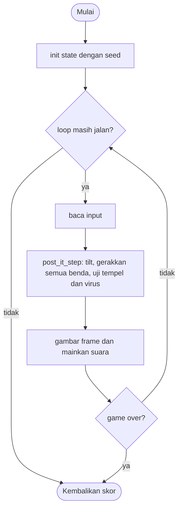

# Post It - design brief

**Owner:** Leader  **Folder:** `games/post_it/`  **Created:** 2026-11-12  **Asal mekanik:** `g01_grabgreen` di proyek `simple-games` (hanya aturan; tidak ada kode, gambar, suara, teks atau font yang disalin)

## Hook
Satu post-it kuning di tengah. Miringkan dunia dengan mouse, tempelkan post-it berwarna ke gugusanmu, dan jangan sampai virus menyentuh satu pun.

## Penjelasan sederhana
Di tengah lapangan ada satu post-it kuning (kepala). Ada 8 post-it berwarna dan 16 virus merah yang melayang. Kamu tidak menggerakkan kepala; kamu "memiringkan dunia": geser mouse menjauh dari tengah, atau tekan panah/WASD, dan semua benda hanyut ke arah itu. Post-it yang menyentuh bagian mana pun dari gugusanmu menempel (+1). Virus yang menyentuh bagian mana pun mengakhiri game.

Di balik layar, `post_it_step()` mengubah posisi mouse menjadi "kemiringan" (tilt) lewat fungsi murni, lalu menggeser tiap benda: gerak dunia ditambah gerak sendiri setengah kecepatan. Benda yang keluar lapangan muncul lagi dari sisi seberang dengan arah baru. Seperti meja dengan kelereng yang kamu miringkan: kelereng baik dikumpulkan, kelereng jahat dihindari.

Kalau cuma punya 1 menit: geser mouse sedikit dari tengah untuk menyapu post-it ke gugusanmu, jauhkan virus merah, klik atau tekan P untuk jeda.

## Kontrol
Mouse: offset pointer dari tengah lapangan = kemiringan (240 px = tilt 1.0, tersaturasi di 120 px). Panah atau WASD yang ditahan menggantikan mouse (kemiringan setengah penuh). Klik atau tombol P: jeda dan lanjut.

## Aturan dan skor
- Kemiringan `(ax, ay)` dijepit ke +-0.5 lalu dikali 8: `spx = ax * 8`, `spy = -ay * 8` piksel per tick asli.
- Tiap benda bergerak `(spx, spy)` ditambah arah sendiri dengan kecepatan setengah dari `v = |(spx, spy)|`; di luar -16..W+16 benda muncul di sisi seberang dengan arah acak baru.
- 8 post-it diproses lebih dulu (uji tempel di dalam loop-nya), lalu 16 virus.
- Post-it jarak < 24 px dari blok mana pun: menempel, `blockn++`, post-it baru muncul acak.
- Virus jarak < 24 px dari blok mana pun: **game selesai**. Jarak < 48 px: virus berkedip dan alarm berbunyi.
- Virus awal selalu >= 144 px dari kepala. Gugusan penuh 256 blok juga mengakhiri game.
- Setelah selesai, virus pembunuh dilingkari 1.0 detik sebelum skor dicatat.
- **Skor = jumlah blok gugusan (mulai dari 1).**

## Cara kerja per frame
1. `arcade_poll()` mengisi `ArcadeInput`.
2. `post_it_step()`: klik atau P membalik `paused`; jika jeda, selesai.
3. `post_it_tilt_from_input()` lalu `post_it_drift_from_tilt()` menghasilkan `spx`, `spy`.
4. Untuk tiap post-it: `move_item()` lalu `test_green()`. Lalu tiap virus: `move_item()` lalu `test_red()`.
5. Hitung `near_count`; jika blok mencapai 256, `capped`.
6. Front-end membandingkan `grabs` untuk nada, mengulang bunyi alarm saat `near_count > 0`, lalu menggambar (area lapangan dipotong dengan scissor).

## Peta file
| File | Isinya | Edit di sini kalau ... |
|---|---|---|
| `post_it_logic.h` | struct `post_it_State` dan fungsi publik (`init`, `init_sized`, `step`, `is_over`, `score`) | menambah field state atau fungsi publik |
| `post_it_logic.c` | semua aturan game (tanpa raylib) | mengubah aturan atau angka keseimbangan |
| `post_it_game.c` | loop raylib, menggambar, suara, `GameDef` (judul, kontrol di menu, urutan, ranked) | mengubah tampilan, suara, atau teks di menu |
| `tests/test_post_it.c` | unit test (hanya logic) | menambah atau mengubah aturan |
| `CMakeLists.txt` | mendaftarkan game lewat `arcade_add_game(...)` | menambah file `.c` atau test baru |
| `GAME.md` | dokumen ini | aturan atau kode berubah |
| `AGENTS.md` | instruksi untuk AI agent (tidak diterjemahkan) | jarang; ikuti aturan di file itu |

## Data penting (struct)
| Field | Tipe | Artinya |
|---|---|---|
| `w`, `h`, `head` | int, Vec2 | ukuran lapangan dan posisi kepala (tengah, tidak pernah bergerak) |
| `spx`, `spy`, `tilt_x`, `tilt_y` | float | hanyut dunia (px per tick asli) dan kemiringan terakhir |
| `blockn` | int | jumlah blok gugusan = skor |
| `bx[]`, `by[]`, `brot[]`, `bcol[]` | float[256], int[256] | posisi, rotasi (derajat), indeks warna tiap blok; blok 0 = kepala |
| `gx[]`, `gy[]`, `grot[]`, `gcol[]` | float[8], int[8] | post-it bebas |
| `rx[]`, `ry[]`, `rrot[]`, `rnear[]` | float[16], bool[16] | virus dan penanda dekat gugusan |
| `near_count` | int | banyak virus dekat; alarm berbunyi selagi > 0 |
| `paused`, `over`, `capped`, `killer`, `over_t` | bool, int, float | jeda, status akhir, indeks virus pembunuh, waktu sejak selesai |
| `grabs`, `last_note` | int | penghitung kejadian untuk suara; nada 0..7 |

## Fungsi-fungsi penting
| Fungsi | Tugas | Dipanggil dari |
|---|---|---|
| `post_it_tilt_from_input` | pointer atau tombol menjadi kemiringan (-1..1) | `step`, tes |
| `post_it_drift_from_tilt` | kemiringan menjadi hanyut (jepit 0.5, kali 8, y dibalik) | `step`, tes |
| `post_it_scale_index` | indeks nada 1..8 menurut ukuran gugusan | `grab_green`, tes |
| `move_item` | hanyut dunia + arah sendiri + bungkus tepi | `step` |
| `test_green`, `grab_green`, `test_red` | uji tempel, menempelkan blok, uji virus | `step` |
| `post_it_step` | jeda, kemiringan, semua benda, batas 256 | `play()` |

## Angka yang bisa diutak-atik
| Konstanta | Nilai sekarang | File | Efek kalau diubah |
|---|---|---|---|
| `PI_HIT_R` | 24 px | `post_it_logic.h` | jarak tempel dan jarak mati |
| `PI_NEAR_R` | 48 px | `post_it_logic.h` | jarak virus berkedip dan alarm |
| `PI_MAX_BLOCKS` | 256 | `post_it_logic.h` | batas array dan akhir game |
| `PI_ACC_PX` | 240 px | `post_it_logic.c` | seberapa jauh offset mouse untuk tilt 1.0 (lebih besar = lebih halus) |
| `PI_MIN_VIRUS_DIST` | 144 px | `post_it_logic.c` | jarak aman virus saat awal |
| angka langsung `8.0`, `0.5` | di `drift_from_tilt`, `move_item` | `post_it_logic.c` | kecepatan hanyut maksimum dan fraksi gerak sendiri |

## Cara menjalankan dan menguji
```bash
# test logic saja (tanpa raylib, ~1 detik)
cmake --preset logic && cmake --build --preset logic && ctest --preset logic -R "^post_it\."

# main game-nya
cmake --preset dev && cmake --build --preset dev && build/dev/bin/arCade

# smoke run headless: jalankan game 300 frame dan simpan screenshot PNG
cmake --preset headless && cmake --build --preset headless && build/headless/bin/arCade --smoke post_it --frames 300 --out smoke-out
```

| Test | Menjaga aturan apa |
|---|---|
| `test_viruses_start_at_least_144_px_from_the_head` | 40 seed: virus awal jauh dari kepala |
| `test_tilt_to_drift_vectors` | (0.3, -0.2) menjadi (2.4, 1.6); 1.0 dijepit jadi 4 |
| `test_pointer_and_keys_to_tilt` | pointer di tengah = 0, 120 px = 0.5, tombol menimpa pointer |
| `test_scale_index_vectors` | 2, 8, 9, 10, 15, 16, 17, 18 sesuai spesifikasi |
| `test_item_moves_with_world_plus_half_speed_heading` | gerak dunia ditambah arah sendiri 1.442 px |
| `test_wrap_uses_a_new_heading` | 497 menjadi -14 dengan arah baru; sisi lain dan sumbu y |
| `test_grab_radius_23_9_versus_24`, `test_any_block_counts_not_only_the_head` | jarak tempel dan semua blok dihitung |
| `test_virus_kill_and_warning_radii` | 47.9 dekat, 48.0 tidak, 24.0 aman, 23.9 mati, lalu jeda tampil |
| `test_cluster_cap_ends_the_game` | 256 blok mengakhiri game |
| `test_pause_by_key_and_click` | P dan klik menjeda dan melanjutkan |
| `test_dt_consistency` | satu detik di 50 Hz dan 60 Hz berakhir di tempat yang sama |
| `test_zero_tilt_freezes_the_world`, `test_constant_tilt_player_ends_the_game` | tanpa tilt tidak ada gerak; pemain skrip berakhir sendiri |
| `test_same_seed_same_result`, `test_monkey_never_breaks_invariants` | deterministik; 20 seed x 5000 frame, semua benda dalam batas |

## Jebakan dan hal yang perlu diingat
- Gugusan tidak bergerak; yang bergerak adalah post-it dan virus. Tanpa kemiringan (v = 0) seluruh dunia berhenti, jadi tidak ada yang bisa menyentuh siapa pun.
- Urutan penting: semua post-it dulu, lalu virus; `blockn` bisa bertambah di tengah loop dan post-it yang baru muncul tetap diuji terhadap blok sisanya.
- Penyimpangan dari simple-games: kemiringan ditiru dari mouse atau tombol (tidak ada akselerometer), layar onboarding akselerometer dihapus.
- Penyimpangan: batas 256 blok mengakhiri game (aslinya crash di blok ke-257); jeda tampil 1.0 detik untuk melingkari virus pembunuh.
- Penyimpangan: jeda lewat klik atau tombol P (aslinya ketuk di mana saja saat dilepas); kedipan virus dihitung dari waktu di front-end tanpa batas 8 virus; alarm berupa bunyi pendek berulang.
- Mouse di luar lapangan (di gutter) tetap dihitung sebagai offset dan menjenuh di tilt maksimum.
- Warna post-it adalah palet neon buatan sendiri, bukan warna aplikasi asli.

## Langkah implementasi (Implementation steps)
1. Aturan sudah ada di `post_it_State` dan `post_it_step()` (hanya di logic). Konstanta ditulis sebagai `#define` di `post_it_logic.c`.
2. Setiap aturan punya unit test di `tests/test_post_it.c`; tes memakai `post_it_init_sized(480, 800)` supaya vektor uji spesifikasi asli berlaku apa adanya.
3. Tampilan ada di `post_it_game.c`: panel 480 x 684 di tengah, aturan di gutter kiri, statistik di gutter kanan. Suara dibuat dari `gfx_make_tone()`.
4. Kalau menambah aturan: tulis tesnya dulu, lalu ubah logic, lalu perbarui bagian Jebakan dan tabel di dokumen ini.

## Pseudocode (untuk laporan)
```
PROSEDUR step(s, input, dt)
    JIKA over MAKA over_t += dt; KEMBALI
    JIKA klik atau tombol P MAKA paused = NOT paused
    JIKA paused MAKA KEMBALI
    (ax, ay) = tilt dari input; (spx, spy) = hanyut dari tilt
    k = dt * 50
    UNTUK setiap post-it i: move_item; UNTUK j = 0 .. blockn-1: JIKA jarak < 24 MAKA tempel(i)
    UNTUK setiap virus i: move_item; JIKA jarak < 24 ke blok mana pun MAKA over = benar
    near_count = jumlah virus dengan jarak < 48
    JIKA blockn >= 256 MAKA over = benar
AKHIR PROSEDUR
```

## Flowchart (untuk laporan)


## Konsep kuliah yang dipakai (untuk Bab I laporan)
| Konsep (Pertemuan) | Di mana (file : fungsi) |
|---|---|
| Struct (13) | `post_it_logic.h` : `post_it_State` |
| Array (9) | `post_it_logic.h` : `bx[]`, `gx[]`, `rx[]` dengan batas konstanta `PI_*` |
| Perulangan (6-7) | `post_it_logic.c` : `test_green` (loop dalam dengan batas yang tumbuh), `post_it_step` |
| Percabangan (5) | `post_it_logic.c` : `move_item` (empat sisi bungkus) |
| Fungsi (11) | `post_it_logic.c` : `post_it_scale_index`, `post_it_drift_from_tilt` |
| Pointer (12) | `post_it_tilt_from_input(..., float *ax, float *ay)` mengisi dua hasil |
