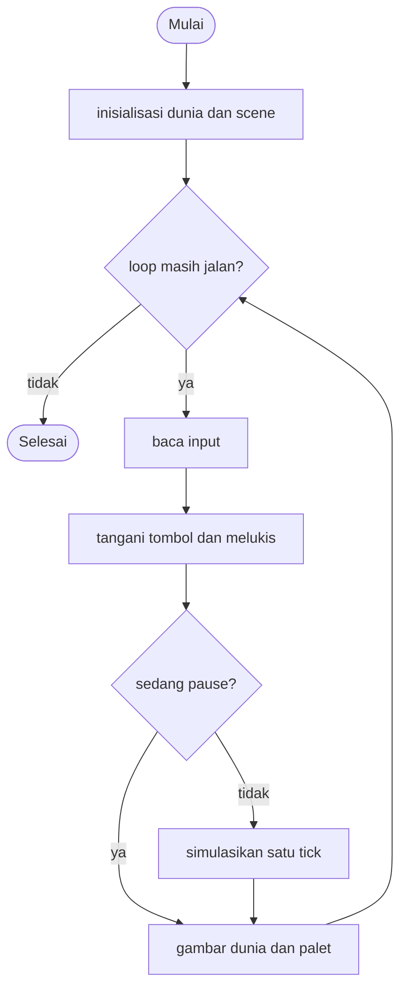

# Sandbox - design brief

**Owner:** Leader  **Folder:** `games/sandbox/`  **Status:** v1 sudah jalan (unranked)

## Hook
Mainan falling-sand (pasir jatuh). Engine yang sama (`core/sandbox.[ch]`) juga menganimasikan background hub, jadi menambah elemen akan memperbaiki keduanya.

## Penjelasan sederhana
Bayangkan akuarium pasir dua dimensi yang terdiri dari kotak-kotak kecil. Setiap kotak (sel) berisi salah satu dari: kosong, pasir, air, atau batu. Dunia ini 320 x 180 sel, dan tiap sel digambar sebesar 4 x 4 piksel sehingga memenuhi layar 1280 x 720.

Tidak ada "fisika" sungguhan. Aturannya sangat sederhana dan dijalankan untuk setiap sel, dari baris paling bawah ke atas, satu kali per frame: pasir dan air mencoba turun satu kotak; kalau terhalang, mereka mencoba turun miring ke kiri atau kanan; khusus air, kalau masih terhalang, ia bergeser ke samping. Pasir lebih berat daripada air, jadi pasir bisa "menembus" air (keduanya bertukar tempat). Batu tidak pernah bergerak. Dari tiga aturan itu saja muncul gundukan pasir, genangan air yang rata, dan pasir yang tenggelam.

Pemain melukis elemen dengan mouse kiri, menghapus dengan mouse kanan, dan memilih elemen dengan tombol angka atau scroll mouse. Tidak ada menang atau kalah.

Kodenya dibagi tiga lapis: `core/src/sandbox.c` (engine murni: aturan gerak sel, dipakai bersama dengan background hub), `games/sandbox/sandbox_logic.c` (input pemain: memilih elemen, ukuran kuas, pause, melukis), dan `sandbox_game.c` (menggambar). Perhatikan awalan nama: fungsi game memakai `sbx_`, fungsi engine memakai `sandbox_`, karena nama `sandbox_*` sudah dipakai oleh engine.

**Kalau cuma punya 1 menit:** menambah elemen biasanya berarti mengubah `core/include/arcade/sandbox.h` dan `core/src/sandbox.c`, bukan folder game ini. Gerak semua sel ada di `sandbox_step`.

## Kontrol
Mouse kiri melukis elemen terpilih, mouse kanan menghapus. `0-3` atau scroll mouse memilih elemen, `+`/`-` mengubah ukuran kuas, Space menjeda, `C` membersihkan, `R` mengembalikan scene awal.

Catatan dari kode: `C` dan `R` dibaca sebagai huruf **kecil** (`typed == 'c'` dan `'r'`), jadi menekan dengan Shift atau CapsLock aktif tidak berpengaruh. Space dan Enter sama-sama menjeda (`action_pressed`).

## Aturan dan skor
Tidak ada menang atau kalah. "Skor" di HUD hanyalah jumlah sel yang terisi. Game ini `ranked = false`.

Rumusnya (`sbx_score`): `lebar * tinggi - jumlah sel kosong`. Hasil akhirnya tidak dicatat ke leaderboard (`finished = false`).

## Cara kerja per frame
1. `arcade_poll(&in)` mengisi `ArcadeInput`. Yang dipakai game ini: `typed` (huruf atau angka yang diketik), `wheel` (scroll mouse), `action_pressed` (Space/Enter), `fire` dan `alt` (mouse kiri dan kanan ditahan), serta posisi mouse `aim_x`, `aim_y`.
2. `sbx_step(&s, &in, ARC_DT)` (`dt` diabaikan):
   1. `handle_keys`: angka `0`..`EL_COUNT-1` memilih elemen; `c` mengosongkan dunia; `r` membangun ulang scene awal; `+`/`=` dan `-` mengubah ukuran kuas (dijepit 0 sampai 12); scroll mouse memutar pilihan elemen; Space atau Enter membalik `paused`.
   2. Posisi mouse diubah menjadi sel: `aim / SBX_CELL`.
   3. Kalau mouse kiri ditahan, `sandbox_paint` melukis elemen terpilih (hanya mengisi sel kosong). Kalau mouse kanan ditahan, `sandbox_paint` dengan `EL_EMPTY` menghapus semuanya di dalam kuas. Melukis tetap bisa dilakukan saat pause.
   4. Kalau tidak sedang pause, `sandbox_step(&s->world)` menjalankan satu tick dunia dan `ticks++`.
3. Di dalam `sandbox_step` (engine): `moved[]` dikosongkan dan `tick++`. Lalu setiap baris dari **bawah ke atas**, arah penyisiran kiri-kanan bergantian (`(tick + y)` genap atau ganjil) supaya pasir tidak condong ke satu sisi. Untuk setiap sel yang belum bergerak dan jenis geraknya bukan `MOVE_NONE`: pilih arah acak (`dir`), lalu coba berurutan: (a) turun lurus, (b) turun miring ke `dir` (dengan syarat sel di samping juga bisa dimasuki), (c) turun miring ke arah sebaliknya, (d) khusus `MOVE_LIQUID`: geser ke samping kalau kosong.
4. Front-end menggambar dunia lewat `gfx_sandbox_view_draw` (tekstur 320 x 180 diperbesar ke seluruh layar), lalu HUD ("SANDBOX", skor, dan "PAUSED" saat dijeda) dan palet elemen di bawah layar.
5. Game ini tidak pernah selesai sendiri (`sbx_is_over` selalu `false`); loop berhenti ketika `arcade_loop_running()` mengembalikan `false`, yaitu saat pemain keluar ke hub.

## Peta file
| File | Isinya | Edit di sini kalau ... |
|------|--------|------------------------|
| `core/include/arcade/sandbox.h` | `ElementId`, `MoveKind`, `ElementDef`, struct `Sandbox`, batas `SANDBOX_MAX_W/H`, API engine | menambah elemen atau jenis gerak baru |
| `core/src/sandbox.c` | Tabel `k_elements`, `sandbox_step` (aturan gerak), `can_enter`, `move_cell`, `sandbox_paint`, dll. | menambah baris elemen atau aturan gerak |
| `games/sandbox/sandbox_logic.h` | `sbx_State`, `SBX_W/H/CELL`, fungsi publik `sbx_*` | menambah field state game |
| `games/sandbox/sandbox_logic.c` | `handle_keys`, `build_scene`, `sbx_step`, skor, batas kuas | menambah tombol atau alat baru |
| `games/sandbox/sandbox_game.c` | Loop raylib, `draw_palette`, HUD, `game_sandbox_def` | mengubah tampilan palet atau teks di menu |
| `games/sandbox/tests/test_sandbox.c` | 4 unit test untuk lapisan game | menambah tombol atau alat |
| `tests/test_sandbox.c` (di root repo) | 9 unit test untuk engine (`core.sandbox`) | menambah elemen atau aturan gerak |
| `app/backdrop.c` | Animasi pasir dan air di belakang menu hub (memakai engine yang sama) | mengubah background hub |
| `docs/SANDBOX.md` | Panduan menambah elemen dan daftar ide | menambah ide atau langkah baru |
| `CMakeLists.txt`, `GAME.md` | Pendaftaran build dan dokumen ini | file baru atau aturan berubah |
| `AGENTS.md` | Instruksi untuk AI agent (tidak diterjemahkan) | jarang; ikuti aturan di file itu |

## Data penting (struct)
`ElementId` (enum): `EL_EMPTY` (0, juga dipakai sebagai penghapus), `EL_SAND`, `EL_WATER`, `EL_STONE`, dan `EL_COUNT` (jumlah elemen, bukan elemen sungguhan). `MoveKind` (enum): `MOVE_NONE` (diam), `MOVE_POWDER` (turun, tidak menyebar), `MOVE_LIQUID` (turun lalu menyebar ke samping).

`ElementDef`: satu baris di tabel `k_elements`.

| Field | Tipe | Artinya |
|-------|------|---------|
| `name` | `const char *` | nama yang tampil di palet |
| `r`, `g`, `b` | `uint8_t` | warna |
| `density` | `int` | massa jenis; yang lebih berat menembus cairan yang lebih ringan |
| `kind` | `MoveKind` | cara bergerak |

Isi tabel sekarang:

| Elemen | Warna (RGB) | `density` | `kind` |
|--------|-------------|-----------|--------|
| `EL_EMPTY` ("Eraser") | 8, 10, 22 | 0 | `MOVE_NONE` |
| `EL_SAND` | 232, 196, 98 | 3 | `MOVE_POWDER` |
| `EL_WATER` | 64, 140, 255 | 2 | `MOVE_LIQUID` |
| `EL_STONE` | 130, 130, 150 | 9 | `MOVE_NONE` |

`Sandbox` (engine, `core`):

| Field | Tipe | Artinya |
|-------|------|---------|
| `w`, `h` | `int` | ukuran dunia dalam sel (dijepit ke `SANDBOX_MAX_W` x `SANDBOX_MAX_H` = 320 x 180) |
| `cells[320*180]` | `uint8_t` | isi tiap sel (nilai `ElementId`); **hanya ID elemen, tidak ada data lain per sel** |
| `moved[320*180]` | `uint8_t` | scratch: sel yang sudah bergerak di tick ini (supaya tidak bergerak dua kali) |
| `tick` | `unsigned` | nomor tick |
| `rng` | `Rng` | pengacak deterministik untuk arah gerak |

`sbx_State` (game):

| Field | Tipe | Artinya |
|-------|------|---------|
| `world` | `Sandbox` | dunia pasir (± 115 KB, makanya `static`, bukan di stack) |
| `element` | `ElementId` | elemen yang dilukis mouse kiri |
| `brush` | `int` | radius kuas dalam sel (0 sampai 12, awal 3) |
| `paused` | `bool` | `true` kalau simulasi dijeda |
| `ticks` | `unsigned` | jumlah tick simulasi yang sudah berjalan |

## Fungsi-fungsi penting
| Fungsi | Tugas | Dipanggil dari |
|--------|-------|----------------|
| `sbx_init(s, seed)` | Membuat dunia 320 x 180, memilih pasir, kuas 3, lalu `build_scene` | `play()`, test |
| `sbx_step(s, in, dt)` | Satu langkah: tombol, melukis, simulasi | `play()` tiap frame, test |
| `sbx_is_over(s)` / `sbx_score(s)` | Selalu `false` dan jumlah sel terisi | `play()` |
| `build_scene(s)` (static) | Mengosongkan dunia lalu menaruh mangkuk batu dan rak batu | `sbx_init`, tombol `r` |
| `handle_keys(s, in)` (static) | Memilih elemen, clear, reset, kuas, scroll, pause | `sbx_step` |
| `sandbox_step(sb)` | Satu tick aturan gerak untuk semua sel | `sbx_step`, `app/backdrop.c`, test |
| `sandbox_paint(sb, cx, cy, radius, id)` | Kuas bulat. `EL_EMPTY` menghapus semuanya; elemen lain hanya mengisi sel kosong | `sbx_step`, `app/backdrop.c`, test |
| `sandbox_get` / `sandbox_set` | Baca atau tulis sel. Di luar grid, `get` mengembalikan `EL_STONE` dan `set` diabaikan | seluruh engine, test |
| `sandbox_count(sb, id)` | Menghitung sel dengan elemen tertentu | `sbx_score`, test |
| `sandbox_element(id)` | Mengambil baris tabel elemen (ID tidak valid menghasilkan baris `EL_EMPTY`) | engine, front-end |
| `can_enter(sb, x, y, mover)` (static) | `true` kalau sel kosong, atau berisi cairan yang lebih ringan dari `mover` | `sandbox_step` |
| `move_cell(sb, x, y, nx, ny)` (static) | Menukar dua sel dan menandainya sudah bergerak | `sandbox_step` |

## Angka yang bisa diutak-atik
| Konstanta | Nilai sekarang | File | Efek kalau diubah |
|-----------|----------------|------|-------------------|
| `SANDBOX_MAX_W` / `SANDBOX_MAX_H` | `320` / `180` | `sandbox.h` | ukuran maksimal dunia (dan ukuran array `cells`/`moved`) |
| `SBX_W` / `SBX_H` | `320` / `180` | `sandbox_logic.h` | ukuran dunia game |
| `SBX_CELL` | `4` px | `sandbox_logic.h` | ukuran tiap sel di layar; 320 x 4 = 1280 dan 180 x 4 = 720 |
| `BRUSH_MIN` / `BRUSH_MAX` | `0` / `12` | `sandbox_logic.c` | batas radius kuas (awal `3`) |
| bentuk kuas (angka langsung di `sandbox_paint`) | sel dilukis kalau `dx^2 + dy^2 <= r^2 + r` | `sandbox.c` | bentuk "bulat" kuas |
| tabel `k_elements` | lihat tabel di atas | `sandbox.c` | warna, massa jenis, dan jenis gerak |
| scene awal (`build_scene`) | mangkuk batu di x 60-139 / y 100-120, rak batu di y 150 / x 190-279 | `sandbox_logic.c` | tampilan awal dan tombol `r` |
| jarak antar swatch palet (angka langsung di `draw_palette`) | `170` px mulai dari x = 16 | `sandbox_game.c` | tata letak palet (lihat jebakan) |

## Cara menjalankan dan menguji
```bash
# test logic saja (tanpa raylib, ~1 detik): game dan engine
cmake --preset logic && cmake --build --preset logic && ctest --preset logic -R "sandbox"

# main game-nya
cmake --preset dev && cmake --build --preset dev && build/dev/bin/arCade

# smoke run headless: jalankan game 300 frame dan simpan screenshot PNG
cmake --preset headless && cmake --build --preset headless && build/headless/bin/arCade --smoke sandbox --frames 300 --out smoke-out
```

Lapisan game (`games/sandbox/tests/test_sandbox.c`, nama test CTest `sandbox.test_sandbox`):

| Test | Menjaga aturan apa |
|------|--------------------|
| `test_init_and_idle_stepping` | Game tidak pernah selesai; 10 tick tanpa input menambah `ticks` 10 dan tidak membuat sel baru |
| `test_select_element_and_paint` | Menekan `2` memilih air; mouse kiri melukis air |
| `test_clear_pause_and_brush` | Space menjeda dunia (`ticks` berhenti), `+` menaikkan kuas jadi 4, `c` mengosongkan dunia |
| `test_monkey_is_safe` | 3000 langkah input acak: kuas selalu 0-12 dan elemen selalu dalam `0..EL_COUNT-1` |

Engine (`tests/test_sandbox.c`, nama test CTest `core.sandbox`):

| Test | Menjaga aturan apa |
|------|--------------------|
| `test_grid_and_bounds` | Ukuran dijepit ke maksimal; di luar grid dianggap batu; `set` di luar grid diabaikan |
| `test_sand_falls_to_floor` | Sebutir pasir jatuh sampai dasar dan jumlahnya tetap 1 |
| `test_sand_makes_a_pile_and_conserves_mass` | Pasir membentuk gundukan dan jumlah selnya tidak berubah |
| `test_stone_is_static_and_blocks` | Batu tidak bergerak dan menahan pasir di atasnya |
| `test_water_spreads_flat` | Air menyebar rata di dasar dan jumlahnya tetap |
| `test_sand_sinks_through_water` | Pasir menembus air sampai dasar; air hanya tergeser, tidak hilang |
| `test_paint_and_erase` | Kuas tidak menimpa batu; penghapus menghapus semua; lukisan jauh di luar grid diabaikan |
| `test_element_table` | Semua elemen punya nama; ID tidak valid jatuh ke `EL_EMPTY`; pasir lebih berat dari air |
| `test_deterministic` | Seed dan input yang sama menghasilkan dunia yang sama |

## Jebakan dan hal yang perlu diingat
- **Tombol angka hanya `0`-`9`.** `handle_keys` memilih elemen dengan `typed - '0'`, jadi elemen ke-11 dan seterusnya tidak punya tombol. Scroll mouse tetap bisa memutar semua elemen berapa pun jumlahnya. Teks kontrol di kartu menu (`GameDef.controls` di `sandbox_game.c`) menulis "0-3" dan harus diperbarui kalau elemen bertambah.
- **Palet di bawah layar hanya muat 7 elemen.** `draw_palette` menaruh swatch pada x = 16 + i x 170. Di layar selebar 1280 px, elemen ke-0 sampai ke-6 muat penuh, elemen ke-7 (x = 1206) terpotong, dan elemen ke-8 dan seterusnya (x >= 1376) berada di luar layar. Elemen 0 adalah penghapus, jadi sekarang ada 3 elemen yang bisa dilukis dan paling banyak 3 lagi sebelum palet harus ditata ulang. Teks bantuan ("brush ...") juga mulai di x = 16 + `EL_COUNT` x 170 (696 sekarang), jadi ia ikut bergeser ke kanan dan akan keluar layar. `docs/SANDBOX.md` menyebut palet dan tombol angka "otomatis" sampai tombol 9, tapi untuk palet itu hanya benar sampai 7 elemen.
- **Sel hanya menyimpan ID elemen.** Tidak ada suhu, umur, muatan listrik, atau arah per sel. Elemen yang butuh data seperti itu (api dengan umur, tanaman yang tumbuh bertahap, kabel, uranium) membutuhkan array tambahan di struct `Sandbox`, seperti `moved[]`. Setiap array `uint8_t` tambahan menambah ± 57,6 KB (320 x 180) ke struct yang sudah ± 115 KB, dan struct yang sama dipakai oleh background hub.
- **`moved[]` mencegah satu sel bergerak dua kali dalam satu tick.** Aturan baru harus mengingat hal ini.
- Cairan adalah satu-satunya yang bisa digeser: `can_enter` hanya mengizinkan `mover` masuk ke sel kosong atau ke cairan yang massa jenisnya lebih kecil. Jenis gerak baru (misalnya gas) perlu aturan di `can_enter` juga.
- **`sandbox_step` berjalan untuk semua 57.600 sel di setiap frame.** Jaga tetap cepat, dan jaga tetap deterministik (hanya pakai `sb->rng`, jangan `rand()` atau waktu).
- Background hub (`app/backdrop.c`) hanya melukis pasir, air, dan batu. Elemen baru tidak muncul di sana kecuali ditambahkan ke sana, **tetapi** perubahan pada `sandbox_step` ikut mengubah tampilan background hub.
- Fungsi di lapisan game memakai awalan `sbx_`, dan fungsi engine memakai `sandbox_`. Jangan dicampur.
- `sbx_State` berukuran ± 115 KB; jangan letakkan di stack (sudah `static` di `play()`).

## Langkah implementasi (Implementation steps)

### Prioritas dari diskusi tim
- [ ] **Tambah lebih banyak elemen**, dengan inspirasi dari game sandbox yang dulu dimainkan tim: [sand:box oleh SmellyMoo di Google Play](https://play.google.com/store/apps/details?id=smellymoo.sand). Ini sudah ada di daftar sebagai langkah 1 di bawah (ide api, minyak, lava, tanaman, asam); bagian ini memperluasnya dengan inspirasi dari game itu, tanpa menduplikasi langkahnya.
  - Catatan tentang sumber: dari halaman Play Store-nya, sand:box menyebut "85+" material berbeda, interaksi antar elemen, makhluk dan objek, elektronik, pinch-zoom, serta impor/ekspor simpanan; ulasan pengguna menyebut uranium dan es. Satu tulisan ulasan (https://spuf.org/2024/01/03/sandbox/) menyebut bahan bakar dan peledak (petrol, nitrogliserin, C4, mesiu), uranium (diam saat dingin; kalau dipanaskan meleleh lalu meledak), air dan tanah, tanaman (sulur, lumut, alga tumbuh terus; bambu dan bunga berhenti tumbuh), rayap yang memakan material, kabel, baterai, LED, gerbang logika (AND/OR/XOR), sekering, bahkan Conway's Game of Life. Daftar material lengkapnya **tidak** dicek; tim hanya diminta menjadikannya referensi.
  - Catatan tentang engine: lihat bagian "Jebakan" di atas (hanya 10 tombol angka, palet muat 7 elemen, sel hanya menyimpan ID).

#### Usul elemen, dikelompokkan menurut apa yang dibutuhkan engine
Semua ini **ide, belum diputuskan**. Kolom "Asal ide": **SM** = disebut di sumber sand:box di atas, **DOC** = sudah ada di `docs/SANDBOX.md`, **umum** = ide umum game falling-sand.

| Tingkat | Elemen | Yang dibutuhkan di engine | Asal ide |
|---------|--------|----------------------------|----------|
| 1: cukup satu baris baru di `k_elements` | Tanah (bubuk), minyak (cairan, `density` 1 mengapung di air), es dan kayu (blok statis), mesiu (bubuk) | hanya ID baru + warna + `density` + `MoveKind` yang sudah ada. Awalnya hanya beda tampilan dan lapisan massa jenis, belum ada reaksi | SM (tanah, mesiu, es, petrol), DOC (minyak) |
| 2: butuh `MoveKind` baru dan/atau reaksi antar tetangga di `sandbox_step`, tanpa data tambahan per sel | Gas atau uap (naik, kebalikan cairan), api (padam dengan peluang acak tiap tick), lava (cairan lambat, mengubah air jadi batu), asam, tanaman yang tumbuh dekat air dan tanah, sekering, peledak yang menyulut sekitarnya | `MOVE_GAS` + aturan di `can_enter`; fungsi yang memeriksa 4 tetangga dengan `sb->rng` untuk peluang | DOC (api, lava, tanaman, asam, gas), SM (tanaman dan tanah, sekering, peledak), umum (reaksi lava dan air) |
| 3: butuh data tambahan per sel atau subsistem baru | Api dengan umur, tanaman bertahap (bambu dan bunga berhenti tumbuh), uranium (suhu: dingin, meleleh, meledak), kabel, baterai, LED, gerbang logika, rayap (agen yang bergerak dan makan), Game of Life, emitter tetap | array tambahan di struct `Sandbox` (umur, suhu, muatan), urutan update yang tidak bergantung pada arah penyisiran, dan untuk Game of Life dua buffer generasi | SM (uranium, kabel, baterai, LED, gerbang, rayap, Game of Life), DOC (api dengan umur, emitter) |

Fitur lain di sand:box yang bukan elemen (pinch-zoom, simpan, impor/ekspor) di luar permintaan ini; simpan/muat scene sudah ada sebagai langkah 4 di bawah.

### Langkah dari design awal
Daftar ini adalah pengembangan dari v1.

1. Tambah elemen di `core/include/arcade/sandbox.h` + `core/src/sandbox.c` (enum, baris tabel, aturan, test). Ide: api, minyak, lava, tanaman, asam (`docs/SANDBOX.md`). Lihat juga usulan bertingkat di atas.
2. Beri setiap elemen baru tombol angka di `handle_keys()` (`sandbox_logic.c`); swatch palet digambar otomatis (lihat batas 10 tombol dan 7 swatch di "Jebakan").
3. Tambah alat untuk menuang dari emitter tetap (array of struct emitter yang di-step di `sbx_step`).
4. Simpan/muat scene ke `ctx->data_dir` dengan file I/O (lihat `core/src/leaderboard.c` untuk polanya).

## Pseudocode (untuk laporan)
```
PROSEDUR sbx_step(state, input)
    tangani tombol: pilih elemen, clear, reset, ukuran kuas, pause
    JIKA mouse kiri ditahan MAKA lukis elemen di sekitar pointer
    JIKA mouse kanan ditahan MAKA hapus di sekitar pointer
    JIKA TIDAK sedang pause MAKA simulasikan satu tick dunia
AKHIR PROSEDUR

PROSEDUR simulate_tick(world)
    UNTUK baris DARI bawah SAMPAI atas
        UNTUK SETIAP kolom (arah bergantian tiap baris)
            JIKA sel adalah pasir atau air DAN belum bergerak MAKA
                JIKA sel di bawah kosong MAKA gerak ke bawah
                JIKA TIDAK, JIKA sel diagonal di bawah kosong MAKA gerak miring
                JIKA TIDAK, JIKA air MAKA geser ke samping kalau kosong
AKHIR PROSEDUR
```

## Flowchart (untuk laporan)


## Konsep kuliah yang dipakai
| Konsep (Pertemuan) | Di mana (file : fungsi) |
|--------------------|-------------------------|
| Array 2D / 1D (9) | `core/src/sandbox.c` : `Sandbox.cells` |
| Enum (13) | `core/include/arcade/sandbox.h` : `ElementId`, `MoveKind` |
| Struct (13) | `ElementDef`, `Sandbox`, `sbx_State` |
| Perulangan bersarang (6) | `core/src/sandbox.c` : `sandbox_step` |
| Percabangan (5) | `core/src/sandbox.c` : `sandbox_step`, `can_enter` |
| Fungsi (11) | `sandbox_logic.c` : `handle_keys` |
