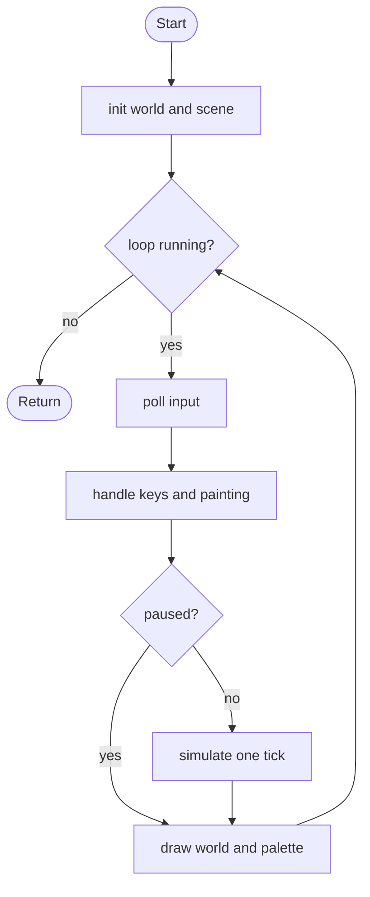

# Sandbox - design brief

**Owner:** Leader  **Folder:** `games/sandbox/`  **Status:** v1 working (unranked)

## Hook
A falling-sand toy. The same engine (`core/sandbox.[ch]`) also animates the hub background, so extending the elements improves both.

## Controls
Left mouse paints the selected element, right mouse erases. `0-3` or the mouse wheel pick the element, `+`/`-` change the brush, Space pauses, `C` clears, `R` resets the scene.

## Rules and scoring
No win or lose. The HUD "score" is simply the number of filled cells. The game is `ranked = false`.

## Implementation steps (extend v1)
1. Add elements in `core/include/arcade/sandbox.h` + `core/src/sandbox.c` (enum, table row, rule, test). Ideas: fire, oil, lava, plant, acid (`docs/SANDBOX.md`).
2. Give each new element a number key in `handle_keys()` (`sandbox_logic.c`); a palette swatch is drawn automatically.
3. Add a tool for pouring from a fixed emitter (a struct array of emitters stepped in `sbx_step`).
4. Save/load a scene to `ctx->data_dir` with file I/O (see `core/src/leaderboard.c` for the pattern).

## Pseudocode (for the report)
```
PROCEDURE sbx_step(state, input)
    handle keys: select element, clear, reset, brush size, pause
    IF left mouse held THEN paint element around the pointer
    IF right mouse held THEN erase around the pointer
    IF NOT paused THEN simulate one tick of the world
END PROCEDURE

PROCEDURE simulate_tick(world)
    FOR row FROM bottom TO top
        FOR each column (direction alternates every row)
            IF cell is sand or water AND not already moved THEN
                IF cell below is free THEN move down
                ELSE IF a diagonal cell below is free THEN move diagonally
                ELSE IF water THEN move sideways if free
END PROCEDURE
```

## Flowchart (for the report)


## Course concepts used
| Concept (Pertemuan) | Where (file : function) |
|---------------------|-------------------------|
| Array 2D / 1D (9) | `core/src/sandbox.c` : `Sandbox.cells` |
| Enum (13) | `core/include/arcade/sandbox.h` : `ElementId`, `MoveKind` |
| Struct (13) | `ElementDef`, `Sandbox`, `sbx_State` |
| Perulangan bersarang (6) | `core/src/sandbox.c` : `sandbox_step` |
| Percabangan (5) | `core/src/sandbox.c` : `sandbox_step`, `can_enter` |
| Fungsi (11) | `sandbox_logic.c` : `handle_keys` |
