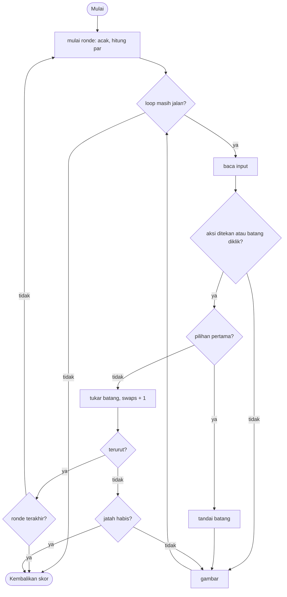

# Sort It - design brief

**Owner:** Leader  **Folder:** `games/sort_it/`  **Status:** v1 sudah jalan (3 ronde)

## Hook
Kamu adalah algoritma sorting. Urutkan batang-batang itu dengan swap sesedikit mungkin. Layar menunjukkan berapa swap yang dibutuhkan *selection sort* dan *bubble sort* untuk batang yang sama, serta batas minimum secara teori (`par`).

## Penjelasan sederhana
Bayangkan sederet kartu bernomor yang acak urutannya. Aturannya: dalam satu langkah, kamu hanya boleh **menukar dua kartu** (swap), dan tujuanmu mengurutkannya dari kecil ke besar dengan langkah sesedikit mungkin. Di layar, kartu itu digambar sebagai batang; makin tinggi batang, makin besar angkanya.

Supaya ada patokan, game menghitung tiga angka untuk susunan yang sama:
- **best possible (`par`)**: jumlah swap paling sedikit yang mungkin, tidak bisa dikalahkan siapa pun. Cara hitungnya: lihat ke mana tiap angka seharusnya pergi, lalu hitung "lingkaran" perpindahan (cycle). Tiap cycle sepanjang L butuh L-1 swap. Contoh: `[3,1,2]` adalah satu cycle sepanjang 3, jadi butuh 2 swap; `[2,1,3,5,4]` punya dua cycle sepanjang 2 (dan satu angka yang sudah di tempatnya), jadi butuh 2 swap.
- **selection sort**: jumlah swap kalau algoritma selection sort yang mengurutkannya (tiap putaran mencari angka terkecil lalu menukarnya ke depan; paling banyak n-1 swap).
- **bubble sort**: jumlah swap kalau bubble sort yang mengurutkannya (menukar tetangga yang terbalik berulang-ulang; jumlahnya sama dengan banyaknya pasangan yang urutannya terbalik, jadi biasanya paling boros).

Game ini **bergiliran (turn-based)**: tidak ada timer dan tidak ada yang bergerak sendiri, jadi `dt` sengaja diabaikan. Ada 3 ronde dengan 6, 8, lalu 10 batang. Skor tiap ronde makin kecil kalau kamu memakai swap lebih banyak dari `par`, dan kalau kamu menghabiskan jatah swap (budget), game berakhir.

Aturan ada di `sort_it_logic.c` (tanpa raylib, bisa di-test di terminal). Algoritma sorting yang dipakai untuk perbandingan ada di `core/src/sortlib.c` karena dipakai bersama. `sort_it_game.c` hanya menggambar batang dan meneruskan input.

**Kalau cuma punya 1 menit:** `start_round` mengacak batang lalu menghitung `par`, `bubble_swaps`, dan `selection_swaps`; `act_on_cursor` adalah satu-satunya tempat swap terjadi dan skor dihitung.

## Kontrol
Kiri/Kanan (atau klik sebuah batang) menggerakkan kursor. Space (atau klik) memilih sebuah batang, lalu pilih batang kedua untuk ditukar dengannya.

## Aturan dan skor
3 ronde dengan 6, 8, 10 batang (permutasi acak dari 1..n). Tiap ronde: 300 poin kalau tepat `par`, dikurangi 40 untuk setiap swap tambahan, minimal 100. Kalau jatah swap habis (`par + 2 + n/2`), game berakhir dengan poin yang sudah terkumpul.

Detail dari kode:
- Rumus poin ronde (`round_points`): `max(100, 300 - 40 * (swaps - par))`. Skor maksimal seluruh game 900 (3 x 300).
- Jatah swap `budget = par + 2 + n / 2` (pembagian bilangan bulat): ronde 6 batang `par + 5`, 8 batang `par + 6`, 10 batang `par + 7`.
- Kalau swap yang terakhir **sekaligus** membuat batang terurut, ronde dianggap selesai (pengecekan "terurut" dilakukan sebelum pengecekan jatah).
- Susunan awal tiap ronde tidak pernah sudah terurut.

## Cara kerja per frame
1. `arcade_poll(&in)` mengisi `ArcadeInput`. Yang dipakai: `left_pressed`, `right_pressed`, `action_pressed`, `fire_pressed` (klik kiri), dan `aim_x` (posisi mouse).
2. `sort_it_step(&s, &in, ARC_DT)` (parameter `dt` diabaikan):
   1. Kalau `over` sudah `true`, langsung keluar.
   2. Kiri/kanan menggeser `cursor` (dijaga antara 0 dan `n - 1`).
   3. Kalau ada klik, `sort_it_index_at(s, aim_x)` mengubah posisi x mouse menjadi nomor batang. Kalau ada batangnya, kursor pindah ke sana dan klik dihitung sebagai aksi.
   4. Kalau ada aksi (Space atau klik), `act_on_cursor` berjalan:
      - belum ada batang yang ditandai: tandai batang di kursor (`mark`)
      - menekan batang yang sama lagi: batalkan tanda
      - selain itu: tukar kedua batang (`swap_int`), `swaps++`, hapus tanda. Lalu: kalau sudah terurut, tambahkan poin ronde dan mulai ronde berikutnya (atau selesai kalau itu ronde terakhir). Kalau belum terurut tapi `swaps >= budget`, `over` dan `lost` menjadi `true`.
3. `start_round` (dipanggil di `init` dan setelah tiap ronde selesai) memilih jumlah batang dari `k_round_sizes`, mengacak 1..n dengan Fisher-Yates (diulang sampai tidak sudah terurut), mereset `cursor`, `mark`, `swaps`, menghitung `par` dan `budget`, lalu menjalankan bubble sort dan selection sort pada salinan untuk mendapat jumlah swap mereka.
4. Front-end `draw()` menggambar batang (tinggi sebanding dengan nilainya, batang yang ditandai berwarna magenta, kursor berupa garis kuning di bawah batang), baris "Round x / 3   swaps y / budget", baris perbandingan (`best possible`, `selection sort`, `bubble sort`), petunjuk, dan "last round: +N" setelah ada ronde yang selesai.
5. Kalau `sort_it_is_over()` bernilai `true`, loop berhenti.

## Peta file
| File | Isinya | Edit di sini kalau ... |
|------|--------|------------------------|
| `sort_it_logic.h` | Konstanta `SI_*`, struct `sort_it_State`, fungsi publik (termasuk `sort_it_index_at`) | menambah field state atau mengubah ukuran |
| `sort_it_logic.c` | `start_round`, `act_on_cursor`, `round_points`, `sort_it_step`, skor | mengubah aturan, jatah swap, atau skor |
| `sort_it_game.c` | Loop raylib, menggambar batang dan teks, HUD, `game_sort_it_def` | mengubah tampilan atau teks di menu |
| `tests/test_sort_it.c` | 7 unit test (hanya logic) | menambah atau mengubah aturan |
| `CMakeLists.txt` | Mendaftarkan game ke build | menambah file `.c` atau test baru |
| `core/include/arcade/sortlib.h` dan `core/src/sortlib.c` | Algoritma sorting yang menghitung perbandingan dan swap, plus `sort_min_swaps` (milik `core`, dipakai bersama dan punya test sendiri: `core.sortlib`) | menambah algoritma (insertion sudah ada, merge sort belum) |
| `GAME.md` | Dokumen ini | aturan atau kode berubah |
| `AGENTS.md` | Instruksi untuk AI agent (tidak diterjemahkan) | jarang; ikuti aturan di file itu |

## Data penting (struct)
`sort_it_State`: seluruh keadaan game.

| Field | Tipe | Artinya |
|-------|------|---------|
| `values[SI_MAX_N]` | `int` | susunan batang: permutasi dari 1..n (hanya `n` elemen pertama yang dipakai) |
| `n` | `int` | jumlah batang ronde ini (6, 8, atau 10) |
| `cursor` | `int` | batang yang sedang disorot |
| `mark` | `int` | batang pertama yang dipilih untuk ditukar; `-1` berarti belum ada |
| `round` | `int` | nomor ronde, mulai dari 0 |
| `swaps` | `int` | swap yang sudah dipakai di ronde ini |
| `par` | `int` | swap minimum yang mungkin (`sort_min_swaps`) |
| `budget` | `int` | batas swap; kalau habis, game berakhir |
| `bubble_swaps`, `selection_swaps` | `int` | jumlah swap yang akan dipakai kedua algoritma untuk ronde ini |
| `last_round_score` | `int` | poin ronde yang baru saja selesai (untuk teks di layar) |
| `score` | `int` | total poin |
| `over` | `bool` | game selesai (menang semua ronde atau kalah) |
| `lost` | `bool` | `true` kalau selesai karena jatah swap habis |
| `rng` | `Rng` | pengacak deterministik untuk mengacak batang |

`SortStats` (di `core`): `comparisons` dan `swaps`, yang dihitung oleh fungsi sorting di `sortlib`.

## Fungsi-fungsi penting
| Fungsi | Tugas | Dipanggil dari |
|--------|-------|----------------|
| `sort_it_init(s, seed)` | Mengosongkan state, men-seed `rng`, memulai ronde pertama | `play()`, test |
| `sort_it_step(s, in, dt)` | Satu langkah logic: input kursor dan aksi | `play()` tiap frame, test |
| `sort_it_is_over(s)` / `sort_it_score(s)` | Status selesai dan skor | `play()` |
| `sort_it_index_at(s, x)` | Mengubah posisi x piksel menjadi nomor batang; `-1` kalau di luar area batang | `sort_it_step`, test |
| `start_round(s)` (static) | Mengacak, menghitung `par`, `budget`, dan angka perbandingan | `sort_it_init`, `act_on_cursor` |
| `act_on_cursor(s)` (static) | Menandai, membatalkan, atau menukar; mengecek terurut dan jatah swap | `sort_it_step` |
| `round_points(s)` (static) | `max(100, 300 - 40 * (swaps - par))` | `act_on_cursor` |
| `sort_min_swaps(a, n)` (`core`) | Menghitung swap minimum lewat penghitungan cycle (n sampai 64; pasti tepat kalau semua nilai berbeda) | `start_round`, test |
| `sort_bubble`, `sort_selection`, `sort_insertion` (`core`) | Sorting yang menghitung perbandingan dan swap | `start_round` (bubble dan selection), `sort_min_swaps` (insertion) |
| `swap_int(a, b)` (`core`) | Menukar dua `int` lewat pointer | logic dan `sortlib` |

## Angka yang bisa diutak-atik
| Konstanta | Nilai sekarang | File | Efek kalau diubah |
|-----------|----------------|------|-------------------|
| `SI_MAX_N` | `12` | `sort_it_logic.h` | ukuran maksimal array `values`; harus >= batang terbanyak di `k_round_sizes` |
| `SI_ROUNDS` | `3` | `sort_it_logic.h` | jumlah ronde; harus sama dengan panjang `k_round_sizes` |
| `k_round_sizes` | `{6, 8, 10}` | `sort_it_logic.c` | jumlah batang per ronde |
| `SI_X0` / `SI_AREA_W` | `140` / `1000` px | `sort_it_logic.h` | lokasi dan lebar area batang (juga dipakai untuk klik mouse) |
| jatah swap (angka langsung di `start_round`) | `par + 2 + n / 2` | `sort_it_logic.c` | seberapa longgar jatah swap |
| rumus poin ronde (angka langsung di `round_points`) | `300`, `40` per swap tambahan, minimal `100` | `sort_it_logic.c` | keseimbangan skor |
| tata letak batang (angka langsung di `draw`) | dasar `y = 520`, tinggi total `340` px, jarak `6` px | `sort_it_game.c` | hanya tampilan |

## Cara menjalankan dan menguji
```bash
# test logic saja (tanpa raylib, ~1 detik)
cmake --preset logic && cmake --build --preset logic && ctest --preset logic -R "^sort_it\."

# main game-nya
cmake --preset dev && cmake --build --preset dev && build/dev/bin/arCade

# smoke run headless: jalankan game 300 frame dan simpan screenshot PNG
cmake --preset headless && cmake --build --preset headless && build/headless/bin/arCade --smoke sort_it --frames 300 --out smoke-out
```

| Test | Menjaga aturan apa |
|------|--------------------|
| `test_init_makes_an_unsorted_permutation` | Susunan awal bukan sudah terurut, berupa permutasi 1..n, `par` sama dengan `sort_min_swaps`, `par <= selection_swaps`, dan `budget > par` |
| `test_mark_toggle_and_cursor_bounds` | Kursor tidak keluar dari 0..n-1; menekan batang yang sama dua kali membatalkan tanda tanpa swap |
| `test_swap_counts_and_exchanges_values` | Swap benar-benar menukar nilai dan menambah `swaps` |
| `test_clicking_bars_uses_the_same_rules` | `sort_it_index_at` benar (di luar area = -1) dan klik memindahkan kursor serta menandai batang |
| `test_optimal_play_scores_maximum` | Bermain optimal (par di tiap ronde) menghasilkan skor penuh 900 dan tidak kalah |
| `test_running_out_of_swaps_ends_the_game` | Menukar sia-sia sampai jatah habis mengakhiri game, dan input sesudahnya tidak mengubah skor |
| `test_monkey_is_safe` | 5000 langkah input acak: kursor dan tanda selalu valid, skor tidak negatif |

## Jebakan dan hal yang perlu diingat
- **Klik hanya memakai posisi x.** `sort_it_index_at` mengabaikan y, jadi klik di mana pun pada kolom sebuah batang (bahkan di atas atau bawah batang) memilih batang itu.
- Satu klik sekaligus memindahkan kursor **dan** melakukan aksi. Tidak ada langkah "pindah dulu, tekan kemudian" untuk mouse.
- `par` hanya pasti tepat kalau semua nilai berbeda (sekarang selalu begitu karena permutasi 1..n). Kalau nanti ada nilai kembar, `sort_min_swaps` hanya batas atas (lihat komentar di `sortlib.h`).
- `sort_min_swaps` hanya mendukung n sampai 64, dan `values` hanya sampai `SI_MAX_N` (12). Menambah ronde dengan lebih dari 12 batang berarti menaikkan `SI_MAX_N`.
- `dt` diabaikan karena game ini turn-based. Mode time attack (langkah 4) baru akan memakai `dt`.
- Mengubah `core/src/sortlib.c` memengaruhi test lain (`core.sortlib`) dan game lain yang memakainya.
- Kalau jatah swap habis, skor yang sudah terkumpul tetap dibawa (game over, bukan skor 0).
- Game ini `ranked = true`, `order = 70`.

## Langkah implementasi (Implementation steps)
Daftar ini adalah pengembangan dari v1.

1. Animasikan algoritma: tambah `sort_selection_trace()` di `core/src/sortlib.c` yang mencatat setiap swap, lalu putar ulang sebagai "lawan hantu" di sebelah batangmu.
2. Tambah insertion sort dan merge sort ke baris perbandingan (merge sort butuh rekursi: bahan bagus untuk laporan).
3. Tingkat kesulitan: jumlah batang dan jatah swap; simpan yang terbaik per tingkat lewat leaderboard.
4. Mode time attack (memakai `dt`, yang sekarang sengaja diabaikan).

## Pseudocode (untuk laporan)
```
PROSEDUR start_round()
    n <- jumlah batang untuk ronde ini
    ULANGI acak nilai 1..n (Fisher-Yates) SAMPAI tidak sudah terurut
    par <- swap minimum (hitung cycle pada permutasi)
    bubble_swaps, selection_swaps <- jalankan algoritmanya pada salinan dan hitung swap

PROSEDUR act_on_cursor()
    JIKA belum ada yang ditandai MAKA mark <- cursor
    JIKA TIDAK, JIKA mark = cursor MAKA hapus tanda
    JIKA TIDAK tukar values[mark] dan values[cursor]; swaps <- swaps + 1
        JIKA terurut MAKA tambah poin ronde; ronde berikutnya (atau selesai setelah ronde terakhir)
        JIKA TIDAK, JIKA swaps >= budget MAKA game over
```

## Flowchart (untuk laporan)


## Konsep kuliah yang dipakai
| Konsep (Pertemuan) | Di mana (file : fungsi) |
|--------------------|-------------------------|
| Array (9) | `sort_it_logic.h` : `values[SI_MAX_N]` |
| Pointer (10) | `core/src/sortlib.c` : `swap_int(int *a, int *b)` |
| Sorting (14) | `core/src/sortlib.c` : `sort_bubble`, `sort_selection`, `sort_insertion` |
| Struct (13) | `sort_it_State`, `SortStats` |
| Perulangan (6) | `start_round` (loop acak), `sort_min_swaps` (menghitung cycle) |
| Percabangan (5) | `act_on_cursor` |
