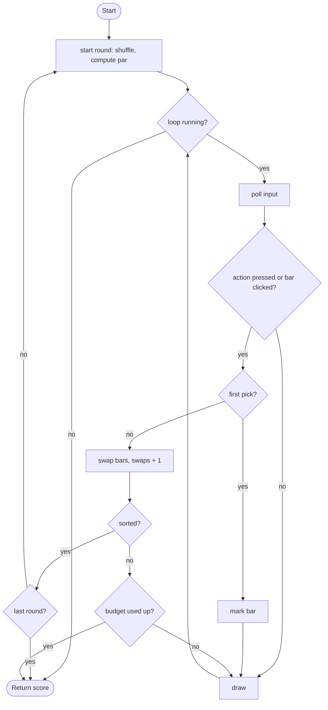

# Sort It - design brief

**Owner:** Leader  **Folder:** `games/sort_it/`  **Status:** v1 working (3 rounds)

## Hook
You are the sorting algorithm. Sort the bars with as few swaps as possible. The screen shows how many swaps *selection sort* and *bubble sort* would need on the same bars, and the theoretical minimum (`par`).

## Controls
Left/Right (or click a bar) moves the cursor. Space (or click) picks a bar, then picks a second bar to swap with it.

## Rules and scoring
3 rounds with 6, 8, 10 bars (a shuffled permutation of 1..n). Each round: 300 points at par, minus 40 per extra swap, minimum 100. If you use up the swap budget (`par + 2 + n/2`) the game ends with the points so far.

## Implementation steps (extend v1)
1. Animate the algorithms: add `sort_selection_trace()` to `core/src/sortlib.c` recording each swap, then replay it as a "ghost opponent" next to your bars.
2. Add insertion sort and merge sort to the comparison line (merge sort needs recursion: good report material).
3. Difficulty levels: number of bars and swap budget; save the best per level through the leaderboard.
4. Time attack mode (uses `dt`, currently ignored on purpose).

## Pseudocode (for the report)
```
PROCEDURE start_round()
    n <- size for this round
    REPEAT shuffle values 1..n (Fisher-Yates) UNTIL not sorted
    par <- minimum swaps (count cycles of the permutation)
    bubble_swaps, selection_swaps <- run the algorithms on a copy and count swaps

PROCEDURE act_on_cursor()
    IF nothing marked THEN mark <- cursor
    ELSE IF mark = cursor THEN unmark
    ELSE swap values[mark] and values[cursor]; swaps <- swaps + 1
        IF sorted THEN add round points; next round (or finish after the last)
        ELSE IF swaps >= budget THEN game over
```

## Flowchart (for the report)


## Course concepts used
| Concept (Pertemuan) | Where (file : function) |
|---------------------|-------------------------|
| Array (9) | `sort_it_logic.h` : `values[SI_MAX_N]` |
| Pointer (10) | `core/src/sortlib.c` : `swap_int(int *a, int *b)` |
| Sorting (14) | `core/src/sortlib.c` : `sort_bubble`, `sort_selection`, `sort_insertion` |
| Struct (13) | `sort_it_State`, `SortStats` |
| Perulangan (6) | `start_round` (shuffle loop), `sort_min_swaps` (cycle counting) |
| Percabangan (5) | `act_on_cursor` |
