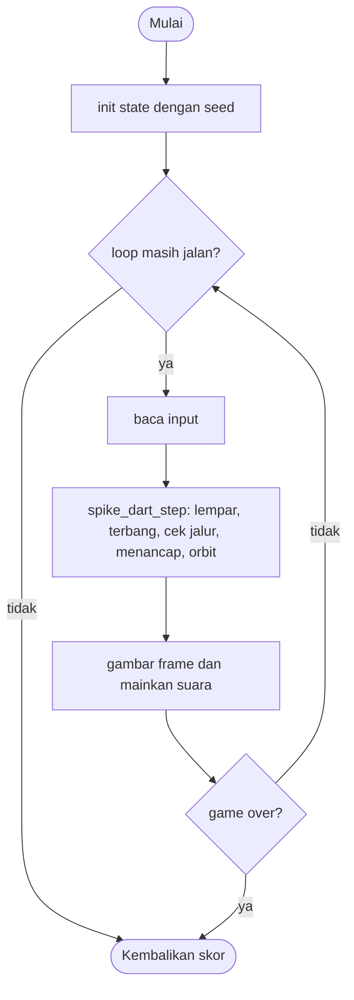

# Spike Dart - design brief

**Owner:** Leader  **Folder:** `games/spike_dart/`  **Created:** 2026-11-12  **Asal mekanik:** `g06_knifedart` di proyek `simple-games` (hanya aturan; tidak ada kode, gambar, suara, teks atau font yang disalin)

## Hook
Lempar paku ke target yang berputar, tapi jangan sampai paku baru menabrak paku lama yang sedang lewat di jalur lempar.

## Penjelasan sederhana
Di tengah layar ada target bulat. Setiap kali kamu menekan tombol, sebuah paku meluncur dari bawah, menancap di target, lalu ikut berputar mengelilinginya (satu putaran penuh tiap 4 detik). Makin banyak paku, makin ramai di sekitar target. Kalau paku yang kamu lempar bertemu paku lama yang kebetulan sedang lewat tepat di bawah target (jalur lempar), game selesai.

Di balik layar, `spike_dart_step()` menggerakkan paku yang terbang ke atas, mengecek jalur hanya di 68 piksel terakhir perjalanannya, dan memutar semua paku yang sudah menancap. Yang dicek hanya jarak horizontal ke jalur (bukan tabrakan garis sungguhan), persis seperti aslinya. Seperti menyelipkan jarum ke roda yang berputar: kamu menunggu celahnya.

Kalau cuma punya 1 menit: tekan untuk melempar, tunggu sampai tidak ada paku lewat di bawah target, lalu lempar lagi.

## Kontrol
Klik mouse, spasi, atau tombol apa saja (huruf, panah): lempar paku. Hanya bisa melempar saat paku di tangan sedang menunggu (tidak sedang terbang).

## Aturan dan skor
- Paku baru menunggu di `(spike_x, spike_y)` dan terbang ke atas `spike_spd` piksel per tick asli.
- Zona cek: `tip < target_dn + 68`. Di zona ini, jika ada paku menancap dengan `y > target_dn` dan `|x - spike_x| < 8`, **game selesai**.
- Menancap: `tip <= target_dn`. Paku menancap di sudut orbit pi/2 (posisi (240, TARGETY + 152)), `stuck++`.
- Semua paku menancap berputar `pi/2` radian per detik (waktu nyata, bukan per frame).
- Paku ke-64 yang menancap juga mengakhiri game (batas array; di aslinya akan crash).
- **Skor = jumlah paku yang menancap (`stuck`).**

## Cara kerja per frame
1. `arcade_poll()` mengisi `ArcadeInput`.
2. `spike_dart_step()`: jika ada klik/tombol dan paku sedang menunggu, `flying = true` dan `throws++`.
3. Paku terbang naik `spike_spd * k` (`k = dt * 50`), lalu cek zona dan jalur, lalu cek menancap.
4. Jika menancap: pasang di orbit, `stuck++`, `sticks++`, selesai frame ini tanpa memutar.
5. Jika tidak: semua paku menancap diputar `pi/2 * dt` dan posisinya dihitung ulang dari sudutnya.
6. Front-end membandingkan `throws` dan `sticks` dengan frame lalu untuk suara, lalu menggambar.

## Peta file
| File | Isinya | Edit di sini kalau ... |
|---|---|---|
| `spike_dart_logic.h` | struct `spike_dart_State` dan fungsi publik (`init`, `init_sized`, `step`, `is_over`, `score`) | menambah field state atau fungsi publik |
| `spike_dart_logic.c` | semua aturan game (tanpa raylib) | mengubah aturan atau angka keseimbangan |
| `spike_dart_game.c` | loop raylib, menggambar, suara, `GameDef` (judul, kontrol di menu, urutan, ranked) | mengubah tampilan, suara, atau teks di menu |
| `tests/test_spike_dart.c` | unit test (hanya logic) | menambah atau mengubah aturan |
| `CMakeLists.txt` | mendaftarkan game lewat `arcade_add_game(...)` | menambah file `.c` atau test baru |
| `GAME.md` | dokumen ini | aturan atau kode berubah |
| `AGENTS.md` | instruksi untuk AI agent (tidak diterjemahkan) | jarang; ikuti aturan di file itu |

## Data penting (struct)
| Field | Tipe | Artinya |
|---|---|---|
| `w`, `h` | int | ukuran lapangan |
| `target_x`, `target_y`, `target_dn` | float | pusat target dan y tepi bawahnya (`target_y + 120`) |
| `spike_x`, `spike_y` | float | tempat paku baru menunggu (x tengah, y = h - 80) |
| `spike_spd` | float | kecepatan terbang (piksel per tick asli), dihitung di `init_sized` |
| `stuck` | int | jumlah paku menancap = skor |
| `px[]`, `py[]`, `rot[]` | float[64] | pusat dan sudut orbit tiap paku menancap |
| `cur_y`, `flying` | float, bool | posisi y paku di tangan dan apakah sedang terbang |
| `over`, `capped`, `over_t` | bool, bool, float | selesai, selesai karena penuh 64, detik sejak selesai |
| `throws`, `sticks` | int | penghitung kejadian untuk suara |

## Fungsi-fungsi penting
| Fungsi | Tugas | Dipanggil dari |
|---|---|---|
| `spike_dart_init_sized` | menghitung semua konstanta dari ukuran lapangan | `spike_dart_init`, tes |
| `spike_dart_step` | lempar, terbang, cek jalur, menancap, orbit | `play()`, tes |
| `spike_dart_lane_blocked` | apakah ada paku menancap di jalur lempar | `step`, tes |
| `stick_current`, `orbit_all`, `place_on_orbit` | fungsi kecil di dalam logic untuk menancapkan, memutar, dan menghitung posisi | `step` |
| `spike_dart_is_over`, `spike_dart_score` | status akhir dan skor | `play()`, hub |

## Angka yang bisa diutak-atik
| Konstanta | Nilai sekarang | File | Efek kalau diubah |
|---|---|---|---|
| `SD_MAX_SPIKES` | 64 | `spike_dart_logic.h` | batas array dan akhir game |
| `SD_ORBIT_SPEED` | pi/2 rad/detik | `spike_dart_logic.c` | kecepatan putar semua paku (lebih besar = lebih sulit) |
| `SD_LANE_HALF` | 8 px | `spike_dart_logic.c` | lebar jalur lempar |
| `SD_EPS` | 0.01 | `spike_dart_logic.c` | toleransi float saat menancap |
| `SD_OVER_DELAY` | 1.2 s | `spike_dart_logic.h` | lama paku merah ditampilkan sebelum skor dicatat |
| angka langsung `68`, `10` | di `step`, `init_sized` | `spike_dart_logic.c` | panjang zona cek dan jumlah tick terbang |

## Cara menjalankan dan menguji
```bash
# test logic saja (tanpa raylib, ~1 detik)
cmake --preset logic && cmake --build --preset logic && ctest --preset logic -R "^spike_dart\."

# main game-nya
cmake --preset dev && cmake --build --preset dev && build/dev/bin/arCade

# smoke run headless: jalankan game 300 frame dan simpan screenshot PNG
cmake --preset headless && cmake --build --preset headless && build/headless/bin/arCade --smoke spike_dart --frames 300 --out smoke-out
```

| Test | Menjaga aturan apa |
|---|---|
| `test_init_is_sane` | state awal benar |
| `test_spec_constants_at_480x800` | TARGETY 340, TARGETDN 460, kecepatan 22.8 |
| `test_first_spike_sticks_in_10_ticks_at_orbit_radius` | 10 tick sampai menancap, pusat (240, 492) |
| `test_orbit_after_one_second` | setelah 1 detik pusat di (392, 340) |
| `test_orbit_period_at_60hz` | satu putaran penuh 240 frame di 60 fps |
| `test_lane_test_matches_spec_vectors` | (244, 470) kena jalur; di atas atau 8.5 px dari jalur aman |
| `test_throw_into_a_passing_spike_ends_game` | paku yang tiba saat paku lama lewat jalur mengakhiri game |
| `test_throw_with_clear_lane_survives` | jalur kosong: menancap dan skor 2 |
| `test_spamming_throws_eventually_loses` | pemain yang tidak menunggu kalah sendiri |
| `test_throw_ignored_while_flying` | klik saat terbang tidak melempar lagi |
| `test_cap_of_64_ends_the_game` | paku ke-64 mengakhiri game |
| `test_big_step_cannot_tunnel` | dt besar tetap menancap |
| `test_same_seed_same_result`, `test_monkey_never_breaks_invariants` | deterministik; 20 seed x 5000 frame tanpa NaN |

## Jebakan dan hal yang perlu diingat
- Orbit memakai `dt` nyata (pi/2 rad per detik), terbang memakai `k = dt * 50`; keduanya sama dengan 50 Hz asli.
- Paku yang menancap tidak diputar pada frame menancap (sama seperti aslinya).
- Penyimpangan dari simple-games: batas 64 paku mengakhiri game (aslinya crash di paku ke-65).
- Penyimpangan: `SD_EPS = 0.01` supaya paku yang tepat mencapai tepi (22.8 x 10 tick) tidak lolos karena pembulatan float.
- Penyimpangan: paku yang menancap langsung dipasang di posisi orbit tepat (240, TARGETY + 152), tanpa sisa lebih yang mungkin timbul di 60 fps.
- Penyimpangan: ada jeda tampil 1.2 detik untuk paku merah; tidak ada tombol play-again atau ranking online.
- Game ini tidak memakai angka acak, jadi `seed` tidak berpengaruh.

## Langkah implementasi (Implementation steps)
1. Aturan sudah ada di `spike_dart_State` dan `spike_dart_step()` (hanya di logic). Konstanta ditulis sebagai `#define` di `spike_dart_logic.c`.
2. Setiap aturan punya unit test di `tests/test_spike_dart.c`; tes memakai `spike_dart_init_sized(480, 800)` supaya vektor uji spesifikasi asli berlaku apa adanya.
3. Tampilan ada di `spike_dart_game.c`: panel 480 x 684 di tengah, aturan di gutter kiri, statistik di gutter kanan. Suara dibuat dari `gfx_make_tone()`.
4. Kalau menambah aturan: tulis tesnya dulu, lalu ubah logic, lalu perbarui bagian Jebakan dan tabel di dokumen ini.

## Pseudocode (untuk laporan)
```
PROSEDUR step(s, input, dt)
    JIKA s.over MAKA s.over_t += dt; KEMBALI
    JIKA paku menunggu DAN ada klik atau tombol MAKA flying = benar
    JIKA flying MAKA
        cur_y -= spike_spd * (dt * 50)
        tip = cur_y - 40 + 8
        JIKA tip < target_dn + 68 DAN jalur terhalang MAKA over = benar; KEMBALI
        JIKA tip <= target_dn MAKA tancapkan; KEMBALI
    UNTUK setiap paku menancap i
        rot[i] += (pi / 2) * dt
        hitung posisi dari rot[i]
AKHIR PROSEDUR
```

## Flowchart (untuk laporan)


## Konsep kuliah yang dipakai (untuk Bab I laporan)
| Konsep (Pertemuan) | Di mana (file : fungsi) |
|---|---|
| Struct (13) | `spike_dart_logic.h` : `spike_dart_State` |
| Array (9) | `spike_dart_logic.h` : `px[]`, `py[]`, `rot[]` dengan batas `SD_MAX_SPIKES` |
| Perulangan (6-7) | `spike_dart_logic.c` : `orbit_all`, `spike_dart_lane_blocked` |
| Percabangan (5) | `spike_dart_logic.c` : `spike_dart_step` (zona cek, menancap) |
| Fungsi (11) | `spike_dart_logic.c` : `stick_current`, `place_on_orbit` |
| Pointer (12) | `spike_dart_step(spike_dart_State *s, ...)` |
