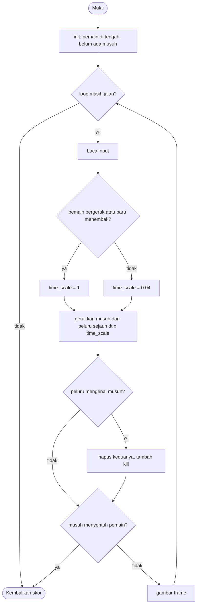

# Time Shooter - design brief

**Owner:** Member 1  **Folder:** `games/time_shooter/`  **Status:** placeholder (mekanik utama sudah jalan)

## Hook
Gaya Superhot: **waktu hanya bergerak saat kamu bergerak** (atau baru saja menembak). Kalau diam, musuh dan peluru membeku, jadi setiap langkah adalah sebuah keputusan.

## Penjelasan sederhana
Bayangkan tombol pause yang dikendalikan oleh gerakanmu sendiri. Selama kamu menahan tombol gerak, dunia berjalan normal: musuh mengejar, peluru melesat. Begitu kamu berhenti, dunia nyaris berhenti total (jalan di 4% kecepatan normal). Di saat itu kamu bebas berpikir, membidik, lalu bergerak lagi.

Di balik layar, semuanya diatur oleh **satu angka** bernama `time_scale`. Nilainya `1.0` kalau pemain sedang bergerak atau baru menembak, dan `0.04` (`TS_IDLE_SCALE`) kalau pemain diam. Pemain selalu bergerak dengan waktu asli (`dt`), sedangkan musuh, peluru, dan timer spawn memakai "waktu dunia": `wdt = dt * time_scale`. Itu satu-satunya trik di game ini; sisanya adalah musuh yang mengejar, peluru, dan tabrakan lingkaran.

Kodenya dibagi dua. `time_shooter_logic.c` berisi semua aturan dan **tidak** memakai raylib, jadi bisa di-test lewat terminal dalam hitungan detik. `time_shooter_game.c` hanya membaca input, memanggil `time_shooter_step()` tiap frame, lalu menggambar hasilnya. Aturan salah, cari di logic. Tampilan salah (warna, efek, HUD), cari di `_game.c`.

**Kalau cuma punya 1 menit:** semua yang bergerak selain pemain harus dikali `wdt`, bukan `dt`. Kalau tidak, hook "waktu berhenti saat diam" rusak.

## Kontrol
WASD / panah untuk bergerak. Mouse untuk membidik, klik kiri untuk menembak (cooldown 0,25 detik; menembak membuat waktu berjalan selama 0,2 detik).

## Aturan dan skor
Musuh mengejar kamu; kena sentuh satu musuh berarti game over. Tembak musuh: +100 per musuh. Selain itu +1 per detik *waktu dunia* yang berhasil dilalui (waktu yang membeku tidak dihitung, jadi diam terus tidak menguntungkan).

Rumus persisnya (`time_shooter_score`): `kills * 100 + (int)world_time`.

## Cara kerja per frame
Satu frame di `play()` (`time_shooter_game.c`) berjalan seperti ini:

1. `arcade_poll(&in)` mengisi `ArcadeInput`: arah gerak (`move_x`, `move_y`), posisi mouse (`aim_x`, `aim_y`), dan tombol tembak (`fire`, `fire_pressed`).
2. `time_shooter_step(&s, &in, ARC_DT)` dipanggil. `ARC_DT` selalu 1/60 detik. Di dalamnya, urutannya:
   1. Kalau `over` sudah `true`, langsung keluar (tidak ada yang berubah lagi setelah game over).
   2. **Pemain bergerak dengan waktu asli.** Kalau panjang vektor input > 0,1, pemain geser sejauh `PLAYER_SPEED * dt`, lalu dijaga supaya tidak keluar layar.
   3. `cooldown` dan `burst` dikurangi `dt`. Kalau tombol tembak ditekan dan `cooldown <= 0`, `fire_bullet()` membuat peluru ke arah mouse, `cooldown` diisi 0,25 dan `burst` diisi 0,2.
   4. **Tentukan kecepatan dunia.** `time_scale = 1.0` kalau pemain bergerak atau `burst > 0`, selain itu `0.04`. Lalu `wdt = dt * time_scale` dan `world_time += wdt`.
   5. Timer spawn berkurang `wdt`. Kalau habis, `spawn_enemy()` memunculkan satu musuh dari tepi layar, dan timer diisi ulang (makin banyak kill, makin pendek).
   6. Setiap musuh yang hidup bergerak ke arah pemain sejauh `speed * wdt`. Kalau lingkarannya menyentuh pemain, `over = true`.
   7. Setiap peluru yang hidup bergerak `vel * wdt`. Kalau keluar layar, peluru dimatikan. Kalau mengenai musuh, keduanya dimatikan, `kills++`, dan posisi kill disimpan di `last_kill`.
3. Front-end melihat `kills` dan `over` untuk memicu efek: ledakan partikel dan layar bergetar tiap kill, ledakan besar saat pemain mati.
4. `BeginDrawing()`, lalu `draw()` menggambar backdrop (grid ikut membeku bersama dunia), musuh, peluru, pemain, **time bar**, dan tint biru tipis saat dunia membeku. Setelah itu HUD, lalu `arcade_frame_end()`.
5. Kalau `time_shooter_is_over()` bernilai `true`, loop berhenti dan hasil (`score`, `finished`) dikembalikan ke hub.

## Peta file
| File | Isinya | Edit di sini kalau ... |
|------|--------|------------------------|
| `time_shooter_logic.h` | Definisi `ts_Enemy`, `ts_Bullet`, `time_shooter_State`, batas array, `TS_IDLE_SCALE`, dan 4 fungsi publik | menambah field state atau fungsi publik |
| `time_shooter_logic.c` | Semua aturan: gerak pemain, `time_scale`, spawn, musuh, peluru, skor, plus konstanta (`PLAYER_SPEED`, dll.) | mengubah aturan atau angka keseimbangan |
| `time_shooter_game.c` | Loop raylib, menggambar, partikel, getaran layar, HUD, dan `game_time_shooter_def` (judul, kontrol di menu, urutan, ranked) | mengubah tampilan atau teks di menu |
| `tests/test_time_shooter.c` | Unit test (hanya logic) | menambah atau mengubah aturan |
| `CMakeLists.txt` | Mendaftarkan game ke build lewat `arcade_add_game(...)` | menambah file `.c` atau test baru |
| `GAME.md` | Dokumen ini | aturan atau kode berubah (jaga pseudocode, flowchart, tabel konsep tetap cocok) |
| `AGENTS.md` | Instruksi untuk AI agent (tidak diterjemahkan) | jarang; ikuti aturan di file itu |

## Data penting (struct)
`ts_Enemy`: satu musuh.

| Field | Tipe | Artinya |
|-------|------|---------|
| `pos` | `Vec2` | posisi pusat musuh (piksel) |
| `speed` | `float` | kecepatan kejar (piksel per detik *waktu dunia*), diacak 70-110 lalu ditambah `kills * 1.5` |
| `alive` | `bool` | `false` berarti slot kosong dan boleh dipakai musuh baru |

`ts_Bullet`: satu peluru.

| Field | Tipe | Artinya |
|-------|------|---------|
| `pos` | `Vec2` | posisi peluru |
| `vel` | `Vec2` | kecepatan (vektor arah dikali `BULLET_SPEED`), piksel per detik waktu dunia |
| `alive` | `bool` | `false` berarti slot kosong |

`time_shooter_State`: seluruh keadaan game.

| Field | Tipe | Artinya |
|-------|------|---------|
| `player` | `Vec2` | posisi pemain |
| `time_scale` | `float` | `1.0` = waktu normal, `TS_IDLE_SCALE` (0,04) = membeku. Dibaca front-end untuk time bar, tint, dan backdrop |
| `enemies[TS_MAX_ENEMIES]` | `ts_Enemy` | pool musuh (maks. 40 sekaligus) |
| `bullets[TS_MAX_BULLETS]` | `ts_Bullet` | pool peluru (maks. 24 sekaligus) |
| `spawn_timer` | `float` | hitung mundur spawn berikutnya, dalam waktu dunia |
| `cooldown` | `float` | sisa jeda sebelum boleh menembak lagi (waktu asli) |
| `burst` | `float` | sisa waktu "dunia dijalankan karena baru menembak" (waktu asli) |
| `world_time` | `float` | total detik waktu dunia yang sudah berjalan (untuk skor) |
| `kills` | `int` | jumlah musuh yang tertembak |
| `last_kill` | `Vec2` | lokasi kill terakhir, dipakai front-end untuk memicu partikel |
| `over` | `bool` | `true` setelah pemain tersentuh musuh |
| `rng` | `Rng` | pengacak deterministik, di-seed dari `ctx->seed` |

## Fungsi-fungsi penting
| Fungsi | Tugas | Dipanggil dari |
|--------|-------|----------------|
| `time_shooter_init(s, seed)` | Mengosongkan semua musuh dan peluru, menaruh pemain di tengah, mengisi nilai awal | `play()` |
| `time_shooter_step(s, in, dt)` | Satu langkah logic (1/60 detik): gerak, tembak, `time_scale`, spawn, musuh, peluru | `play()` tiap frame, dan unit test |
| `time_shooter_is_over(s)` | Mengembalikan `s->over` | `play()` |
| `time_shooter_score(s)` | `kills * 100 + (int)world_time` | HUD dan hasil akhir |
| `spawn_enemy(s)` (static) | Mencari slot musuh kosong, memilih tepi layar acak (usaha sampai 6 kali supaya jarak ke pemain > 280 px), mengacak kecepatan | `time_shooter_step` |
| `fire_bullet(s, target)` (static) | Mencari slot peluru kosong, menembak dari pemain ke arah `target`; kalau mouse tepat di atas pemain, peluru ke kanan | `time_shooter_step` |
| `draw(s, t, shake)` (di `_game.c`) | Menggambar seluruh frame | `play()` |

## Angka yang bisa diutak-atik
| Konstanta | Nilai sekarang | File | Efek kalau diubah |
|-----------|----------------|------|-------------------|
| `TS_IDLE_SCALE` | `0.04` | `time_shooter_logic.h` | makin besar, dunia makin bergerak saat kamu diam (makin sulit) |
| `TS_MAX_ENEMIES` | `40` | `time_shooter_logic.h` | batas musuh sekaligus; kalau penuh, spawn dilewati |
| `TS_MAX_BULLETS` | `24` | `time_shooter_logic.h` | batas peluru sekaligus; kalau penuh, tembakan diabaikan |
| `PLAYER_SPEED` | `260` px/detik | `time_shooter_logic.c` | kecepatan pemain |
| `PLAYER_R` / `ENEMY_R` / `BULLET_R` | `14` / `12` / `6` | `time_shooter_logic.c` | radius tabrakan (lihat jebakan soal radius di front-end) |
| `BULLET_SPEED` | `720` px/detik | `time_shooter_logic.c` | kecepatan peluru |
| `FIRE_COOLDOWN` | `0.25` detik | `time_shooter_logic.c` | jeda antar tembakan |
| `FIRE_BURST` | `0.20` detik | `time_shooter_logic.c` | berapa lama waktu berjalan setelah menembak |
| `TOP_MARGIN` | `44` px | `time_shooter_logic.c` | batas atas area bermain (di bawahnya baru area main, di atasnya ruang HUD) |
| spawn awal (angka langsung di `time_shooter_init`) | `0.8` detik | `time_shooter_logic.c` | jeda sebelum musuh pertama |
| interval spawn (angka langsung di `time_shooter_step`) | `max(0.5, 1.4 - kills * 0.03)` | `time_shooter_logic.c` | makin kecil makin ramai; mentok 0,5 detik di 30 kill |
| kecepatan musuh (angka langsung di `spawn_enemy`) | `70..110 + kills * 1.5` | `time_shooter_logic.c` | satu-satunya kurva kesulitan selain interval spawn |
| jarak spawn minimum (di `spawn_enemy`) | `280` px, 6 percobaan | `time_shooter_logic.c` | seberapa jauh musuh baru dari pemain |
| ambang "pemain bergerak" (di `time_shooter_step`) | panjang vektor input `> 0.1` | `time_shooter_logic.c` | seberapa kecil input yang dianggap bergerak |
| lebar time bar | `200` px | `time_shooter_game.c` | hanya tampilan |

## Cara menjalankan dan menguji
```bash
# test logic saja (tanpa raylib, ~1 detik)
cmake --preset logic && cmake --build --preset logic && ctest --preset logic -R "^time_shooter\."

# main game-nya
cmake --preset dev && cmake --build --preset dev && build/dev/bin/arCade

# smoke run headless: jalankan game 300 frame dan simpan screenshot PNG
cmake --preset headless && cmake --build --preset headless && build/headless/bin/arCade --smoke time_shooter --frames 300 --out smoke-out
```

| Test | Menjaga aturan apa |
|------|--------------------|
| `test_world_is_frozen_when_idle` | Diam 2 detik: musuh hampir tidak bergerak (< 12 px) dan `time_scale < 0.1` |
| `test_world_runs_when_moving` | Bergerak 1 detik: musuh menempuh > 60 px dan `time_scale == 1` |
| `test_bullet_kills_enemy` | Peluru yang mengenai musuh mematikan keduanya, `kills == 1`, skor >= 100 |
| `test_touching_an_enemy_ends_the_game` | Musuh menyentuh pemain berarti game over, dan setelah itu skor tidak berubah lagi |
| `test_cooldown_limits_fire_rate` | Menahan tombol tembak 0,1 detik hanya menghasilkan 1 peluru |
| `test_deterministic_and_bounded_with_monkey` | 4000 langkah input acak (monkey): hasil sama untuk seed sama, dan pemain tidak pernah keluar layar |

## Jebakan dan hal yang perlu diingat
- **Semua yang bergerak selain pemain harus memakai `wdt`.** Contoh benar: `e->pos = vec2_add(e->pos, vec2_scale(dir, e->speed * wdt));`. Kalau kamu menulisnya dengan `dt`, musuh tetap bergerak saat pemain diam dan hook-nya hilang.
- Array berukuran tetap (`TS_MAX_*`), tidak ada alokasi memori. Array penuh artinya spawn atau tembakan dilewati, bukan error.
- Front-end memicu partikel dan getaran layar dengan memantau `kills` dan `last_kill`. Kalau kamu menambah jenis kill baru, pastikan dua field itu ikut diperbarui.
- Menahan klik kiri membuat waktu berjalan sekitar 80% dari waktu (burst 0,2 detik dari tiap 0,25 detik cooldown), jadi "menembak terus" hampir sama dengan bergerak.
- `spawn_enemy` mencoba 6 kali mencari titik > 280 px dari pemain, tapi kalau semuanya gagal, titik percobaan terakhir tetap dipakai. Jadi musuh sesekali bisa muncul dekat pemain.
- Front-end menulis radius sebagai angka langsung (`12.0f` untuk musuh, `14.0f` untuk pemain), bukan memakai `ENEMY_R` / `PLAYER_R`. Kalau radius di logic diubah, ubah juga yang di `time_shooter_game.c`, atau gambar dan hitbox tidak sinkron.
- Musuh dicek lebih dulu daripada peluru dalam satu langkah. Kalau musuh menyentuh pemain di frame yang sama dengan peluru yang akan mengenainya, musuh yang "menang".
- Game ini `ranked = true`, `order = 10` (posisi pertama di menu).

## Langkah implementasi (Implementation steps)

### Prioritas dari diskusi tim
- [ ] **Bikin lebih sulit**: game ini sekarang terlalu basic. Cara persisnya belum ditentukan ("somehow"), jadi ini daftar opsi, bukan keputusan.
  - Catatan: sekarang semua musuh sama persis (pengejar lurus), dan satu-satunya kenaikan kesulitan adalah interval spawn yang memendek (mentok di 30 kill) dan kecepatan musuh `+1.5` per kill. Kecepatan pemain 260 px/detik, jadi musuh baru baru menyamai pemain setelah sekitar 100 kill. Pemain juga bisa berhenti kapan saja untuk membidik tanpa risiko apa pun, karena dunia membeku.
  - Opsi yang sudah ada di daftar bawah: jenis musuh dan peluru musuh (langkah 1-2), wave dan kurva kesulitan (langkah 3), pickup (langkah 4). Opsi lain yang bisa dipertimbangkan: membuat berhenti punya harga (misalnya energi atau batas waktu membeku), atau musuh yang tidak sepenuhnya ikut membeku.
- [ ] **Time bar di kiri bawah tidak berguna**: bar itu hanya pernah menampilkan dua kondisi, penuh (kecepatan normal) atau hampir kosong (sangat lambat).
  - Catatan: ini bukan bug, tapi akibat desain. `time_scale` cuma punya dua nilai (`1.0` atau `0.04`), dan bar digambar selebar `200 * time_scale` px, jadi hasilnya hanya dua keadaan. Opsi: (a) buat `time_scale` naik-turun halus (misalnya mendekati target tiap frame) supaya bar menunjukkan transisi; (b) ubah isi bar menjadi sesuatu yang bernilai kontinu, misalnya sisa `burst`, `cooldown`, atau energi slow-motion dari langkah 4; (c) hapus bar-nya.
  - Kalau `time_scale` dibuat halus, cek test `test_world_runs_when_moving` (mengharapkan tepat `1.0` setelah 1 detik bergerak) dan `test_world_is_frozen_when_idle` (mengharapkan `< 0.1` setelah 2 detik diam). Front-end juga memakai `time_scale` untuk backdrop dan tint (ambang `0.5`).

### Langkah dari design awal
1. Variasi musuh di `time_shooter_logic.c`: tambah field `kind` di `ts_Enemy` (pengejar, cepat, penembak yang menembakkan peluru ke kamu) dan munculkan sesuai nomor wave.
2. Peluru musuh: pakai ulang `ts_Bullet` dengan flag `from_enemy`; peluru ini juga mengikuti `time_scale` (trik Superhot: menghindari peluru yang membeku).
3. Wave dan kurva kesulitan: ganti timer spawn linear dengan tabel wave (array of struct).
4. Pickup: token slow-motion dan shield (array of struct + tabrakan).
5. Juice di `time_shooter_game.c`: tint saat membeku dan partikel sudah ada; tambahkan efek slow-down saat mati dan penghitung combo.
6. Test: satu test per aturan di `tests/test_time_shooter.c`.

## Pseudocode (untuk laporan)
```
PROSEDUR step(state, input, dt)
    JIKA game over MAKA KEMBALI
    JIKA pemain bergerak MAKA gerakkan pemain (waktu asli)
    JIKA tombol tembak ditekan DAN cooldown = 0 MAKA tembak peluru ke arah mouse; cooldown <- 0.25; burst <- 0.2
    JIKA bergerak ATAU burst > 0 MAKA time_scale <- 1 JIKA TIDAK time_scale <- 0.04
    world_dt <- dt * time_scale
    munculkan musuh saat timer spawn (dalam waktu dunia) habis
    UNTUK SETIAP musuh: gerak ke pemain sejauh speed * world_dt; JIKA menyentuh pemain MAKA game over
    UNTUK SETIAP peluru: gerak sejauh kecepatan * world_dt
        UNTUK SETIAP musuh: JIKA peluru mengenai musuh MAKA hapus keduanya, kills <- kills + 1
AKHIR PROSEDUR
```

## Flowchart (untuk laporan)


## Konsep kuliah yang dipakai
| Konsep (Pertemuan) | Di mana (file : fungsi) |
|--------------------|-------------------------|
| Struct + array of struct (9, 13) | `time_shooter_logic.h` : `ts_Enemy enemies[]`, `ts_Bullet bullets[]` |
| Perulangan (6) | `time_shooter_logic.c` : `time_shooter_step` memutar semua musuh dan peluru |
| Percabangan (5) | `time_shooter_step` : aturan `time_scale`, tabrakan |
| Operator + fungsi matematika (4, 12) | `vec2_norm`, `vec2_dist` (`core/include/arcade/mathx.h`: `sqrtf`) |
| Fungsi (11) | `spawn_enemy`, `fire_bullet` |
