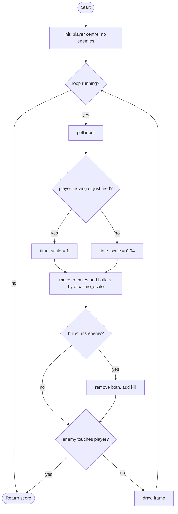

# Time Shooter - design brief

**Owner:** Member 1  **Folder:** `games/time_shooter/`  **Status:** placeholder (core mechanic works)

## Hook
Superhot-style: **time only moves when you move** (or just fired). Standing still freezes enemies and bullets, so every step is a decision.

## Controls
WASD / arrows move. Mouse aims, left click shoots (0.25 s cooldown; shooting lets time run for 0.2 s).

## Rules and scoring
Enemies chase you; touching one ends the run. Shoot them: +100 each. +1 per second of *world* time survived (frozen time earns nothing, so camping does not pay).

## Implementation steps
1. Enemy variety in `time_shooter_logic.c`: add a `kind` field to `ts_Enemy` (chaser, fast, shooter that fires bullets at you) and spawn by wave number.
2. Enemy bullets: reuse `ts_Bullet` with a `from_enemy` flag; they also obey `time_scale` (the Superhot trick: dodge frozen bullets).
3. Waves + difficulty curve: replace the linear spawn timer with a wave table (array of structs).
4. Pickups: a slow-motion token and a shield (struct array + collision).
5. Juice in `time_shooter_game.c`: the freeze tint and particles exist; add a death slow-down and a combo counter.
6. Tests: one per rule in `tests/test_time_shooter.c`.

## Pseudocode (for the report)
```
PROCEDURE step(state, input, dt)
    IF game over THEN RETURN
    IF player is moving THEN move player (real time)
    IF fire pressed AND cooldown = 0 THEN shoot bullet toward the mouse; cooldown <- 0.25; burst <- 0.2
    IF moving OR burst > 0 THEN time_scale <- 1 ELSE time_scale <- 0.04
    world_dt <- dt * time_scale
    spawn an enemy when the spawn timer (in world time) runs out
    FOR each enemy: move toward player at its speed * world_dt; IF touching player THEN game over
    FOR each bullet: move by velocity * world_dt
        FOR each enemy: IF bullet hits enemy THEN remove both, kills <- kills + 1
END PROCEDURE
```

## Flowchart (for the report)


## Course concepts used
| Concept (Pertemuan) | Where (file : function) |
|---------------------|-------------------------|
| Struct + array of structs (9, 13) | `time_shooter_logic.h` : `ts_Enemy enemies[]`, `ts_Bullet bullets[]` |
| Perulangan (6) | `time_shooter_logic.c` : `time_shooter_step` loops over enemies/bullets |
| Percabangan (5) | `time_shooter_step` : time_scale rule, collisions |
| Operator + math functions (4, 12) | `vec2_norm`, `vec2_dist` (`core/include/arcade/mathx.h`: `sqrtf`) |
| Fungsi (11) | `spawn_enemy`, `fire_bullet` |
