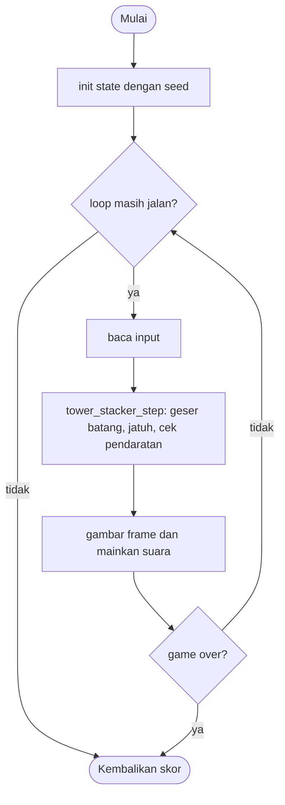

# Tower Stacker - design brief

**Owner:** Leader  **Folder:** `games/tower_stacker/`  **Created:** 2026-11-12  **Asal mekanik:** `g08_stack2d` di proyek `simple-games` (hanya aturan; tidak ada kode, gambar, suara, teks atau font yang disalin)

## Hook
Satu batang bergeser kiri-kanan di atas menara. Jatuhkan tepat waktu: yang menjorok dipotong, jadi menara makin sempit. Landasan sempurna menjaga lebar penuh.

## Penjelasan sederhana
Sebuah batang bergeser bolak-balik di bagian atas layar. Tekan untuk menjatuhkannya ke menara. Bagian batang yang melewati tepi menara dipotong (jatuh dan memudar), sisanya menjadi lantai baru, sehingga menara makin sempit. Kalau kamu mendarat tepat di tepi (selisih kurang dari 1 px) itu "perfect": lebar penuh dipertahankan. Kalau batang sama sekali tidak menyentuh menara, game selesai.

Di balik layar, `tower_stacker_step()` menggeser batang dengan langkah tetap 5 px per tick, menunggu perintah jatuh, lalu membandingkan posisi batang dengan lantai teratas. Selisih `d` menentukan apakah perfect, dipotong, atau meleset. Seperti menumpuk kartu: tiap kali sedikit melenceng, alasnya menyempit.

Kalau cuma punya 1 menit: tekan tepat saat batang berada di atas menara, supaya potongannya kecil atau nol; tiap lantai +1.

## Kontrol
Klik mouse, Spasi, atau tombol apa saja (huruf, panah): jatuhkan batang. Hanya satu kali per batang; tekan lagi saat batang jatuh atau memudar tidak berpengaruh.

## Aturan dan skor
- Lantai awal selebar `w/2` di tengah; tinggi lantai `(int)(h/20)`; batang bergeser 5 px per tick asli dan memantul di dinding.
- Jatuhkan: batang berhenti di x tetap dan jatuh `speed_y` px per tick sampai bagian bawahnya mencapai garis pendaratan `base_y`.
- Pendaratan: `d = |bar_x - base_x|`. `d >= base_w - 1`: **meleset, game selesai**. `d < 1`: perfect, lebar tetap. Selain itu `base_w -= d` dan potongan selebar `d` jatuh pelan dan memudar 0.5 detik.
- Jika batang di kanan menara, lantai baru mulai di `bar_x` dan potongan di ujung kanan; jika di kiri atau sama, `base_x` tetap dan potongan di `bar_x`.
- Garis pendaratan naik satu lantai per poin hanya sampai lantai 9; mulai lantai 10 menara bergeser turun 1 px per tick.
- Tiga nada "bagian hilang" menurut `d < 10`, `d < 30`, selain itu; lantai penuh 1023 mengakhiri game.
- Setelah selesai: jeda 0.8 detik (menara pendek) atau animasi zoom 2.5 detik (skor >= 10).
- **Skor = jumlah lantai di atas lantai dasar.**

## Cara kerja per frame
1. `arcade_poll()` mengisi `ArcadeInput`.
2. `tower_stacker_step()`: jika batang bergeser dan ada tombol, batang membeku dan mulai jatuh.
3. Batang bergeser: sub-jam 50 Hz (`bar_acc += dt * 50`) menjalankan langkah 5 px utuh dan memantul di dinding.
4. Batang jatuh `bar_spy * k` per frame; jika `bar_y >= base_y`, `land()` membandingkan `d` dan memotong atau selesai.
5. Setelah lantai 10, `base_y_move` turun 1 px per tick; potongan memudar selama 0.5 detik lalu batang baru muncul.
6. Front-end menggambar menara dari array lantai (dengan `tower_stacker_zoom()` saat selesai) dan membandingkan `perfects`, `cuts` untuk suara.

## Peta file
| File | Isinya | Edit di sini kalau ... |
|---|---|---|
| `tower_stacker_logic.h` | struct `tower_stacker_State` dan fungsi publik (`init`, `init_sized`, `step`, `is_over`, `score`) | menambah field state atau fungsi publik |
| `tower_stacker_logic.c` | semua aturan game (tanpa raylib) | mengubah aturan atau angka keseimbangan |
| `tower_stacker_game.c` | loop raylib, menggambar, suara, `GameDef` (judul, kontrol di menu, urutan, ranked) | mengubah tampilan, suara, atau teks di menu |
| `tests/test_tower_stacker.c` | unit test (hanya logic) | menambah atau mengubah aturan |
| `CMakeLists.txt` | mendaftarkan game lewat `arcade_add_game(...)` | menambah file `.c` atau test baru |
| `GAME.md` | dokumen ini | aturan atau kode berubah |
| `AGENTS.md` | instruksi untuk AI agent (tidak diterjemahkan) | jarang; ikuti aturan di file itu |

## Data penting (struct)
| Field | Tipe | Artinya |
|---|---|---|
| `w`, `h`, `base_w0`, `base_h0`, `base_x0`, `bar_y0`, `speed_x`, `speed_y` | int, float | konstanta turunan dari ukuran lapangan |
| `base_x`, `base_w`, `base_h` | float | lantai teratas: tepi kiri, lebar, tinggi |
| `base_y`, `base_y_move` | float | garis pendaratan dan posisi gambar puncak menara (bergeser setelah lantai 9) |
| `score` | int | lantai di atas dasar |
| `bases_x[]`, `bases_w[]` | int[1024] | posisi dan lebar tiap lantai (dibulatkan setengah ke atas) |
| `window[][3]` | int[1024][3] | x tiap jendela (0 = tidak ada) |
| `state` | int | `TS_SLIDING`, `TS_FALLING`, `TS_FADING`, `TS_MISSED` |
| `bar_x`, `bar_y`, `bar_w`, `bar_h`, `bar_spx`, `bar_spy`, `bar_alpha` | float | batang (atau potongan yang memudar); `bar_y` adalah tepi bawah |
| `bar_acc` | float | sub-jam 50 Hz untuk langkah 5 px |
| `over`, `capped`, `over_t` | bool, float | status akhir dan waktu sejak akhir (zoom) |
| `perfects`, `cuts`, `landings`, `last_cut_class`, `last_cut_d` | int, float | penghitung kejadian untuk suara |

## Fungsi-fungsi penting
| Fungsi | Tugas | Dipanggil dari |
|---|---|---|
| `tower_stacker_zoom` | posisi atas dan tinggi lantai saat zoom setelah game over | front-end, tes |
| `record_floor` | mencatat lantai baru dan melempar jendela acak | `init_sized`, `land` |
| `new_bar` | batang baru, mulai di `base_x mod 5` | `init_sized`, `land`, `step` |
| `land` | perfect, potong, atau meleset; batas 1023 lantai | `step` |
| `slide_tick` | satu langkah 5 px dan pantulan dinding | `step` |
| `tower_stacker_step` | jatuhkan, geser, jatuh, scroll, pudar | `play()` |

## Angka yang bisa diutak-atik
| Konstanta | Nilai sekarang | File | Efek kalau diubah |
|---|---|---|---|
| `TS_BAR_SPEED_X` | 5 px per tick | `tower_stacker_logic.c` | kecepatan geser (jangan diubah tanpa menjaga perfect tetap bisa dicapai) |
| `TS_SCROLL_FLOORS` | 10 | `tower_stacker_logic.h` | lantai tempat menara mulai bergeser turun |
| `TS_MAX_FLOORS` | 1023 | `tower_stacker_logic.h` | batas array dan akhir game |
| `TS_ZOOM_TIME` | 2.5 s | `tower_stacker_logic.h` | lama zoom dan jeda tampil untuk menara tinggi |
| `TS_OVER_DELAY_SHORT` | 0.8 s | `tower_stacker_logic.h` | jeda tampil untuk menara pendek |
| angka `h / 20`, `0.25`, `0.5 s` | di `init_sized`, `step` | `tower_stacker_logic.c` | tinggi lantai, tinggi garis batang, lama pudar |

## Cara menjalankan dan menguji
```bash
# test logic saja (tanpa raylib, ~1 detik)
cmake --preset logic && cmake --build --preset logic && ctest --preset logic -R "^tower_stacker\."

# main game-nya
cmake --preset dev && cmake --build --preset dev && build/dev/bin/arCade

# smoke run headless: jalankan game 300 frame dan simpan screenshot PNG
cmake --preset headless && cmake --build --preset headless && build/headless/bin/arCade --smoke tower_stacker --frames 300 --out smoke-out
```

| Test | Menjaga aturan apa |
|---|---|
| `test_spec_constants_at_480x800` | BASEW 240, BASEH 40, BASEX 120, BARY 200, SPEEDY 11.2, lantai 0 di y 760 |
| `test_cut_on_the_right_drop_at_150`, `test_cut_on_the_left_drop_at_105` | d = 30 menjadi lebar 210 dan potongan di x 360; d = 15 menjadi 225 |
| `test_perfect_at_120_4_keeps_the_full_width` | d = 0.4 perfect, lebar 240 |
| `test_no_overlap_ends_the_game` | x = 361 selesai; x = 358 masih menyentuh 1 px |
| `test_cut_class_boundaries` | 9.9, 10, 29.9, 30 memilih nada yang benar |
| `test_tower_scrolls_from_floor_10` | garis di 400 selamanya; lantai 10 mulai di 360 dan turun 40 px dalam 40 tick |
| `test_bar_stays_aligned_mod_5_at_60hz`, `test_alignment_survives_cuts_and_random_play` | x batang selalu sama dengan `base_x` modulo 5 (1000 frame di 60 fps; 20 seed acak) |
| `test_scripted_player_gets_perfects_at_60hz` | pemain yang mengetuk tepat waktu mendapat 15 perfect di 60 fps |
| `test_fade_takes_half_a_second_and_blocks_a_second_drop`, `test_drop_only_once_per_bar` | pudar 0.5 detik; satu jatuhan per batang |
| `test_windows_follow_the_rules` | jendela di dalam lantai; lantai di bawah 31 px tanpa jendela |
| `test_floor_cap_ends_the_game` | lantai 1023 mengakhiri game |
| `test_zoom_to_fit_after_a_tall_game`, `test_long_reveal_for_tall_towers` | hfit 58.18, puncak di 160; jeda 2.5 detik; menara pendek 0.8 detik |
| `test_dropping_at_once_ends_the_game`, `test_same_seed_same_result`, `test_monkey_never_breaks_invariants` | pemain tanpa menunggu kalah sendiri; deterministik; 20 seed x 5000 frame |

## Jebakan dan hal yang perlu diingat
- PENGECUALIAN dari aturan `k = dt * 50`: batang bergeser langkah 5 px utuh pada sub-jam 50 Hz. Dengan `k = 0.833` langkah menjadi 4.17 px dan perfect sering mustahil karena sisa x modulo 5 berubah. Akibatnya di 60 fps gerak batang sedikit tersendat; ini diterima.
- Posisi mulai batang adalah `base_x mod 5`, jadi `bar_x` selalu sama dengan `base_x` modulo 5, termasuk setelah potongan (potongan selalu kelipatan 5 dari selisih x).
- Jatuhnya batang (`speed_y`), scroll menara, dan pudar memakai `k` atau `dt` biasa; pendaratan bisa melewati garis sampai kurang dari 8 px di 60 fps, tidak memengaruhi hasil.
- Penyimpangan dari simple-games: batas 1023 lantai mengakhiri game; zoom dibuat fungsi dari `over_t` (bukan animasi bertahap); jeda tampil 0.8 detik untuk menara pendek.
- Penyimpangan: gradasi oranye latar dan sprite batang tidak dipakai; lantai berupa persegi panjang neon dengan jendela kuning dari array `window`.
- Lantai dan jendela dibulatkan setengah ke atas seperti spesifikasi (`(int)(x + 0.5)`); jendela dipilih hanya jika lebar lantai >= 31.

## Langkah implementasi (Implementation steps)
1. Aturan sudah ada di `tower_stacker_State` dan `tower_stacker_step()` (hanya di logic). Konstanta ditulis sebagai `#define` di `tower_stacker_logic.c`.
2. Setiap aturan punya unit test di `tests/test_tower_stacker.c`; tes memakai `tower_stacker_init_sized(480, 800)` supaya vektor uji spesifikasi asli berlaku apa adanya.
3. Tampilan ada di `tower_stacker_game.c`: panel 480 x 684 di tengah, aturan di gutter kiri, statistik di gutter kanan. Suara dibuat dari `gfx_make_tone()`.
4. Kalau menambah aturan: tulis tesnya dulu, lalu ubah logic, lalu perbarui bagian Jebakan dan tabel di dokumen ini.

## Pseudocode (untuk laporan)
```
PROSEDUR step(s, input, dt)
    JIKA over MAKA over_t += dt; KEMBALI
    JIKA bergeser DAN ada tombol MAKA berhenti di x itu dan mulai jatuh
    JIKA bergeser MAKA sub-jam += dt * 50; ULANGI tiap 1: x += 5, pantul di dinding
    y += kecepatan_jatuh * dt * 50
    JIKA score >= 10 DAN puncak < garis MAKA puncak += dt * 50
    JIKA memudar MAKA alpha -= dt / 0.5; JIKA 0 MAKA batang baru; KEMBALI
    JIKA jatuh DAN y >= garis MAKA
        d = |x - base_x|
        JIKA d >= lebar - 1 MAKA over = benar SELAIN ITU JIKA d < 1 MAKA perfect SELAIN ITU potong
        score += 1; catat lantai
AKHIR PROSEDUR
```

## Flowchart (untuk laporan)


## Konsep kuliah yang dipakai (untuk Bab I laporan)
| Konsep (Pertemuan) | Di mana (file : fungsi) |
|---|---|
| Struct (13) | `tower_stacker_logic.h` : `tower_stacker_State` |
| Array 1 dan 2 dimensi (9-10) | `tower_stacker_logic.h` : `bases_x[]`, `bases_w[]`, `window[][3]` |
| Perulangan (6-7) | `tower_stacker_logic.c` : sub-jam `while (bar_acc >= 1)`; front-end menggambar tiap lantai |
| Percabangan (5) | `tower_stacker_logic.c` : `land` (meleset, perfect, potong kiri atau kanan) |
| Fungsi (11) | `tower_stacker_logic.c` : `record_floor`, `new_bar`, `slide_tick`, `tower_stacker_zoom` |
| Pointer (12) | `tower_stacker_zoom(..., float *top_y, float *floor_h)` mengisi dua hasil |
